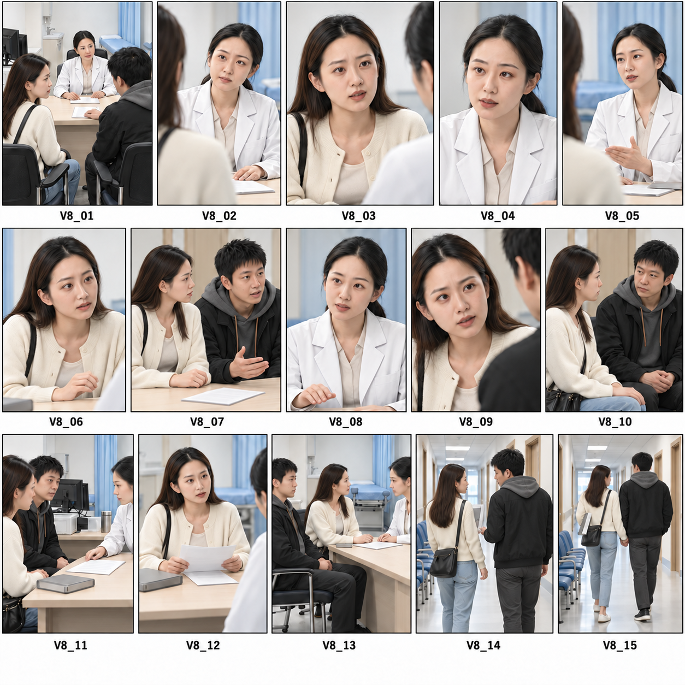

# 《先听她说》第八版 · 构图预览

制作日期：2026-10-21。当前状态：用户选择先调整预览，未批准提交试片。按“先更新GitHub data，再继续制作”的顺序执行：资料入口已先推送至main，提交a037dac；随后制作本页的构图预览。

本组采用内置image_gen绘制浅色写实分镜总览，每段对应一个标号画格。用于检查景别、座位、视线与手/道具的关系；角色服装与场景参考现有素材。医生使用示意面孔，不代表最终演员形象；最终视频仍以本地两张授权照片共同参考面部。预览不上传为Seedance人像首帧，不替代正式角色原图。

当前为v3构图草稿，用户已选择“先调整分镜预览”，具体修改方向待补充；未提交付费视频任务。

## 构图检查与修订

预览初稿存在三处具体问题：07夫妻在画面中的左右与后续双人镜头不一致；08医生抬手过高；14提前出现牵手。已针对这些问题修图，并把14段实际视频机位明确为侧后方、身体朝走廊深处、头转向对方，15段同侧接背影。正式分镜、连戏表与本机提示词同步这一机位说明，22句对白与118秒预算不变。

预览只检查主要构图；动作的先后仍以逐段提示词为准，静态图不能证明口型、声音或连续运动已通过。

## 对照顺序

总览按从左到右、从上到下的V8编号阅读，每格展示该段一个主要构图；段内完整切镜以[分镜与分段表](../分镜与分段表.md)为准。

| 画格 | 秒数 | 本格检查重点 |
| --- | ---: | --- |
| V8_01 | 7 | 三人座位、丈夫短暂碰纸、妻子看他 |
| V8_02 | 8 | 医生抬眼邀请患者说话，表情放松 |
| V8_03 | 6 | 林悦向医生问出生育顾虑 |
| V8_04 | 8 | 医生解释结果，视线有接收者 |
| V8_05 | 11 | 温和说明风险，背景空间连续 |
| V8_06 | 9 | 林悦主动追问，身体略前倾 |
| V8_07 | 8 | 丈夫先答，妻子转向他打断 |
| V8_08 | 5 | 医生小幅抬右手示意等一下 |
| V8_09 | 7 | 林悦争取回答，自然而非瞪人 |
| V8_10 | 8 | 夫妻同框互看，丈夫左手回腿上 |
| V8_11 | 11 | 报告仅在桌中央原位转向一次 |
| V8_12 | 10 | 一张问题纸展开，另有报告在中央 |
| V8_13 | 5 | 丈夫坐回，患者与医生继续沟通 |
| V8_14 | 8 | 左臂抱本、丈夫左手抬半途，不碰本子 |
| V8_15 | 7 | 妻子右手牵丈夫左手，并肩离开 |

## 下一步试片的具体范围

- 模型与规格：Seedance 2.5、480p、9:16，模型生成同期对白；现有三个人物与音色参考不变。
- 先试V8_01与V8_09，每段7秒，合计14秒；按原项目¥0.67/秒暂估¥9.38，实际按API用量结算。
- 这两段分别验证三人抢答关系及林悦的自然反问；不自动重抽。如试片可用，其时长计入118秒首轮。
- 剩余104秒暂估¥69.68，首轮总计¥79.06，不含重抽。是否继续批量取决于试片结果。
- [全套提示词、逐段参考与预算](../prompts/视频提示词.md)已整理；本页的生图原始提示词保存在同目录。

完成预览后先给用户看图与上述提示词，再按确认的规格与预算提交试片。当前没有提交第八版视频任务。
