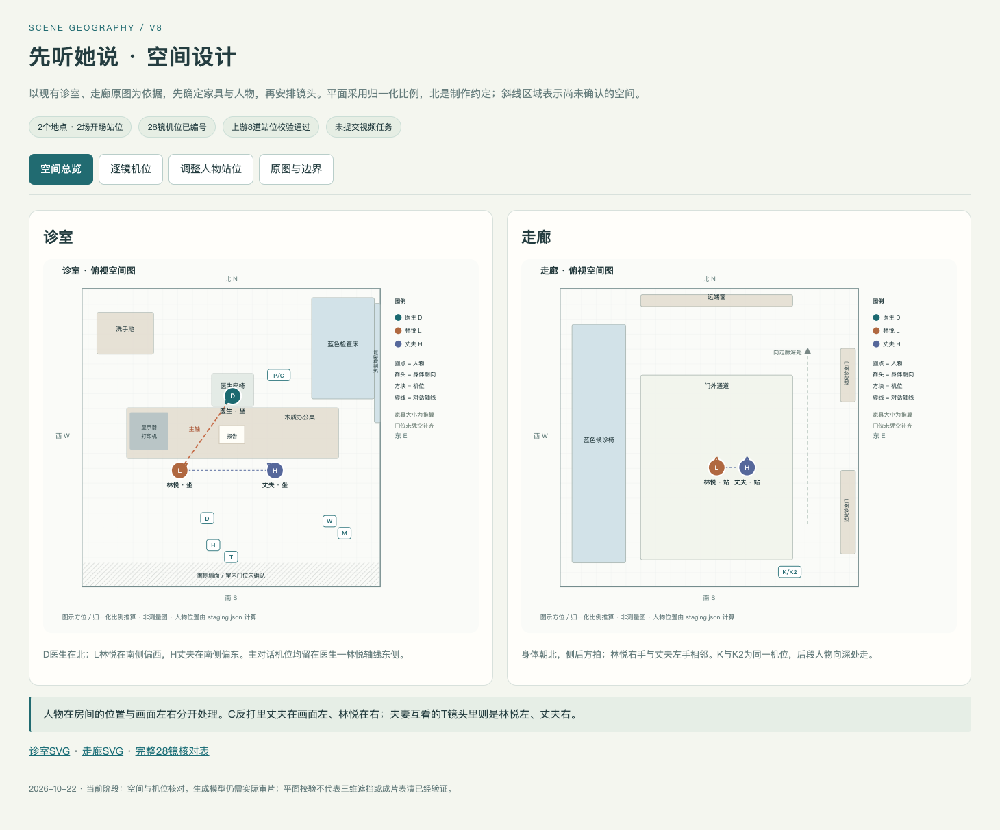

# 《先听她说》第八版 · 空间设计

2026-10-22补齐。两个地点、两场开场站位、28镜机位；本阶段没有提交视频生成任务。

**本机打开 [空间总览.html](空间总览.html)**：空间总览、逐镜机位、人物站位编辑、原图与未确认区域都在同一入口。GitHub不能直接执行HTML，可先看下方图片，或下载本目录后打开HTML。



## 怎么看、怎么调

1. “空间总览”查看诊室/走廊的家具、人物、身体朝向和机位。
2. “逐镜机位”切换28镜，查看摄影方向、视锥、人物水平位置、谁看谁及背景处理。图上圆点为人物，方块为机位；K/K2在同一个位置，代表14与15段共用固定机位。
3. “调整人物站位”中可拖动人物、改坐站和朝向，导出JSON；导入总览后可重算机位与轴侧。页面试改不会直接覆盖正式项目文件和生成提示词，确认采用时再同步。

[可拖动站位报告](staging-report.html) · [诊室俯视图](诊室_俯视空间图.png) · [走廊俯视图](走廊_俯视空间图.png) · [28镜核对表](逐镜空间核对.md) · [开场走位句](开场站位.txt)

## 本次解决的具体问题

- 家具先按现有空景认图，再推算俯视位置；修正了初稿办公桌与检查床的平面重叠。
- 人物固定房间方位，屏幕左右由机位推导。夫妻听医生的C反打里丈夫左、林悦右；夫妻互看的T镜头里林悦左、丈夫右。此前把07画格强制改成林悦左/丈夫右的处理缺少空间依据，不能继续当执行参考。
- “医生—林悦”和“夫妻互看”两组轴线分别核对。诊室机位都在主轴同一侧，夫妻直接交谈使用夫妻轴南侧的W/H/T机位。
- 原诊室图看不到患者背后的门，旧预览07/10的木门不作依据。P/C反打采用紧景别和中性焦外；需要完整南墙大全景时，先补场景资产。
- 走廊14/15保持侧后方同一机位，身体朝北，内侧手为林悦右手与丈夫左手。14先收手，15才牵手，左臂始终抱本子与报告。
- 诊室与走廊分别建图。现有图片不能确认哪扇门相连，因此不虚构整个楼层布局。

## 验证与边界

已实际运行上游novel-staging的8道校验，提供script.json与art.json核对人物和地点；另检查家具实体不重叠、人物点位不叠、机位不落家具内、28镜轴侧。结果见[校验记录](校验结果.json)。

浏览器实际检查覆盖28镜切换、人物拖动、坐站修改、JSON导出/导入、还原、错误导入不破坏当前数据、原图加载和手机宽度，见[浏览器检查](浏览器检查.json)。

**布局是单张透视图推算的归一化示意，没有实测尺寸。** 视锥和屏幕位置是平面几何结果，不验证真实三维遮挡、焦段、口型或生成成片。不可见的南墙、室内门位及诊室与走廊的连接关系均未确认。旧十五格图保留为情绪/景别草稿，空间执行以本目录为准。

## 换窗口接续（2026-10-22）

空间补齐及原生产文件同步已经完成，成果提交为`c0cf71d`。本次仅保存交接，不启动新的生成或重新改稿。

接续先读本页、上级现行`剧本.md`、`连戏表.md`及`改稿记录.md`；本机原生产项目的`交接.md`已汇总完整目录、现行/历史版本、私有资产读取位置、运行环境和后续步骤。

- 现行第八版：15批次、28镜、118秒、22句对白；DeepSeek第16轮A/B通过。
- 空间图、站位编辑与机位核对均已完成；旧15格图的07左右和患者背后木门不能作空间依据。
- 没有提交V8视频任务。已报的14秒试片/118秒首轮费用未获确认，空间补做授权不等于视频费用批准。
- 下一生产环节从空间数据核对构图预览，再按用户新指令接续；确认具体预览、提示词和规格/费用后才提交试片。
- 不重跑旧初始化器覆盖现行文档、空间数据或提示词。HTML预览服务可能随进程结束失效，离线文件仍可直接打开。

## 数据与复现

- `staging.json`：家具认图框、俯视位置及两场开场站位。
- `script.json`、`art.json`：摘自现行剧本与原场景图的最小核对索引，并非重新生成一套小说大纲或美术流程。
- `cameras.json`：9个机位编号、7个摄影位置（P/C共位不同朝向，K/K2共位同方向），28镜分配与走廊末态位移。
- `tools/novel-staging.mjs`：上游原脚本；`tools/build-space.mjs`：本项目的机位检查、统一入口及SVG构建。

安装Node.js 18或更新版本后，在本目录执行：

```bash
node tools/novel-staging.mjs checkup staging.json --script script.json --art art.json
node tools/build-space.mjs
```

此过程不联网、不调用模型。PNG为浏览器渲染的显示副本，HTML/SVG/JSON为可继续编辑的数据与图形。

## 参考来源

使用[eternityspring/shuohao-skills 的 novel-staging](https://github.com/eternityspring/shuohao-skills/tree/main/skills/novel-staging)认图→平面→站位→校验→交付方法，实际运行其脚本并保留可拖动报告；增加了本片机位图、投影核对与统一入口。上游脚本未修改，来源与SHA-256见[upstream.json](tools/upstream.json)，Apache-2.0许可见[LICENSE.upstream](tools/LICENSE.upstream)。没有安装远端Skill或替换原Seedance生产流程。
