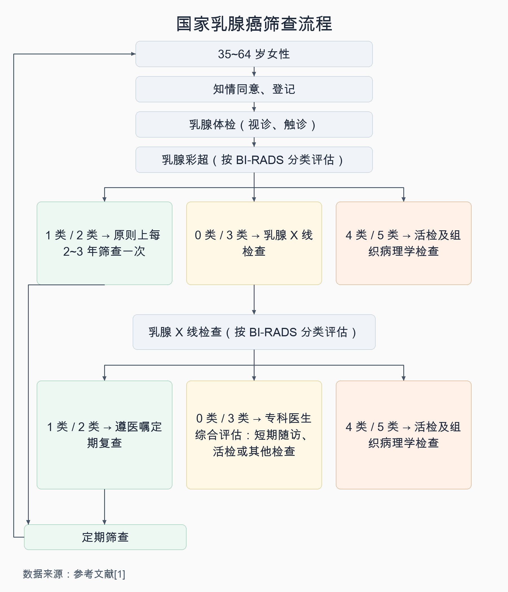
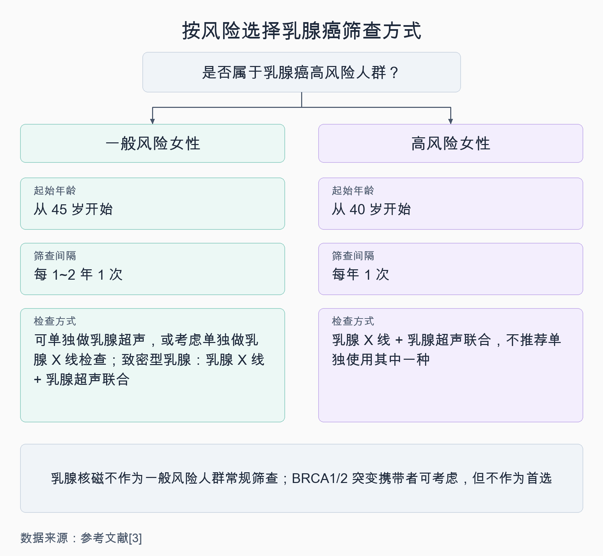
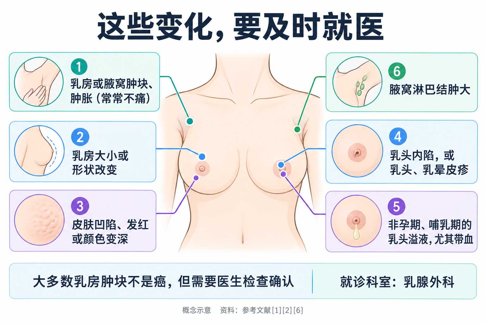

# 乳腺超声还是钼靶？乳腺癌筛查该怎么做

> 单位体检单上写着“乳腺彩超”，朋友说“过了 40 岁要做钼靶”，网上又有人教每个月自己摸一摸。到底该做哪一种？多久做一次？超声报告上写的“3 类”“4 类”是什么意思？自己摸过没发现问题，还需要去医院吗？10 月是乳腺癌防治月，这篇文章把乳腺癌筛查这件事讲清楚。

## 01 为什么要做筛查：早期乳腺癌往往没有感觉

乳腺癌是发生在乳腺上皮组织的恶性肿瘤，近年来发病人数一直位列我国女性新发恶性肿瘤之首 [1]。世界卫生组织（WHO）的数据显示，2024 年全球约有 240 万女性被诊断为乳腺癌 [2]。

筛查之所以重要，是因为**早期乳腺癌通常没有明显的症状或体征**，等到自己摸到、看到异常时，病情可能已经不是最早期了 [1]。国家卫生健康委的健康教育核心知识指出：**早期乳腺癌患者的 5 年生存率可达 90% 以上，到晚期下降至 30% 左右** [1]。WHO 也指出，乳腺癌越早发现、越早治疗，死亡率越低；肿块较小、尚未扩散到附近淋巴结时，治疗成功的可能性更大 [2]。

还有一点值得知道：WHO 指出，**约 80% 的乳腺癌发生在除了“女性”和“年龄”之外没有特定风险因素的人身上**；没有家族史，也不等于风险低 [2]。所以“我家没人得过，不用查”的想法并不可靠。

## 02 国家的乳腺癌筛查怎么做：先超声，必要时再做钼靶

先说一个名词：大家常说的“钼靶”，在医学文件里叫**乳腺 X 线检查**（或乳腺 X 线摄影），是用 X 线给乳房拍片。

国家卫生健康委发布的《乳腺癌筛查工作方案》明确了公共卫生筛查项目的做法 [1]：

**筛查对象：35~64 岁的女性**，优先保障农村妇女和城镇低保妇女 [1]。有条件的地区可以适当放宽年龄段，对高风险人群可以适当提高筛查频率 [1]。

**第一步：乳腺体检 + 乳腺彩超。**医生先看、再摸，然后做乳腺彩超。彩超结果用“乳腺影像报告和数据系统”（BI-RADS 分类）来评估 [1]：

- **1 类或 2 类**：原则上每 2~3 年筛查一次；
- **0 类或 3 类**：进一步做乳腺 X 线检查；
- **4 类或 5 类**：做活检及组织病理学检查。

**第二步（需要时）：乳腺 X 线检查。**结果同样按 BI-RADS 分类处理 [1]：

- **1 类或 2 类**：遵医嘱定期复查；
- **0 类或 3 类**：由副高以上专科医生综合评估后，进行短期随访、活检或其他检查；
- **4 类或 5 类**：做活检及组织病理学检查。

看懂这套流程，就能理解报告上的数字：**分类越高，需要进一步检查的必要性越大，但分类本身不是诊断**。0 类表示单项检查还不能下结论，需要加做其他影像检查一起判断 [3]；3 类需要进一步检查或短期随访，具体由医生评估 [1]；只有活检病理才能最终确诊。拿到 3 类以上的报告不必慌，也不能放着不管，**按医生安排把后续检查做完最重要**。

方案对异常结果也有明确的随访要求：彩超或 X 线分类为 0 类、3 类及以上的人，都会被纳入异常或可疑病例的追踪随访，督促尽早接受进一步诊断和治疗 [1]。

## 03 超声和钼靶，分别适合谁

这是大家最常问的问题。国家癌症中心牵头制定的《中国女性乳腺癌筛查与早诊早治指南（2021，北京）》按风险高低给出了建议 [3]。

**先判断自己属于哪一类。**指南把符合以下任意一组条件的女性定为**高风险人群** [3]：

1. **有遗传家族史**（满足任意一项）：一级亲属（母亲、女儿、姐妹）有乳腺癌或卵巢癌史；二级亲属（姑、姨、祖母、外祖母）中 50 岁前患乳腺癌的有 2 人及以上；二级亲属中 50 岁前患卵巢癌的有 2 人及以上；至少 1 位一级亲属携带已知的 BRCA1/2 基因致病性突变，或自己携带这类突变。
2. **满足以下任意一项**：月经初潮年龄 ≤12 岁；绝经年龄 ≥55 岁；有乳腺活检史或乳腺良性疾病手术史，或病理证实有乳腺（小叶或导管）不典型增生；使用“雌孕激素联合”的激素替代治疗不少于半年；45 岁后乳腺 X 线检查提示乳腺为不均匀致密型或致密型。
3. **满足以下任意两项**：无哺乳史或哺乳时间 <4 个月；无活产史（含从未生育、流产、死胎）或初次活产年龄 ≥30 岁；仅使用“雌激素”的激素替代治疗不少于半年；流产（含自然流产和人工流产）≥2 次。

不属于高风险的适龄女性，就是**一般风险人群** [3]。

**再看对应的筛查建议** [3]：

- **一般风险女性**：推荐从 **45 岁**开始筛查，每 **1~2 年**一次。可以单独用乳腺超声，也可以考虑单独用乳腺 X 线检查；如果是**致密型乳腺**，推荐乳腺 X 线检查**联合**乳腺超声。
- **高风险女性**：推荐从 **40 岁**开始筛查，**每年**一次；**不推荐单独**用超声或单独用 X 线，推荐两者**联合**。
- **乳腺核磁（MRI）**：不推荐作为一般风险人群的常规筛查；BRCA1/2 基因突变携带者可以考虑，但不作为首选。

**为什么两种检查会“互相补位”？**乳腺 X 线检查和超声的成像原理不同。致密型乳腺的女性做 X 线检查时，如果发现不确定的病灶，指南提到有必要补充乳腺超声 [3]。指南的系统评价也显示，两者联合在致密型乳腺人群和高风险人群中都有较好的诊断准确性 [3]。所以**不是哪种检查“更高级”，而是要看你的年龄、风险和乳腺类型**，由医生帮你组合。

**国内外的建议为什么不一样？**如果你看过国外资料，会发现说法不同：

- 美国预防服务工作组（USPSTF）2024 年的建议是：**40~74 岁女性每 2 年做一次乳腺 X 线检查** [4]；对于致密型乳腺女性是否要额外加做超声或核磁，它认为目前证据还不足以判断利弊 [4]。
- WHO 介绍的筛查是在表面健康的人群中使用乳腺 X 线检查，**通常针对 50~69 岁女性** [2]。

国内的公共卫生项目以“体检 + 彩超”初筛、必要时再做 X 线检查 [1]，国内指南的起始年龄、间隔和检查组合也有自己的考虑 [3]。这些建议面向的人群和医疗条件不同，**在国内就医，以国内方案和指南为主要参考**，具体怎么查、多久查一次，请医生结合个人情况来定。

## 04 自己摸一摸，能代替筛查吗

不能。

关于乳房自检，一项 Cochrane 系统评价纳入了俄罗斯和上海的两项大型研究，共约 38.9 万名女性。结果显示，**定期乳房自检组和对照组相比，乳腺癌死亡率没有统计学上的差异**（相对危险度 RR 1.05）；而自检组做的、最后结果是良性的活检，几乎是对照组的 2 倍 [5]。作者的结论是，目前不能把乳房自检作为一种筛查方法来推荐 [5]。

但这不等于“不用关注自己的乳房”。英国国家医疗服务体系（NHS）建议：**经常留意自己的乳房，了解它平时的样子和手感**，这样一旦大小、外观或触感有变化，更容易察觉 [6]。WHO 也强调，让女性了解乳腺癌的症状和体征、出现异常及时就医，是早发现的重要一环 [2]。

可以这样理解：

- **定期筛查**：在没有任何症状时，用影像检查找出早期病变；
- **熟悉自己的乳房**：在两次筛查之间，及时发现新出现的变化；
- 两者都不能互相替代。**自己没摸到问题，不代表可以不做筛查；刚做完筛查，出现新变化也要及时就医。**

## 05 出现这些情况，不要等下一次筛查

乳腺癌可能出现的症状和体征包括 [1][2][6]：

- 乳房、胸部或腋窝出现**肿块或肿胀**，乳腺癌的肿块**常常是不痛的**；
- 乳房**大小或形状**发生变化；
- 乳房**皮肤改变**，如出现凹陷（像“橘子皮”）、发红或颜色变深；
- **乳头或乳晕改变**，如乳头内陷、出现像湿疹一样的皮疹；
- **乳头溢液**（不在怀孕或哺乳期），尤其是带血的；
- **腋窝淋巴结肿大**。

发现这些变化，**不要等到下一次筛查**，尽快到医院就诊 [6]。WHO 特别提醒：即使肿块不痛，也应该就医 [2]。

同时也不用自己吓自己：

- **大多数乳房肿块并不是癌** [2]；这些症状也可能由其他疾病引起，但需要医生检查后才能确定 [6]。
- **单纯的乳房疼痛，通常不是乳腺癌的症状** [6]。如果乳房或腋窝疼痛，同时家里有人患过乳腺癌或卵巢癌，建议就医评估 [6]。
- **乳腺增生不一定会发展成乳腺癌**。乳腺增生是一种良性疾病，恶变的可能性很小；但不典型增生等高危病变有恶变可能，需要按医生要求随访 [1]。

**挂哪个科？**乳房有肿块、皮肤或乳头改变、乳头溢液等问题，可以看**乳腺外科**（部分医院叫乳腺科）；做定期筛查，可以去当地承担“两癌”筛查的医疗机构、妇幼保健机构或医院的乳腺专科。

## 06 筛查也有代价，了解后再出发

筛查不是“越多越好”。国内指南明确列出了乳腺癌筛查的危害，包括**假阳性结果、过度诊断、由此带来的焦虑和不必要的治疗**，其中最主要的是过度诊断和假阳性 [3]。

- **假阳性**：筛查提示异常，进一步检查后并不是癌。这会带来额外的检查甚至活检，以及等待结果时的焦虑 [3]。
- **过度诊断**：筛查发现的一部分早期病变，即使不处理，也可能终生不会进展到危及生命 [3]。

指南的系统评价也显示，和每年一次相比，每 2 年一次筛查的假阳性召回等风险更低 [3]。所以指南建议一般风险人群 1~2 年筛查一次，高风险人群才每年一次 [3]。了解这些，不是为了劝退筛查，而是让你**按建议的间隔规律去做，不必频繁重复检查**，拿到可疑结果时也能更平静地配合后续检查。

另外，国家方案中的健康教育核心知识也提到了一些可以做的事：**提倡适龄生育和母乳喂养，提倡健康的生活方式，积极治疗不典型增生等乳腺高危病变** [1]。WHO 列出的风险因素中，肥胖、有害饮酒、吸烟等也属于可以改变的部分 [2]。

按自己的年龄和风险选对检查、按时去做，再加上平时多留意一下自己的身体，就是对乳房健康最踏实的照顾。

---

## 参考文献

[1] 国家卫生健康委员会. [乳腺癌筛查工作方案（含乳腺癌筛查流程图、乳腺癌防治健康教育核心知识）](https://www.nhc.gov.cn/cms-search/downFiles/8bb19eea375f4edf80d9d01a1030d053.pdf). 政府文件，访问日期：2026-10-12.

[2] World Health Organization. [Breast cancer](https://www.who.int/news-room/fact-sheets/detail/breast-cancer). 官方事实清单（2026-07-03 更新），访问日期：2026-10-12.

[3] 赫捷，陈万青，李霓，等. [中国女性乳腺癌筛查与早诊早治指南（2021，北京）](https://doi.org/10.3760/cma.j.cn112152-20210119-00061). 中华肿瘤杂志, 2021, 43(4): 357-382. 临床指南，访问日期：2026-10-12.

[4] U.S. Preventive Services Task Force. [Breast Cancer: Screening](https://www.uspreventiveservicestaskforce.org/uspstf/recommendation/breast-cancer-screening). 推荐声明，2024，访问日期：2026-10-12.

[5] Kösters JP, Gøtzsche PC. [Regular self-examination or clinical examination for early detection of breast cancer](https://doi.org/10.1002/14651858.CD003373). Cochrane Database of Systematic Reviews, 2003(2): CD003373. 系统评价，访问日期：2026-10-12.

[6] NHS. [Symptoms of breast cancer in women](https://www.nhs.uk/conditions/breast-cancer/symptoms/). 官方健康信息，访问日期：2026-10-12.

*本文为健康科普，不能替代个人诊疗意见。乳房出现肿块、皮肤或乳头改变、乳头溢液等情况，请及时到乳腺外科（乳腺科）就诊；筛查方式和间隔请由医生结合个人风险评估决定。*
