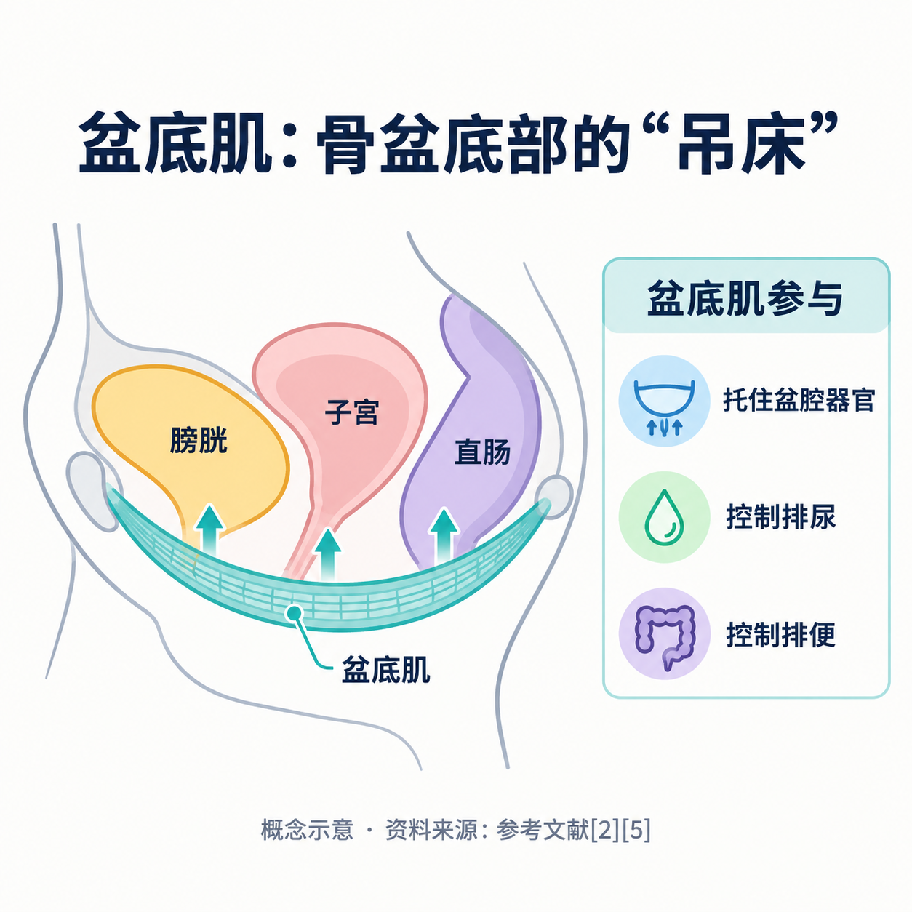
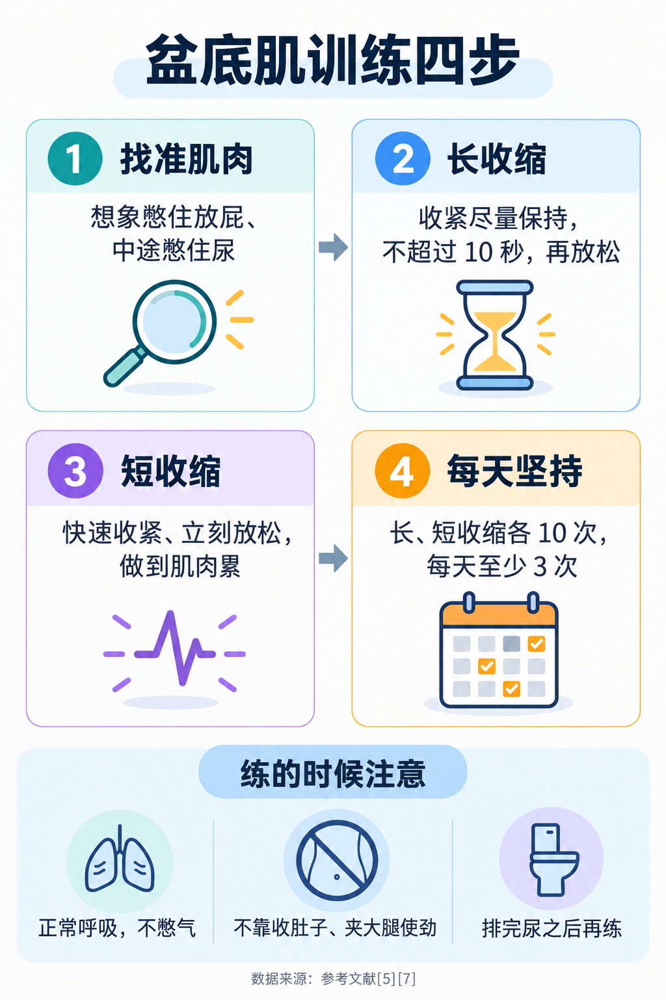
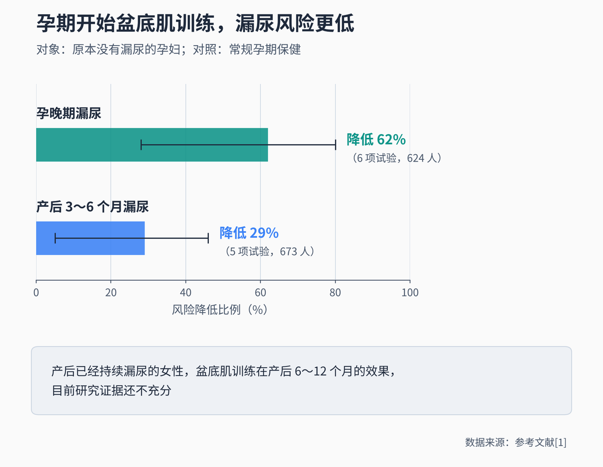

# 产后一咳嗽就漏尿，盆底功能恢复要做什么？

> 孩子出生几个月了，一咳嗽、一打喷嚏、抱起孩子的一瞬间，裤子就湿了一点。不好意思跟人说，又担心是不是一辈子都这样；听说要做“盆底康复”，又不知道自己练行不行、要不要去医院。这篇是医荟她健康整理的读者常见问题，回答依据国内外指南、系统评价和权威患者资料，帮你先弄清楚是怎么回事，再决定下一步怎么做。

**读者问：** 生完孩子以后一咳嗽就漏尿，正常吗？

**医荟她答：** 很常见，但**常见不等于只能忍着**。

这种在咳嗽、打喷嚏、大笑、运动或提重物时，膀胱受到压力而漏出尿液的情况，医学上叫压力性尿失禁，**SUI = Stress Urinary Incontinence（压力性尿失禁）** [6]。它和“突然很急、来不及去厕所就漏了”的急迫性尿失禁不同，两种也可能同时存在 [6]。

一项纳入 46 项随机对照试验的系统评价在背景中提到，**约三分之一的女性产后会出现尿失禁** [1]。所以你并不孤单，也不必觉得难以启齿：英国国家医疗服务体系的患者资料明确建议，有任何类型的尿失禁都可以去看医生，这是很常见的问题，不必尴尬 [6]。

更重要的是，产后漏尿多数有办法改善，第一步往往并不复杂，就是把盆底肌练起来 [2][3]。

**读者问：** 为什么生完孩子特别容易漏尿？

**医荟她答：** 关键在**盆底肌**。

盆底肌是骨盆底部的一组肌肉，像一张有弹性的“吊床”，托住膀胱、子宫和直肠，参与控制排尿和排便 [2][5]。压力性尿失禁通常就是这组肌肉和尿道括约肌变弱或受损的结果；怀孕和分娩，都可能让控制排尿的肌肉变弱 [6]。

英国国家卫生与临床优化研究所（NICE）的盆底功能障碍指南列出了一些会增加风险的因素 [2]：

- **和怀孕、分娩有关的**：生孩子时年龄超过 30 岁；这次之前已经生过孩子；产钳或胎头吸引助产；经阴道分娩时胎儿脸朝上（枕后位）；第二产程用力超过 1 小时；分娩时肛门括约肌受伤。
- **可以改变的**：体重指数超过 25、吸烟、缺乏运动、便秘、糖尿病。
- **其他**：年龄增长、尿失禁的家族史、慢性咳嗽和慢性呼吸道疾病等。

需要说明的是，这些是**让风险升高的因素，不代表有了就一定会漏尿**；没有这些因素的人也可能出现。弄清楚它们的意义在于：能改的尽量改，风险高的人更早开始练、必要时更早找专业人员评估。

**读者问：** 盆底肌训练到底怎么做？自己在家练可以吗？

**医荟她答：** 可以在家练，**但前提是练对**。

英国国家医疗服务体系给产后女性的方法是这样的 [5]：

1. **先找到肌肉**：想象自己在憋住放屁，同时想象在中途憋住尿，收紧的就是盆底肌 [5][7]。
2. **长收缩**：收紧后尽量保持，但不超过 10 秒，然后放松。
3. **短收缩**：快速收紧、立刻放松，一直做到感觉肌肉累了为止。
4. **逐步加量**：目标是长收缩、短收缩各做到 10 次，**每天至少 3 次** [5]。

NICE 尿失禁指南对训练量的建议是：**每次至少 8 次收缩，每天 3 次** [3]。两份资料说法略有不同，但思路一致：**每天多次、规律地练**。

练的时候注意几点 [5][7]：

- 保持正常呼吸，**不要憋气**；
- 收紧的是盆底，**不要靠收肚子、夹大腿来使劲**；
- 躺着、坐着、站着都可以练，熟练后随时随地都能做；
- 可以把上厕所当作提醒，但要在**排完尿之后**再练。

有一点值得提醒：并不是每个人都能自己找准这组肌肉。NICE 建议，在开始有指导的盆底肌训练之前，由医生或治疗师通过手指检查确认你能正确收缩盆底肌 [3]；对于确实无法有效收缩的人，可以考虑用生物反馈、电刺激或阴道哑铃辅助训练 [2]。所以如果你练了一段时间，完全感觉不到肌肉在用力，或者不确定自己练得对不对，就值得让专业人员检查一下。

**读者问：** 要练多久才能看到效果？

**医荟她答：** 要有耐心，**一般以“月”为单位**。

NICE 建议，对压力性尿失禁或以压力性为主的混合性尿失禁（包括孕妇），先进行**至少 3 个月**的有指导的盆底肌训练，作为首选治疗 [2][3]；训练期间至少复查评估一次，结束时再评估一次 [2]。英国国家医疗服务体系的资料也提醒，可能要坚持几个月才看得到效果 [7]。

效果怎么样？一项纳入 31 项试验的系统评价显示，有压力性尿失禁的成年女性，坚持盆底肌训练的一组在疗程结束时**自觉治愈的比例约 56%，不训练的对照组约 6%** [4]。这些研究的参与者多数不是刚生完孩子的女性，但它说明，盆底肌训练对压力性尿失禁是有可靠证据的方法。

对于产后女性，证据要如实说清楚：专门针对产后的系统评价发现，**原本没有漏尿的孕妇在孕期就开始规律训练，和常规孕期保健相比，孕晚期发生漏尿的风险降低约 62%（6 项试验，624 人），产后 3～6 个月降低约 29%（5 项试验，673 人）**；而对产后已经持续漏尿的女性，盆底肌训练在产后 6～12 个月时的效果，**目前研究证据还不充分**，研究质量偏低 [1]。这并不是说产后练没有用，而是现有试验规模小、方案差别大，还不能给出确切结论 [1]。

还有一点：**练有效果，就要一直练下去** [2][3]。NICE 指南鼓励女性终身坚持盆底肌训练，因为长期训练能持续帮助预防症状 [2]。

**读者问：** 产后是不是每个人都要去医院做“盆底康复”？什么时候去评估？

**医荟她答：** **不是每个人都需要做仪器治疗，但每个人都值得关注自己的盆底。**

NICE 指南的建议是分层次的 [2]：

- **所有孕妇和刚生完孩子的女性**：鼓励做盆底肌训练，出院前和产后例行检查时也会再次提醒。
- **产后例行检查时**：医护人员应主动询问有没有漏尿等盆底问题的症状。所以产后复查时，**主动说出自己的情况**，不要因为不好意思而略过。
- **分娩时有这些情况的**：产钳或胎头吸引助产、胎儿枕后位经阴道分娩、肛门括约肌受伤，可以考虑在产后接受为期 3 个月、由专业人员指导的盆底肌训练。

至于电刺激等仪器：NICE 指南**不建议常规把电刺激和盆底肌训练搭配使用** [3]，只在无法有效主动收缩盆底肌时，才考虑用生物反馈或电刺激帮助训练 [2]。系统评价也发现，不区分有没有症状、对所有产后女性统一做盆底肌训练，**不太可能降低漏尿发生率**；更有针对性的方式可能效果更好 [1]。

所以，产后要不要做额外的治疗、做哪种，最好在医生评估后决定，而不是“别人做了我也要做”。

**读者问：** 日常生活里，还能做些什么帮助恢复？

**医荟她答：** 除了盆底肌训练，这些小事也有帮助 [2][3][7]：

- **控制体重**：体重指数超过 30 的女性，减重有助于改善尿失禁和盆腔器官脱垂的症状 [2][3]。但不必等减完体重再开始其他治疗 [2]。
- **少喝含咖啡因的饮料**：咖啡、浓茶、可乐等会刺激膀胱 [2][7]。
- **水不要刻意少喝**：很多人怕漏尿就少喝水，但喝得太少反而会让膀胱容量变小、加重便秘。饮水量偏多或偏少的，适当调整到合适的量 [2][7]。
- **防治便秘**：多吃富含膳食纤维的食物，排便时不要长期用力屏气 [2][7]。
- **戒烟**：吸烟带来的长期咳嗽会给盆底额外的压力 [7]。
- **抱孩子、提东西时先收紧盆底**：提重物前和提的过程中收紧盆底肌；尽量避免频繁搬重物 [7]。
- **运动先选温和的**：跑跳等高冲击运动和仰卧起坐会给盆底增加压力，症状明显时可以先换成力量训练类的温和运动 [7]。

这些办法往往要坚持几周甚至几个月才能感觉到变化 [2]，别因为一两周没见效就放弃。

**读者问：** 出现哪些情况，要尽快去看医生？

**医荟她答：** 有任何程度的漏尿，影响了生活，都可以去看医生 [6]。下面这些情况**更不要拖** [3][6][8]：

- 膀胱或尿道部位持续疼痛；
- 尿里有血，或者反复出现尿路感染；
- 排尿困难，总觉得尿不干净；
- 同时有控制不住大便或排气；
- 尿液持续不断地漏，而不只是在咳嗽、用力时漏；
- 摸到或看到阴道口有东西鼓出来，或者下身总有坠胀、沉重感 [8]。

可以去**妇科**或**泌尿外科**就诊，有的医院设有盆底门诊或产后康复门诊。就诊前可以连续记录几天的“排尿日记”：每天喝了多少水、什么时候排尿、什么时候漏尿、当时在做什么。NICE 建议初次评估时使用排尿日记，至少记录 3 天，包括上班日和休息日 [3]，这能帮助医生更快判断是哪一类尿失禁。

非手术治疗是压力性尿失禁的首选 [3]；如果坚持规范训练后效果仍不满意，医生会再评估其他办法。

**读者问：** 产后漏尿，和年纪大以后的尿失禁、子宫脱垂有关系吗？

**医荟她答：** 有关联，但**不是必然会走到那一步**。

盆腔器官脱垂，是指子宫、膀胱或直肠向阴道里膨出 [8]。它在 50 岁以上的女性中比较常见，绝经后更多见；怀孕和分娩、超重、长期便秘用力、慢性咳嗽、子宫切除等盆腔手术，都和它有关 [8]。尿失禁的风险也会随着年龄增长而升高 [2][6]。NICE 指南还提醒，孕前或孕期就出现的盆底问题，孕期可能加重，产后也可能持续存在 [2]。

但英国国家医疗服务体系的资料同样强调：**尿失禁并不是变老必然会有的事** [6]。产后这段时间，恰恰是了解自己盆底、养成训练习惯的好时机。对于症状较轻的盆腔器官脱垂，NICE 也建议先进行至少 4 个月有指导的盆底肌训练 [2]。

把盆底肌训练当作像刷牙一样的日常习惯，从产后一直坚持下去，是对以后几十年生活质量的投资。

生孩子改变了身体，漏尿也只是其中一个需要照顾的地方。不必羞于开口，也不必焦虑硬扛：练对、练够、有问题及时找医生，大多数人都能慢慢好起来。

---

## 参考文献

[1] Woodley SJ, Lawrenson P, Boyle R, et al. [Pelvic floor muscle training for preventing and treating urinary and faecal incontinence in antenatal and postnatal women](https://doi.org/10.1002/14651858.CD007471.pub4). Cochrane Database Syst Rev, 2020, 5(5): CD007471. 系统评价，访问日期：2026-10-30.

[2] National Institute for Health and Care Excellence (NICE). [Pelvic floor dysfunction: prevention and non-surgical management (NG210)](https://www.nice.org.uk/guidance/ng210/chapter/Recommendations). 英国临床指南（2021-12-09 发布），访问日期：2026-10-30.

[3] National Institute for Health and Care Excellence (NICE). [Urinary incontinence and pelvic organ prolapse in women: management (NG123)](https://www.nice.org.uk/guidance/ng123/chapter/Recommendations). 英国临床指南（2019-04-02 发布，2019-06-24 更新），访问日期：2026-10-30.

[4] Dumoulin C, Cacciari LP, Hay-Smith EJC. [Pelvic floor muscle training versus no treatment, or inactive control treatments, for urinary incontinence in women](https://doi.org/10.1002/14651858.CD005654.pub4). Cochrane Database Syst Rev, 2018, 10(10): CD005654. 系统评价，访问日期：2026-10-30.

[5] NHS. [Your post-pregnancy body](https://www.nhs.uk/baby/support-and-services/your-post-pregnancy-body/). 英国国家医疗服务体系患者资料（2026-07-20 审阅），访问日期：2026-10-30.

[6] NHS. [Urinary incontinence](https://www.nhs.uk/conditions/urinary-incontinence/). 英国国家医疗服务体系患者资料（2023-06-15 审阅），访问日期：2026-10-30.

[7] NHS. [Urinary incontinence: 10 ways to stop leaks](https://www.nhs.uk/common-health-questions/lifestyle/what-are-pelvic-floor-exercises/). 英国国家医疗服务体系患者资料（2023-06-15 审阅），访问日期：2026-10-30.

[8] NHS. [Pelvic organ prolapse](https://www.nhs.uk/conditions/pelvic-organ-prolapse/). 英国国家医疗服务体系患者资料（2025-07-03 审阅），访问日期：2026-10-30.

*本文为健康科普，按读者常见问题整理，不能替代个人诊疗意见。产后漏尿、盆底功能恢复的评估和治疗，请到妇科（盆底门诊或产后康复门诊）或泌尿外科由医生结合检查结果判断；出现尿血、排尿疼痛、排尿困难、持续漏尿或阴道口有肿物脱出时，请及时就医。*
