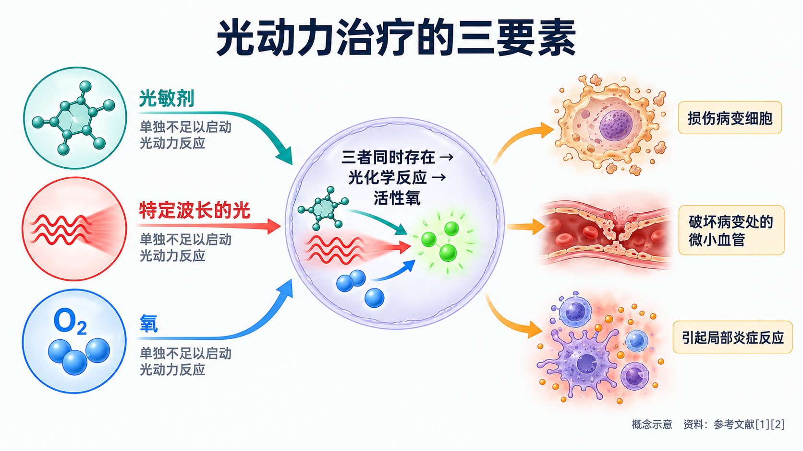
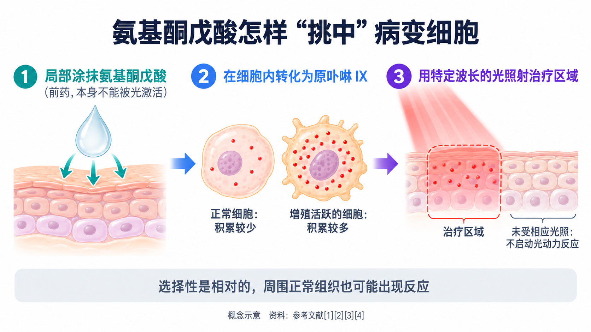
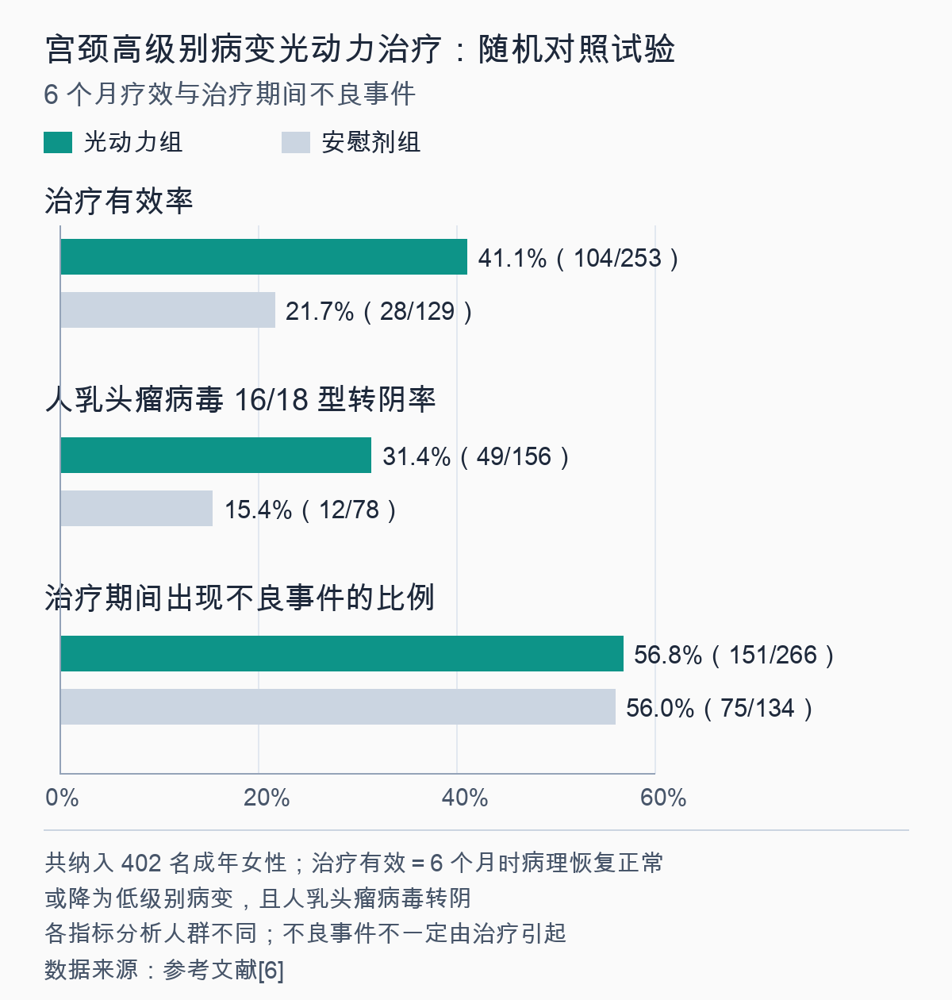

# 光动力治疗是什么：光、药、氧怎么一起清除病变细胞

> 皮肤科医生说脸上的日光性角化可以“做个光动力”，妇科门诊里也有人听说宫颈病变能“照光治疗”。光真的能治病吗？照一照就能把病变细胞清除掉，正常组织为什么没事？它是不是什么病变都能治？这篇文章把光动力治疗的原理、用途和局限一次讲清楚。

## 01 光、药、氧：三样东西缺一不可

**PDT = Photodynamic Therapy（光动力治疗）**。顾名思义，它靠“光”带动一场化学反应来治疗疾病。

美国国家癌症研究所（NCI）这样描述它的基本过程：先让细胞吸收一种**能被光激活的药物，叫光敏剂**；再用**特定波长的光**照射，光敏剂被激活后产生**一种活性氧**，把细胞杀死；照射用的光可以来自激光，也可以来自发光二极管（LED）[1]。

一篇发表在《临床医师癌症杂志》上的权威综述把它概括为三个要素：**光敏剂、光和氧** [2]。关键在于，**这三样东西单独存在时都没有毒性**，只有凑在一起，才会启动光化学反应，产生一种活性极高的氧（单线态氧），在很短时间内让细胞发生凋亡或坏死 [2]。

除了直接损伤病变细胞，光动力还会**破坏病变组织里的微小血管**，并引起局部的炎症反应，可能带动免疫系统参与清除 [1][2]。

这个思路并不新。光动力现象在 **20 世纪初**就被科学家描述过，最早用于临床治疗肿瘤的光敏剂是一类叫“血卟啉衍生物”的卟啉混合物 [2]。此后一百多年，光敏剂和光源不断更新，才慢慢走进今天的皮肤科和妇科门诊。

## 02 为什么能“挑着”作用于病变组织

光动力治疗的“选择性”来自几层设计，下面以皮肤科和妇科最常用的**氨基酮戊酸**类光敏剂为例。

**第一层：药本身不是光敏剂，要在细胞里“变身”。**氨基酮戊酸是人体合成血红素过程中的一种天然前体物质，它本身不能被光激活；进入细胞后，会被转化成真正起作用的光敏物质——**原卟啉 IX** [2][3]。所以它被称为“前药”。

**第二层：病变细胞积累得更多。**研究显示，**增殖活跃的细胞会积累更多由氨基酮戊酸转化来的原卟啉 IX**，这正是把它用于治疗和诊断的生物学基础 [3]。

**第三层：光只照在需要治疗的地方。**这类药物多是局部涂抹在病变部位，照射也只针对治疗区域；没有被照到的地方，即使有少量药物，也不会发生光动力反应 [2]。

需要说明的是，这种选择性是**相对的，而不是绝对的**。早在 1997 年的综述中，研究者就把“提高原卟啉 IX 在病变组织中的选择性”列为仍需改进的方向之一 [3]。周围正常组织也可能出现一定的反应，这也是治疗后会有红肿、疼痛等不适的原因之一。

## 03 光能照多深，决定了它能治什么

光动力有一个天然的限制：**光在人体组织里走不远**。

NCI 指出，光动力治疗所用的光**穿透组织的深度大约只有 1 厘米**，因此它主要用于治疗**长在皮肤表面或紧贴皮肤下方的病变，以及长在内脏器官或体腔内表面黏膜上的病变**，对体积较大的肿瘤帮助有限 [1]。综述也写道，光动力对组织的破坏深度从几毫米到约 1 厘米不等，这个“缺点”反过来正好适合治疗**浅表的病变**，比如黏膜的异型增生、日光性角化、原位癌和浅表肿瘤 [2]。

光的颜色也有讲究。蓝光在组织中穿透最浅，红光和近红外光穿透更深；但波长超过约 800 纳米的光能量不够，无法产生单线态氧 [2]。所以理想的光敏剂，最好能被**波长 600~800 纳米的红光到深红光**激活 [2]。不同的光敏剂吸收的光不同，**光源要和药物“配对”**，不能随便找一盏灯照照就算光动力。

一句话：**光动力适合“薄而浅”的病变，不适合深、大或已经扩散的病变。**

## 04 皮肤科：用得最早、也最成熟的领域

在国外，光动力已经获批用于多种疾病。NCI 列出的美国食品药品监督管理局（FDA）已批准用途包括：**日光性角化病、基底细胞癌、0 期皮肤鳞状细胞癌**，以及晚期皮肤 T 细胞淋巴瘤、巴雷特食管、食管癌和非小细胞肺癌 [1]。

英国皮肤科医师协会的患者资料介绍，光动力在皮肤科主要用于**浅表型基底细胞癌、鲍温病（皮肤原位鳞癌）、日光性角化病和日晒损伤的皮肤**；常规治疗无效或不适合时，偶尔也用于痤疮或病毒疣 [4]。常规的做法是：把含光敏剂的乳膏或凝胶涂在病变处并覆盖敷料，**约 3 小时后**擦去药物，再用红光照射**约 10~15 分钟** [4]。还有一种“日光光动力”，涂药后在户外自然光下待满 2 小时，疼痛通常比常规光动力轻得多 [4]。

和手术、冷冻等方法相比，局部用氨基酮戊酸的光动力有几个特点：**不需要开刀，美容效果好，耐受性较好，可以一次处理多处浅表病变，适合口腔黏膜、外阴等特殊部位，也可以重复治疗而没有累积毒性** [3]。但它并不是在所有方面都更好：对于**结节型**皮肤肿瘤，它的完全缓解率和长期复发率总体上并不优于传统治疗 [3]。

## 05 妇科：宫颈和下生殖道的光动力

宫颈、阴道和外阴都是“浅表的黏膜”，正好落在光动力能照到的范围内。近年来，下生殖道病变的发病年龄趋向年轻，**保护器官结构、保留生育力**的需求越来越突出，这推动了光动力在妇科的应用 [5]。

**国内专家共识怎么说？**2022 年，国内妇产科专家发表了氨基酮戊酸光动力用于女性下生殖道疾病的中国专家共识。专家组一致认为，氨基酮戊酸光动力在以下疾病的治疗中有重要价值 [5]：

- 宫颈鳞状上皮内病变；
- 阴道鳞状上皮内病变；
- 外阴鳞状上皮内病变；
- 外阴硬化性苔藓；
- 尖锐湿疣。

共识同时强调，**还需要更多循证医学研究来更新和扩展现有的推荐** [5]。

**为什么大家关注它？**对于宫颈高级别病变，目前推荐的治疗仍是**消融或切除性手术**，但这类手术会损伤宫颈，并与以后怀孕时并发症风险升高有关 [6]。光动力不切除宫颈组织，研究者希望它能为有生育计划的年轻女性多提供一种选择 [6][7]。

**目前最有分量的证据是一项随机对照试验。**2025 年发表在《医学》（Med）杂志上的一项国际多中心随机对照试验，纳入了 **402 名宫颈高级别鳞状上皮内病变的成年女性**，按 2:1 随机分配，一组用含 5% 氨酮戊酸己酯（六氨基酮戊酸，氨基酮戊酸的一种衍生物）的软膏做宫颈光动力治疗，另一组用安慰剂 [6]。研究把“6 个月时病理恢复正常或降为低级别病变，同时人乳头瘤病毒转阴”定义为治疗有效，结果是 [6]：

- **治疗有效率**：光动力组 **41.1%**（104/253），安慰剂组 **21.7%**（28/129）；
- **人乳头瘤病毒 16/18 型转阴率**：光动力组 **31.4%**（49/156），安慰剂组 **15.4%**（12/78）；
- **治疗期间出现不良事件的比例**：光动力组 **56.8%**，安慰剂组 **56.0%**，两组接近；
- 6 个月时有效的患者，再观察 6 个月后，**54.9%**（56/102）仍保持有效。

这组数字说明两件事：光动力比安慰剂明显更有效；但它**并不是“照一次就好”**——6 个月时有效的不到一半，有效的人里也有一部分没能维持。所以无论做没做光动力，**治疗后按时复查都不能少**。另外需要知道，这项研究由研发该药物的企业资助 [6]。

**和传统的冷刀锥切比呢？**国内一项纳入 137 名宫颈高级别病变患者的研究，比较了氨基酮戊酸光动力和冷刀锥切：6 个月时病变缓解率分别为 **88.0% 和 89.6%**，人乳头瘤病毒清除率分别为 **80.0% 和 82.7%**，差异没有统计学意义；光动力组的副作用明显更少，但**费用更高、疗程更长** [7]。不过，这项研究是**按患者意愿和医生评估分组的，不是随机分组**，两组人群本身可能就不一样，结果只能作为参考 [7]。

## 06 治疗中和治疗后，可能会有哪些反应

光动力的不适主要来自两方面：**治疗部位的局部反应**和**光敏反应**。

**局部反应**：NCI 提到，治疗部位可能出现灼伤感、肿胀、疼痛，少数会留下瘢痕，具体表现与治疗部位有关；副作用一般会在治疗结束后逐渐好转 [1]。以皮肤科为例，常规光动力在照光时可能比较疼，医生可以暂停照射，或用冷喷、风扇、局部麻醉来缓解；治疗后常见发红、肿胀，有时结痂或渗液，通常几天内消退 [4]。

**光敏反应和避光**：这一点**不同药物差别很大**。

- **静脉注射的光敏剂**，药物会分布到全身。比如 NCI 提到，用卟吩姆钠这种光敏剂后，**皮肤和眼睛会在约 6 周内对光敏感**，期间要避开直射阳光和明亮的室内灯光 [1]。
- **局部涂抹的光敏剂**，避光主要针对治疗部位。英国皮肤科医师协会建议，常规光动力后通常**保留敷料两天**，避免治疗部位再受光照；无法遮盖时，**48 小时内**涂抹防晒系数 50 的防晒霜 [4]。

所以，治疗后要避光多久、怎么避，**一定以你所用药物的说明书和医生的交代为准**，不要套用别人的经验。

## 07 光动力不是“万能光”：哪些情况不适合

把前面的内容合起来，光动力有几个明确的边界：

**深、大的病变照不透。**光只能穿透约 1 厘米，较大的肿瘤或病变较深时效果有限 [1][2]。

**不是每种浅表病变都比传统治疗好。**比如结节型皮肤肿瘤，光动力的效果总体并不优于传统治疗 [3]。

**宫颈病变的证据还在积累。**国内共识认可它的价值，但也明确需要更多研究 [5]；随机对照试验中 6 个月有效率为 41.1%，并非人人有效 [6]。宫颈病变适不适合光动力、和观察随访或锥切怎么取舍，要结合**病理结果、病变范围、年龄和生育计划**，由医生评估后决定。

**它治的是“病变”，不是专门“杀病毒”的药。**研究中的人乳头瘤病毒转阴，是评估疗效的指标之一 [6]，并不意味着光动力是一种专门的抗病毒治疗。面对“照几次光、病毒全转阴”之类的宣传，要保持警惕。

**去哪个科？**皮肤上的日光性角化、浅表皮肤肿瘤等问题，看**皮肤科**；宫颈、阴道、外阴的病变或尖锐湿疣，看**妇科**（不少医院设有宫颈疾病门诊或阴道镜门诊）。是否做光动力、用哪种光敏剂，以正规医院医生的评估和药品说明书为准。

光动力的巧妙之处，在于让一束本来无害的光，只在需要它的地方发挥作用；了解它能做什么、做不到什么，才能在医生给出选择时，心里更有底。

---

## 参考文献

[1] National Cancer Institute. [Photodynamic Therapy to Treat Cancer](https://www.cancer.gov/about-cancer/treatment/types/photodynamic-therapy). 官方患者教育资料（2025-05-15 审阅），访问日期：2026-10-14.

[2] Agostinis P, Berg K, Cengel KA, et al. [Photodynamic therapy of cancer: an update](https://doi.org/10.3322/caac.20114). CA: A Cancer Journal for Clinicians, 2011, 61(4): 250-281. 综述，访问日期：2026-10-14.

[3] Peng Q, Warloe T, Berg K, et al. [5-Aminolevulinic acid-based photodynamic therapy. Clinical research and future challenges](https://pubmed.ncbi.nlm.nih.gov/9191516/). Cancer, 1997, 79(12): 2282-2308. 综述，访问日期：2026-10-14.

[4] British Association of Dermatologists. [Photodynamic therapy](https://www.bad.org.uk/pils/photodynamic-therapy/). 患者信息资料（2022 年 12 月更新），访问日期：2026-10-14.

[5] Qiu L, Li J, Chen F, et al. [Chinese expert consensus on the clinical applications of aminolevulinic acid-based photodynamic therapy in female lower genital tract diseases (2022)](https://doi.org/10.1016/j.pdpdt.2022.102993). Photodiagnosis and Photodynamic Therapy, 2022, 39: 102993. 专家共识，访问日期：2026-10-14.

[6] Chen F, Hillemanns P, Ruan H, et al; APRICITY Investigators. [Photodynamic therapy for high-grade squamous intraepithelial lesions: A randomized controlled trial](https://doi.org/10.1016/j.medj.2025.100851). Med, 2025, 6(12): 100851. 随机对照试验，访问日期：2026-10-14.

[7] Wang X, Chen Y, Huang J, et al. [Comparative Efficacy of Photodynamic Therapy and Cold Knife Conization for Cervical High-Grade Squamous Intraepithelial Lesions](https://doi.org/10.3390/curroncol32110590). Current Oncology, 2025, 32(11): 590. 非随机对照研究，访问日期：2026-10-14.

*本文为健康科普，不能替代个人诊疗意见。皮肤浅表病变是否适合光动力治疗，请到皮肤科就诊；宫颈、阴道、外阴病变或尖锐湿疣，请到妇科就诊评估；治疗后的避光和复查请遵医嘱及药品说明书。*
