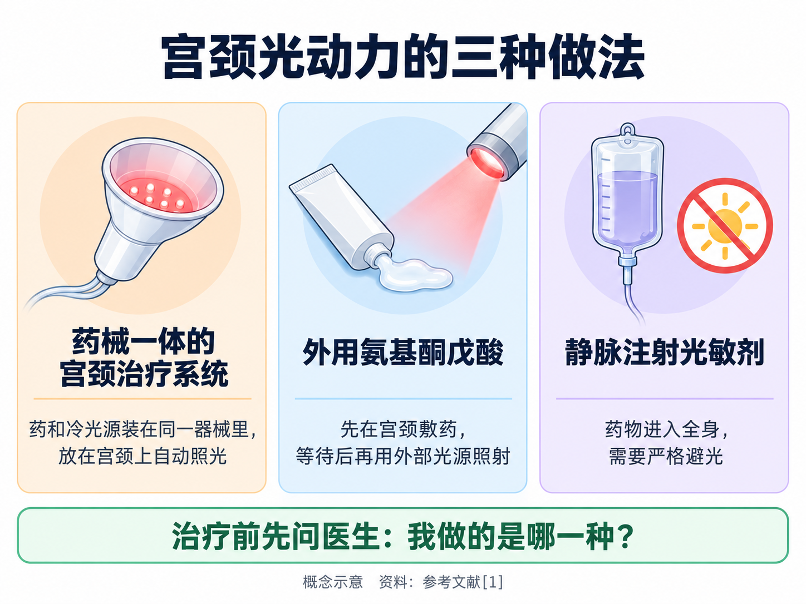
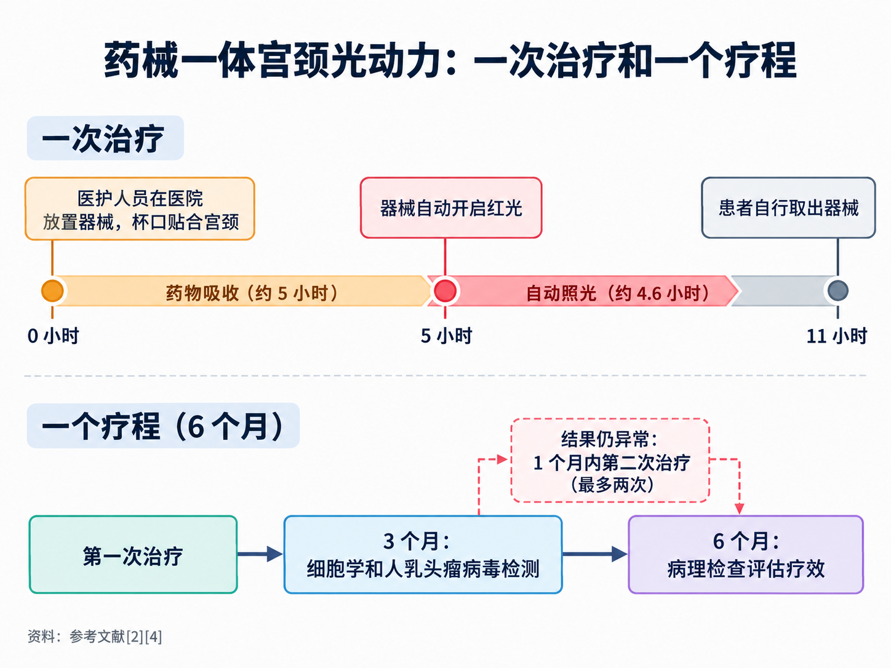
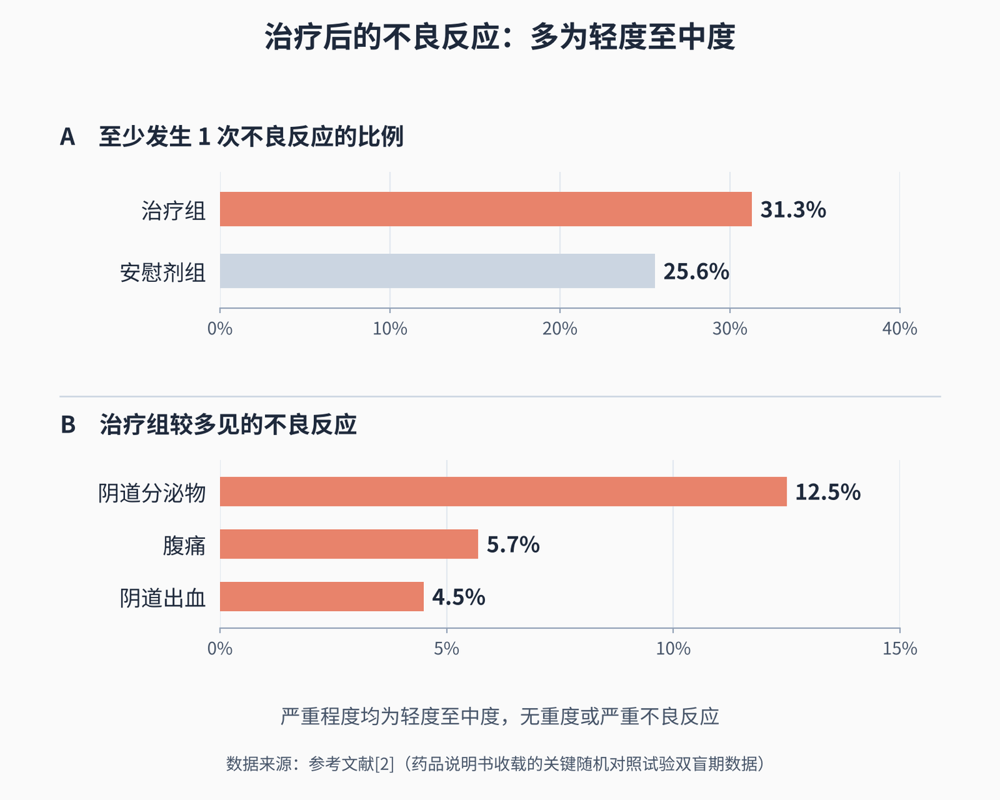

# 做光动力治疗是什么感受：流程、时间和常见反应

> 医生说宫颈病变可以考虑光动力，你点了头，接下来的问题却一个接一个：要先做什么检查？药怎么上、光怎么照？要在医院待一整天吗？会不会很疼？做完以后分泌物变多、肚子有点疼，算不算正常？这篇文章按“治疗前、治疗中、治疗后”的顺序，把这些问题讲清楚。

## 01 先弄清：你做的是哪一种光动力

**PDT = Photodynamic Therapy（光动力治疗）**。它让病变组织先吸收光敏药物，再用特定波长的光照射，引发光化学反应来破坏病变细胞。

“做光动力”听起来是一件事，实际上**不同的药、不同的给药方式，流程和感受差别很大**。2026 年发布的《子宫颈上皮内瘤变 2 级（CIN 2）管理中国专家共识》，按给药途径和光敏剂的不同，把用于宫颈病变的光动力分为三种 [1]：

- **氨基酮戊酸光动力**：把药涂在宫颈上，等一段时间后再用外部光源照射；
- **血卟啉注射液光动力**：光敏剂从静脉注射进入全身，**需要严格避光**；
- **氨酮戊酸己酯光动力**：**光敏剂和放在阴道内的冷光源做成一体的自动装置**。

这三种在国内的获批情况也不一样：

- 由**盐酸氨酮戊酸己酯软膏和一次性宫颈光动力治疗灯**组成的治疗系统，2026 年 2 月在国内首次上市，说明书适应证是 **18 岁及以上、经组织学证实为宫颈上皮内瘤变 2 级的患者，排除宫颈浸润癌和宫颈原位腺癌** [2]；
- 外用氨基酮戊酸在国内**获批的适应证是尖锐湿疣** [3]。2022 年国内妇产科专家共识认为它在宫颈鳞状上皮内病变等疾病中有重要价值 [5]，但这属于专家共识中的应用，不是说明书适应证。

所以，在问“疼不疼、要多久”之前，先问医生一句：**我做的是哪一种？**下面重点讲前两种局部用药的做法；静脉注射光敏剂的全身避光问题，我们会另写一篇。

## 02 治疗前：先把病变看清楚

光动力不切下组织，治疗后没有一份“切下来的病理”可以兜底，所以**治疗前的评估是整个过程里最关键的一步**。

**一般要先走完这几步：**

- **活检病理确诊**：筛查结果异常只是提示，是不是宫颈病变 2 级，要靠阴道镜下取活检、病理医生判断 [1][2]；
- **阴道镜充分评估**：共识要求宫颈**鳞柱交界和病变上边缘完全看得见**、宫颈管内没有高级别病变 [1]；治疗系统的说明书也要求**使用前经过充分的阴道镜检查** [2]；
- **排除不适合的情况**：细胞学或组织学提示腺上皮病变或浸润癌、临床怀疑恶性病变的，不做光动力；对红光等光源过敏、患卟啉症、对药物成分过敏、怀孕或哺乳期，也不适合 [1]。

对药械一体的治疗系统，说明书还特别写明：**宫颈结构不完整、或宫颈大小不适合放置器械的，不推荐使用** [2]。做过宫颈手术的女性，要主动告诉医生。

**就诊时，还要主动说清楚这些：**

- 有没有怀孕的可能、是否在哺乳；
- 是否在吃会让皮肤对光敏感的药物，或本身有光敏性疾病——皮肤科指南把这些列为氨基酮戊酸光动力的慎用情况 [3]；
- 以前有没有对药物或光过敏。

正规流程里，医生会在治疗前讲清治疗流程、费用和可能的不良反应，并请你签署知情同意书 [3]。有疑问，就在这个时候问。

## 03 治疗中：两种常见做法，时间差别很大

### 药械一体的宫颈治疗系统：放进去，回家，自己取出

这种治疗的特点是**药和光源装在同一个小器械里**。按说明书 [2]：

- 由**经过培训的医护人员**把 2 克软膏挤进器械的杯口、铺平，再经阴道把杯口贴合在宫颈表面；
- 放好之后**不需要守在照光设备旁边**，器械留在体内；
- **11 小时后，由患者自己取出器械**，一次治疗就完成了。

器械里的光什么时候亮？支持这一治疗获批的国际多中心随机对照试验（也就是后文发表在《医学》杂志上的那项研究），在临床试验登记中写明：器械在**放置 5 小时后自动开启红光**，**连续照射约 4.6 小时**后自动关闭 [4]。也就是说，前面几个小时是药物吸收，后面几个小时是照光，整个过程由器械自动完成。

一个疗程不止“放一次”这么简单。说明书规定 [2]：

- 治疗后 **3 个月**做细胞学和人乳头瘤病毒检测；
- 结果仍有低级别病变或更重的病变，或人乳头瘤病毒仍阳性，需要做**第二次治疗**，并在细胞学检测后 1 个月内完成；
- 整个疗程 **6 个月**，**最多治疗两次**，疗程结束时要做**病理检查**评估疗效。

**在医院要待多久？**放置这一步在医院完成，取出由自己在家完成，所以通常不需要在医院等上十几个小时。具体当天的就诊安排，以医院的流程为准。

### 外用氨基酮戊酸：先敷药等几个小时，再照光

这种做法分成“敷药”和“照光”两段，都在医院完成。国内说明书获批的是尖锐湿疣，皮肤科指南给出的腔道内（包括宫颈）尖锐湿疣方案是 [3]：

- 宫颈部位治疗前，**先清除宫颈表面的黏液**；
- 把 10%~20% 的氨基酮戊酸溶液或凝胶敷在病灶表面及周围约 1 厘米范围内，**封包避光 3 小时**；
- 敷药结束后用**红光照射**，有条件的医院可以用带宫颈帽的光纤照光；
- 治疗后 **1 周复诊**，病灶没有完全消退的可以重复治疗；初发病例一般 **3~4 次为 1 个疗程**。

这意味着，每次治疗**光是等药物吸收就要约 3 小时**，再加上照光时间，要给自己预留较长的时间；而且通常要分几次来。用于宫颈鳞状上皮内病变时，具体的药物浓度、敷药时间和治疗次数，由医生按专家共识和个人情况决定 [5]。

## 04 会疼吗：照光时和照光后的感受

**外用氨基酮戊酸：照光时可能有疼痛和烧灼感。**皮肤科指南指出，治疗中的疼痛是氨基酮戊酸光动力**最主要的不良反应**，通常在**照光开始后几分钟达到最强**，照光结束后消失或减轻；疼的程度和病变类型、部位、面积以及照光参数有关 [3]。指南推荐照光时用 0~10 分给疼痛打分，按轻、中、重采取冷风、冷喷降温等不同处理 [3]。这些描述来自皮肤科的经验，宫颈部位的感受会因人而异；**照光时觉得疼，直接告诉医生**，医生可以调整处理。

**药械一体的治疗系统：照光发生在你离开医院之后。**早期的剂量探索随机研究报告，这种治疗**使用方便，患者和妇科医生的接受度良好**，报告的不良反应只有**分泌物、不适感和点滴出血**等局部、可自行缓解的反应 [6]。说明书记录，关键临床试验中有 1 名患者因中度尿路阻塞和轻度外阴阴道疼痛**提前取出了器械**，取出后没有经过治疗，当天就自行恢复 [2]。

所以，如果器械在体内时出现**排尿困难**或明显的疼痛，不必硬撑，及时联系治疗医院，按医生的指导处理。

## 05 治疗后：分泌物、腹痛、少量出血常见吗

先看药械一体治疗系统的数据。说明书汇总了关键随机对照试验双盲期的结果 [2]：

- 至少发生 1 次**不良反应**的比例：治疗组 **31.3%**，安慰剂组 **25.6%**，两组接近；
- 严重程度**均为轻度至中度**，没有重度或严重不良反应；
- 治疗组较多见的是：**阴道分泌物 12.5%**，**腹痛 5.7%**，**阴道出血 4.5%**。

同一项试验发表在《医学》（Med）杂志上的论文报告，治疗期间出现**不良事件**的比例为治疗组 56.8%（151/266）、安慰剂组 56.0%（75/134）[7]。这个数字比上面高，是因为“不良事件”统计的是治疗期间发生的所有不适，**不论是否由治疗引起**；“不良反应”则是判断与治疗有关的部分。两组都很接近，说明不少不适并不是光动力本身带来的。

这组数据说明：**分泌物增多、腹痛、阴道出血是这种治疗后可能出现的反应**，试验中多数人没有出现，出现的也都是轻到中度。但“两组接近”不等于没有风险，试验人群和你的个人情况也可能不同。

**外用氨基酮戊酸**的治疗后反应，皮肤科指南的描述是：治疗后可能先出现红斑、水肿、瘙痒、烧灼感、渗出等急性反应，之后可能有干燥、结痂；轻中度的局部反应**属于起效过程中的正常反应** [3]。对尿道、肛门、生殖器部位的治疗，指南建议治疗后**穿宽松衣物、适当多喝水**，出现排尿困难、感染等情况及时就医 [3]。

**避光要注意什么？**这一点不同药物差别很大：静脉注射的光敏剂需要严格避光 [1]，局部用药的要求则以所用药物的说明书和医生的交代为准，不要套用别人的经验。

## 06 哪些情况要及时联系医生

治疗后的轻微不适可以观察，但下面这些情况，**不要等到预约的复查日**：

- **发热、异常出血、严重的下腹或盆腔疼痛**：共识在介绍宫颈消融治疗的术后注意事项时提醒，出现发热、异常出血或严重盆腔疼痛应及时复诊 [1]；光动力治疗后出现类似情况，同样应尽快联系医生；
- **排尿困难、尿不出来**，或器械在体内时出现明显疼痛 [2][3]；
- 局部反应**严重或持续不缓解** [3]。

**按时复查比“感觉好了”更重要。**光动力并不是人人都能治好：随机对照试验中，6 个月时达到治疗有效的比例，治疗组为 **41.1%**（104/253），安慰剂组为 **21.7%**（28/129）；6 个月时有效的患者再观察 6 个月，有 **54.9%**（56/102）保持有效 [7]。没有达到预期效果的，医生会根据复查结果调整方案，必要时改为其他治疗。疗程结束后，共识推荐宫颈病变 2 级治疗后**长期随访**，检测结果连续阴性后间隔 3 年复查，**持续至少 25 年** [1]。

治疗后多久能同房、能不能备孕，和具体药物、治疗次数、复查结果都有关，请在治疗前后直接问你的医生；我们也会单独写一篇来讲。

**该去哪个科？**宫颈病变的光动力治疗和复查看**妇科**，很多医院设有**宫颈疾病门诊或阴道镜门诊**。治疗后有不适，优先联系做治疗的那家医院。

提前知道每一步会发生什么，比只听一句“不开刀”更能让人安心；真正让治疗有意义的，是治疗前看清楚、治疗后按时复查。

---

## 参考文献

[1] 中国优生科学协会阴道镜和宫颈病理学分会, 中华医学会妇科肿瘤学分会. [子宫颈上皮内瘤变 2 级（CIN 2）管理中国专家共识（2026 版）](https://www.obgyncn.com/CN/10.13390/j.issn.1672-1861.2026.01.030). 中国妇产科临床杂志, 2026, 27(1): 89-96. 专家共识，访问日期：2026-10-17.

[2] 国家医疗保障局. [2026 年国家医保药品目录调整申报材料（公示版）：盐酸氨酮戊酸己酯软膏宫颈光动力治疗系统](https://www.nhsa.gov.cn/attach/Ypsn2026/YPSW202600597/YPSW202600597.pdf). 企业申报材料公示版（含说明书适应证、用法用量、不良反应、禁忌与注意事项），访问日期：2026-10-17.

[3] 中华医学会皮肤性病学分会光动力治疗研究中心, 中国康复医学会皮肤病康复专业委员会, 中国医学装备协会皮肤病与皮肤美容分会光医学治疗装备学组. [氨基酮戊酸光动力疗法皮肤科临床应用指南（2021 版）](https://doi.org/10.35541/cjd.20200731). 中华皮肤科杂志, 2021, 54(1): 1-9. 临床指南，访问日期：2026-10-17.

[4] ClinicalTrials.gov. [NCT04484415（APRICITY 研究）临床试验登记页](https://clinicaltrials.gov/study/NCT04484415). 临床试验登记（Ⅲ期多中心随机双盲安慰剂对照，入组 402 例；干预措施说明），访问日期：2026-10-17.

[5] Qiu L, Li J, Chen F, et al. [Chinese expert consensus on the clinical applications of aminolevulinic acid-based photodynamic therapy in female lower genital tract diseases (2022)](https://doi.org/10.1016/j.pdpdt.2022.102993). Photodiagnosis and Photodynamic Therapy, 2022, 39: 102993. 专家共识（依据摘要），访问日期：2026-10-17.

[6] Hillemanns P, Garcia F, Petry KU, et al. [A randomized study of hexaminolevulinate photodynamic therapy in patients with cervical intraepithelial neoplasia 1/2](https://doi.org/10.1016/j.ajog.2014.10.1107). American Journal of Obstetrics and Gynecology, 2015, 212(4): 465.e1-465.e7. 随机对照研究（依据摘要），访问日期：2026-10-17.

[7] Chen F, Hillemanns P, Ruan H, et al; APRICITY Investigators. [Photodynamic therapy for high-grade squamous intraepithelial lesions: A randomized controlled trial](https://doi.org/10.1016/j.medj.2025.100851). Med, 2025, 6(12): 100851. 随机对照试验（依据摘要），访问日期：2026-10-17.

*本文为健康科普，不能替代个人诊疗意见。宫颈病变是否适合光动力治疗、具体流程、避光和复查要求，请到妇科（宫颈疾病门诊或阴道镜门诊）由医生评估，并以药品说明书和医嘱为准。*
