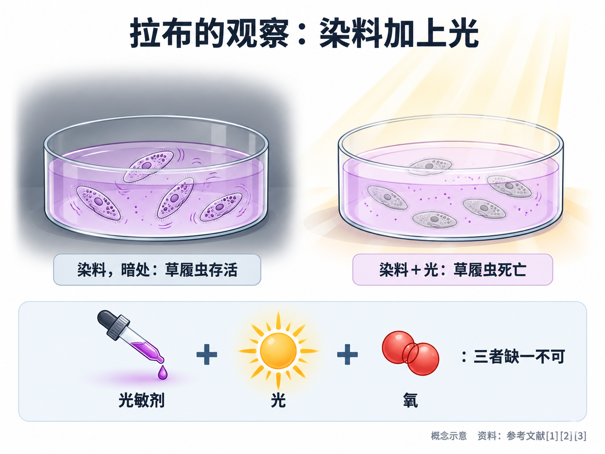
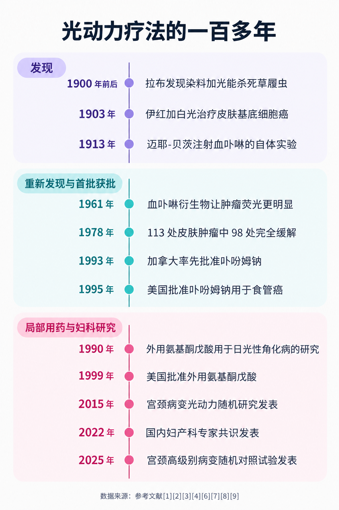
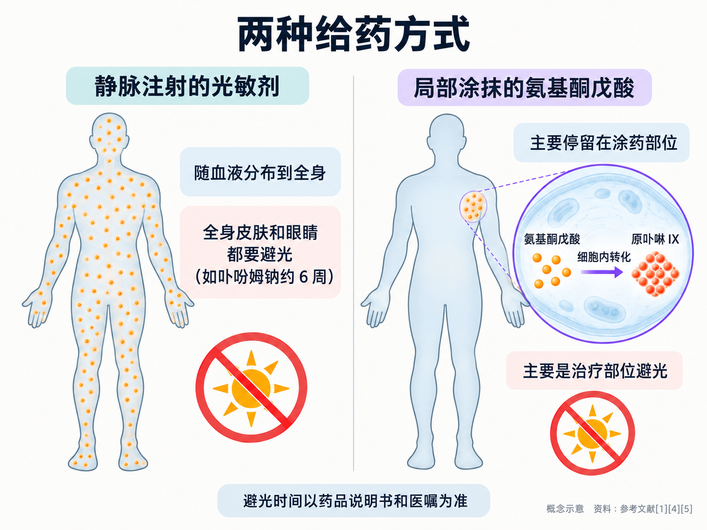

# 光动力疗法的一百多年：从草履虫实验到妇科门诊

> 第一次在妇科门诊听到“光动力”，不少人会以为这是近几年才冒出来的新技术，甚至有点像“高科技噱头”。其实，它的故事要从一百多年前慕尼黑的一间实验室说起：一位医学生发现，染料加上光，能杀死水里的草履虫。从那时起，光动力经历了偶然发现、大胆的自体实验、几十年的沉寂、重新被发现，再到一个个适应证被逐步批准。了解这段历史，能帮我们更清楚地看到：它能做什么，又为什么不是“万能光”。

## 01 一个意外：染料加上光，草履虫死了

**PDT = Photodynamic Therapy（光动力疗法）**。它的核心是三样东西一起发挥作用：能被光激活的药物（光敏剂）、匹配波长的光，以及氧 [2][4]。

这个原理最早是在微生物身上被注意到的。1900 年前后，慕尼黑的医学生**奥斯卡·拉布**在药理学家**赫尔曼·冯·塔佩纳**的实验室里研究吖啶类染料对草履虫的作用 [2][3]。他发现实验结果时好时坏，后来把这种差别和**实验室里的日光多少**联系了起来 [2]：染料本身并不足以杀死草履虫，**染料和光同时存在时**，草履虫才会死亡 [1][3]。

这是文献中最早关于“光动力效应”的报告之一 [1]。冯·塔佩纳后来提出了“光动力”这一名称 [3]。1902 年，又有研究者发现这种效应还**需要氧气参与** [3]；冯·塔佩纳的团队在随后十年里进一步确认：**光敏剂、光和氧，三者缺一不可** [2]。

这里要分清一个容易混淆的概念。差不多同一时期，医生**芬森**因用光治疗疾病获得了 1903 年诺贝尔生理学或医学奖 [3]。那是单纯用光本身治病的“光疗”；而光动力的关键在于**光要和光敏药物、氧配合**，单独照光并不能启动这种反应。

## 02 第一次用在人身上：伊红治皮肤肿瘤，和一次大胆的自体实验

拉布的报告发表大约 3 年后，**冯·塔佩纳和耶西奥内克**做了一次尝试：用 1% 的伊红染料加白光治疗皮肤的基底细胞癌 [2][3]。这是最早用光动力治疗人类皮肤肿瘤的报告 [2]。

1913 年，**迈耶-贝茨**做了一个今天看来相当冒险的实验：他给自己注射了 200 毫克血卟啉，然后让皮肤晒太阳。结果，晒到光的皮肤出现了**肿胀、疼痛和瘙痒** [3]。这被视为血卟啉类光敏剂在人体身上的第一次试验 [2]。

这次自体实验恰好说明了光敏剂的另一面：**药物分布到全身时，全身皮肤都会对光变得敏感**。直到今天，使用静脉注射光敏剂的患者治疗后仍要严格避光，道理就在这里：比如用卟吩姆钠后，**皮肤和眼睛会在约 6 周内对光敏感** [5]。

## 03 沉寂与重新发现：肿瘤会“发光”

此后很长一段时间里，相关研究转向了另一条线索——**卟啉类物质会在肿瘤里聚集，并且在特定光线下发出荧光** [1]：

- **1948 年**，有研究总结发现，卟啉会选择性地聚集在小鼠肿瘤中 [1]；
- **1955 年**，研究者把这一发现扩展到癌症患者，静脉注射血卟啉后可以看到肿瘤发出荧光 [1]；
- **1961 年**，美国梅奥诊所的团队报告，一种经过化学处理的**血卟啉衍生物**能让肿瘤荧光更明显 [1]。这种衍生物最初是作为放射增敏剂开发的，20 世纪 60 年代主要被研究用于荧光诊断，但当时发现它识别肿瘤的灵敏度和特异度都有限 [2]。

真正把注意力拉回“治疗”的，是 1972 年的一项研究：血卟啉加上光，可以消灭培养中的胶质瘤细胞和移植在小鼠身上的肿瘤 [1]。1975 年，美国罗斯威尔帕克癌症研究所的**托马斯·道格蒂**团队用血卟啉和经过滤光的氙灯，治愈了动物身上的肿瘤 [1]；1976 年，研究者确认**单线态氧**是造成细胞损伤的主要物质 [1]。

## 04 道格蒂和第一批获批：从实验台到正式适应证

1978 年，道格蒂团队报告了第一组较大规模的人体治疗结果：25 名患者的 113 处皮肤肿瘤接受了血卟啉衍生物光动力治疗，其中 **98 处（88%）完全缓解** [2][4]。这是光动力进入现代临床的起点 [4]。

起步并不顺利。据记载，道格蒂最早向美国国立卫生研究院申请经费时被拒，评审意见是“**光穿不透活体组织**” [1]。这个质疑并非毫无道理：后来的测算显示，光在肿瘤组织中有效穿透的深度大约只有几毫米 [1]；美国国家癌症研究所也指出，光动力所用的光穿透组织**通常不超过约 1 厘米**，因此它主要适合长在皮肤表面、皮下浅层，或体腔、内脏表面黏膜上的病变 [5]。**“照得到”才“治得到”**，这个限制从一开始就伴随着光动力。

此后，光动力在多个国家陆续有了正式的适应证：

- 1982 年，日本**早田（Hayata）**团队开始把光动力用于非小细胞肺癌 [4]；
- 1990 年，研究者明确了血卟啉衍生物中真正起作用的成分，提纯后的药物就是后来获批的**卟吩姆钠** [1][6]；
- 1993 年，**加拿大**率先批准卟吩姆钠用于膀胱癌的预防性治疗，随后荷兰、法国、德国、日本等国也陆续批准 [3]；
- 1995 年 12 月，**美国食品药品监督管理局**批准卟吩姆钠 [6]，用于食管癌 [1]。光动力由此成为美国第一个获批的“药物加器械”联合疗法 [4]。

光源也在不断变化。拉布用的是日光，早年的研究用过荧光灯、白炽灯和滤过的氙灯 [1]；如今照射用的光可以来自**激光**，也可以来自**发光二极管（LED）**等光源 [5]。不同光敏剂需要相应波长的光来激活，光源和药物必须“配对” [4][5]。

## 05 从“全身打药”到“局部涂药”：氨基酮戊酸登场

早期的卟啉类光敏剂大多需要**静脉注射**，药物会分布到全身，患者治疗后要较长时间避光。光动力要走进门诊、处理更多浅表病变，还需要一种更“温和”的给药方式。

答案来自人体自身合成血红素的通路。**氨基酮戊酸**是这条通路上的一种天然前体物质，本身不能被光激活，进入细胞后会转化成光敏物质**原卟啉 IX** [1][4]：

- **1987 年**，研究显示氨基酮戊酸能促进细胞合成原卟啉 IX [1]；
- **1990 年**，加拿大的**肯尼迪**团队较早认识到它在临床光动力中的潜力 [1]，并把**局部外用氨基酮戊酸**用于治疗皮肤的日光性角化病 [4]；
- **1999 年 12 月**，美国食品药品监督管理局批准了外用氨基酮戊酸 [6]，用于日光性角化病 [3]。

这一步的意义在于：**药物可以直接涂在病变部位**，照光也只针对治疗区域，光敏反应主要局限在局部。此后，研究者又开发出氨基酮戊酸的衍生物：**氨基酮戊酸甲酯** 2004 年在美国获批用于日光性角化病，**氨基酮戊酸己酯** 2010 年在美国获批用于膀胱癌的诊断 [3]。

同一时期，光动力还走进了眼科：2000 年 4 月，美国食品药品监督管理局批准了光敏剂**维替泊芬** [6]，用于一类湿性老年性黄斑变性 [3]。这种眼病与视网膜异常血管有关，光动力在这里针对的是**异常血管**，而不是肿瘤细胞 [1]。

**两种给药方式，各自适合什么？**

| | 静脉注射的光敏剂 | 局部涂抹的光敏剂（如氨基酮戊酸类） |
|---|---|---|
| 药物分布 | 随血液分布到全身 | 主要停留在涂药部位 |
| 常见用途 | 食管、肺、膀胱等腔道或内脏表面的病变 [1][4][5] | 皮肤、宫颈等体表或可直接涂药的浅表病变 [4][7] |
| 避光 | 全身皮肤和眼睛都要避光，如卟吩姆钠约 6 周 [5] | 主要是治疗部位避光 |

具体用哪一种、避光多久，**要以所用药物的说明书和医生的交代为准**。

## 06 走进妇科门诊：宫颈和下生殖道的光动力

宫颈、阴道和外阴的不少病变长在表面，正好落在光能照到的范围内，这让光动力很自然地被带进了妇科。

日本较早把卟吩姆钠的用途扩展到宫颈癌和宫颈异型增生 [3]。局部用的氨基酮戊酸类药物出现后，研究者开始尝试把药物直接涂在宫颈上再照光，希望在**不切除宫颈组织**的前提下处理癌前病变，为有生育计划的年轻女性多提供一种选择 [8][9]：

- **2015 年**，一项随机、安慰剂对照的剂量探索研究纳入宫颈病变 1 级和 2 级的女性，用不同浓度的氨基酮戊酸己酯做宫颈光动力。结果显示，对**宫颈病变 2 级**的女性，5% 浓度组在 3 个月时的疗效明显优于安慰剂；但在**宫颈病变 1 级**的女性中，和安慰剂相比差异没有统计学意义 [8]。
- **2025 年**，一项国际多中心随机对照试验纳入 402 名宫颈高级别病变的成年女性，在研究设定的评价标准下，光动力组 6 个月时的治疗有效率为 **41.1%**，安慰剂组为 **21.7%** [9]。这说明它有效，但也说明**并非人人有效**，治疗后仍需按时复查。

在国内，2022 年妇产科专家发表的中国专家共识认为，氨基酮戊酸光动力在**宫颈、阴道、外阴的鳞状上皮内病变，外阴硬化性苔藓和尖锐湿疣**的治疗中有重要价值，同时强调还需要更多循证医学研究来更新推荐 [7]。皮肤科方面，以血卟啉单甲醚为光敏剂的光动力已成为我国治疗鲜红斑痣的主要方法之一 [10]。

需要说明的是，**专家共识和临床研究不等于药品已经获批这些适应证**。某种光敏剂在国内获批用于哪些疾病，以国家药品监督管理局的公开信息和药品说明书为准。

## 07 读懂历史，也就读懂了它的边界

回头看这一百多年，几条规律一直没变：

**它离不开“照得到”。**从道格蒂被质疑“光穿不透活体组织”开始，光的穿透深度就决定了光动力主要用于浅表病变 [1][5]。体积大、位置深或已经扩散的病变，不能指望靠局部照光解决。

**每一个适应证都是一项项研究“攒”出来的。**从 1978 年的第一组病例，到各国陆续批准的具体用途，光动力是按疾病、按药物逐个积累证据的 [1][3][4][6]。一种光敏剂在某个疾病上获批，不代表它在其他疾病上同样适用。

**妇科应用仍在积累证据。**宫颈病变的光动力已有随机对照试验支持，但疗效并非百分之百，适不适合、和观察随访或锥切怎么取舍，要结合病理结果、病变范围、年龄和生育计划，由医生评估 [7][8][9]。面对“照几次就好”“病毒全转阴”之类的宣传，要保持警惕。

**去哪个科？**皮肤上的日光性角化、浅表皮肤肿瘤或鲜红斑痣，看**皮肤科**；宫颈、阴道、外阴的病变或尖锐湿疣，看**妇科**，不少医院设有宫颈疾病门诊或阴道镜门诊。

从草履虫到妇科门诊，光动力走了一百多年；它的价值不在“神奇”，而在于让对的光、对的药，作用在对的病变上。

---

## 参考文献

[1] Kessel D. [Photodynamic Therapy: A Brief History](https://doi.org/10.3390/jcm8101581). Journal of Clinical Medicine, 2019, 8(10): 1581. 历史综述，访问日期：2026-10-15.

[2] Cengel KA, Simone CB 2nd, Glatstein E. [PDT: What's Past Is Prologue](https://doi.org/10.1158/0008-5472.CAN-16-0927). Cancer Research, 2016, 76(9): 2497-2499. 述评，访问日期：2026-10-15.

[3] Aebisher D, Czech S, Dynarowicz K, et al. [Photodynamic Therapy: Past, Current, and Future](https://doi.org/10.3390/ijms252011325). International Journal of Molecular Sciences, 2024, 25(20): 11325. 综述，访问日期：2026-10-15.

[4] Agostinis P, Berg K, Cengel KA, et al. [Photodynamic therapy of cancer: an update](https://doi.org/10.3322/caac.20114). CA: A Cancer Journal for Clinicians, 2011, 61(4): 250-281. 综述，访问日期：2026-10-15.

[5] National Cancer Institute. [Photodynamic Therapy to Treat Cancer](https://www.cancer.gov/about-cancer/treatment/types/photodynamic-therapy). 官方患者教育资料（2025-05-15 审阅），访问日期：2026-10-15.

[6] U.S. Food and Drug Administration. [Drugs@FDA: FDA-Approved Drugs](https://www.accessdata.fda.gov/scripts/cder/daf/). 监管数据库（卟吩姆钠 NDA 020451 首次批准 1995-12-27；外用氨基酮戊酸 NDA 020965 首次批准 1999-12-03；维替泊芬 NDA 021119 首次批准 2000-04-12），访问日期：2026-10-15.

[7] Qiu L, Li J, Chen F, et al. [Chinese expert consensus on the clinical applications of aminolevulinic acid-based photodynamic therapy in female lower genital tract diseases (2022)](https://doi.org/10.1016/j.pdpdt.2022.102993). Photodiagnosis and Photodynamic Therapy, 2022, 39: 102993. 专家共识，访问日期：2026-10-15.

[8] Hillemanns P, Garcia F, Petry KU, et al. [A randomized study of hexaminolevulinate photodynamic therapy in patients with cervical intraepithelial neoplasia 1/2](https://doi.org/10.1016/j.ajog.2014.10.1107). American Journal of Obstetrics and Gynecology, 2015, 212(4): 465.e1-465.e7. 随机对照研究，访问日期：2026-10-15.

[9] Chen F, Hillemanns P, Ruan H, et al; APRICITY Investigators. [Photodynamic therapy for high-grade squamous intraepithelial lesions: A randomized controlled trial](https://doi.org/10.1016/j.medj.2025.100851). Med, 2025, 6(12): 100851. 随机对照试验，访问日期：2026-10-15.

[10] Xu J, Li H. [Efficacy and safety of hemoporfin photodynamic therapy in treating port-wine stains in Chinese children: a systematic review and meta-analysis](https://doi.org/10.3389/fped.2024.1501401). Frontiers in Pediatrics, 2025, 12: 1501401. 系统评价与荟萃分析，访问日期：2026-10-15.

*本文为健康科普，不能替代个人诊疗意见。皮肤浅表病变是否适合光动力治疗，请到皮肤科就诊；宫颈、阴道、外阴病变或尖锐湿疣，请到妇科就诊评估；具体药物的适应证、避光和复查要求请遵医嘱及药品说明书。*
