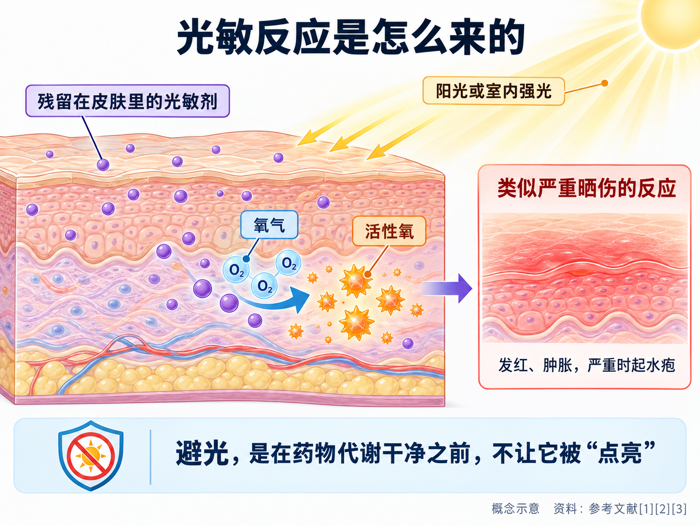
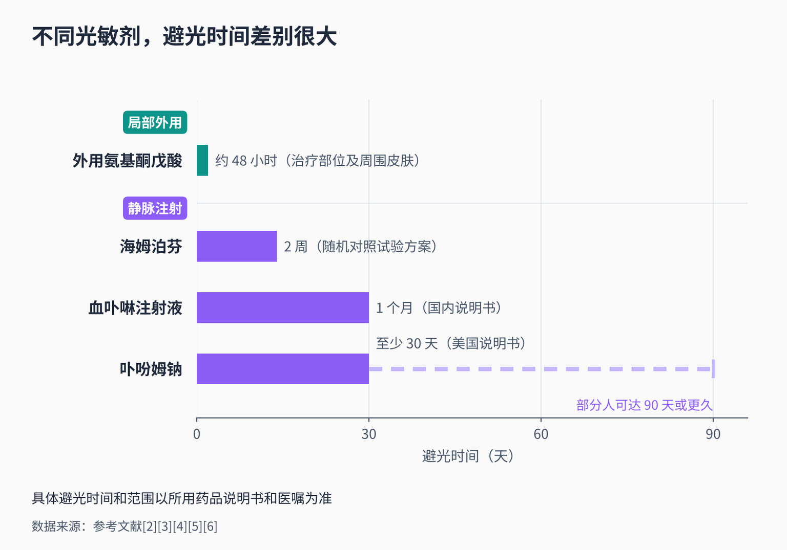
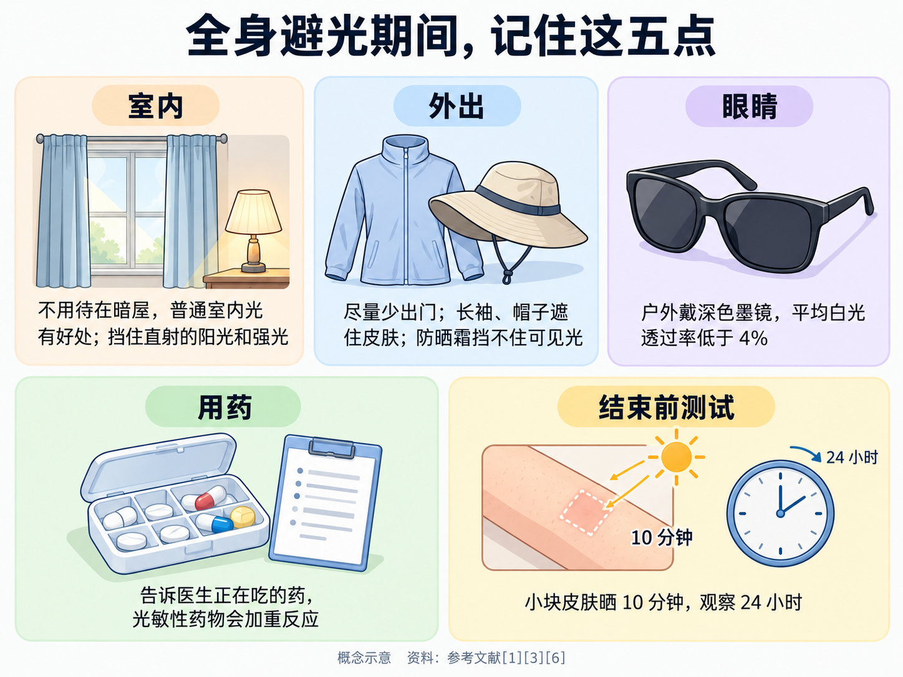
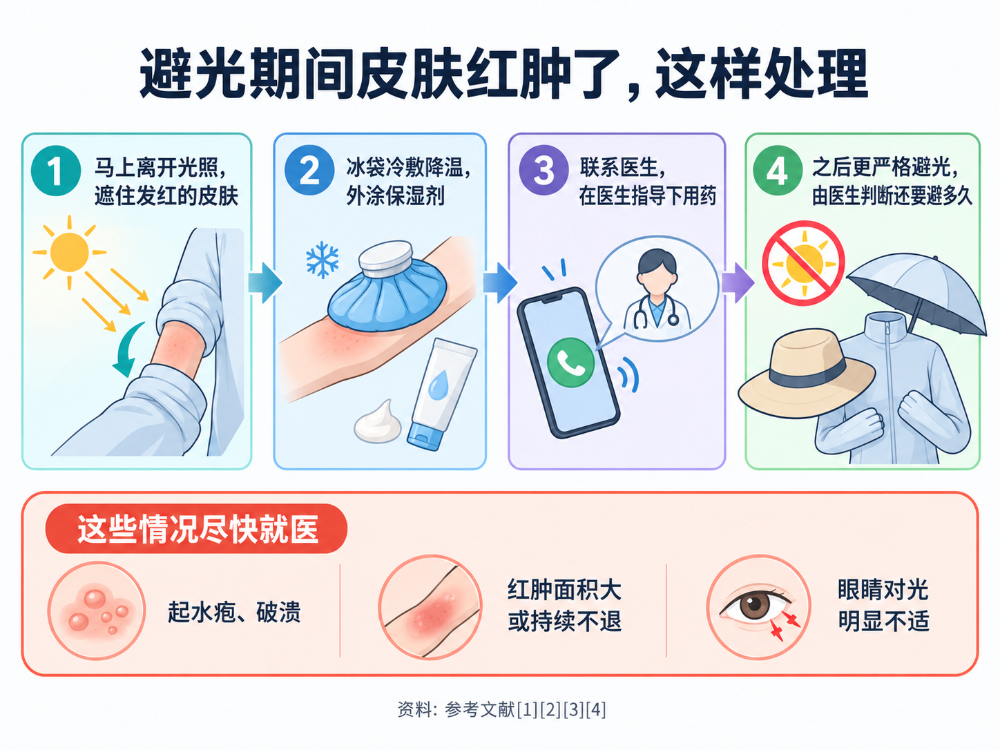

# 光动力治疗后为什么要避光？要避多久？

> 做完光动力，有人被叮嘱“回家两天别晒太阳”，有人却被要求“一个月都得躲着光”；有人听说要拉紧窗帘待在暗屋里，有人觉得涂厚厚的防晒霜就够了。到底为什么要避光？要避多久？在家能不能开灯、能不能看手机？皮肤突然红肿了又该怎么办？这篇文章把这些问题一次讲清楚。

## 01 避光，是因为“药”还留在身上

**PDT = Photodynamic Therapy（光动力治疗）**。它的原理是：先让病变组织吸收一种叫“光敏剂”的药物，再用特定波长的光照射；光敏剂吸收光能后传给周围的氧分子，生成单态氧、氧自由基等**活性氧**，破坏病变细胞 [1][2]。

光、药、氧，三样凑齐才会起反应。问题在于，**治疗结束后，光敏剂并不会马上从身体里消失**。只要皮肤里还残留着光敏剂，再遇到足够强的光，同样的反应就可能发生在不该发生的地方——这就是**光敏反应**。

很多人以为只有医院里的专用光源才能“激活”药物。其实不然：**日光本身就是一种复合光，也能激发光敏剂**，皮肤科甚至有专门利用日光作为光源的“日光光动力疗法” [2]。所以治疗后晒太阳，相当于在医院外又做了一次没人控制剂量的照光。

光敏反应看起来像**严重的晒伤**：皮肤发红、肿胀，严重时起水疱 [3]；也可能留下色素沉着 [4]。眼睛同样会受影响，表现为对阳光、明亮灯光甚至夜间汽车大灯格外敏感、不舒服 [3]。

**避光的目的，就是在光敏剂代谢干净之前，不给它“被点亮”的机会。**

## 02 为什么有的避两天，有的要避一个月

避光多久，主要取决于两件事：**药是怎么进入身体的**，以及**这种药在身体里停留多久**。

**静脉注射的光敏剂：药会跟着血液走遍全身。**

光动力最早用于临床的一批光敏剂，是血卟啉衍生物、卟吩姆钠等“第一代光敏剂”。它们是混合制剂，**光毒性强，需要避光 4 周以上** [1]。药物经静脉进入后分布到全身，皮肤里也有，所以要避光的是**全身皮肤和眼睛**，而不只是治疗部位。

- **血卟啉注射液**：国内说明书的适应证是口腔、膀胱等部位和表浅癌症，静脉滴注后 48～72 小时再进行激光治疗；说明书要求**用药后严格避光一个月**，以免在曝光部位出现红肿、色素沉着等光敏副作用 [4]。
- **卟吩姆钠**：在美国获批用于食管癌、部分支气管内肺癌和巴雷特食管高级别异型增生等。美国说明书要求注射后**至少 30 天**避免皮肤和眼睛受到阳光直射或室内强光照射，并提醒**部分患者的光敏状态可能持续 90 天甚至更久** [3]。

即使按要求做了防护，光敏反应也不少见：卟吩姆钠的美国说明书记录，在肿瘤患者中光敏反应的发生率约为 **20%**，在巴雷特食管高级别异型增生患者中约为 **69%** [3]。这也说明，**避光要求不是可有可无的客套话**。

后来研发的光敏剂，有的在体内清除得快得多。比如用于鲜红斑痣（一种先天性皮肤毛细血管畸形）的**海姆泊芬**，同样是静脉给药，但它的半衰期很短，约 1.31 小时 [5]。在国内一项纳入 440 名患者的随机对照试验中，研究方案要求治疗后**避光 2 周**，期间避免强光、戴墨镜和帽子、穿长袖衣物；海姆泊芬组 735 例次治疗中记录到 10 例次与光暴露有关的反应，与安慰剂组（110 例次中 2 例次）没有明显差别 [5]。

**局部外用的光敏剂：主要停留在涂药的地方。**

外用**氨基酮戊酸**本身没有光敏性，涂在病灶上以后，被病变细胞吸收，在细胞内转化成具有光敏性的原卟啉Ⅸ，再由光来激活 [2]。药物集中在局部，全身影响小，失效也快 [1]，所以避光时间短得多，范围也小得多：

- 国内皮肤科指南：头面部等暴露在外的部位，治疗后要**严格防晒，48 小时内减少室外活动和室内强光源暴露** [2]；
- 美国获批的氨基酮戊酸凝胶说明书：治疗后约 **48 小时**内，治疗部位**及周围皮肤**都要避开阳光和长时间强光（比如美黑床、太阳灯），**不论这块皮肤当时有没有被照光** [6]。

一句话概括：**静脉用药，避的是全身，时间以周计；局部用药，避的是涂药部位，时间以天计。**具体到你用的那一种，**以药品说明书和医生的交代为准**，不要拿别人的避光时间往自己身上套。

## 03 做的是宫颈光动力？先问清楚用的哪种药

宫颈病变的光动力，用的药并不一样，避光要求也就不一样。治疗前或出院前，可以直接问医生这几个问题：

- **我用的光敏剂是什么？是涂在局部，还是从静脉打进去的？**
- **需要避光多少天？是全身避光，还是只注意治疗部位？**
- **避光期间眼睛要不要特别防护？**
- **我平时吃的药里，有没有会加重光敏反应的？**

如果是**静脉注射的光敏剂**，就要按全身避光来安排，提前规划好接下来几周的工作和出行。

如果是**局部用药**，药物集中在宫颈局部，治疗后更常见的是局部反应，而不是全身皮肤的光敏反应。比如国内获批用于宫颈病变 2 级的药械一体宫颈光动力治疗系统，说明书收载的较多见不良反应是**阴道分泌物（12.5%）、腹痛（5.7%）和阴道出血（4.5%）** [7]。外用氨基酮戊酸治疗生殖器部位后，指南建议**穿宽松衣物、适当多喝水**，出现感染、排尿困难等情况及时就医 [2]。这类治疗后有没有额外的避光要求，同样以所用药物的说明书和医生的交代为准。

## 04 避光期间，日常生活怎么过

下面这些建议主要针对**需要全身避光的静脉用光敏剂**；局部用药的，按医生交代把重点放在治疗部位即可。

**不用躲进小黑屋。**这是最常见的误区。卟吩姆钠的美国说明书特别指出：**普通的室内环境光对皮肤反而有好处**，残留的药物会在这种柔和光线下通过“光漂白”反应逐渐、安全地失去活性，所以**避光期间不应该一直待在暗室里** [3]。要避开的是**阳光直射和室内强光**，比如检查灯（包括牙科治疗灯）、手术灯、近距离没有灯罩的灯泡 [3]；居家或办公时，可以用窗帘挡住直射进来的强光 [1]。

**尽量少出门；必须出门时，用衣物把皮肤遮住。**治疗后数天至数周内要避免阳光直射，减少外出；出门时穿长袖衣物，戴帽子和墨镜 [1][5]。

**防晒霜挡不住光敏反应。**普通防晒霜主要阻挡紫外线，**对可见光引起的光敏反应没有保护作用** [3]。医生可能会建议暴露部位涂防晒霜作为辅助 [1]，但它**不能代替衣物遮挡和减少外出**。

**眼睛也要保护。**全身用药后，眼睛可能对阳光、强光和车灯格外敏感。卟吩姆钠的美国说明书要求，**至少 30 天内、并直到眼睛的不适消失**，在户外都要戴深色墨镜，墨镜的平均白光透过率要**低于 4%** [3]。普通浅色太阳镜达不到这个要求，可以请医生或验光师帮忙确认。

**主动告诉医生你在吃的药。**正在服用光敏性药物、本身有光敏性疾病（比如红斑狼疮），都会增加光敏反应的风险，四环素类抗生素就是常见的光敏性药物 [1][2]。和其他已知的光敏性药物一起使用，可能加重光动力治疗后的光毒反应 [6]。避光期间如果要看病开药，记得告诉接诊医生你刚做过光动力。皮肤白皙、容易晒伤的人，光敏风险也更高 [1]。

**避光期结束，先小范围试一试。**卟吩姆钠的美国说明书建议，在让皮肤重新接受阳光直射之前，先拿一小块皮肤**晒 10 分钟**，观察 **24 小时**；没有出现发红、肿胀、起水疱，再逐步恢复户外活动；如果出现了，就继续避光两周后再试 [3]。具体怎么试、什么时候试，按你所用药物的说明书和医生的指导来。

## 05 皮肤突然红肿了，怎么办

避光期间如果不小心晒到，或者皮肤突然发红、发热、发痒，可以按这个顺序处理：

1. **马上离开光照**，回到没有阳光直射的地方，遮住发红的皮肤。
2. **冷敷降温**：可以用冰袋局部冷敷，并外涂保湿剂 [1][2]。
3. **联系医生**：血卟啉注射液说明书写明，一旦发生光敏副作用，可给予**抗过敏药物和外用皮质激素** [4]；瘙痒严重时，医生可能开口服抗组胺药 [2]。**这些药请在医生指导下使用**，不要自行买药乱涂。
4. **之后更严格地避光**，并把这次反应告诉医生，由医生判断后面还要避多久。

出现**水疱、破溃**，红肿范围大、持续不退，或者眼睛对光明显不适，要尽快就医 [2][3]。对水疱、糜烂要注意保护创面、避免感染 [2]。

局部外用氨基酮戊酸治疗后，治疗部位本身出现轻到中度的红斑、水肿、瘙痒、渗出、干燥、结痂，**属于起效过程中的正常反应**，和意外晒伤引起的光敏反应不是一回事；但如果症状严重或持续不缓解，同样建议及时复诊 [2]。

## 06 什么时候要尽快就医，去哪个科

下面这些情况，不要等到预约的复查日：

- 皮肤起**水疱、破溃**，或红肿面积大、越来越重 [2][3]；
- 红肿、瘙痒、烧灼感**严重或持续不缓解** [2]；
- 眼睛对光**明显不适** [3]；
- 治疗部位出现感染迹象、排尿困难等情况 [2]。

**找谁看？**优先联系**给你做光动力治疗的科室**，他们最清楚你用的药和剂量；做宫颈光动力的，一般是**妇科（宫颈疾病门诊或阴道镜门诊）**。皮肤上的光敏反应需要处理时，也可以看**皮肤科**，就诊时一定要说明自己刚做过光动力、用的是哪种药、什么时候用的。

避光不是要把自己关起来，而是在药物退场之前，替皮肤和眼睛挡住那一束不该来的光；问清楚自己用的是哪种药，就知道该挡多久、挡哪里。

---

## 参考文献

[1] 中国抗癌协会. [《中国肿瘤防治核心科普知识（2025）》——光动力疗法篇](http://www.caca.org.cn/system/2025/04/08/030136738.shtml). 学会科普（依托《中国肿瘤整合诊治指南》），2025-04-08，访问日期：2026-10-18.

[2] 中华医学会皮肤性病学分会光动力治疗研究中心, 中国康复医学会皮肤病康复专业委员会, 中国医学装备协会皮肤病与皮肤美容分会光医学治疗装备学组. [氨基酮戊酸光动力疗法皮肤科临床应用指南（2021 版）](https://doi.org/10.35541/cjd.20200731). 中华皮肤科杂志, 2021, 54(1): 1-9. 临床指南，访问日期：2026-10-18.

[3] U.S. National Library of Medicine, DailyMed. [Porfimer sodium for injection: prescribing information（卟吩姆钠注射剂美国处方信息，Revised 12/2019）](https://dailymed.nlm.nih.gov/dailymed/drugInfo.cfm?setid=5c4841b4-fbc0-4163-8ee1-cb28629cbfbf). 药品说明书，访问日期：2026-10-18.

[4] 39 药品通. [血卟啉注射液说明书](https://ypk.39.net/738376/manual/). 药品说明书（数据库转载），访问日期：2026-10-18.

[5] Zhao Y, Tu P, Zhou G, et al. [Hemoporfin photodynamic therapy for port-wine stain: a randomized controlled trial](https://doi.org/10.1371/journal.pone.0156219). PLoS One, 2016, 11(5): e0156219. 随机对照试验，访问日期：2026-10-18.

[6] U.S. Food and Drug Administration. [Aminolevulinic acid hydrochloride gel, 10%: prescribing information（氨基酮戊酸凝胶美国处方信息，Revised 09/2026）](https://www.accessdata.fda.gov/drugsatfda_docs/label/2026/208081s040lbl.pdf). 药品说明书，访问日期：2026-10-18.

[7] 国家医疗保障局. [2026 年国家医保药品目录调整申报材料（公示版）：盐酸氨酮戊酸己酯软膏宫颈光动力治疗系统](https://www.nhsa.gov.cn/attach/Ypsn2026/YPSW202600597/YPSW202600597.pdf). 企业申报材料公示版（含说明书适应证、不良反应摘录），访问日期：2026-10-18.

*本文为健康科普，不能替代个人诊疗意见。光动力治疗后的避光时间和范围因药物而异，请以所用药品说明书和医嘱为准；宫颈光动力相关问题请咨询妇科（宫颈疾病门诊或阴道镜门诊），皮肤光敏反应可就诊皮肤科或联系原治疗科室。*
