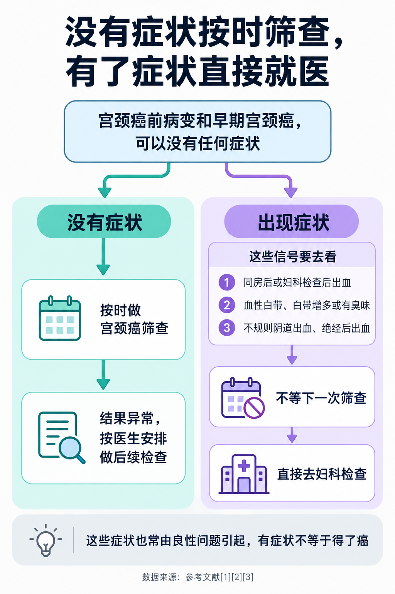
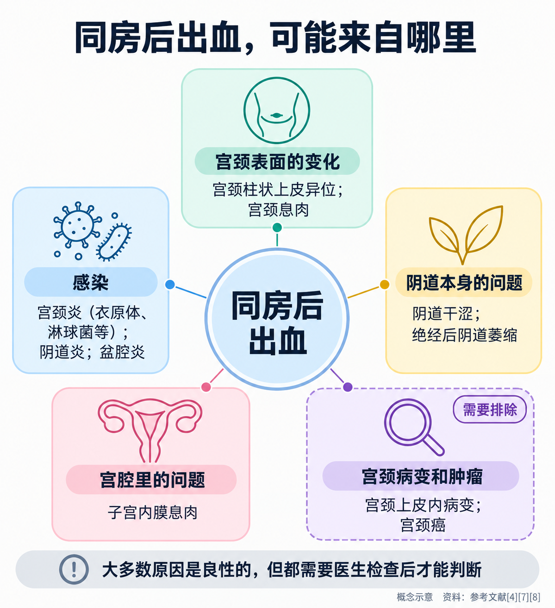
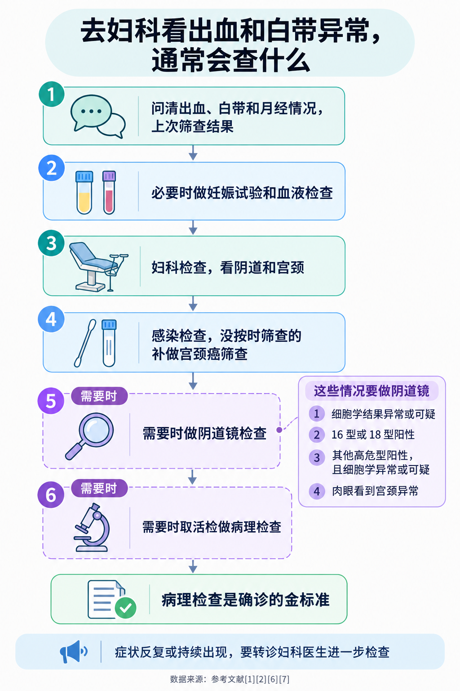

# 同房后出血、白带异常：哪些信号要警惕宫颈问题

> 同房后纸巾上带了一点血，或者这段时间白带总是发黄、带血丝，很多人第一反应是上网搜，越搜越怕：是不是宫颈癌？也有人想着“去年刚做过筛查，结果正常”，就一直拖着没去医院。其实，同房后出血和白带异常背后的原因很多，大多数是良性的；但它们确实是需要去检查的信号，不能用一次正常的筛查结果来“抵消”。这篇文章讲清楚：哪些信号值得留意、常见原因有哪些、为什么上次筛查正常也要去看，以及该去哪个科、会做哪些检查。

## 01 宫颈的早期病变，常常不会“报信”

先说一个容易被误解的事实：**宫颈癌前病变和早期宫颈癌，可以没有任何症状** [1]。国家卫生健康委的宫颈癌防治健康教育核心知识也写道，宫颈癌早期常常没有明显症状，随着病情进展，才逐渐出现阴道不规则出血、阴道排液等症状 [2]。世界卫生组织同样提到，**癌前病变很少引起症状，所以定期筛查很重要** [3]。

这意味着两件事：

- **没有症状，不等于宫颈没问题**，适龄女性仍要按时筛查；
- **出现了症状，就不要等下一次筛查**，应该直接去医院检查。

国家卫生健康委《宫颈癌诊疗指南（2022 年版）》列出了随着宫颈病变加重可能出现的症状 [1]：

- **接触性阴道出血**，也就是同房后或妇科检查后出血；
- **异常白带**，比如血性白带、白带增多；
- **不规则阴道出血**，或**绝经后阴道出血**。

到了晚期，还可能出现阴道大量出血、水样甚至米汤样白带，以及肿瘤侵犯其他器官引起的症状 [1]。世界卫生组织列出的需要就医的信号，还包括白带增多或有臭味、背部或腿部或盆腔持续疼痛、体重下降、乏力、食欲减退等 [3]。

不过，这些症状**并不是宫颈癌特有的**。下面会讲到，同样的出血和分泌物变化，更常见的原因是一些良性问题。它们的意义在于提醒你：**该去让医生看一看了。**

## 02 同房后出血，常见原因大多是良性的

同房后出血并不少见。一项系统评价汇总的社区调查显示，**同房后出血的时点患病率在女性中约为 0.7%~9%**，有研究报告，有月经的女性一年内累计约有 6% 出现过这种情况 [5]。

它最常见的来源，是生殖道表面一些容易出血的地方，包括**宫颈息肉、宫颈炎、宫颈柱状上皮异位、宫颈上皮内病变或癌** [4]。按大类可以这样理解 [4][7][8]：

- **宫颈表面的变化**：宫颈柱状上皮异位（下一部分专门讲）、宫颈息肉；
- **感染**：宫颈炎，常见的病原体是衣原体和淋球菌；阴道炎、盆腔炎也可能引起；
- **阴道本身的问题**：阴道干涩，绝经后雌激素下降引起的阴道萎缩；
- **宫腔里的问题**：比如子宫内膜息肉；
- **宫颈病变和肿瘤**：宫颈上皮内病变、宫颈癌，少数为阴道或子宫内膜的肿瘤。

**宫颈息肉**是宫颈表面或宫颈管里长出的小赘生物，英国医院的患者资料说，大约每 100 名女性中有 4 人有息肉，40~50 多岁更常见；它们绝大多数是良性的，常常没有症状，有症状时可能表现为同房后或两次月经之间出血、分泌物增多，一般建议摘除 [8]。

**那么，同房后出血的人里，有多少是宫颈病变或癌？**

- 一篇综述汇总多项研究后指出，**在因同房后出血就诊的女性中，宫颈癌的比例约为 3.0%~5.5%，宫颈上皮内病变约为 6.8%~17.8%** [4]。这个范围很宽，与研究设计和地区有关：**筛查普及的国家，比例更低** [4]；
- 前面那篇系统评价按社区人群估算，**一位出现同房后出血的女性患宫颈癌的风险，随年龄明显不同**：20~24 岁约为 4.4 万分之一，45~54 岁约为 2400 分之一 [5]。研究者也坦言，这方面的证据质量还不高 [5]；
- 综述还提到，**大多数因同房后出血去看医生的女性，查不出明确的原因**；在自然有月经的女性中，约 60% 在 6 个月内自行好转 [4]。

所以，同房后出血**多数不是癌**，年轻女性尤其少见；但宫颈病变确实是需要排除的原因之一。澳大利亚和新西兰皇家妇产科学院的立场声明说得很清楚：**生殖道恶性肿瘤是异常出血中不常见的原因，在年轻女性中很少见，但对每一位患者都必须考虑到** [6]。

## 03 被说“宫颈糜烂”，先别慌

很多人第一次听到同房后出血的解释，是“宫颈糜烂”。这个名字听起来像宫颈烂了，其实医生现在多称为**宫颈柱状上皮异位**。

宫颈管里面原本覆盖着一层柔软的腺上皮（柱状上皮）。在雌激素等激素的影响下，这层上皮会“露”到宫颈外表面来，检查时看上去是一片发红的区域 [8]。英国医院的患者资料说，**它与激素水平变化、怀孕和口服避孕药有关**，对多数女性**不会造成问题**，常常不用治疗也会慢慢消退；**它与宫颈癌或会导致癌症的情况没有关系** [8]。

不过，露在外面的柱状上皮比较娇嫩，**同房时、做宫颈筛查时容易出血**，也可能让分泌物增多 [7][8]。症状困扰明显时，医生可能建议做局部处理 [8]。

这里要特别提醒两点：

- **“柱状上皮异位”是一个外观描述，不是排除了其他问题的诊断。**发红的宫颈是不是单纯的柱状上皮异位，医生通常要结合宫颈癌筛查结果来判断；
- **它本身一般不需要治疗**，不要因为“糜烂”两个字就去做各种不必要的治疗。

## 04 白带有哪些变化，值得留意

白带本身是正常的。英国国家医疗服务体系的资料说，**没有明显或难闻的气味，颜色清亮或发白，质地黏稠或稀滑**，通常就不用担心 [10]。

白带的气味、颜色或性状突然改变，最常见的原因是**阴道或宫颈的感染** [10]：

- 有鱼腥味，可能是细菌性阴道病；
- 稠厚、发白、像豆腐渣，可能是外阴阴道假丝酵母菌病（霉菌性阴道炎）；
- 发黄、发绿或呈泡沫状，可能是滴虫感染；
- **分泌物异常同时伴有盆腔痛或出血，可能是衣原体或淋球菌感染** [10]。

阴道炎的分类和治疗，我们在《阴道炎为什么总是反复？先分清是哪一种》里讲过，这里重点说说和**宫颈**有关的两种情况。

**宫颈炎：常常没感觉。**美国疾病预防控制中心的性传播感染诊疗指南指出，宫颈炎**常常没有症状**，部分女性会出现白带异常和**两次月经之间的阴道出血**；医生检查时的两个主要表现是**宫颈管口有脓性或黏液脓性分泌物**，以及**用棉签轻碰宫颈管就会持续出血** [9]。最常见的明确病因是**沙眼衣原体或淋球菌**，但也有很多宫颈炎找不到具体的病原体 [9]。指南建议对宫颈炎患者评估是否合并盆腔炎，并做衣原体和淋球菌检测 [9]。澳大利亚和新西兰皇家妇产科学院也指出，同房后出血是衣原体感染**最常见的就诊症状** [6]。

**和宫颈病变相关的白带变化**：随着宫颈病变加重，可能出现**血性白带、白带增多**；晚期宫颈癌可能出现水样甚至米汤样白带 [1]。这些表现同样可能由其他原因引起，需要检查后才能判断。

无论是哪一种变化，都**不要自己诊断、自己买药** [10]，也不要用阴道冲洗来“清洁”，冲洗反而容易刺激阴道 [10]。

## 05 上次筛查正常，为什么还要去看

这是最容易被忽视的一点。

**宫颈癌筛查是为没有症状的人设计的。**它的作用是在没有任何感觉的时候，提前发现癌前病变；但它不是“保险单”，不能保证到下一次筛查之前都不会有问题。

一篇关于同房后出血的综述特别提醒：**在已经存在浸润性宫颈癌的情况下，宫颈涂片的假阴性率可达 50%**，所以**一次正常的涂片结果，不能排除同房后出血的女性存在恶性病变** [4]。英国国家医疗服务体系的资料也建议，两次月经之间或同房后出血，应该去看全科医生或性健康门诊，因为**这有时可能是癌症的信号，任何异常出血都要检查** [7]。

那是不是出一次血，就要马上做一大堆检查？也不必。澳大利亚和新西兰皇家妇产科学院的建议是 [6]：

- 出现同房后出血的女性，**应该做检查来排除宫颈癌和衣原体感染**；
- 如果**只出现过一次**，宫颈癌筛查结果正常、宫颈外观也正常，**一般不需要立即转诊**；
- 但如果**反复出现或持续存在**，就**必须转诊给妇科医生**。

换句话说：**出现症状，先去看一次医生；症状反复，要追到底。**“上次筛查正常”可以帮医生判断风险，但不能代替这次的检查。

## 06 去哪个科，会做哪些检查

**去哪个科？**到医院**妇科**就诊；很多医院设有**宫颈疾病门诊或阴道镜门诊**。怀孕期间出血，要尽快联系产科医生。

**就诊时，医生通常会这样做** [1][2][7]：

1. **问清楚情况**：出血和月经、同房的关系，持续多久、量多少，白带有什么变化，有没有腹痛，避孕方式，上次筛查的时间和结果；
2. **必要时做妊娠试验和血液检查** [7]；
3. **妇科检查**：用窥器看看阴道和宫颈，有没有息肉、炎症、出血点或肉眼可见的异常 [7]；
4. **感染检查**：根据情况做衣原体、淋球菌等性传播感染检测，以及白带检查 [7][9]；
5. **宫颈癌筛查**：没有按时筛查的，补做宫颈细胞学检查和（或）人乳头瘤病毒检测 [4]；
6. **阴道镜检查**：国家卫生健康委的筛查工作方案规定，**细胞学结果异常或可疑、人乳头瘤病毒 16 型或 18 型阳性、其他高危型阳性同时细胞学异常或可疑，以及肉眼检查宫颈异常的**，要做阴道镜检查 [2]；
7. **活检病理**：阴道镜下或直视下取宫颈组织做病理检查，是**最终确诊的金标准** [1]；
8. **其他检查**：怀疑出血来自宫腔时，可能安排超声或宫腔镜检查 [7]。

**就诊前可以准备：**记下每次出血的日期、和同房的关系、出血量；末次月经时间；带上历次的筛查报告。

**这些情况要尽快就医，不要等门诊预约** [3][7]：

- **月经推迟或可能怀孕，同时有阴道出血和下腹痛**——要警惕宫外孕 [7]；
- 出血量很多；
- **绝经后又出现阴道出血** [1][3]；
- 出血伴持续的盆腔、腰背或腿部疼痛 [3]。

同房后出血和白带异常，多数时候是可以查清、也可以处理的小问题；去看一次医生，既是给自己一个确定的答案，也是不让真正需要处理的问题被耽误。

---

## 参考文献

[1] 国家卫生健康委员会. [宫颈癌诊疗指南（2022 年版）](https://sxzlyy.com/Sites/Uploaded/File/2022/04/196378598375058767976949987.pdf). 诊疗指南（医疗机构网站转载全文），2022，访问日期：2026-10-29.

[2] 国家卫生健康委员会. [宫颈癌筛查工作方案（含宫颈癌防治健康教育核心知识）](https://www.nhc.gov.cn/fys/c100078/202201/e4209b0a6e604f6aba3e793d8eddebf3/files/1733998298755_31891.pdf). 政府文件，2022，访问日期：2026-10-29.

[3] World Health Organization. [Cervical cancer](https://www.who.int/news-room/fact-sheets/detail/cervical-cancer). 官方事实清单（2026-07-03），访问日期：2026-10-29.

[4] Tarney CM, Han J. [Postcoital Bleeding: A Review on Etiology, Diagnosis, and Management](https://pmc.ncbi.nlm.nih.gov/articles/PMC4086375/). Obstetrics and Gynecology International, 2014: 192087. 综述，访问日期：2026-10-29.

[5] Shapley M, Jordan J, Croft PR. [A systematic review of postcoital bleeding and risk of cervical cancer](https://pmc.ncbi.nlm.nih.gov/articles/PMC1839021/). British Journal of General Practice, 2006, 56(527): 453-460. 系统评价（依据摘要），访问日期：2026-10-29.

[6] Royal Australian and New Zealand College of Obstetricians and Gynaecologists. [Investigation of intermenstrual and postcoital bleeding (C-Gyn 6)](https://ranzcog.edu.au/RANZCOG_SITE/media/RANZCOG-MEDIA/Women%27s%20Health/Statement%20and%20guidelines/Clinical%20-%20Gynaecology/Investigation-of-intermenstrual-and-postcoital-bleeding-(C-Gyn-6).pdf?ext=.pdf). 专业学会最佳实践声明（2021 年 7 月版），访问日期：2026-10-29.

[7] NHS. [Bleeding between periods or after sex](https://www.nhs.uk/symptoms/vaginal-bleeding-between-periods-or-after-sex/). 英国国家医疗服务体系患者资料（2024-08-13 审阅），访问日期：2026-10-29.

[8] Gloucestershire Hospitals NHS Foundation Trust. [Cervical ectropion and other conditions affecting the cervix](https://www.gloshospitals.nhs.uk/your-visit/patient-information-leaflets/cervical-ectropion-and-other-conditions-affecting-cervix-ghpi1542/). 英国医院妇科患者资料（GHPI1542_05_26），访问日期：2026-10-29.

[9] Workowski KA, Bachmann LH, Chan PA, et al. [Sexually Transmitted Infections Treatment Guidelines, 2021](https://www.cdc.gov/mmwr/volumes/70/rr/rr7004a1.htm). MMWR Recommendations and Reports, 2021, 70(4). 美国疾病预防控制中心诊疗指南（宫颈炎章节），访问日期：2026-10-29.

[10] NHS. [Vaginal discharge](https://www.nhs.uk/conditions/vaginal-discharge/). 英国国家医疗服务体系患者资料（2024-02-15 审阅），访问日期：2026-10-29.

*本文为健康科普，不能替代个人诊疗意见。出现同房后出血、两次月经之间出血、绝经后出血或白带异常，请到妇科（或宫颈疾病门诊、阴道镜门诊）由医生检查后判断原因和处理方式；怀孕期间出血请尽快联系产科医生，出血量大或伴明显腹痛请及时急诊就医。*
