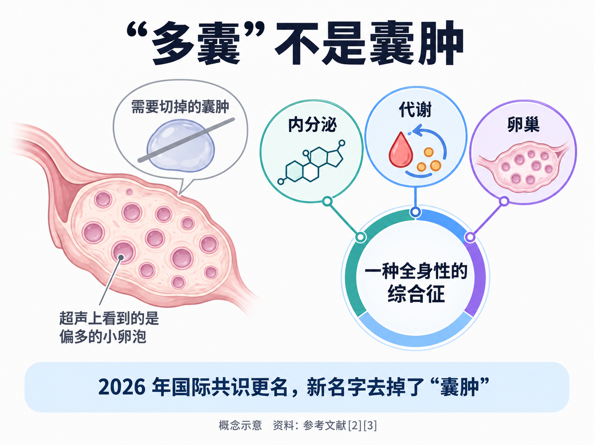
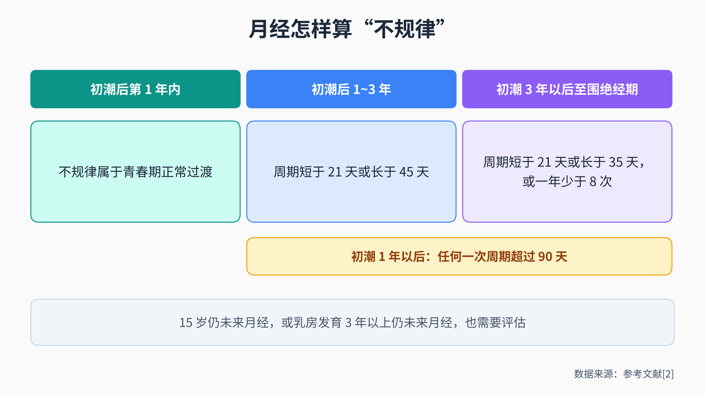
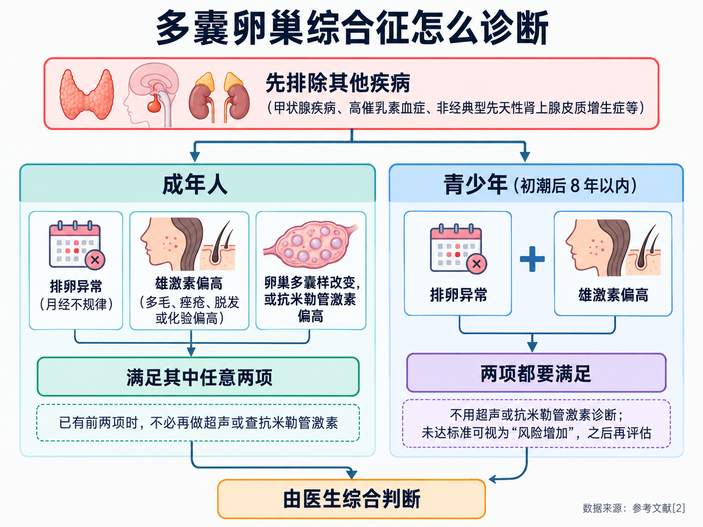
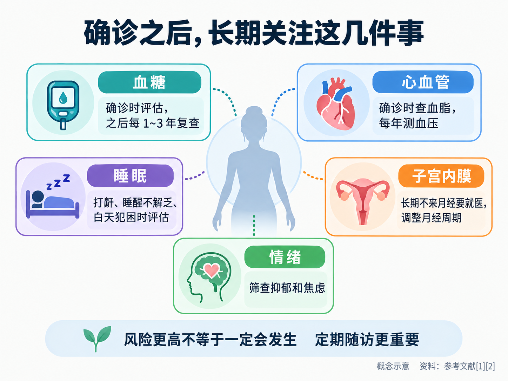

# 月经总推迟、长痘、体重难控制：多囊卵巢综合征是怎么回事

> 月经一推就是一两个月，脸上的痘反反复复，体重好像喝水都会涨。去医院做了个 B 超，报告上写着“卵巢多囊样改变”，心里一下子慌了：卵巢里长了好多囊肿？要不要手术？以后还能不能怀孕？其实，“多囊卵巢综合征”这个名字本身就很容易让人误会。这篇文章把它是什么、怎么诊断、和体重有什么关系、平时怎么调整、想要孩子时怎么办，以及长期要留意什么，一次讲清楚。

## 01 名字里的“多囊”，不是卵巢里长了囊肿

先认识一下这个名字：**PCOS = Polycystic Ovary Syndrome（多囊卵巢综合征）**。

它是一种很常见的病。世界卫生组织（WHO）估计，**育龄女性中约 10%~13% 受它影响**，而全世界**多达 70% 的患者并不知道自己有这个病** [1]。2023 年多囊卵巢综合征国际循证指南同样给出了 10%~13% 的全球患病率 [2]。我国中华医学会妇产科学分会内分泌学组制定的诊疗指南把它描述为一种**常见的生殖内分泌代谢性疾病**，会影响生活质量、生育和远期健康，而且每个人的表现差别很大 [4]。

问题出在名字上。“多囊”两个字让很多人以为卵巢里长满了需要切掉的囊肿。2026 年 5 月，国际上 56 个学术、临床和患者组织经过多轮全球调查与专家共识，在《柳叶刀》发表文章，把它更名为 **PMOS = Polyendocrine Metabolic Ovarian Syndrome**，字面意思是“多内分泌、代谢与卵巢综合征” [3]。更名的理由很直接：旧名字**暗示卵巢里有病理性囊肿，这并不准确**，还掩盖了它在内分泌和代谢方面的多种表现，容易造成诊断延误、看病“东一块西一块”和病耻感 [3]。新名字特意**去掉了“囊肿”**，把内分泌、代谢和卵巢三方面的问题都放了进去 [3]。

超声上看到的“多囊”，其实是卵巢里**直径 2~9 毫米的小卵泡数量偏多**，或者卵巢体积偏大 [2]，并不是需要手术切除的病理性囊肿 [3]。目前国内的诊疗指南用的仍是“多囊卵巢综合征”这个名字 [4]，本文也沿用它。

**记住一点：它不是“卵巢里长了东西”，而是一种牵涉激素和代谢的全身性问题。**

## 02 诊断主要看三件事，还要先排除别的病

2023 年国际指南规定，成年女性要诊断多囊卵巢综合征，需要在**排除其他原因之后**，满足以下三项中的**任意两项** [2]：

**第一，排卵异常，最常见的表现是月经不规律。**指南给“月经不规律”定了具体的标准 [2]：

- 初潮后第 1 年内：月经不规律属于青春期的正常过渡；
- 初潮后 1~3 年：周期短于 21 天或长于 45 天；
- 初潮 3 年以后直到围绝经期：周期短于 21 天或长于 35 天，或者一年少于 8 次；
- 初潮 1 年以后：任何一次周期超过 90 天；
- 另外，15 岁还没来月经，或者乳房开始发育 3 年以上还没来月经，也需要评估。

指南也提醒，**月经规律的人也可能存在排卵问题**，需要时医生可以通过抽血查孕酮来确认 [2]。

**第二，雄激素偏高的表现或化验结果。**表现包括多毛、痤疮和女性型脱发 [2]。其中，**多毛对判断最有价值**；只有痤疮或只有脱发、没有多毛时，提示作用相对弱一些 [2]。化验方面，指南推荐查总睾酮或游离睾酮等指标 [2]。需要注意，**正在吃复方口服避孕药会明显影响雄激素化验结果**，就诊时一定要告诉医生 [2]。

**第三，卵巢“多囊样”改变，或者抗米勒管激素（AMH）偏高。**成年人用经阴道超声时，单侧卵巢的卵泡数达到 20 个及以上，可以视为多囊样改变；如果设备较老或图像不够清楚，可以看卵巢体积是否达到 10 毫升及以上 [2]。抗米勒管激素是 2023 年版指南新加入的选项，可以代替超声来判断这一项，但**不能单独靠它诊断**，而且超声和抗米勒管激素**不需要两样都做**，以免过度诊断 [2]。

这里有两点常被忽略：

**其一，B 超看到“多囊样改变”不等于得了多囊卵巢综合征。**它只是三项之一。反过来，**如果已经同时有月经不规律和雄激素偏高的表现，就不需要再做超声或查抗米勒管激素**，已经可以考虑诊断 [2]。

**其二，必须先排除其他疾病。**甲状腺疾病、高催乳素血症、非经典型先天性肾上腺皮质增生症等也会引起类似表现，指南建议查促甲状腺激素、催乳素和 17-羟孕酮来排除；闭经或症状较重的人，还要进一步评估其他原因 [2]。

我国也有中华医学会妇产科学分会制定的《多囊卵巢综合征中国诊疗指南》，适用于青春期、育龄期和围绝经期患者 [4]。具体到每个人，医生会结合病史、体格检查和化验结果综合判断，**不建议自己对着标准“确诊”**。

## 03 青春期的女孩：别急着下结论

青春期是最容易“误诊”的阶段。初潮后的头几年，月经本来就可能不规律；这个年龄的卵巢在超声上也常常看起来“多囊”，和正常生理变化有很多重叠 [2]。

所以国际指南对青少年的要求更严格：**必须同时有排卵异常和雄激素偏高两项**；在**初潮后 8 年以内，不建议用超声或抗米勒管激素来诊断** [2]。

如果女孩有一些相关表现，但还达不到诊断标准，医生可以把她视为“风险增加”，**在初潮后 8 年左右或之前再评估一次** [2]。指南特别提到几种需要复查的情况：在开始吃复方口服避孕药之前就已经有相关表现的、表现一直持续的，以及青春期体重增加明显的 [2]。

对家长来说，要不要、什么时候给孩子做评估和诊断，可以和医生一起商量，同时顾及孩子的心理感受 [2]。

## 04 和体重、代谢是什么关系

很多患者都有一个困扰：明明吃得不多，体重却总往上走。

指南的说法比较客观：**目前没有一致的证据表明，多囊卵巢综合征患者在生活习惯上和其他人有什么不同** [2]；但许多患者**身体里存在一些推动体重逐年增加的机制**，具体机制还不完全清楚，这也让体重管理更难 [2]。所以，**体重难控制不一定是“不够自律”**。指南还专门提醒医生注意体重偏见和病耻感，在称体重前先征得本人同意 [2]。

**胰岛素抵抗**是多囊卵巢综合征发病机制中的一个因素 [2]，简单说，就是身体对胰岛素“不太敏感”。但指南**不建议在日常诊疗中常规化验胰岛素水平**，因为现有的检测方法临床意义有限 [2]。

更值得关注的是血糖：**无论年龄大小、胖还是不胖，多囊卵巢综合征患者发生空腹血糖受损、糖耐量异常和 2 型糖尿病的风险都更高** [2]。因此，**瘦的患者也不能忽视代谢问题**。

## 05 生活方式调整：不只是为了减重

无论胖瘦，**健康的生活方式都是管理多囊卵巢综合征的核心** [2]。WHO 也指出，健康饮食和规律运动对所有患者都有意义，**即使体重没有下降也是如此** [1]。

**饮食：没有哪一种“多囊专属食谱”。**指南认为，多种饮食和运动方式都有好处，**没有证据表明某一种方案比其他方案更好** [2]。选自己能长期坚持的方式，比追逐某种流行饮食更重要。

**运动：动一点总比不动好。**指南沿用一般人群的运动建议 [2]：

- 成年人（18~64 岁）为了保持健康、防止体重增加，每周至少进行 **150~300 分钟中等强度**或 **75~150 分钟高强度**有氧运动（或两者组合），另外每周有两天（不连续）做肌肉力量练习；
- 如果想适度减重、防止体重反弹，每周至少 **250 分钟中等强度**或 **150 分钟高强度**运动；
- 青少年每天至少 **60 分钟**中等到高强度活动；
- 尽量减少久坐，用任何强度的活动替代久坐时间都有好处。

**体重：重在不继续增加。**对体重偏高的人，体重管理可以带来明显的健康改善；即使目标是减重，也更强调**终身防止体重继续增加**、改善腰围等中心性肥胖指标，而不是一味追求体重秤上的数字 [2]。体重不高的人和青少年，重点是保持健康习惯、防止体重过度增加 [2]。

**需要用药时，由医生根据目标来选。**多囊卵巢综合征目前**还不能根治**，治疗的目的是改善症状、帮助生育和降低远期风险 [1]。按国际指南 [2]：

- 调整月经周期、改善多毛等高雄激素表现，**复方口服避孕药是首选的药物**，没有指定的品种，倾向于剂量较低、副作用较少的；
- **二甲双胍主要用于改善代谢方面的问题**，效果优于肌醇；肌醇的临床获益有限；
- 多毛可以考虑激光脱毛，抗雄激素药物只在其他方法无效或不适合时使用；
- 抗雄激素药物可能影响胎儿发育，**可能怀孕的女性使用时需要同时做好避孕** [2]。

具体用不用药、用哪一种，要在医生评估后共同决定，**不要自行购买激素类药物**，也不要轻信“调理多囊”的保健品宣传。

## 06 有生育计划时怎么办

“多囊是不是就怀不上了？”这是很多人最担心的问题。指南的态度很明确：**多囊卵巢综合征患者往往可以成功怀孕，有的自然怀孕，有的借助治疗** [2]。

**怀孕前，先把身体状态调好。**指南建议，和常规孕前保健一样，关注体重、血压、吸烟、饮酒、饮食营养、叶酸补充、运动、睡眠和心理健康 [2]。几项检查尤其重要 [2]：

- **备孕或准备做助孕治疗时，建议做口服葡萄糖耐量试验**，因为孕期高血糖的风险较高；孕前没做的，可以在第一次产检时做，并且所有患者在**孕 24~28 周**都应做这项检查；
- **备孕时量血压**，因为孕期高血压疾病的风险较高；
- 叶酸剂量请遵医嘱，国际指南提到体重指数超过 30 的女性可能需要更高剂量。

**需要促排卵时，有多种选择。**对于只是因为不排卵而不孕、没有其他不孕因素的患者，国际指南把**来曲唑列为首选的促排卵药物**，克罗米芬等作为二线选择，试管婴儿等辅助生殖技术一般放在其他促排卵方法无效之后 [2]。需要说明的是，**来曲唑用于促排卵在很多国家仍属于说明书以外的用法**，医生会向患者说明证据和可能的顾虑 [2]。开始促排卵之前，要先确认没有怀孕 [2]。这些都需要在妇科或生殖医学科医生的指导下进行。

**怀孕后，要让产检医生知道你有多囊卵巢综合征。**指南把它视为**高风险妊娠**，患者孕期出现以下情况的风险更高：孕期体重增加过多、流产、妊娠期糖尿病、妊娠期高血压和子痫前期、胎儿生长受限和低出生体重、早产、剖宫产 [2]。风险更高不等于一定会发生，提前告知医生、按时产检，就能得到相应的监测和支持。指南也提到，**二甲双胍不常规推荐用于孕期** [2]。

## 07 长期要关注哪些健康风险

多囊卵巢综合征不只是“月经和生育”的问题，它和多种长期健康风险**相关**。下面这些风险“更高”，指的是和没有这个病的女性相比，并不意味着每个人都会出现 [1][2]。

**糖尿病：确诊时就查血糖，之后定期复查。**指南建议所有成年和青少年患者在确诊时评估血糖情况，之后**每 1~3 年复查一次**，具体间隔根据其他糖尿病风险因素决定 [2]。口服葡萄糖耐量试验是评估血糖最准确的方法 [2]。

**心血管：查血脂，每年量血压。**患者心血管疾病的风险被认为更高，但**绝经前女性心血管病的总体风险本身较低** [2]。指南建议确诊时查一次血脂，**每年测一次血压** [2]。

**睡眠：打鼾、睡醒不解乏要说出来。**患者阻塞性睡眠呼吸暂停更常见，而且和胖瘦无关 [2]。如果有打鼾、醒来仍觉得没睡好、白天犯困或疲劳，可以告诉医生做进一步评估 [2]。

**子宫内膜：长期不来月经别拖着。**绝经前的患者发生子宫内膜增生和子宫内膜癌的风险明显更高，**但发生子宫内膜癌的总体概率仍然较低，所以不建议常规筛查** [2]。长期不来月经又没有治疗、体重偏高、患有 2 型糖尿病、子宫内膜持续增厚，都会让风险进一步升高 [2]。控制体重、调整月经周期、规律使用孕激素等，都是预防的办法 [2]。

**情绪：焦虑和抑郁值得认真对待。**多囊卵巢综合征患者中，中重度抑郁和焦虑症状很常见，指南建议对所有患者进行抑郁筛查，对成年患者进行焦虑筛查 [2]。WHO 也提到，进食障碍和对自己身体形象的负面感受同样需要关注 [1]。**情绪困扰不是“想太多”，可以直接和医生说。**

此外，WHO 还列出了代谢相关的脂肪性肝炎、高血压和高胆固醇等问题 [1]。这些听起来很多，但核心就是一句话：**确诊之后，把它当成需要长期管理的慢性问题，定期做该做的检查。**

## 08 什么时候去医院，看哪个科

出现以下情况，建议到医院**妇科**（有条件的可以看**妇科内分泌**专科）就诊 [1][2][5]：

- 月经经常推迟、一年来不到 8 次，或者某一次超过 3 个月不来；
- 面部或身体毛发明显增多，或者痤疮、皮肤油腻、脱发持续困扰；
- 体重增加或很难减下来，或者脖子、腋下出现发黑发厚的皮肤；
- 备孕一段时间还没有怀上；
- 这些症状已经影响到日常生活、工作或情绪 [5]。

已经确诊的人，血糖、血脂等代谢问题可以同时在**内分泌科**随访；有生育需求、需要促排卵时，可以到**生殖医学科**就诊。

就诊前，可以先记录最近半年到一年的月经情况（每次哪天开始、持续几天）、体重变化、正在服用的药物（尤其是避孕药），这些信息能帮医生更快作出判断。

多囊卵巢综合征不是一个让人害怕的“囊肿病”，也不是一句“少吃多动”就能打发的小毛病。认识它，早一点诊断，长期好好管理，大多数人都能把它对生活和健康的影响降到最低。

---

## 参考文献

[1] World Health Organization. [Polycystic ovary syndrome](https://www.who.int/news-room/fact-sheets/detail/polycystic-ovary-syndrome). 官方事实清单（2026-01-22），访问日期：2026-10-20.

[2] Teede HJ, Tay CT, Laven JJE, et al. [Recommendations From the 2023 International Evidence-based Guideline for the Assessment and Management of Polycystic Ovary Syndrome](https://doi.org/10.1210/clinem/dgad463). Journal of Clinical Endocrinology and Metabolism, 2023, 108(10): 2447-2469. 国际循证指南，访问日期：2026-10-20.

[3] Teede HJ, Khomami MB, Morman R, et al. [Polyendocrine metabolic ovarian syndrome, the new name for polycystic ovary syndrome: a multistep global consensus process](https://doi.org/10.1016/S0140-6736(26)00717-8). The Lancet, 2026, 407(10545): 2329-2339. 全球共识研究，访问日期：2026-10-20.

[4] 中华医学会妇产科学分会内分泌学组及指南专家组. [多囊卵巢综合征中国诊疗指南](https://med.wanfangdata.com.cn/Paper/Detail?id=PeriodicalPaper_zhfck201801002). 中华妇产科杂志, 2018, 53(1): 2-6. 临床指南，访问日期：2026-10-20.

[5] NHS. [Polyendocrine metabolic ovarian syndrome (PMOS)](https://www.nhs.uk/conditions/polycystic-ovary-syndrome-pcos/). 官方健康信息（2026-06-30 审阅），访问日期：2026-10-20.

*本文为健康科普，不能替代个人诊疗意见。月经不规律、多毛痤疮、备孕困难等情况，请到妇科或妇科内分泌专科就诊；血糖、血脂等代谢问题可到内分泌科随访，有生育需求可到生殖医学科就诊；所有药物的使用请遵医嘱。*
