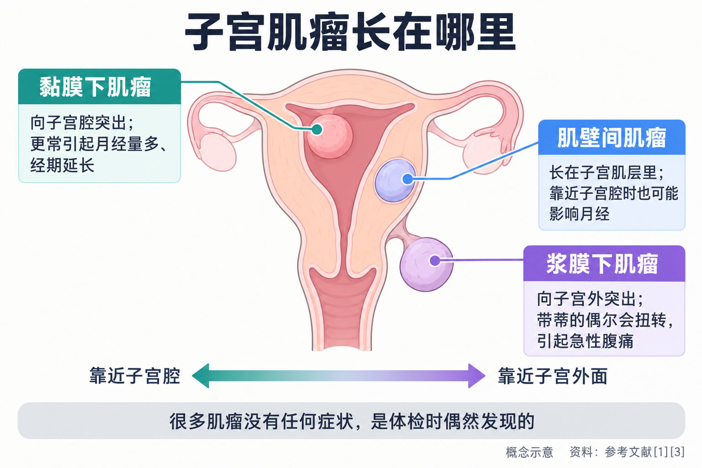
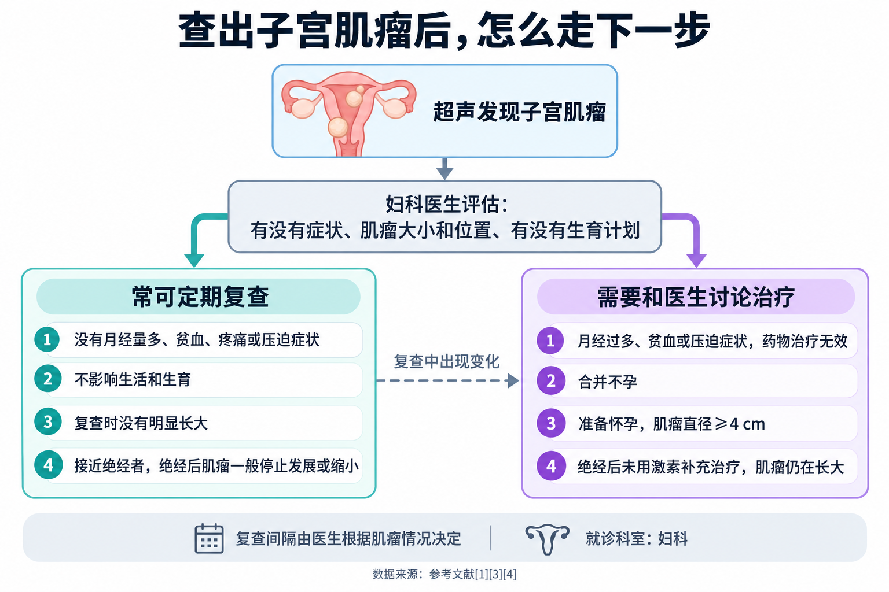
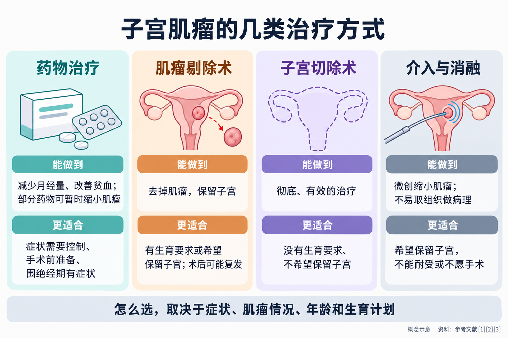

# 查出子宫肌瘤，一定要切吗？

> 体检做了个妇科超声，报告上写着“子宫肌层低回声结节，考虑子宫肌瘤”。有人一看“瘤”字就慌了：是不是肿瘤？要不要马上做手术？也有人听说“肌瘤不用管”，就再也没复查过。其实，子宫肌瘤非常常见，绝大多数是良性的，很多人可以只是定期复查；但也有一些情况确实需要治疗。这篇文章讲清楚：肌瘤是什么、哪些可以先观察、哪些需要处理、各种治疗方式适合谁，以及备孕和快绝经时要考虑什么。

## 01 子宫肌瘤很常见，绝大多数是良性的

子宫肌瘤，是**子宫平滑肌组织增生形成的良性肿瘤**，也是女性最常见的良性肿瘤 [1]。名字里虽然有个“瘤”字，但它和人们担心的“癌”不是一回事。

它有多常见？《子宫肌瘤的诊治中国专家共识》估计，**育龄期女性的患病率可达 25%，尸体解剖统计的发病率可达 50% 以上** [1]。国外一项随机抽取 35~49 岁女性做超声筛查的研究发现，到 50 岁时，白人女性中约有**近 70%**、黑人女性中**超过 80%** 曾长过子宫肌瘤 [5]。不同研究得到的数字差别很大，一项纳入 60 篇文献的系统综述显示，患病率从 4.5% 到 68.6% 不等，主要取决于研究人群和检查方法 [6]。共同的结论是：**很多女性一生中都会遇到它，其中不少人自己并不知道。**

和肌瘤有关的因素包括：年龄超过 40 岁、初潮早、没有生育过或生育晚、肥胖、多囊卵巢综合征、使用激素补充治疗、有子宫肌瘤家族史等 [1]。这些因素与风险增加有关，但具体为什么会长，目前**确切病因还不清楚** [1]。

肌瘤会不会变成恶性？专家共识指出，已有肌瘤发生恶变的比例**一般认为不到 0.5%** [1]；国内 30 家医院 33723 例子宫肌瘤剔除术中，术后病理发现子宫肉瘤的比例为 **0.18%** [1]。所以，**查出肌瘤不必恐慌**，但也不是“永远不用管”——医生会特别留意一些少见但重要的信号，比如**绝经后肌瘤还在长、肌瘤短期内长得很快**，这些情况需要进一步评估 [1]。

## 02 长在哪里，比长多大更影响症状

同样是肌瘤，有人毫无感觉，有人却月经量大到贫血。差别很大程度上取决于**它长在哪里**。

按和子宫壁的关系，肌瘤主要分为几类 [1]：

- **黏膜下肌瘤**：向子宫腔里突出，贴着子宫内膜长；
- **肌壁间肌瘤**：长在子宫的肌肉层里；
- **浆膜下肌瘤**：向子宫外面突出，有的还带着一个“蒂”；
- 少数长在子宫颈或阔韧带等特殊部位。

医生常用国际妇产科联盟的 0~8 型分类来描述肌瘤的确切位置，**数字越小，越靠近子宫腔** [1]。专家共识指出，**月经改变常见于 0 型到 3 型肌瘤**，也就是靠近子宫腔的肌瘤，表现为月经量增多、经期延长、淋漓不尽或周期缩短，可能因此导致贫血 [1]。

其他可能的表现还有 [1][3]：

- 肌瘤较大时，可能在小腹摸到包块，压迫膀胱时尿频，压迫直肠时排便不畅；
- 黏膜下肌瘤可能引起痛经；
- 带蒂的浆膜下肌瘤发生扭转，或者肌瘤发生“红色变性”时，可能出现急性腹痛，后者还可能伴发热；
- 影响子宫腔形态或压迫输卵管时，可能和不孕有关。

但需要强调：**很多肌瘤没有任何症状**，是体检时偶然发现的 [1][3][4]。

**怎么查？**超声是诊断子宫肌瘤最常用的方法，其中**经阴道超声最常用**；没有性生活的女性可以做经腹部或经直肠超声 [1]。需要更准确地了解肌瘤数目、位置和与子宫腔的关系时，医生可能会安排磁共振检查 [1]。

## 03 哪些情况可以先观察，定期复查就行

对很多人来说，查出肌瘤后最重要的问题是：**能不能不治？**

英国国家医疗服务体系（NHS）明确指出，**如果肌瘤没有引起症状，通常不需要治疗** [3]。美国卫生与公众服务部妇女健康办公室也给出了同样的建议：**有肌瘤但没有症状，可能不需要治疗**，医生会在定期检查时看它有没有长大 [4]。

一般来说，下面这样的情况，**常常可以在医生评估后定期复查**：

- 没有月经量多、贫血、明显疼痛或压迫症状；
- 肌瘤不影响生活，也没有影响生育的问题；
- 复查时没有明显、快速地长大；
- 尤其是**已经接近绝经**的女性——绝经后肌瘤一般会停止发展或缩小 [1][4]。

复查多久做一次、做什么检查，要由医生根据肌瘤的大小、位置和变化决定，没有放之四海而皆准的间隔。复查的意义在于**看它有没有变化、有没有出现症状**，而不是“查出来就必须做点什么”。

相反，出现下面这些情况时，就需要和医生认真讨论治疗了。专家共识列出的手术适应证包括 [1]：

- 肌瘤导致**月经过多、异常出血甚至贫血**，或者压迫膀胱、直肠、神经等出现症状，**经药物治疗无效**；
- 子宫肌瘤合并**不孕**；
- **准备怀孕**时，肌瘤直径 **≥4 cm**，建议剔除；
- **绝经后没有用激素补充治疗，但肌瘤仍在长大**。

NHS 的说法也类似：药物不起作用、肌瘤太大或症状越来越重时，可能需要手术 [3]。

**以下情况请尽早去妇科就诊** [1][3]：

- 月经量明显增多、经期拉长，或出现头晕、乏力、心慌等贫血表现；
- 尿频、排尿困难、便秘等压迫症状，或症状已经影响工作和生活；
- 突然出现剧烈腹痛，或腹痛伴发热；
- 绝经后又出现阴道出血，或者复查发现肌瘤明显长大。

## 04 治疗方式：药物、手术和其他方法各适合谁

需要治疗时，选择很多。美国妇产科医师学会（ACOG）在 2021 年的实践公告中指出，子宫切除虽然是彻底、有效的治疗，但**许多患者因为希望将来生育或想保留子宫，会寻求子宫切除以外的选择**，并从中获益 [2]。具体怎么选，取决于症状、肌瘤的大小、数目和位置、年龄、有没有生育计划，以及本人的意愿 [1][3]。

**药物治疗：分两类，作用不一样。**专家共识把治疗肌瘤的药物分成两大类 [1]：

| 类别 | 常用药物（通用名） | 能做到什么 | 局限 |
|---|---|---|---|
| 主要改善月经量多 | 非甾体抗炎药、氨甲环酸、复方口服避孕药、左炔诺孕酮宫内缓释系统 | 减少月经量、缓解痛经 | **不能缩小肌瘤** |
| 既能改善症状又能缩小肌瘤 | 促性腺激素释放激素激动剂、米非司酮 | 改善贫血、缩小肌瘤和子宫 | 有低雌激素等不良反应；**停药后肌瘤往往会再长回来** |

以促性腺激素释放激素激动剂为例，它通过抑制卵巢功能起作用。专家共识提到，**治疗 3 个月时子宫体积平均缩小约 50%**，但超过 70% 的患者会出现不良反应，主要是低雌激素症状；**停药后 3~6 个月，随着卵巢功能恢复，肌瘤往往会“反弹”到治疗前的大小** [1]。因此，要维持效果需要持续用药，这类药物常用于**手术前缩小肌瘤、纠正贫血**，为手术做准备 [1]。米非司酮也多用于术前预处理或围绝经期有症状的患者，用药时间更长时的安全性还需要进一步研究 [1]。

药物是否适合你、用多久，需要医生评估后决定，**不要自行购买激素类药物使用**。

**手术治疗：保留子宫，还是切除子宫。**

- **肌瘤剔除术**：只切掉肌瘤，保留子宫，适合**有生育要求或希望保留子宫**的女性 [1]。可以经腹腔镜、开腹或经阴道完成；**向子宫腔突出的黏膜下肌瘤，符合条件的可以用宫腔镜切除**，腹部没有切口 [1]。它的局限是会复发：专家共识指出，远期随访中**术后复发率接近 50%，约 1/3 的患者最终需要再次手术** [1]。
- **子宫切除术**：适合**没有生育要求、不希望保留子宫**的女性，是彻底、有效的治疗方式 [1][2]。

**其他微创方法**：比如**子宫动脉栓塞术**（通过血管介入阻断肌瘤的血液供应，让它缩小）[1][3]、**高强度聚焦超声消融**（把超声能量聚焦到肌瘤内部，让组织凝固坏死）[1] 等。专家共识指出，它们适用于要求保留子宫的女性，尤其是不能耐受或不愿意手术的人 [1]；子宫动脉栓塞也适合**剔除术后复发、做过多次腹部手术**的女性 [1]。这些方法多数创伤更小，但**不容易取到肌瘤组织做病理检查**，各有优势和局限 [1]。此外，宫腔镜下子宫内膜切除等方法主要用于控制月经过多，并不能去掉肌瘤 [1]。

一句话概括：**药物多是“控制症状”或“为手术做准备”，剔除术“去掉肌瘤、保留子宫”，子宫切除“彻底但失去子宫”，介入和消融“微创缩小肌瘤”。**没有哪一种对所有人都最好。

## 05 有生育计划时：先评估肌瘤会不会“碍事”

对想要孩子的女性，问题会更具体：肌瘤会不会影响怀孕？要不要先切掉？

**肌瘤的位置是关键。**美国生殖医学学会 2017 年的指南认为，目前**没有足够证据说明“有肌瘤”本身会降低怀孕的可能**；但对于**让子宫腔变形的肌瘤**（肌壁间肌瘤向子宫腔突出，或带有黏膜下成分），剔除后可以提高怀孕率、降低早期流产风险，证据等级为“尚可”[7]。对没有症状但让子宫腔变形的肌瘤，可以考虑剔除，以改善妊娠结局 [7]。

国内专家共识的建议是：子宫肌瘤合并不孕时可考虑手术；**准备怀孕时，肌瘤直径 ≥4 cm 建议剔除** [1]。可以看到，国内外指南判断的角度不同：美国指南更看重**肌瘤是否让子宫腔变形**，国内共识还给出了**直径的参考线**。具体到个人，还要结合年龄、卵巢功能、肌瘤数目等，由妇科或生殖医学科医生综合判断。

**剔除术后，不能马上怀孕。**子宫上的伤口需要时间愈合。专家共识建议根据肌瘤类型确定术后避孕时间：**0 型、1 型和 7 型肌瘤避孕 3 个月；2 型到 6 型及 8 型避孕 6~12 个月** [1]。术前要和医生充分沟通，了解手术对生育结局的可能影响和日后妊娠时子宫破裂的风险 [1]。

**怀孕后发现肌瘤，大多数也能平稳度过。**专家共识提到，妊娠合并子宫肌瘤的估计发生率为 0.1%~3.9%，**多数孕妇孕期平稳** [1]。孕期激素水平升高，肌瘤可能长大，**体积增大多发生在孕 20 周以内**；部分孕妇可能出现肌瘤变性引起的疼痛、阴道出血、早产等并发症 [1]。因此，孕期发现肌瘤应**按高危孕妇管理，定期监测肌瘤大小、与胎盘的关系和母儿情况**，绝大多数不需要特殊处理 [1]。美国妇女健康办公室也指出，有肌瘤的女性孕期和分娩时出现问题的可能更大，但**大多数仍能正常怀孕** [4]。

## 06 快绝经了，肌瘤会怎样

子宫肌瘤的生长和性激素有关。专家共识指出，肌瘤**青春期前少见，绝经后发展停止或缩小** [1]；美国妇女健康办公室也说，**绝经后肌瘤通常会缩小** [4]。

这意味着两件事：

**第一，快绝经的女性，如果肌瘤没有症状，常常可以先观察。**有症状时，医生也可能先考虑药物控制症状，比如米非司酮在临床上多用于围绝经期有症状的患者 [1]。

**第二，绝经后的“反常”要重视。**专家共识把**绝经后没有用激素补充治疗、但肌瘤仍在长大**列为手术指征 [1]，并指出恶性风险与**绝经后、肌瘤生长快、超声显示肌瘤血流丰富**等有关 [1]。另外，激素补充治疗可能让肌瘤长大 [1]，正在或打算使用激素补充治疗的女性，应告诉医生自己有肌瘤，按医嘱复查。绝经后再次出现阴道出血，**不要想当然地归咎于肌瘤**，应及时到妇科就诊，查明原因。

查出子宫肌瘤，不必一听“瘤”就慌，也不能从此不闻不问。弄清它长在哪、有没有症状、自己有没有生育计划，和妇科医生一起决定是观察还是治疗，才是最适合自己的那条路。

---

## 参考文献

[1] 子宫肌瘤的诊治中国专家共识专家组. [子宫肌瘤的诊治中国专家共识](https://doi.org/10.3760/cma.j.issn.0529-567x.2017.12.001). 中华妇产科杂志, 2017, 52(12): 793-800. 专家共识，访问日期：2026-10-28.

[2] American College of Obstetricians and Gynecologists. [Management of Symptomatic Uterine Leiomyomas: ACOG Practice Bulletin, Number 228](https://doi.org/10.1097/AOG.0000000000004401). Obstetrics & Gynecology, 2021, 137(6): e100-e115. 实践公告（依据摘要），访问日期：2026-10-28.

[3] NHS. [Fibroids](https://www.nhs.uk/conditions/fibroids/). 英国国家医疗服务体系健康信息（2026-03-17 审阅），访问日期：2026-10-28.

[4] Office on Women's Health, U.S. Department of Health and Human Services. [Uterine fibroids](https://www.womenshealth.gov/a-z-topics/uterine-fibroids). 美国卫生与公众服务部妇女健康办公室健康信息（2025-02-28 更新），访问日期：2026-10-28.

[5] Baird DD, Dunson DB, Hill MC, Cousins D, Schectman JM. [High cumulative incidence of uterine leiomyoma in black and white women: ultrasound evidence](https://doi.org/10.1067/mob.2003.99). American Journal of Obstetrics and Gynecology, 2003, 188(1): 100-107. 原始研究，访问日期：2026-10-28.

[6] Stewart EA, Cookson CL, Gandolfo RA, Schulze-Rath R. [Epidemiology of uterine fibroids: a systematic review](https://doi.org/10.1111/1471-0528.14640). BJOG, 2017, 124(10): 1501-1512. 系统综述，访问日期：2026-10-28.

[7] Practice Committee of the American Society for Reproductive Medicine. [Removal of myomas in asymptomatic patients to improve fertility and/or reduce miscarriage rate: a guideline](https://doi.org/10.1016/j.fertnstert.2017.06.034). Fertility and Sterility, 2017, 108(3): 416-425. 临床指南（依据摘要），访问日期：2026-10-28.

*本文为健康科普，不能替代个人诊疗意见。是否需要治疗、选择哪种治疗方式，请到妇科由医生结合症状、肌瘤情况和生育计划评估决定；有生育计划者可同时咨询生殖医学科；激素类药物请遵医嘱使用。*
