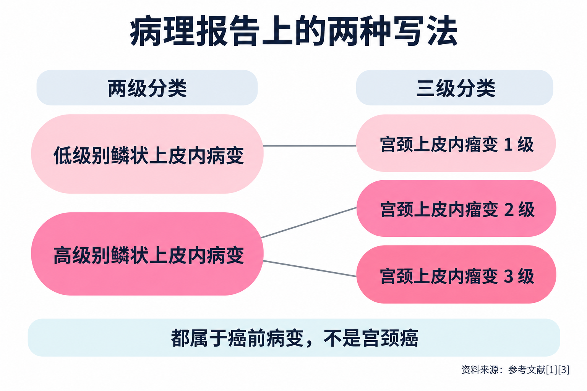

# 宫颈活检报告上写着“低级别”“高级别”，是什么意思？

> 做完阴道镜、取了活检，等了好几天，拿到的病理报告上写着“低级别鳞状上皮内病变”或者“高级别鳞状上皮内病变”，后面可能还跟着括号里的“CIN 2”，再往下是一串 p16、Ki-67。很多人第一反应是：这是不是癌？要不要马上手术？这篇是医荟她健康整理的读者常见问题，回答依据国内外的专业共识、指南和研究，帮你先把报告读懂，再带着问题去找医生。

**读者问：** 报告上的“低级别”“高级别”到底是什么意思？

**医荟她答：** 它们是病理医生给宫颈鳞状上皮异常改变分的两个等级：**LSIL = Low-grade Squamous Intraepithelial Lesion（低级别鳞状上皮内病变）**，**HSIL = High-grade Squamous Intraepithelial Lesion（高级别鳞状上皮内病变）**。

2012 年，美国病理学家学会和美国阴道镜与宫颈病理学会联合 35 个相关组织，推荐用“低级别”“高级别”这套两级说法描述人乳头瘤病毒相关的鳞状上皮病变，和细胞学报告的用词对应起来，临床医生更容易对照理解 [3]。

简单说：**低级别更像是病毒感染留下的痕迹，高级别才是需要认真对待的癌前病变** [1][2]。

**读者问：** 括号里写的“宫颈上皮内瘤变 1 级、2 级、3 级”，和“低级别”“高级别”是什么关系？

**医荟她答：** 这是更早的一套三级分法，**CIN = Cervical Intraepithelial Neoplasia（宫颈上皮内瘤变）**。两套说法的对应关系是 [1]：

- 低级别鳞状上皮内病变，相当于宫颈上皮内瘤变 1 级；
- 高级别鳞状上皮内病变，包括宫颈上皮内瘤变 2 级和 3 级。

所以报告上常见“高级别鳞状上皮内病变（CIN 2）”这样的写法，括号里的数字是进一步说明 [3]。国内共识也建议，病理报告要写明“高级别鳞状上皮内病变 / 宫颈上皮内瘤变 2 级”，并注明标本是活检还是锥切 [1]。

**这个括号很重要**：同样是“高级别”，2 级和 3 级的处理思路并不一样，后面会讲到。

**读者问：** 是不是查出来就是宫颈癌了？

**医荟她答：** **不是。** 这两类都属于“上皮内病变”，也就是宫颈癌前病变，不是宫颈癌 [1]。

其中，宫颈上皮内瘤变 3 级被认为是宫颈癌的直接前身，所以需要治疗 [2]；2 级有相当一部分会自己消退，1 级的消退比例更高 [2]。发现它们的意义正在于：在变成癌之前，有足够的时间处理。

**读者问：** 低级别（1 级）需要治疗吗？

**医荟她答：** 多数情况下**不需要马上治疗，以定期复查为主**。

美国阴道镜与宫颈病理学会 2019 年的风险管理指南认为，组织学的低级别病变本质上是人乳头瘤病毒感染在组织上的表现，消退率高，年轻人尤其如此，之后查出 2 级及以上病变并不常见；对 1 级病变，**观察优于治疗**。25 岁及以上、连续至少 2 年都诊断为 1 级的，仍首选观察，治疗也可以接受 [2]。

有一种情况要多留个心：如果之前的细胞学结果是“高级别鳞状上皮内病变”，而活检只看到低级别，医生会更谨慎，可能建议直接做诊断性锥切；在阴道镜下看得清楚等条件合适时，也可以 1 年后复查人乳头瘤病毒检测和阴道镜 [2]。

**读者问：** 高级别是不是就一定要手术？

**医荟她答：** 要看括号里是几级，也要看年龄和其他情况。

**3 级**：美国指南明确建议**治疗**，不建议观察（孕期除外）[2]；国内共识也把随访中查出 3 级及以上病变列为切除性治疗的指征 [1]。

**2 级**：可以分情况考虑。2026 年《宫颈上皮内瘤变 2 级管理中国专家共识》的推荐是 [1]：

- 25 岁以下，优先推荐保守观察，治疗也是可接受的选择；
- 25 岁及以上、有生育需求的，如果阴道镜下鳞柱交界和病变上界都看得清、宫颈管里没有 2 级病变、以前没治疗过，而且能按时随访，可以选择保守观察；
- 病变面积大（累及超过 2 个象限）、人乳头瘤病毒 16 或 18 型持续阳性、细胞学高度异常的，持续或进展的风险高，保守观察要慎重。

美国 2019 年指南的思路略有不同：25 岁及以上的 2 级病变**一般建议治疗**，只有当本人对治疗影响将来怀孕的顾虑超过对癌症的担心时，才可以选择观察；25 岁以下则首选观察 [2]。两边都强调，**鳞柱交界或病变上界看不全时，不适合观察** [1][2]。

**读者问：** 2 级病变不治，真的会自己好吗？

**医荟她答：** 相当一部分会。

一项纳入 36 项研究、3160 名女性的系统评价和荟萃分析发现，未经治疗、在密切随访下的 2 级病变，**24 个月时约 50% 消退，32% 持续存在，18% 进展**；30 岁以下女性中，消退约 60%，进展约 11% [4]。国内研究中，育龄期 2 级病变患者随访 3～66 个月，63%～78.6% 消退，12.2%～15% 进展为 3 级，均未发现进展为宫颈癌 [1]。

需要说明的是，这些都是**在医生密切随访下**观察到的结果。随访本身就是安全的前提，不能把它理解成“放着不管也会好”。

**读者问：** 选择观察，是不是就什么都不用做了？

**医荟她答：** 恰恰相反，**观察是一种需要严格执行的管理方式**。

按照国内共识，选择保守观察前，医生要先排除腺上皮病变和可疑浸润癌，讲清楚观察的目标、阴道镜可能漏诊的风险、病变持续或进展的风险，并签署知情同意书 [1]。之后通常在 6 个月和 12 个月时复查：25 岁以下做细胞学检查，25 岁及以上做以人乳头瘤病毒检测为基础的检查，同时做阴道镜评估 [1]。

出现以下情况就要结束观察，通常改做宫颈切除性治疗 [1]：

- 任何一次复查发现 3 级或更重的病变；
- 2 级病变持续 2 年没有消退；
- 病变范围扩大、伸进宫颈管，或者阴道镜下看不清病变上界、鳞柱交界。

病变消退、降级以后，也不是一劳永逸：之后每年复查一次，结果阴性的再连续每年查 2 年，然后改为每 3 年一次，**至少随访 25 年** [1]。

**读者问：** 报告上还有 p16、Ki-67，这些又是什么？

**医荟她答：** 这是病理科加做的免疫组化染色，帮助判断病变级别。

当显微镜下的形态看起来像 2 级病变时，病理学界推荐加做 p16 染色来帮助分级 [3]。国内共识指出，几乎所有 2 级病变 p16 都呈大片状强阳性；但也有 20%～40% 的 1 级病变 p16 阳性，所以**不能只凭 p16 阳性就诊断为 2 级**，要结合形态和人乳头瘤病毒检测结果综合判断 [1]。Ki-67 反映细胞增殖的活跃程度，2 级病变的阳性细胞会延伸到上皮中上层，但目前还没有统一的诊断界值 [1]。

另外，现有研究显示，这些指标**对 2 级病变将来是消退还是进展，没有明确的预测价值** [1]。所以不必盯着某一项染色结果反复琢磨，后续怎么处理，要由医生综合年龄、其他检查结果等决定。

**读者问：** 拿到报告，接下来该怎么做？

**医荟她答：** 可以按下面几步来：

1. **带齐资料去妇科或宫颈门诊、阴道镜门诊**：细胞学、人乳头瘤病毒检测、阴道镜和病理报告都带上，医生需要放在一起看。
2. **主动告诉医生你的情况**：年龄、有没有生育计划、以前是否治疗过宫颈病变、是否怀孕。这些都会影响选择观察还是治疗 [1][2]。
3. **怀孕期间查出 2 级病变**：一般以随访为主，产后再评估 [1]。
4. **绝经后查出 2 级病变**：国内共识首选切除性治疗 [1]。
5. **不论选择观察还是治疗，都要按时复查**，这是整个管理里最关键的一环。

病理报告上的每一个字都有它的意思，但它只是诊疗的起点。读懂它，是为了和医生商量时心里更有底，而不是自己吓自己。

---

## 参考文献

[1] 中国优生科学协会阴道镜和宫颈病理学分会，中华医学会妇科肿瘤学分会. [子宫颈上皮内瘤变 2 级（CIN 2）管理中国专家共识（2026 版）](https://www.obgyncn.com/CN/10.13390/j.issn.1672-1861.2026.01.030). 中国妇产科临床杂志，2026，27(1)：89-98. 专家共识，访问日期：2026-10-27.

[2] Perkins RB, Guido RS, Castle PE, et al. [2019 ASCCP Risk-Based Management Consensus Guidelines for Abnormal Cervical Cancer Screening Tests and Cancer Precursors](https://doi.org/10.1097/LGT.0000000000000525). J Low Genit Tract Dis，2020，24(2)：102-131. 指南，访问日期：2026-10-27.

[3] Waxman AG, Chelmow D, Darragh TM, et al. [Revised terminology for cervical histopathology and its implications for management of high-grade squamous intraepithelial lesions of the cervix](https://doi.org/10.1097/AOG.0b013e31827001d5). Obstet Gynecol，2012，120(6)：1465-1471. 综述，访问日期：2026-10-27.

[4] Tainio K, Athanasiou A, Tikkinen KAO, et al. [Clinical course of untreated cervical intraepithelial neoplasia grade 2 under active surveillance: systematic review and meta-analysis](https://doi.org/10.1136/bmj.k499). BMJ，2018，360：k499. 系统评价与荟萃分析，访问日期：2026-10-27.

*本文为健康科普，按读者常见问题整理，不能替代个人诊疗意见。宫颈病变是否需要治疗、选择哪种方式，请到妇科（宫颈门诊或阴道镜门诊）由医生结合完整检查结果评估。*
