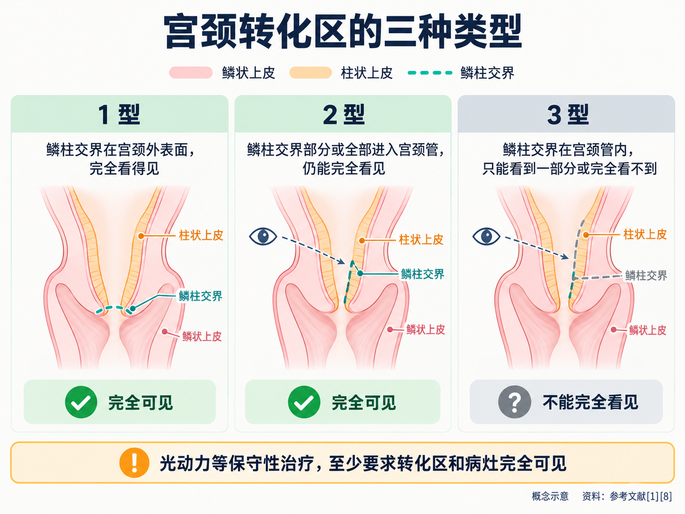
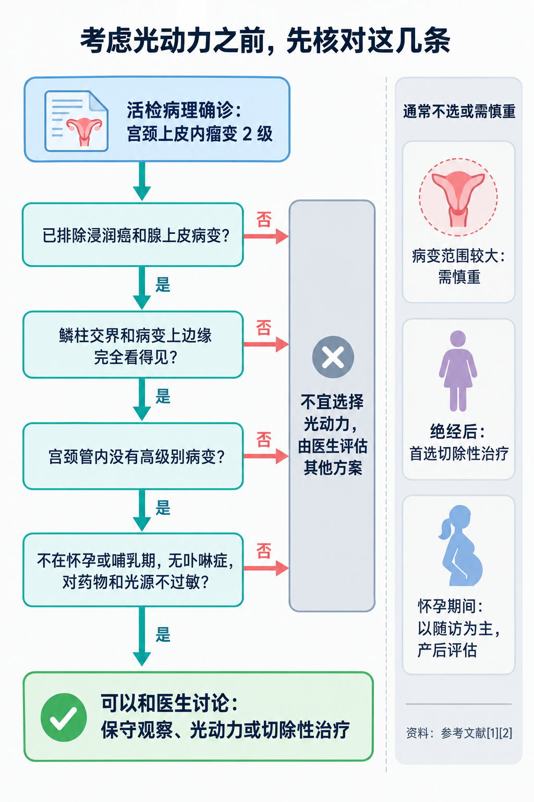
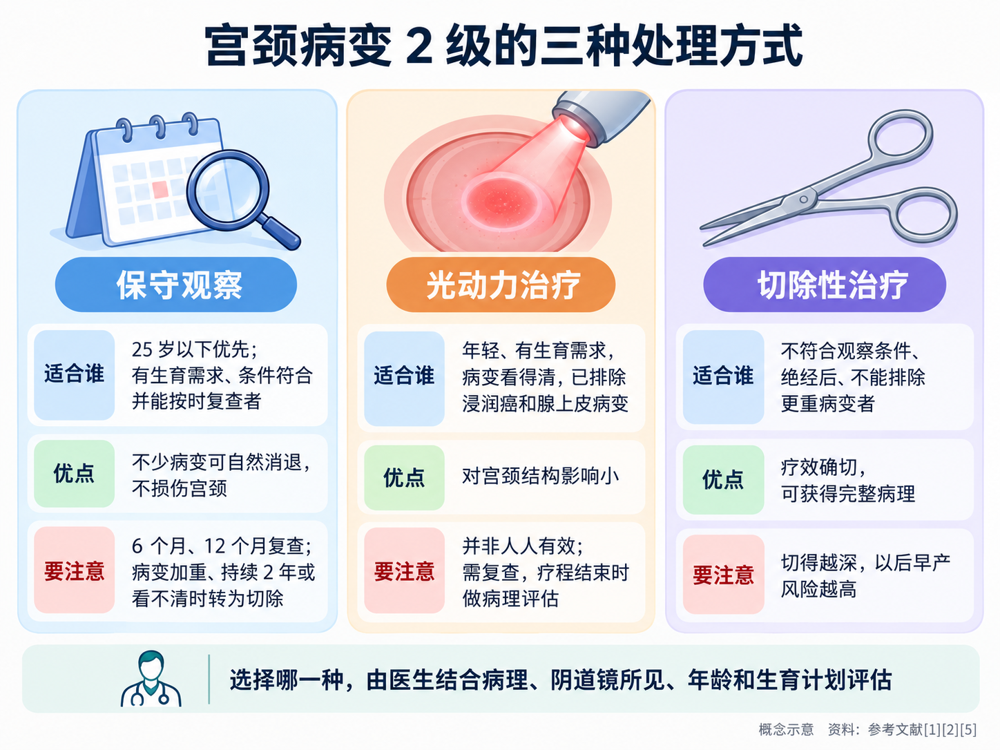

# 哪些宫颈病变适合光动力治疗，哪些不适合

> 活检报告上写着“高级别鳞状上皮内病变（CIN2）”，医生说可以考虑做锥切，也提到“现在有光动力，不用开刀”。很多人第一反应是：能不开刀当然最好。可没过几天又听说，有人想做光动力，却被医生建议直接手术。光动力到底适合谁？医生在做决定前，会先看哪些条件？这篇文章把这些条件一条条讲清楚。

## 01 先弄清：光动力在宫颈病变处理里是什么位置

**PDT = Photodynamic Therapy（光动力治疗）**。它让病变组织先吸收一种光敏药物，再用特定波长的光照射，引发光化学反应来破坏病变细胞。

2026 年发布的《子宫颈上皮内瘤变 2 级（CIN 2）管理中国专家共识》，把宫颈病变 2 级的处理分成三条路 [1]：

- **保守观察**：不马上治疗，按计划定期复查；
- **保守性治疗**：包括激光、冷冻、热凝、电凝等**消融治疗**，以及**光动力治疗**；
- **切除性治疗**：主要是宫颈环形电切术和冷刀锥切术，把病变连同一部分宫颈组织切下来，送病理检查。

也就是说，光动力是多种选择中的一种，**不是用来取代其他方法的**。共识认为它的主要优势是**对宫颈结构以及流产、早产等不良妊娠结局影响小**，适合年轻、有生育需求的女性；同时也明确指出，目前的证据主要来自小样本研究和少数随机对照试验，**它和切除性治疗相比的长期安全性，还需要更多高质量研究验证** [1]。

**国内的获批情况分两种药，要分开看：**

- **用于宫颈病变 2 级的光动力**：国家医保局公示的 2026 年医保目录调整申报材料显示，一种由**盐酸氨酮戊酸己酯软膏和一次性宫颈光动力治疗灯**组合而成的治疗系统，已获得国内注册批件，**2026 年 2 月**首次在国内上市。说明书适应证是：**18 岁及以上、经组织学证实为宫颈上皮内瘤变 2 级的患者，排除宫颈浸润癌和宫颈原位腺癌** [2]。
- **外用氨基酮戊酸**：2007 年在国内获批的适应证是**尖锐湿疣** [3]。它用于宫颈鳞状上皮内病变，依据的是 2022 年国内妇产科专家共识：专家组一致认为它在宫颈、阴道、外阴鳞状上皮内病变等疾病中有重要价值，同时强调需要更多循证研究来更新推荐 [4]。这属于专家共识中的应用，**不是这种药说明书上的适应证**。

支持前一种治疗系统的关键证据，是 2025 年发表的一项国际多中心随机对照试验：402 名宫颈高级别病变成年女性按 2:1 分组，6 个月时治疗有效（病理恢复正常或降为低级别病变，且人乳头瘤病毒转阴）的比例，光动力组为 **41.1%**（104/253），安慰剂组为 **21.7%**（28/129）[5]。光动力组的有效率高于安慰剂组，但**并不是人人都能治好**。这项研究由研发该药的企业资助 [5]。

## 02 适合考虑光动力的情况：几个条件要同时满足

2026 年中国专家共识列出的光动力适应证是 [1]：

- **年轻、有生育需求的女性**；
- 阴道镜下**宫颈鳞柱交界和病变的上边缘都能完全看到**；
- **宫颈管里没有高级别病变**；
- **没有浸润癌，也没有腺上皮病变**。

另外，**病变范围较大的，选择时要慎重** [1]。对已经获批的宫颈光动力治疗系统，说明书还要求**18 岁及以上、经活检组织学确诊为病变 2 级** [2]。

这里有几个容易误会的地方：

**第一，诊断要靠活检病理，不能只看筛查结果。**细胞学报告或人乳头瘤病毒阳性，只是提示需要进一步检查；是不是病变 2 级、有没有更重的病变，要靠阴道镜下取活检、由病理医生判断 [1][2]。

**第二，“年轻、有生育需求”是优先考虑的人群，不是唯一的门槛。**共识这样写，是因为光动力的主要优势在于保护宫颈结构，对还想生育的人意义最大 [1]。没有生育计划的女性，同样可能有其他合适的选择，要和医生一起权衡。

**第三，病变 3 级不在已获批治疗系统的适应证里。**说明书写的是病变 2 级 [2]；上述共识讨论的也是病变 2 级 [1]。共识中，保守观察期间一旦发现病变 3 级及以上，就要做切除性治疗 [1]；病变 3 级怎么处理，要听医生的具体评估。

**第四，低级别病变（1 级）一般不急着治疗。**美国阴道镜和宫颈病理学会 2019 年的管理指南建议：25 岁及以上、低级别病变连续存在至少 2 年的，**首选继续观察**，经过充分沟通后选择治疗也可以接受 [6]。国内 2022 年专家共识把氨基酮戊酸光动力列为宫颈鳞状上皮内病变的治疗选择之一 [4]，但是否需要治疗，先要判断有没有必要，而不是先选治疗方法。

## 03 为什么必须先排除浸润癌和腺上皮病变

这是光动力的第一道门槛，原因在于它的工作方式。

**光照得不深。**美国国家癌症研究所指出，光动力所用的光穿透组织通常**不超过约 1 厘米**，只能用于长在表面、或紧贴表面下方的病变 [7]。宫颈上皮内病变还局限在表层上皮里，属于光能够到达的范围；**一旦已经发生浸润，病变向深处生长**，就不是这种表面治疗应该处理的情况了。

**不切下组织，就没有“最终病理”。**切除性治疗切下的组织要送病理检查，这一步本身也是一次诊断，可以发现活检时漏掉的更重病变。共识指出，消融治疗**无法获取组织学标本，不能进行病理学评估** [1]；光动力同样不切除组织。所以在治疗前，必须尽量确认没有藏着更严重的病变。

**腺上皮病变要切除，不适合表面治疗。**宫颈的病变分两类：长在鳞状上皮上的“鳞状上皮内病变”，以及长在腺上皮上的“腺上皮病变”。光动力的研究和适应证针对的都是前一类。共识把**细胞学或组织学提示腺上皮病变或浸润癌、或临床怀疑恶性病变**列为光动力的禁忌证 [1]；已获批的治疗系统说明书也明确**排除宫颈浸润癌和宫颈原位腺癌** [2]。美国 2019 年指南同样建议，原位腺癌要做**切除** [6]。

所以，如果细胞学报告里出现“不典型腺细胞”之类的描述，或者阴道镜下看到可疑浸润的表现，医生通常会先做进一步检查，必要时做诊断性切除，而不是直接做光动力 [1][6]。

## 04 “转化区”看不看得清，为什么这么重要

宫颈表面有两种上皮：外面是鳞状上皮，宫颈管里面是柱状上皮，两者的交界线叫**鳞柱交界**。交界附近的区域叫**转化区**，绝大多数宫颈病变就长在这里，紧挨着鳞柱交界 [1]。

国际宫颈病理与阴道镜联盟的术语把转化区分为三型，国际癌症研究机构的阴道镜图谱这样描述 [8]：

- **1 型**：鳞柱交界完全看得见，全部位于宫颈外表面；
- **2 型**：鳞柱交界完全看得见（可能需要借助宫颈管扩张器），但部分或全部位于宫颈管内；
- **3 型**：鳞柱交界在宫颈管内，即使借助器械，也只能看到一部分，或完全看不到。

**看不全，就可能漏掉病变。**共识引用的研究显示，鳞柱交界看不见时，宫颈癌漏诊风险为 0.6%，看得见时为 0.3%；国内研究也显示，鳞柱交界看不见时，病变 2 级女性中漏诊更重病变的风险增加 9.6 倍 [1]。光动力只能作用在光照到、看得到的地方，如果病变的上边缘藏在宫颈管深处，医生既无法确认病变全貌，也无法保证治疗覆盖到。所以共识要求光动力和其他保守性治疗，**至少要满足转化区和病灶完全可见** [1]。美国 2019 年指南也规定，鳞柱交界或病变上界不能完全看清时，**不能做消融治疗** [6]。

**绝经后的女性要特别注意。**共识指出，绝经后由于雌激素缺乏，下生殖道萎缩，**病变多位于宫颈管内**，阴道镜下活检漏诊的风险增加；因此，在充分评估、排除手术禁忌后，**绝经后病变 2 级的女性首选切除性治疗** [1]。

## 05 哪些情况通常不考虑光动力

把前面的条件反过来看，下面这些情况，**一般不选光动力**，或需要格外慎重 [1][2]：

- **怀疑或确诊浸润癌**，或细胞学、组织学提示**腺上皮病变**；
- **鳞柱交界或病变上边缘看不全**，或**宫颈管里有高级别病变**；
- **病变范围较大**（共识写的是“需慎重”）；
- **绝经后**的病变 2 级：首选切除性治疗；
- **怀孕或哺乳期**；
- 患有**卟啉症**，或对光敏药物、凝胶等成分过敏，或对红光等光源过敏。

关于怀孕期间发现的病变 2 级，共识的原则是**以随访为主，产后再评估**；分娩方式按产科指征决定，病变 2 级本身不是选择剖宫产的理由 [1]。

## 06 光动力、观察随访和切除，怎么取舍

对于确诊病变 2 级的女性，光动力不是唯一的“不开刀”选项。三条路各有适合的人：

**保守观察：病变可能自己退回去。**病变 2 级有相当一部分会自然消退，年轻女性尤其明显：研究显示，25 岁以下女性的病变 2 级有 88% 可以消退，平均消退时间为 21 个月 [1]。共识推荐：**25 岁以下优先保守观察**；25 岁及以上、有生育需求、鳞柱交界和病变上界可见、宫颈管内没有病变 2 级、既往没有宫颈病变治疗史、并能按时随访的，也可以选择观察 [1]。观察期间在 6 个月和 12 个月时复查，包括基于年龄的检测和阴道镜检查；**一旦发现病变 3 级及以上、病变持续 2 年不退、范围扩大或看不清了，就要转为切除性治疗** [1]。

不过，病变范围大（超过 2 个象限）、人乳头瘤病毒 16/18 型持续阳性、细胞学高度异常的，病变持续或进展的风险更高，**选择观察要慎重** [1]。

**光动力：想积极治疗、又想尽量保护宫颈。**适合符合前面那些条件、希望主动治疗但担心手术影响以后怀孕的人。需要知道的是，它**也要按时复查**：已获批治疗系统的说明书规定，治疗后 3 个月做细胞学和人乳头瘤病毒检测，结果仍异常的需要第二次治疗，整个疗程 6 个月，最多治疗两次，**疗程结束时要做病理检查评估疗效** [2]。随机对照试验中，6 个月时有效的患者再观察 6 个月，有 54.9%（56/102）保持有效 [5]。共识把“治疗后再次复发的病变 2 级”列为切除性治疗的适应证之一 [1]，所以光动力之后并不意味着永远不用手术。

**切除性治疗：疗效确切，能拿到完整病理。**宫颈环形电切术和冷刀锥切术的疗效和术后残留、复发风险相当；共识建议有生育需求的女性尽量选择环形电切术，筛查、阴道镜或病理结果不能排除浸润癌的，必要时做冷刀锥切 [1]。它的代价是可能增加早产、胎膜早破等不良妊娠结局，**而且切得越深风险越高**，有研究显示切除深度每增加 1 毫米，早产风险增加约 6% [1]。因此医生会在切净病变的前提下尽量控制深度。切除后一般建议 6~12 个月再备孕 [1]。

**国内外的推荐并不一样。**美国 2019 年指南讨论的治疗方式是切除和消融，对组织学高级别病变的推荐是**首选切除，消融也可接受**；对担心未来怀孕的病变 2 级患者，在鳞柱交界可见、宫颈管取样没有发现病变 2 级及以上的前提下，**观察或治疗都可以接受** [6]。国内 2026 年共识则把光动力列为病变 2 级的保守性治疗之一 [1]。两者都强调：任何不切除组织的处理方式，前提都是**看得清、排除了更重的病变**。

**该去哪个科？**宫颈病变的评估和治疗看**妇科**，很多医院设有**宫颈疾病门诊或阴道镜门诊**。可以带上历次的细胞学、人乳头瘤病毒检测、阴道镜和活检病理报告，主动告诉医生自己的年龄、生育计划和能否按时复查，这些都会影响方案的选择。

光动力是一种值得了解的选择，但它有清楚的边界；先把病变看清、把更重的情况排除，再谈用什么方法治，才是对自己最稳妥的顺序。

---

## 参考文献

[1] 中国优生科学协会阴道镜和宫颈病理学分会, 中华医学会妇科肿瘤学分会. [子宫颈上皮内瘤变 2 级（CIN 2）管理中国专家共识（2026 版）](https://www.obgyncn.com/CN/10.13390/j.issn.1672-1861.2026.01.030). 中国妇产科临床杂志, 2026, 27(1): 89-96. 专家共识，访问日期：2026-10-16.

[2] 国家医疗保障局. [2026 年国家医保药品目录调整申报材料（公示版）：盐酸氨酮戊酸己酯软膏宫颈光动力治疗系统](https://www.nhsa.gov.cn/attach/Ypsn2026/YPSW202600597/YPSW202600597.pdf). 企业申报材料公示版（含说明书适应证、用法用量及上市时间），访问日期：2026-10-16.

[3] 中华医学会皮肤性病学分会光动力治疗研究中心, 中国康复医学会皮肤病康复专业委员会, 中国医学装备协会皮肤病与皮肤美容分会光医学治疗装备学组. [氨基酮戊酸光动力疗法皮肤科临床应用指南（2021 版）](https://doi.org/10.35541/cjd.20200731). 中华皮肤科杂志, 2021, 54(1). 临床指南，访问日期：2026-10-16.

[4] Qiu L, Li J, Chen F, et al. [Chinese expert consensus on the clinical applications of aminolevulinic acid-based photodynamic therapy in female lower genital tract diseases (2022)](https://pubmed.ncbi.nlm.nih.gov/35781093/). Photodiagnosis and Photodynamic Therapy, 2022, 39: 102993. 专家共识（依据摘要），访问日期：2026-10-16.

[5] Chen F, Hillemanns P, Ruan H, et al; APRICITY Investigators. [Photodynamic therapy for high-grade squamous intraepithelial lesions: A randomized controlled trial](https://doi.org/10.1016/j.medj.2025.100851). Med, 2025, 6(12): 100851. 随机对照试验（依据摘要），访问日期：2026-10-16.

[6] Perkins RB, Guido RS, Castle PE, et al. [2019 ASCCP Risk-Based Management Consensus Guidelines for Abnormal Cervical Cancer Screening Tests and Cancer Precursors](https://pmc.ncbi.nlm.nih.gov/articles/PMC7147428/). Journal of Lower Genital Tract Disease, 2020, 24(2): 102-131. 管理指南，访问日期：2026-10-16.

[7] National Cancer Institute. [Photodynamic Therapy to Treat Cancer](https://www.cancer.gov/about-cancer/treatment/types/photodynamic-therapy). 官方患者教育资料（2025-05-15 审阅），访问日期：2026-10-16.

[8] International Agency for Research on Cancer. [Atlas of Colposcopy: Principles and Practice — Types of transformation zone](https://screening.iarc.fr/atlascolpodetail.php?Index=10). 阴道镜图谱，访问日期：2026-10-16.

*本文为健康科普，不能替代个人诊疗意见。宫颈病变是否适合光动力治疗、观察随访或切除性治疗，请到妇科（宫颈疾病门诊或阴道镜门诊）由医生结合病理结果、阴道镜所见、年龄和生育计划评估；用药以药品说明书和医嘱为准。*
