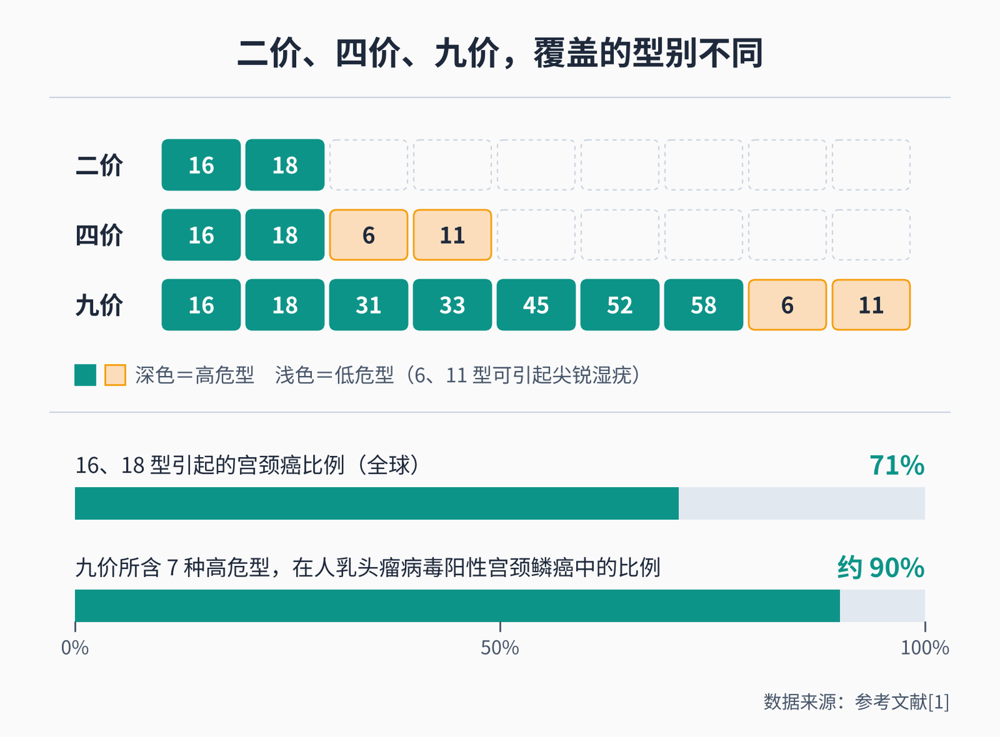
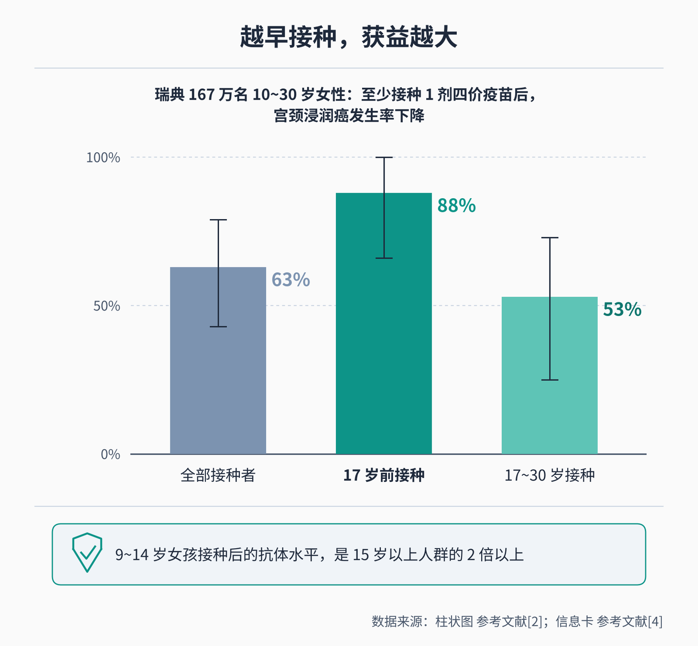
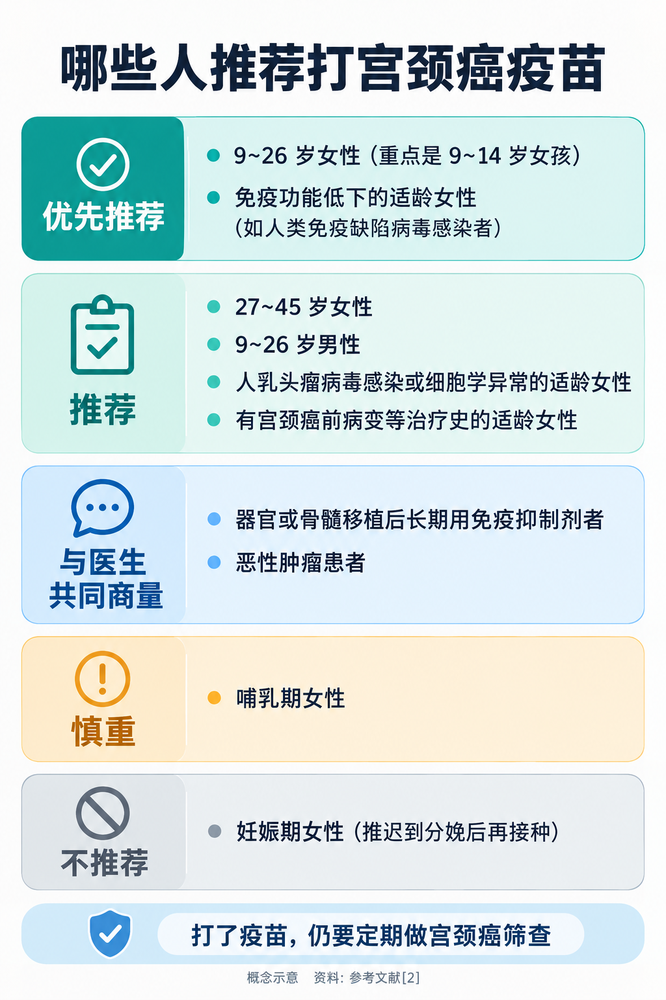

# 宫颈癌疫苗二价、四价、九价怎么选？几岁打最合适

> 女儿 13 岁，学校通知可以免费打二价宫颈癌疫苗，可身边总有人说“要打就打九价”，到底该不该等？自己 32 岁了，还值不值得打？体检查出过人乳头瘤病毒阳性，打疫苗还有没有用？打完疫苗，是不是就不用再做宫颈癌筛查了？这篇文章把这几个问题一次讲清楚。

## 01 “几价”，说的是能防几种型别的病毒

先认识主角：**HPV = Human Papillomavirus（人乳头瘤病毒）**。宫颈癌疫苗就是人乳头瘤病毒疫苗，它预防的是这种病毒的感染，进而预防由它引起的宫颈癌前病变和宫颈癌。

人乳头瘤病毒有很多型别。按致癌能力分为高危型和低危型：高危型主要有 16、18、31、33、35、39、45、51、52、56、58、59、66、68 这 14 种，其中 **16 型风险最高**，可以引起宫颈、阴道、外阴、肛门等部位的癌前病变和癌；低危型以 6、11 型为主，可引起**尖锐湿疣**（肛门生殖器疣）[2]。

所谓“几价”，就是疫苗里包含几种型别的病毒样颗粒，也就是能直接预防几种型别 [1]：

- **二价**：16、18 型，两种高危型；
- **四价**：在二价基础上加了 6、11 型，所以**还能预防尖锐湿疣**；
- **九价**：在四价基础上再加 31、33、45、52、58 型，共 7 种高危型 + 2 种低危型。

为什么二价只防两种也很有用？因为 16 和 18 型是导致宫颈癌最主要的两种。世界卫生组织（WHO）的立场文件指出，**全球 71% 的宫颈癌由 16 和 18 型引起**；九价疫苗所含的 7 种高危型，合起来约占人乳头瘤病毒阳性宫颈鳞癌的 90% [1]。国家疾控局的科普问答也提到，**至少 70% 的宫颈癌与 16、18 型持续感染有关** [4]。

疫苗里的成分是病毒的外壳蛋白组装成的“空壳”，**不含病毒的遗传物质，没有感染性** [1]，打疫苗不会让人感染人乳头瘤病毒。

## 02 从第一支疫苗到今天：国内现在有哪些

人乳头瘤病毒疫苗问世不到 20 年。**四价疫苗 2006 年在全球最早上市，双价疫苗 2007 年上市，九价疫苗 2014 年上市**；进入国内的时间分别是 2017 年、2016 年和 2018 年 [2]。之后国产疫苗陆续获批：**2019 年和 2021 年各有一种国产双价疫苗上市** [2]，**2025 年首个国产九价疫苗获国家药监局批准上市** [5]。

按《预防性人乳头瘤病毒疫苗中国临床应用指南（2025 版）》（以下简称“中国指南”）整理，截至 2025 年 1 月，国内已获批的疫苗及接种程序大致如下 [2]：

- **二价疫苗（共 3 种）**：获批用于 9~45 岁女性（其中一种为 9~30 岁女性）；9~14 岁接种 **2 剂**，更大年龄接种 **3 剂**，均在半年左右完成；
- **四价疫苗**：获批用于 9~45 岁女性，以及 9~26 岁男性（2025 年 1 月获批）；9~13 岁女性可接种 2 剂，其余 3 剂；
- **九价疫苗**：获批用于 9~45 岁女性；9~14 岁接种 2 剂，其余 3 剂。

2025 年获批的国产九价疫苗，适用年龄和剂次以其说明书为准。具体打哪一种、打几针，接种时以疫苗说明书和接种单位的安排为准。

**年纪小的打 2 剂就够，不是“打折”**：临床试验显示，9~14 岁女孩接种 2 剂后产生的抗体，不低于年轻成年女性接种 3 剂的水平 [2]。

## 03 二价、四价、九价，防宫颈癌的效果差多少

这是大家最纠结的问题。先看权威结论：

WHO 在 2022 年的立场文件中明确，**从公共卫生角度看，目前所有已获批的二价、四价和九价疫苗，在预防宫颈癌前病变和宫颈癌方面，免疫原性、保护效力和实际效果相当**，因为宫颈癌主要由 16、18 型引起 [1]。WHO 也说，各国选择哪种疫苗，要结合当地的疾病负担、疫苗获批人群、产品特点、价格等因素综合考虑 [1]。

国内的临床试验也给出了很高的保护效力。比如在国内的大型临床试验中，进口双价疫苗（随访 72 个月，基线未感染的人群）和四价疫苗（随访 78 个月）对 16/18 型相关的**宫颈病变 2 级及以上**病变的保护效力都达到 **100%** [2]。九价疫苗对它额外覆盖的 31、33、45、52、58 型相关病变也有很高的保护效力 [2]。

三者真正的区别在于：

- **二价**：覆盖最主要的两种高危型，是**国家免疫规划为 13 岁女孩免费提供的疫苗** [3]；
- **四价**：防宫颈癌的型别和二价一样，**多了预防尖锐湿疣**；
- **九价**：多覆盖 5 种高危型，同时能预防尖锐湿疣 [1]。在我国宫颈细胞学正常的女性中，最常见的 5 种型别依次是 52、16、58、18、33 型 [2]，其中 52、58、33 型只有九价疫苗直接覆盖。

所以怎么选，可以这样考虑：

- **13 岁左右的女孩**：免费的二价疫苗已经覆盖导致宫颈癌最主要的型别，而且**在首次性行为前接种效果最好** [2]，按时接种免费疫苗是很好的选择；
- **成年女性自费接种**：在获批年龄内，可以结合年龄、预算和当地供应情况选择；想同时预防尖锐湿疣、覆盖更多型别，可以考虑四价或九价；
- **不建议为了等某一种疫苗一拖再拖**：越早在感染之前完成接种，获益越大（见下一部分）。

还有一点：**多剂次接种时，尽量全程用同一种疫苗** [1]。WHO 也说明，如果之前打的是哪一种已经不清楚或买不到了，可以用任何一种人乳头瘤病毒疫苗完成剩下的剂次 [1]。

## 04 几岁打最合适：越早越好，最好在第一次性行为之前

**WHO 推荐的主要目标人群是 9~14 岁、还没有性行为的女孩** [1]。中国指南的推荐是 [2]：

- **优先推荐 9~26 岁女性接种，重点是 9~14 岁女孩**；
- **推荐 27~45 岁有条件的女性接种**；
- 推荐 9~26 岁男性接种，倡导男女共防。

为什么越早越好？原因有两个。

一是**年纪小，免疫反应更强**。国家疾控局介绍，**9~14 岁女孩接种后产生的抗体水平，是 15 岁以上人群的 2 倍以上** [4]。

二是**在感染之前接种，才能发挥最大作用**。疫苗只能预防，不能清除已经存在的感染 [2][4]。瑞典一项覆盖 167 万名 10~30 岁女性的真实世界研究显示，至少接种 1 剂四价疫苗后，宫颈浸润癌的发生率下降 63%；其中 **17 岁前接种的女性下降 88%，17~30 岁接种的下降 53%** [2]。

### 13 岁女孩：可以免费接种 2 剂

**自 2025 年 11 月 10 日起，人乳头瘤病毒疫苗纳入国家免疫规划**，为 2011 年 11 月 10 日以后出生、满 13 周岁的女孩**免费接种 2 剂次双价疫苗，间隔 6 个月** [3]。国家疾控局的解答还说明 [4]：

- 选择 13 岁，是为了在感染机会增加、也就是首次性行为之前完成接种；
- 第一剂之后间隔半年打第二剂，**间隔最好不要超过一年**；
- 符合出生日期要求的女孩，因故错过免费接种时间的，**可以到辖区接种点免费补种**；
- 已经自费打过四价或九价疫苗的，视同完成了免疫规划疫苗接种，**不需要重复接种**；已经自费打了部分剂次的，可以按原有程序完成全程。

### 剂次：国内按说明书执行

WHO 2022 年把推荐调整为：9~14 岁女孩可以打 1 剂或 2 剂，15~20 岁可以打 1 剂或 2 剂，21 岁以上打 2 剂（间隔 6 个月）；其中**单剂次属于说明书之外的用法**，是 WHO 从公共卫生角度给出的选项 [1]。**国内接种目前按疫苗说明书和国家免疫规划的程序执行**（见第 02 部分），不要自行减少剂次。

## 05 过了最佳年龄，还值得打吗

**值得考虑，但获益会比年轻时小一些。**

中国指南指出，**27~45 岁女性接种二价、四价、九价疫苗后产生的抗体，不劣于 16~26 岁女性**，因此这个年龄段接种仍可获益 [2]。指南还提到，我国 25~45 岁女性高危型人乳头瘤病毒感染率达 19.9%；随着年龄增长，感染更不容易转阴，持续感染的机会增加 [2]。所以指南推荐 **27~45 岁有条件的女性接种**，并强调要结合个人情况，采取个体化的接种策略 [2]。

WHO 也提醒，疫苗对年龄较大时才接种的女性，作用相对有限 [1]——这个年龄段很多人已经有过性生活，可能已经接触过部分型别。所以，**这个年龄段打疫苗是“加一层保护”，不能代替定期筛查**。

超过 45 岁的女性，不在国内疫苗的获批年龄范围内。对这个年龄段来说，**按时做宫颈癌筛查**是最重要的防线。

## 06 已经感染过、有过病变、在备孕，能打吗

### 人乳头瘤病毒阳性或细胞学异常：仍推荐接种

很多人以为“已经感染了，打了也没用”。其实**感染了某一型，疫苗仍能预防其他还没感染的型别** [4]，研究也显示，疫苗对既往感染过人乳头瘤病毒的女性仍有保护作用 [2]。中国指南推荐：**无论是否存在人乳头瘤病毒感染或细胞学异常，适龄女性都推荐接种** [2]。

需要说清楚的是：**疫苗是预防性的，对已经发生的感染没有清除作用，也不能治疗已经存在的病变** [2][4]。阳性或细胞学异常，仍要按医生要求复查或做进一步检查，不能用打疫苗代替。

**打疫苗前也不需要先查人乳头瘤病毒** [1]。

### 做过宫颈癌前病变治疗：治疗前或治疗后尽早接种

宫颈高级别病变治疗后，有可能再次感染或复发。一项纳入 18 项研究的荟萃分析显示，接种疫苗使宫颈病变 2 级及以上病变的**复发风险降低 57%**，其中 16/18 型相关的复发风险降低 74% [2]。中国指南推荐**有宫颈癌前病变的适龄女性，在治疗前或治疗后尽早接种** [2]。最佳接种时机目前还不明确，现有研究大多是在手术前或术后不久接种的 [2]。接种不能代替治疗后的定期复查。

### 怀孕和哺乳

- **孕期不推荐接种** [1][2]。这不是因为发现了危害——已有研究没有发现孕期接种增加不良妊娠结局的风险——而是孕期的研究数据有限，出于谨慎暂不推荐 [1][2]；
- **打了一针后才发现怀孕**：剩下的剂次推迟到分娩后再打，已经完成接种的无需干预 [2]；WHO 明确，**孕期意外接种不需要终止妊娠** [1]。接种前也不需要常规做妊娠检测 [2]；
- **哺乳期**：WHO 认为哺乳不是接种的禁忌，不影响母婴哺乳安全 [1]；中国指南考虑到哺乳期安全性数据还不够多，**建议慎重** [2]。两者表述有差异，哺乳期是否接种，可以和医生商量后决定。

### 其他需要注意的情况

- **免疫功能低下的人**（如人类免疫缺陷病毒感染者）发生相关疾病的风险更高，属于**优先推荐**接种的人群；WHO 建议这类人群至少接种 2 剂，条件允许时接种 3 剂 [1][2]。器官或骨髓移植后长期用免疫抑制剂、恶性肿瘤患者，需要和医生共同商量 [2]；
- **对疫苗成分严重过敏的人不能接种**；有血小板减少或凝血功能障碍的人不宜接种；正在发热等急性疾病期间，建议痊愈后再接种；经期不适的女性可以避开经期接种 [2]；
- **打完不需要查抗体**。目前没有标准化的抗体检测，也没有明确多少抗体才算“有保护”，中国指南明确接种后**无需进行抗体检测** [2]。

### 安全吗

WHO 指出，疫苗自 2006 年获批以来已使用超过 5 亿剂次，**安全且耐受性良好**，接种后的不良反应**通常轻微、短暂** [2]。最常见的是**接种部位疼痛、红肿**，全身反应常见发热、疲乏、头痛等 [2]。国内监测数据显示，2017—2020 年全国报告接种 2274.4 万剂次，**未发现安全问题** [2]。

接种后要在接种点**留观 30 分钟**；局部疼痛、红肿一般居家处理即可，比如冷敷；有明显不适时及时就医 [4]。

## 07 打了疫苗，仍然要定期筛查

**打了疫苗，也要按年龄规律做宫颈癌筛查。**中国指南给出的理由很清楚 [2]：

- 疫苗所含型别有限，**不能预防所有高危型别**；
- 疫苗**不能清除已经存在的感染，也不能阻止已有病变的进展**；
- 对接种前已有感染或存在其他危险因素的人，保护作用会打折扣；
- 少数宫颈癌可能与人乳头瘤病毒无关；
- 疫苗的保护作用目前已证实可持续很多年（四价疫苗的长期随访证实有 14 年），但**是否终身有效还需要研究证实**。

WHO 也强调，接种疫苗是一级预防，**不能取代日后的筛查** [1]。国家疾控局同样建议，**即使接种了疫苗，仍要定期进行宫颈癌筛查** [4]。

**去哪里打？**13 岁女孩的免费接种，留意学校和辖区接种点的通知；自费接种，可以到社区卫生服务中心等预防接种门诊咨询预约。已经有人乳头瘤病毒阳性、宫颈病变或做过相关治疗的，可以先到**妇科**就诊，请医生结合复查安排一起考虑接种时机。

疫苗挡住大部分感染，筛查发现漏网的病变，**早打疫苗、按时筛查**，两件事一起做，才是对宫颈最完整的保护。

---

## 参考文献

[1] World Health Organization. [Human papillomavirus vaccines: WHO position paper, December 2022](https://www.who.int/publications/i/item/who-wer9750-645-672). Weekly Epidemiological Record, 2022, 97(50): 645-672. 立场文件，访问日期：2026-10-25.

[2] 中华医学会妇科肿瘤学分会，中国优生科学协会阴道镜和宫颈病理学分会，中华预防医学会肿瘤预防与控制专委会，等. [预防性人乳头瘤病毒疫苗中国临床应用指南（2025 版）](https://xhyxzz.pumch.cn/article/doi/10.12290/xhyxzz.2025-0246). 协和医学杂志, 2025, 16(2): 350-360. 临床指南，访问日期：2026-10-25.

[3] 国家疾病预防控制局，国家卫生健康委员会，教育部，等. [关于将人乳头瘤病毒疫苗纳入国家免疫规划有关工作事宜的通知（国疾控卫免发〔2025〕16号）](https://www.gov.cn/zhengce/zhengceku/202510/content_7046467.htm). 政府文件，2025，访问日期：2026-10-25.

[4] 国家疾病预防控制局卫生与免疫规划司. [人乳头瘤病毒（HPV）疫苗系列科普问答](https://www.ndcpa.gov.cn/jbkzzx/c100040/common/content/content_2089546092879712256.html). 官方科普，2026，访问日期：2026-10-25.

[5] 福建省药品监督管理局. [中国第一、全球第二！国产九价HPV疫苗获批上市](https://yjj.scjgj.fujian.gov.cn/zwgk/xwdt/sjdt1/202506/t20250605_6921792.htm). 政府网站信息，2025，访问日期：2026-10-25.

*本文为健康科普，不能替代个人诊疗意见。疫苗种类、剂次和接种时间以疫苗说明书和接种单位的安排为准，可到社区卫生服务中心等预防接种门诊咨询；已有人乳头瘤病毒感染、宫颈病变或治疗史，以及孕期、哺乳期、免疫功能低下的女性，请先到妇科由医生评估。*
