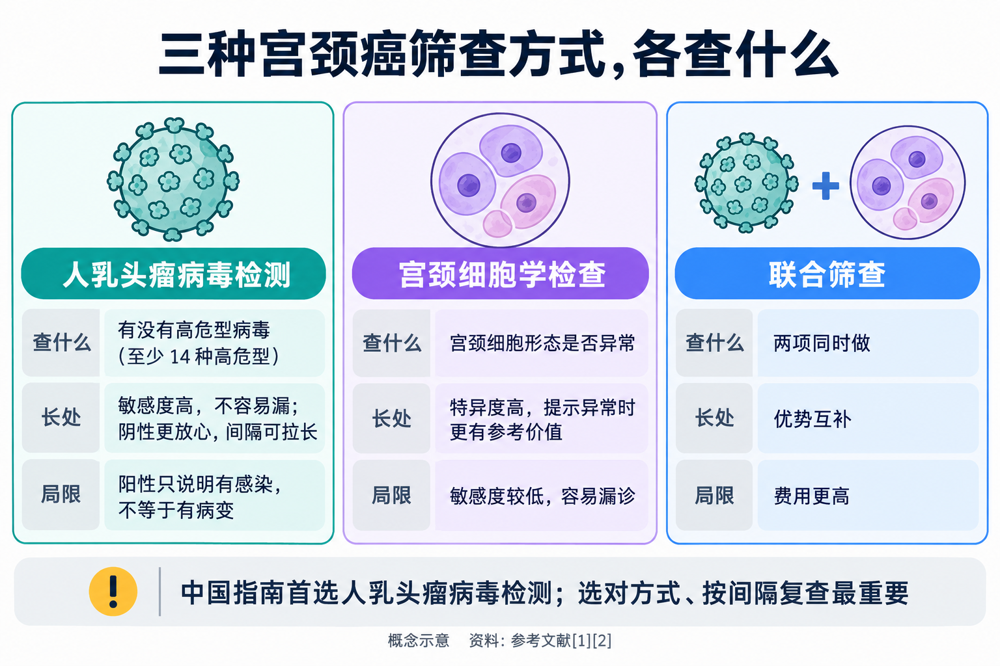
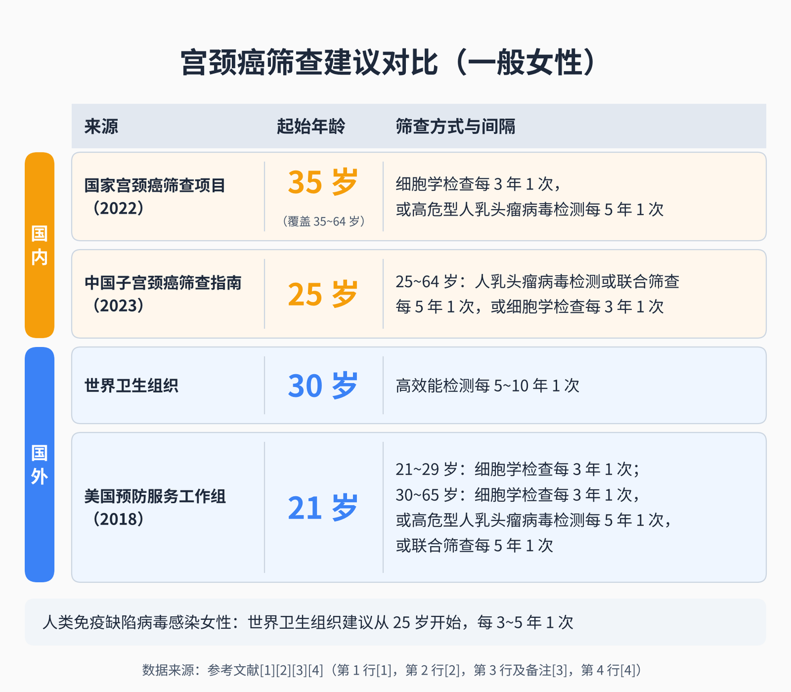
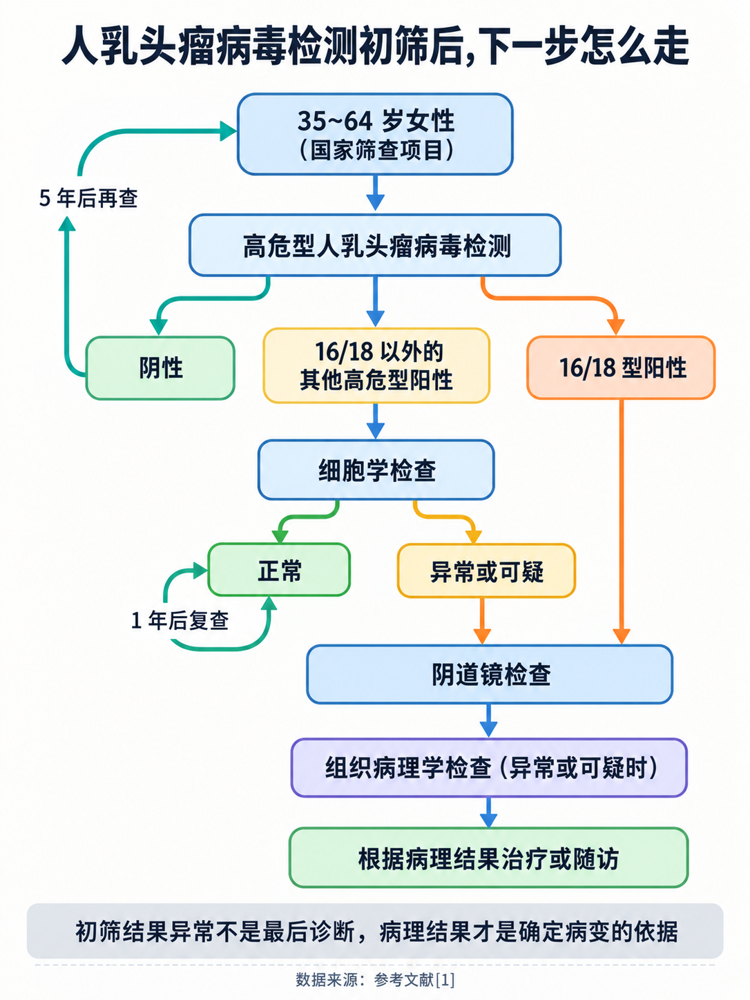

# 宫颈癌筛查怎么查：人乳头瘤病毒检测、细胞学检查和联合筛查有什么不同

> 体检套餐里有“TCT”，也有“HPV”，还有一项叫“联合筛查”，价格差了不少。到底做哪一个？有人说 25 岁就该查，社区“两癌筛查”却从 35 岁开始；打过宫颈癌疫苗的朋友问，还用查吗？妈妈 60 多岁了，说“绝经了不用再查”。这篇文章把宫颈癌筛查这件事从头讲清楚：查什么、几岁开始、多久一次、结果异常怎么办、什么时候可以停。

## 01 筛查找的主要不是“癌”，而是癌变之前的那段时间

先认识主角：**HPV = Human Papillomavirus（人乳头瘤病毒）**。

世界卫生组织（WHO）指出，**宫颈癌是由某些致癌型别的人乳头瘤病毒持续感染引起的** [3]。这种病毒很常见，几乎所有有性生活的人一生中都会在某个时候感染过，通常没有任何症状，**大多数情况下会被免疫系统自然清除** [3]。只有少数持续感染，才可能让宫颈细胞出现异常，进而发展为癌前病变。

关键在于时间：**异常细胞发展成癌，通常需要 15~20 年**；免疫力低下的女性（如未经治疗的人类免疫缺陷病毒感染者）这个过程可能更快，约 5~10 年 [3]。

这就是筛查的意义所在。癌前病变**很少引起症状** [3]，国家卫生健康委的健康教育核心知识也指出，**宫颈癌早期常常没有明显症状** [1]。定期筛查，就是在这段漫长的、自己感觉不到的时间里，把癌前病变找出来并及时处理，**阻断它向宫颈癌发展** [1]。所以宫颈癌筛查的目标，与其说是“找癌”，不如说是“在变成癌之前拦住它”。

## 02 三种筛查方式，各自在看什么

### 人乳头瘤病毒检测：查“有没有高危病毒”

从宫颈取一点脱落细胞样本，检测里面有没有高危型人乳头瘤病毒的核酸。国家卫健委《宫颈癌筛查工作方案》要求，检测**至少要覆盖 WHO 明确的 14 种高危型别**：16、18、31、33、35、39、45、51、52、56、58、59、66、68 型 [1]。

检测分两类 [2]：

- **不分型检测**：能查出 14 种高危型里有没有感染，但不说明具体是哪一型；
- **分型检测**：能区分出部分或全部型别，临床常见的是“16/18 型单独报告 + 其他 12 种高危型”。之所以要单独看 16 和 18 型，是因为**这两型阳性的人发生宫颈癌及癌前病变的风险更高** [2]。

**它的长处**：发现癌前病变的敏感度更高，结果阴性时更让人放心，因此筛查间隔可以拉长；检测由机器完成，受人为因素影响小 [2]。国内多中心大样本研究显示，与细胞学检查相比，它能检出更多高级别及以上病变，漏诊率更低 [2]。

**它的局限**：阳性只说明有病毒感染，**不代表已经有癌前病变**，可能带来心理负担，处理不当也可能导致过度诊断和过度治疗 [2]。

### 宫颈细胞学检查：查“细胞长得正不正常”

同样是从宫颈取脱落细胞，但做成玻片，由专业人员在显微镜下看细胞形态有没有异常。不少体检单上写的“TCT”，一般就是指其中的**液基细胞学检查**。

细胞学检查是宫颈癌筛查里资历最老的方法。**20 世纪中期，传统的巴氏涂片开始用于宫颈癌筛查**，作为主要筛查方法用了半个多世纪，使宫颈癌的发病率和死亡率下降 [2]。后来出现的液基细胞学检查，制片更规范、细胞和背景更清晰、质量更稳定 [2]。现在的报告采用“贝塞斯达报告系统”（TBS），1988 年首次制定，目前使用的是 2014 年修订的第 3 版，**我国超过 90% 的实验室使用这套报告术语** [2]。报告上常见的“未明确意义的不典型鳞状细胞”“低级别鳞状上皮内病变”等描述，都来自这套系统。

**它的长处**：特异度高，对宫颈病变 2 级及以上的病变特异度超过 90%，查出来“异常”时，真有问题的可能性相对较大 [2]。

**它的局限**：容易漏，对宫颈病变 2 级及以上的敏感度只有 53%~81%，低于人乳头瘤病毒检测；对宫颈原位腺癌的诊断准确性只有约 50% [2]。结果还受取材、制片、阅片人员水平、年龄和病变本身的影响 [2]。

### 联合筛查：两项一起做

就是人乳头瘤病毒检测和细胞学检查同时做。前者敏感、不容易漏，后者特异、更能判断眼下的风险，**两者联合可以优势互补** [2]，但花费比单做一项更高 [2]。

**怎么选？**《中国子宫颈癌筛查指南（一）》（2023）的态度很明确 [2]：

- **首选人乳头瘤病毒检测**作为初筛方法，要用经过国内外权威机构认可、经临床验证可用于初筛的检测方法和试剂；
- **细胞学检查**用于还不具备人乳头瘤病毒检测条件的地区，条件成熟后改用以人乳头瘤病毒检测为基础的筛查；
- **联合筛查**用于医疗卫生资源充足的地区、到医院就诊时顺便做的“机会性筛查”，以及部分特殊人群。

所以**没有哪一种是“高级版”**，只要选对方式、按对应的间隔规律去查，都是有效的筛查。

## 03 几岁开始、多久一次：国内有两套建议，用途不同

很多人困惑的“25 岁还是 35 岁”，其实来自两份用途不同的文件。

**一是国家公共卫生筛查项目。**国家卫健委 2022 年印发的《宫颈癌筛查工作方案》，面向的是政府组织的“两癌”筛查 [1]：

- **服务对象：35~64 岁女性**，优先保障农村妇女和城镇低保妇女 [1]；
- **筛查内容**：妇科检查 + 初筛，初筛用**宫颈细胞学检查（原则上每 3 年一次）**或**高危型人乳头瘤病毒检测（原则上每 5 年一次）** [1]。

**二是专业学会的临床指南。**中国优生科学协会阴道镜和子宫颈病理学分会、中华医学会妇科肿瘤学分会等七个学（协）会共同制定的《中国子宫颈癌筛查指南（一）》（2023）建议 [2]：

- **25 岁开始筛查**。不建议更早，是因为 25 岁以下女性人乳头瘤病毒感染率虽高，但**多为一过性感染**，宫颈癌发病率低，过早干预还可能对日后怀孕产生不利影响 [2]；
- **25~64 岁**：**每 5 年一次人乳头瘤病毒检测，或每 5 年一次联合筛查；或每 3 年一次细胞学检查** [2]；
- **65 岁以上**：满足条件可以停止筛查（见第 07 部分）[2]。

两者并不矛盾：前者规定的是政府组织提供筛查服务的人群范围 [1]，后者是专业学会给出的临床筛查建议 [2]。**25~34 岁的女性虽然还不在免费项目的范围内，按指南也建议开始筛查**，可以到医院妇科或体检机构自行安排。

注意两个间隔的对应关系：**人乳头瘤病毒检测或联合筛查是 5 年，单做细胞学是 3 年**，不要混用。这也意味着，结果正常的话，**没有必要每年都查**。

## 04 国外的建议为什么不一样

如果你看过国外资料，会发现起始年龄和方式不太一样：

- **WHO**：一般女性**从 30 岁开始**，用高效能检测**每 5~10 年**筛查一次；人类免疫缺陷病毒感染的女性**从 25 岁开始，每 3~5 年**一次 [3]。WHO 全球战略还提出，女性至少要在 **35 岁和 45 岁前**各接受一次高效能检测筛查 [3]。
- **美国预防服务工作组（USPSTF，2018）**：**21~29 岁**每 3 年做一次细胞学检查；**30~65 岁**可以每 3 年做一次细胞学检查、每 5 年做一次高危型人乳头瘤病毒检测，或每 5 年做一次联合筛查；**不建议 21 岁以下**女性筛查；65 岁以上、既往筛查充分且不属于高风险的女性，不建议继续筛查 [4]。

这些建议面向的人群、疾病负担和医疗条件不同，起始年龄和间隔也就不同。**在国内就医，以国内指南和国家方案为主要参考**；具体怎么查、多久查一次，可以请医生结合个人情况来定。

## 05 结果异常了，下一步做什么

先记住一句话：**细胞学检查或人乳头瘤病毒检测结果异常，都不能作为疾病的最后诊断**，要由专业人员结合检查结果和个人情况综合评估，再决定进一步检查或治疗 [1]。

国家筛查方案给出的流程可以帮助理解 [1]：

**用人乳头瘤病毒检测初筛时：**

- **阴性**：5 年后再查；
- **16/18 型阳性**：直接做**阴道镜检查**；
- **16/18 以外的其他高危型阳性**（或不分型检测提示任何高危型阳性）：加做**细胞学检查**来分流——细胞学正常的，**1 年后复查**；细胞学异常或可疑的，做阴道镜检查。

**用细胞学检查初筛时：**

- **正常**：3 年后再查；
- **异常或可疑**：做阴道镜检查。

此外，妇科检查时肉眼看到异常或可疑的，也要做阴道镜检查 [1]。

**阴道镜检查**是在宫颈涂上醋酸后用放大设备仔细观察宫颈表面 [3]，必要时在可疑部位取一小块组织做**组织病理学检查**（也就是常说的“活检”）。**病理结果才是确定有没有病变、是什么级别的依据** [1]。之后再根据病理结果决定是治疗还是随访。

拿到异常结果，不必慌，也不能放着不管：

- **人乳头瘤病毒阳性很常见**，大多数感染会被免疫系统自然清除 [3]，阳性本身不等于有病变 [2]；
- 但被提示要复查或做阴道镜时，**一定要按时去**。国家方案把人乳头瘤病毒阳性、细胞学“未明确意义的不典型鳞状细胞”及以上等异常或可疑结果都列入追踪随访，督促尽早进一步诊断和治疗 [1]。

## 06 打过疫苗，为什么还要查

**需要查。**国家卫健委的健康教育核心知识写得很直接：**无论是否接种疫苗，均需定期接受宫颈癌筛查** [1]。

原因有两个 [2]：

- **疫苗没有覆盖所有高危型别**，不能预防所有型别的感染。WHO 指出，目前的宫颈癌疫苗都能预防 16 和 18 型，这两型导致了约 76% 的宫颈癌 [3]，剩下的部分仍要靠筛查发现；
- **接种前可能已经感染**。有过性生活的女性接种前可能已经感染了人乳头瘤病毒，接种疫苗并不能阻断已有感染的进程。

WHO 也强调，**即使接种过疫苗，定期筛查仍然重要** [3]。中国指南建议，**接种过疫苗的女性，筛查策略和普通人群相同** [2]。至于接种人群能不能延长筛查间隔、改变筛查方法，指南认为还需要更多研究证据 [2]。

所以疫苗和筛查是两道互补的防线：**疫苗负责尽量不被感染，筛查负责及早发现漏网的病变**。

## 07 65 岁以后能不能停？这些人要特别安排

### 65 岁以上：满足条件才可以停

“绝经了就不用查”是误区。中国指南规定，**65 岁以上女性要同时满足以下条件，才可以停止筛查** [2]：

- **有充分的阴性筛查记录**：10 年内连续 3 次细胞学检查正常，或连续 2 次人乳头瘤病毒检测或联合筛查正常，**而且最近一次筛查在 5 年之内**；
- **没有高危因素**：没有宫颈上皮内瘤变、没有人乳头瘤病毒持续感染、没有因人乳头瘤病毒相关疾病接受过治疗。

反过来，**65 岁以上从未筛查过、65 岁前 10 年内没有充分的阴性筛查记录，或者有临床指征的，仍然应该筛查** [2]。

### 切除了子宫的女性

要看当初为什么切 [2]：

- **因良性疾病**（不是宫颈癌前病变）切除子宫的：如果没有可疑症状或体征，**不推荐常规筛查**；
- **因宫颈癌前病变**切除子宫的：**每年做一次联合筛查**，连续 3 次都阴性，可延长到每 3 年一次，**持续 25 年**。

### 免疫功能低下的女性

包括人类免疫缺陷病毒感染者、器官移植或造血干细胞移植后的女性，以及因系统性红斑狼疮等自身免疫病长期用免疫抑制剂的女性。她们发生人乳头瘤病毒感染、宫颈癌前病变和宫颈癌的风险更高，中国指南建议**有性生活后尽早开始筛查，筛查策略按人类免疫缺陷病毒感染人群执行** [2]。WHO 对人类免疫缺陷病毒感染女性的建议是从 25 岁开始、每 3~5 年一次 [3]。WHO 数据显示，人类免疫缺陷病毒感染女性患宫颈癌的可能性是一般人群的 6 倍 [3]。

### 25 岁以下、有高危因素的女性

有多个性伴侣、过早开始性生活、人类免疫缺陷病毒感染、吸烟等高危因素的，中国指南建议**提前筛查，在开始性生活后 1 年内进行，并适当缩短筛查间隔** [2]。

### 准备怀孕或已经怀孕的女性

孕期做宫颈癌筛查是安全的，不会威胁妈妈和宝宝的健康 [2]。从未筛查过、没有规范筛查过，或者正好到了该复查时间的女性，指南建议**在孕前检查或第一次产检时做筛查**，方式用单独细胞学检查或联合筛查 [2]。

## 08 有症状别等筛查，去哪里查

筛查是给**没有症状**的人做的。如果已经出现症状，就不要等下一次筛查了。

WHO 建议，出现以下情况要及时就医 [3]：

- **两次月经之间的异常出血、绝经后出血或同房后出血**；
- 阴道分泌物增多或有异味。

国家卫健委的健康教育核心知识也提到，随着病情进展，宫颈癌会逐渐出现**阴道不规则出血、阴道排液**等症状 [1]。这些症状也可能由其他妇科疾病引起，需要医生检查后判断；但**不要因为“上次筛查结果正常”就忽视新出现的症状**。

**去哪里查？**

- **35~64 岁女性**：可以关注当地的“两癌”筛查项目，到承担筛查工作的医疗机构、妇幼保健机构参加 [1]；
- **其他年龄或想自行安排的女性**：到医院**妇科**就诊或在体检机构预约，告诉医生自己的年龄、上次筛查的时间和结果、疫苗接种情况，由医生建议具体方式；
- 拿到异常结果、需要做阴道镜的，到医院**妇科**或**宫颈疾病专科（阴道镜门诊）**就诊。

适龄开始、选对方式、按间隔规律复查，结果异常时按医生安排把后续检查做完，这几件事做好了，宫颈癌就是一种可以提前拦住的癌症。

---

## 参考文献

[1] 国家卫生健康委员会. [宫颈癌筛查工作方案（含细胞学检查流程图、高危型 HPV 检测流程图、宫颈癌防治健康教育核心知识）](https://www.nhc.gov.cn/fys/c100078/202201/e4209b0a6e604f6aba3e793d8eddebf3/files/1733998298755_31891.pdf). 政府文件，2022，访问日期：2026-10-19.

[2] 中国优生科学协会阴道镜和子宫颈病理学分会，中华医学会妇科肿瘤学分会，中国抗癌协会妇科肿瘤专业委员会，等. [中国子宫颈癌筛查指南（一）](http://www.jmcm2018.com/CN/10.12151/JMCM.2023.03-08). 肿瘤综合治疗电子杂志, 2023, 9(3): 41-48. 临床指南，访问日期：2026-10-19.

[3] World Health Organization. [Cervical cancer](https://www.who.int/news-room/fact-sheets/detail/cervical-cancer). 官方事实清单（2026-07-03 更新），访问日期：2026-10-19.

[4] U.S. Preventive Services Task Force. [Cervical Cancer: Screening](https://www.uspreventiveservicestaskforce.org/uspstf/recommendation/cervical-cancer-screening). 推荐声明，2018，访问日期：2026-10-19.

*本文为健康科普，不能替代个人诊疗意见。宫颈癌筛查的方式和间隔、筛查结果异常后的处理，请到妇科（或阴道镜门诊、宫颈疾病专科）由医生结合个人情况评估决定；出现异常阴道出血或分泌物异常，请及时到妇科就诊。*
