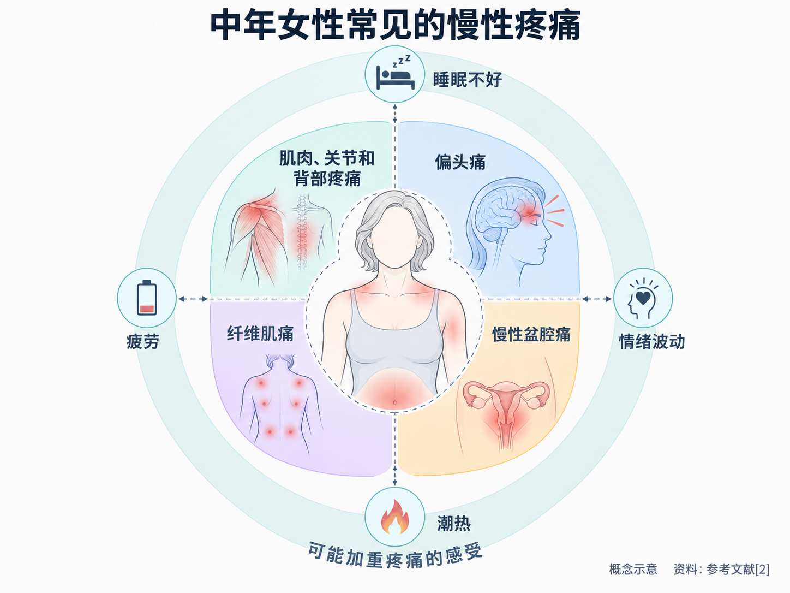
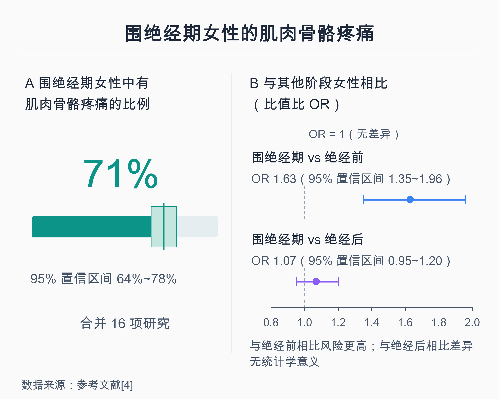
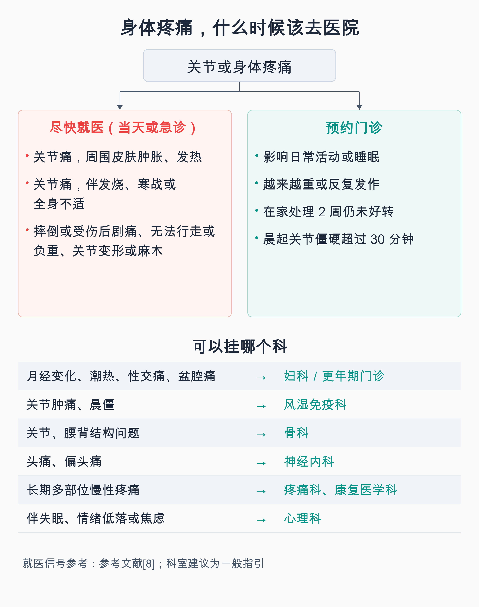

# 更年期的疼，不只是“年纪大了”：中年女性的慢性疼痛

> 四十多岁以后，早上起床手指发僵，肩膀抬不起来，腰背隐隐作痛，头痛好像也比以前来得勤。去医院拍了片子、抽了血，结果“没什么大问题”，最后常常落到一句“年纪大了，正常”。可是疼是真的，睡不好也是真的。这些疼和更年期有没有关系？哪些可以自己调理，哪些必须去医院？这篇文章把这件事讲清楚。

## 01 今年的世界更年期关怀日，主题就是“疼”

每年 10 月 18 日是国际绝经学会（IMS）发起的世界更年期关怀日。**2026 年的主题是“中年期慢性疼痛”（Chronic Pain at Midlife）** [1]。国际绝经学会指出，在绝经过渡期及绝经后，有相当一部分女性受慢性疼痛困扰，但无论在研究还是在临床照护中，这个问题都被低估了 [1]。

围绕这个主题，学会组织多国专家发表了一篇白皮书，梳理了中年女性最常见、最影响生活的几类疼痛 [2]：

- **肌肉、关节和背部的疼痛**；
- **偏头痛**；
- **慢性盆腔痛**；
- **纤维肌痛**（一种以全身广泛疼痛为主要表现的慢性疼痛）。

白皮书特别提到，这些疼痛常常**不是单独出现，而是几种叠在一起**，所以需要整体地看，而不是“头痛看头、腰痛看腰” [2]。它还指出，睡眠不好、疲劳、情绪波动和潮热等更年期症状，也可能加重疼痛的感受 [2]。

学会给女性的科普资料里有一句话值得记住：**即使影像检查和化验结果都“正常”，疼痛也是真实存在的；不必默默忍着，可以请医生和你一起制定应对方案** [3]。

## 02 更年期和疼痛，到底有没有关系

先说结论：**有关联，但不是简单的“绝经导致疼痛”。**

一项纳入 16 项研究的系统评价与荟萃分析显示，**围绝经期女性中，约 71% 有肌肉骨骼疼痛**（95% 置信区间 64%~78%）[4]。和还没进入绝经过渡期的女性相比，围绝经期女性出现肌肉骨骼疼痛的风险更高（比值比 OR 1.63）；和已经绝经的女性相比，两者风险相近（OR 1.07，差异没有统计学意义）[4]。

这组数字可以这样理解：

- **从绝经过渡期开始，肌肉、关节疼痛确实更常见**，这不是“想多了”；
- 同一研究也发现，中重度疼痛的可能性随年龄增长而上升 [4]。也就是说，**激素变化和年龄增长、关节本身的退变常常同时在起作用**，很难把某一次疼痛单独归到“更年期”头上；
- 这个比例说的是人群中的情况，**不代表每个进入更年期的女性都会疼**，个体差异很大。

为什么这个阶段更容易疼？白皮书的解释是：绝经前后雌激素水平的变化，会和肌肉骨骼的退行性改变、神经和免疫系统对疼痛的“敏感化”、以及身体的神经内分泌应激反应相互作用，共同放大疼痛 [2]。这是多种因素交织的结果，**目前还不能用一个原因解释所有人的疼**。

## 03 几类值得单独说的“疼”

**关节和肌肉痛：先排除别的病。**手指僵、膝盖痛、肩膀痛、腰背痛，是这个年龄段最常见的抱怨。但骨关节炎、类风湿关节炎、痛风、甲状腺问题等疾病也会在这个年龄出现。我国《中国绝经管理与绝经激素治疗指南 2023 版》明确，**肌肉关节痛这类躯体症状，要先由相关专科诊治、排除器质性疾病后，才考虑是否与绝经有关** [5]。所以不要一疼就认定“是更年期”，也不要一句“更年期”就不再查。

**偏头痛：可能在围绝经期变得更“乱”。**综述研究显示，围绝经期激素水平波动不稳定，可能让偏头痛发作更频繁、更没规律；绝经后，无先兆偏头痛常常会有所缓解，而有先兆偏头痛则更容易持续 [6]。**有先兆偏头痛的女性（发作前出现闪光、视野缺损等），在考虑任何激素类治疗前一定要主动告诉医生**，因为治疗方式的选择需要把这一点考虑进去 [6]。

**性交痛、外阴阴道干涩灼痛：这也是“疼”，而且有办法。**绝经后雌激素下降，外阴、阴道和下尿路组织会发生变化，医学上称为绝经生殖泌尿综合征（GSM），可以表现为干涩、烧灼感、性交疼痛，以及尿频、尿急等 [7]。很多女性因为不好意思开口而一直忍着。我国专家共识指出，以干涩、烧灼、性交痛为主时，可首选阴道保湿剂或润滑剂；阴道局部雌激素疗效确切 [7]。指南也建议，**如果只是为了改善这类局部症状，首选阴道局部用药，而不是全身激素** [5]。具体用不用、怎么用，需要妇科医生评估。

**全身多处疼、伴随疲劳和睡眠差：别忘了纤维肌痛。**如果疼痛分布广泛、找不到明确的局部病变，又常常伴随疲劳、睡眠不好，可以请医生评估是否有纤维肌痛等慢性疼痛问题 [2]。这类疼痛需要的是系统的管理，而不是反复换止痛药。

## 04 出现这些情况，要及时去医院

以关节痛为例，英国国家医疗服务体系（NHS）的就医建议可以作为参考 [8]：

**需要尽快就医（当天或急诊）：**

- 关节疼痛，同时周围皮肤**肿胀、发热**；
- 关节疼痛，同时**发烧**、发冷寒战或全身不舒服；
- 摔倒或受伤后关节剧痛、无法行走或负重、关节变形，或受伤部位麻木、刺痛。

**需要预约门诊：**

- 疼痛已经**影响日常活动或睡眠**；
- 疼痛或肿胀越来越重，或反复发作；
- 在家处理 **2 周**后仍没有好转；
- **早上起床后关节僵硬超过 30 分钟**。

除此之外，头痛的模式突然改变、性交痛或盆腔痛持续存在、疼痛伴随明显的体重下降或情绪低落，也都值得找医生聊一聊。

**挂哪个科？**可以按疼痛的部位和特点来选：

- 与月经变化、潮热出汗、性交痛、盆腔痛有关的，看**妇科**，有条件的医院可以挂**更年期门诊（绝经门诊）**；
- 关节肿痛、晨僵明显的，看**风湿免疫科**；关节、腰背的结构性问题，看**骨科**；
- 头痛、偏头痛，看**神经内科**；
- 长期、多部位、反复治疗效果不好的慢性疼痛，可以看**疼痛科**，功能锻炼可找**康复医学科**；
- 疼痛伴随长期失眠、情绪低落或焦虑，可以同时看**心理科或精神心理科**。

## 05 激素治疗能不能止痛？要看是什么疼

很多人会问：既然和雌激素有关，补激素是不是就不疼了？答案没那么简单。

一项纳入 57 项研究的系统评价与荟萃分析发现，**用过激素治疗和从没用过的女性相比，在全身性肌肉骨骼疼痛上没有看到明显差别**（相对危险度 RR 1.00）；在骨关节炎和类风湿关节炎上，各研究结果不一致 [9]。作者认为，目前还需要专门设计的研究，才能给出明确的临床建议 [9]。

我国指南的态度也一致：绝经激素治疗（MHT）对月经紊乱、潮热出汗、睡眠障碍、疲乏和情绪问题的推荐级别较高；**肌肉关节痛等躯体症状推荐级别较低，而且前提是先排除其他疾病** [5]。另外，激素治疗有明确的适应证和禁忌证，**是否使用、用哪种方式，必须由医生评估后决定**，不能自行购买使用。

换句话说，如果疼痛和潮热、失眠等更年期症状一起出现，医生在全面评估后可能会把激素治疗作为整体方案的一部分；但**不应把激素当成“止痛药”来期待**。

## 06 不靠硬扛：日常能做的事

慢性疼痛很少靠一种办法解决，国际绝经学会也强调“没有单一的解决方案”，需要多方面一起来 [3]。

以慢性腰背痛为例，世界卫生组织（WHO）2023 年发布的非手术管理指南，推荐的方向包括：**帮助患者了解疼痛、学会自我管理的健康教育，规律的运动锻炼，部分物理治疗，认知行为治疗等心理干预，以及在医生指导下使用非甾体抗炎药等药物** [10]。这些思路对其他慢性疼痛也有参考价值：

- **动起来，但循序渐进**：长期不动会让肌肉更弱、关节更僵。选择自己能坚持的运动，如快走、游泳、骑车、力量训练，从小量开始；有关节问题时可以请康复科医生或治疗师帮忙制定方案。
- **把睡眠当成治疗的一部分**：睡眠不好和疼痛会互相影响 [2]。如果潮热、盗汗严重干扰睡眠，可以去妇科或更年期门诊处理。
- **照顾情绪**：长期疼痛容易让人焦虑、低落，而情绪又会放大疼痛的感受。必要时寻求心理专业帮助，这不是“想不开”，而是正规治疗的一部分 [10]。
- **止痛药按说明用，别长期自己扛着吃**：需要长期或反复用止痛药时，应在医生或药师指导下使用，同时把疼痛的原因查清楚。
- **记一份“疼痛日记”**：记录疼痛的部位、时间、程度、和月经或潮热的关系、什么情况下加重或减轻。看病时带上，能帮医生更快判断。

中年以后的疼，值得被认真对待：它可能和更年期有关，也可能是别的病在提醒你，弄清楚原因，才谈得上好好应对。

---

## 参考文献

[1] International Menopause Society. [World Menopause Day 2026](https://www.imsociety.org/education/world-menopause-day-2026/). 官方网页，访问日期：2026-10-11.

[2] Mailis A, Ang SB, Di Renna T, et al. [Chronic pain at midlife](https://doi.org/10.1080/13697137.2026.2722558). Climacteric, 2026（国际绝经学会 2026 年世界更年期关怀日白皮书）. 综述，访问日期：2026-10-11.

[3] International Menopause Society. [Chronic Pain At Midlife: A World Menopause Day factsheet](https://www.imsociety.org/wp-content/uploads/2026/10/WMD26-Factsheet.pdf). 科普资料，访问日期：2026-10-11.

[4] Lu 等. [Musculoskeletal Pain during the Menopausal Transition: A Systematic Review and Meta-Analysis](https://doi.org/10.1155/2020/8842110). Neural Plasticity, 2020. 系统评价与荟萃分析，访问日期：2026-10-11.

[5] 中华医学会妇产科学分会绝经学组. [中国绝经管理与绝经激素治疗指南 2023 版](https://newdrugs.dxy.cn/pc/clinicalGuidelines/ASAYgrS2FoOiGXt2Iceg3g==). 中华妇产科杂志, 2023, 58(1): 4-21. 临床指南，访问日期：2026-10-11.

[6] Korn 等. [Migraine across the menopausal transition and beyond: A narrative review](https://doi.org/10.1111/head.70071). Headache: The Journal of Head and Face Pain, 2026. 综述，访问日期：2026-10-11.

[7] 中华妇产科杂志. [绝经生殖泌尿综合征临床诊疗专家共识](https://cmab.yiigle.com/uploads/guide_html/%E7%BB%9D%E7%BB%8F%E7%94%9F%E6%AE%96%E6%B3%8C%E5%B0%BF%E7%BB%BC%E5%90%88%E5%BE%81%E4%B8%B4%E5%BA%8A%E8%AF%8A%E7%96%97%E4%B8%93%E5%AE%B6%E5%85%B1%E8%AF%86.html). 专家共识，访问日期：2026-10-11.

[8] NHS. [Joint pain](https://www.nhs.uk/symptoms/joint-pain/). 官方健康信息，访问日期：2026-10-11.

[9] Overton R, Amini P, Chew A, et al. [The effect of hormone replacement therapy on musculoskeletal pain in menopausal women: A systematic review and meta-analysis](https://doi.org/10.1177/20533691251403087). Post Reproductive Health. 系统评价与荟萃分析，访问日期：2026-10-11.

[10] World Health Organization. [WHO guideline for non-surgical management of chronic primary low back pain in adults in primary and community care settings](https://www.who.int/publications/i/item/9789240081789). 指南，2023，访问日期：2026-10-11.

*本文为健康科普，不能替代个人诊疗意见。如有持续或加重的疼痛，请到正规医院就诊：与绝经相关的症状可看妇科或更年期门诊，关节问题可看风湿免疫科或骨科，头痛可看神经内科，长期慢性疼痛可看疼痛科。*
