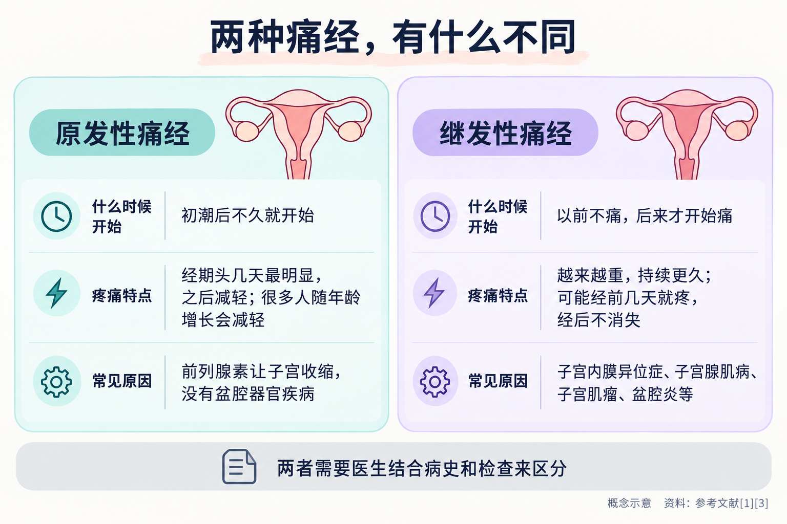
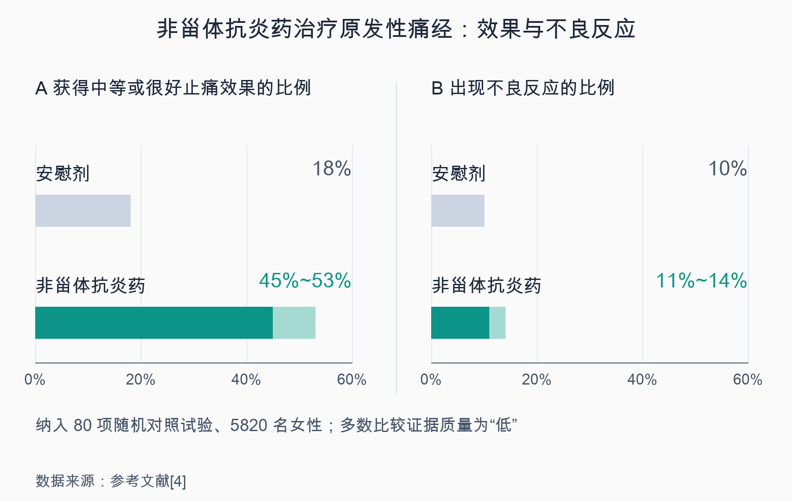
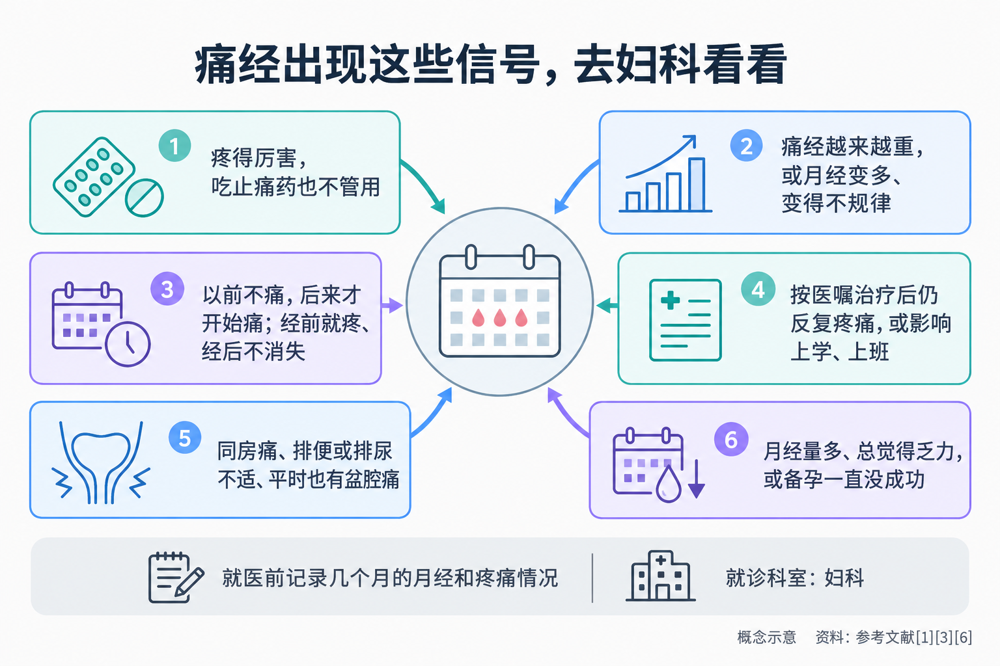

# 痛经正常吗？这几种痛经要去医院

> 每个月那几天，小腹一阵阵绞着疼，有时还腰酸、恶心、拉肚子。长辈说“女孩子都这样，忍忍就过去了”，也有人说“止痛药吃多了会上瘾，能不吃就不吃”。痛经到底算不算正常？止痛药能不能吃、怎么吃？哪些痛经背后可能藏着别的问题，需要去医院看看？这篇文章一次讲清楚。

## 01 痛经很常见，但“常见”不等于“只能忍”

痛经，指月经前或月经期间出现的疼痛和不适 [1]。美国妇产科医师学会（ACOG）指出，**超过一半有月经的女性，每个月会有 1~2 天的疼痛**，多数程度较轻；但也有一些女性疼得厉害，以至于每个月有好几天没法正常上学、上班，有的还伴有腹泻、恶心、呕吐、头痛和头晕 [1]。

一项汇总了 15 项大样本人群研究的综述显示，育龄女性中痛经的比例在不同研究里从 **16% 到 91%** 不等，其中**疼痛严重的占 2%~29%** [2]。研究还发现，痛经和年龄、生育和情绪压力都有关：**年龄增长、生育过、使用口服避孕药的女性，痛经往往更少；压力大、有痛经家族史的女性，痛经更常见** [2]。

所以，痛经确实很普遍，**轻度、能忍受、不影响生活的经期不适，大多不必紧张**。但如果疼到要请假、躺平，或者疼痛的样子越来越“不对劲”，就不该再用“大家都这样”来打发自己。英国国家医疗服务体系（NHS）也提醒，经期疼痛大多是正常的，但有时它背后是需要处理的疾病 [3]。

## 02 原发性和继发性：两种痛经，来源不一样

医生通常把痛经分成两类 [1]：

**原发性痛经：子宫“用力过猛”引起的疼痛。**它不是由盆腔器官的疾病引起的。月经来潮时，子宫内膜会产生一种叫**前列腺素**的物质，它让子宫的肌肉和血管收缩，引起痉挛性的疼痛 [1]。月经第一天前列腺素水平最高，随着内膜脱落、出血继续，水平逐渐下降，**所以疼痛通常在经期头几天最明显，之后会减轻** [1]。

原发性痛经的特点是：**往往在初潮后不久就开始**；很多人随着年龄增长会逐渐减轻，生完孩子后也可能有所改善 [1]。

**继发性痛经：生殖器官有了“问题”。**这类痛经是由生殖器官的疾病引起的 [1]。ACOG 总结了它的典型样子：**疼痛往往随时间越来越重，持续时间也比一般的经期痉挛长**，比如月经来之前好几天就开始疼，经期中越来越重，月经结束后也不消失 [1]。

常见的原因包括 [1][3]：

- **子宫内膜异位症**：类似子宫内膜的组织长到了子宫以外的地方，经期时这些组织也会出血，引起疼痛 [1]；
- **子宫腺肌病**：子宫内膜组织长进了子宫的肌肉壁里；
- **子宫肌瘤**：长在子宫壁上的肌瘤可能引起疼痛，小肌瘤通常不痛；
- **盆腔炎**等生殖器官感染；
- 刚放置宫内节育器的头几个月，也可能出现经期疼痛加重；
- 少数情况下，是先天的生殖器官发育异常，或克罗恩病、泌尿系统疾病等在经期加重 [1]。

简单说：**从初潮开始就有、经期头一两天最痛、之后慢慢缓解的，多是原发性痛经；以前不怎么痛、后来越来越痛，或者疼痛的时间越拉越长的，要警惕继发性痛经。**不过，两者只靠自己判断并不可靠，最终要由医生结合病史、检查来区分。

## 03 止痛药怎么吃才安全有效

很多人对止痛药有顾虑，宁愿硬扛。其实对原发性痛经来说，药物通常就是第一步 [1]。

**首选的一类止痛药：非甾体抗炎药。**这类药的英文缩写是 NSAIDs，常见的有布洛芬、萘普生，很多可以在药店直接买到 [1]。它们之所以对痛经特别“对症”，是因为它们能**减少身体产生前列腺素**，从源头上减轻子宫的痉挛 [1][4]。

疗效有比较扎实的研究证据。一项 Cochrane 系统评价纳入了 80 项随机对照试验、5820 名女性，结果显示，对原发性痛经，**非甾体抗炎药缓解疼痛的效果明显优于安慰剂**：如果服用安慰剂的女性中有 18% 获得中等或很好的止痛效果，那么服用非甾体抗炎药的女性中会有 **45%~53%** 达到同样效果 [4]。和对乙酰氨基酚相比，非甾体抗炎药的止痛效果也更好一些 [4]。

但它也有代价：非甾体抗炎药的不良反应更多，**如果服用安慰剂的女性中有 10% 出现不良反应，服用非甾体抗炎药的女性中会有 11%~14% 出现**，主要涉及胃肠道和神经系统 [4]。目前**也没有足够证据说明哪一种非甾体抗炎药最好、最安全** [4]。需要说明的是，这项评价中多数比较的证据质量被评为“低”，主要原因是原始研究对方法的报告不够充分 [4]。

**怎么吃效果更好？**ACOG 建议：**在月经刚来或刚开始疼的时候就服用，效果最好**，通常只需要吃 1~2 天 [1]。不要等疼到受不了才吃。剂量和服用间隔请按药品说明书或医嘱，不要自行加量。

**哪些人不适合自己吃？**ACOG 提醒，有**出血性疾病、哮喘、对阿司匹林过敏、肝脏损伤、胃病或消化性溃疡**的女性不应服用非甾体抗炎药 [1]。有这些情况，或者正在服用其他药物，请先咨询医生或药师。

**吃了止痛药还疼，还有别的办法吗？**有。ACOG 介绍，含激素的避孕方法（如复方口服避孕药、避孕贴、阴道环，以及只含孕激素的避孕方法和含激素的宫内节育器）也可以用来缓解痛经 [1]。这类方法是否适合你，需要医生评估后决定，**不要自行购买使用**。

## 04 不吃药的时候，可以试试这些

除了药物，有一些简单的方法可以帮助减轻经期不适 [1][3]：

- **热敷**：用热水袋（外面裹一条毛巾防烫伤）或暖贴放在小腹，或者洗个热水澡 [1][3]；
- **规律运动**：一周大部分日子都运动一下，比如散步、慢跑、骑车、游泳 [1]；不舒服的时候，也可以试试瑜伽、散步这类轻柔的运动 [3]；
- **轻揉腹部和后腰** [3]；
- **睡够觉**：经前和经期睡眠充足，更能应对不适 [1]；
- **放松**：冥想、瑜伽等放松练习有助于应对疼痛 [1]。

网上流传的一些补充剂，ACOG 的看法是：维生素 B1 或镁补充剂可能有帮助，**但目前研究还不够，不能作为有效疗法推荐** [1]。针灸、穴位按压、神经电刺激等方法可能有用，具体是否适合，可以和医生讨论 [1]。

## 05 子宫内膜异位症：最需要警惕的“痛经元凶”

在继发性痛经里，**子宫内膜异位症**是特别值得了解的一种。它也可能发生在青少年中。若痛经持续影响生活，尤其伴有同房痛、排便或排尿不适，不应只把它当作“正常经期反应” [6][7]。

世界卫生组织（WHO）估计，全球约 **10%（约 1.9 亿）育龄女性**受子宫内膜异位症影响，它可以从初潮开始，一直持续到绝经 [6]。主要表现包括 [6]：

- **严重的经期疼痛**；
- **月经量多**，可能因此导致缺铁和乏力；
- **慢性盆腔痛**；
- 影响性生活（**同房疼痛**）、排便或排尿；
- 腹胀、恶心；
- **不孕**。

WHO 特别指出，社会上常常忽视或淡化经期疼痛，**子宫内膜异位症带来的慢性盆腔痛并不正常**；从出现症状到确诊，**平均要经历 4~12 年** [6]。很多人就是在“痛经很正常”的观念里，一年年忍了下来。

**怎么查？**医生会先详细了解月经情况、疼痛程度、出血量和伴随症状，可以借助**超声或核磁（MRI）**等影像检查，**开始治疗前不一定需要先做手术** [6]。ACOG 在 2026 年发布新版子宫内膜异位症诊断指南，其官方解读强调：医生可以依据病史、症状和体格检查作出临床判断，在继续进行影像评估的同时启动经验性治疗 [5]。欧洲人类生殖与胚胎学会（ESHRE）2022 年指南也不再把腹腔镜作为所有人的第一步；影像检查阴性并不排除子宫内膜异位症，经验性治疗无效或不适合时，医生可考虑腹腔镜进一步评估 [7]。

**能治好吗？**目前**还没有能彻底根治子宫内膜异位症的治疗**，治疗的目标是控制症状、减少长期影响 [6]。常用的方法包括非甾体抗炎药等止痛药、激素类药物和手术，具体用哪种，要根据症状、年龄、生育计划等个体情况，由医生和患者一起决定 [6][7]。这也是为什么**早一点就医很重要**：及时评估，有助于尽早获得适合自己的症状管理与支持 [5][6]。

## 06 出现这些情况，请去妇科看看

综合 ACOG、NHS 和 WHO 的资料，出现以下情况时，建议到医院**妇科**就诊 [1][3][6]：

- 疼得厉害或比平时更痛，**而且吃了止痛药也不管用**——这种情况要尽快就医 [3]；
- **痛经越来越重**，或者月经变得更痛、量更多、周期变得不规律 [1][3]；
- **以前不痛，后来才开始痛**，或者疼痛时间越拉越长：月经前好几天就开始疼，月经结束后还不消失 [1]；
- **按医嘱治疗后仍反复疼痛，或疼痛继续影响日常生活**，需要复诊，进一步查找原因 [1][3]；
- 伴有**同房疼痛、排便或排尿时不适**、平时也有盆腔痛，或者**备孕一直没有成功** [6]；
- 月经量很多，还总觉得**乏力** [6]；
- 每个月都因为痛经**没法正常上学、上班** [1]。

去医院前，可以先简单记录几个月的情况：月经哪天开始、持续几天、量多不多、哪几天疼、疼到什么程度、吃了什么药、有没有效。这些信息能帮医生更快判断。

青春期的女孩痛得厉害，家长也不要只说“长大就好了”。**严重、加重或止痛药无效时，应及时就医；治疗后仍没有改善，也应按医嘱复诊**，不必自己等够某个固定月数才去检查 [1][3]。

痛经是身体发出的信号，大多数时候它只是在提醒“月经来了”，但当它变得越来越响、越来越不一样时，值得认真听一听，带着它去见一次妇科医生。

---

## 参考文献

[1] American College of Obstetricians and Gynecologists. [Dysmenorrhea: Painful Periods](https://www.acog.org/womens-health/faqs/dysmenorrhea-painful-periods). 患者教育资料（2020 年 12 月更新），访问日期：2026-10-13.

[2] Ju H, Jones M, Mishra G. [The prevalence and risk factors of dysmenorrhea](https://doi.org/10.1093/epirev/mxt009). Epidemiologic Reviews, 2014, 36: 104-113. 系统综述，访问日期：2026-10-13.

[3] NHS. [Period pain](https://www.nhs.uk/conditions/period-pain/). 官方健康信息（2026-03-18 审阅），访问日期：2026-10-13.

[4] Marjoribanks J, Ayeleke RO, Farquhar C, Proctor M. [Nonsteroidal anti-inflammatory drugs for dysmenorrhoea](https://doi.org/10.1002/14651858.CD001751.pub3). Cochrane Database of Systematic Reviews, 2015(7): CD001751. 系统评价，访问日期：2026-10-13.

[5] American College of Obstetricians and Gynecologists. [ACOG Publishes New Endometriosis Clinical Guidance, Aiming to Shorten Time to Diagnosis and Improve Access to Care](https://www.acog.org/news/news-releases/2026/02/acog-publishes-new-endometriosis-clinical-guidance-aiming-shorten-time-diagnosis-improve-access-care). 新版诊断指南官方发布解读，2026-02-20，访问日期：2026-10-13.

[6] World Health Organization. [Endometriosis](https://www.who.int/news-room/fact-sheets/detail/endometriosis). 官方事实清单（2025-10-15），访问日期：2026-10-13.

[7] Becker CM, Bokor A, Heikinheimo O, et al. [ESHRE guideline: endometriosis](https://doi.org/10.1093/hropen/hoac009). Human Reproduction Open, 2022(2): hoac009. 临床指南，访问日期：2026-10-13.

*本文为健康科普，不能替代个人诊疗意见。痛经严重、逐渐加重或伴有同房痛、月经量多、不孕等情况，请到妇科就诊；止痛药和激素类药物的使用请遵医嘱或咨询药师。*
