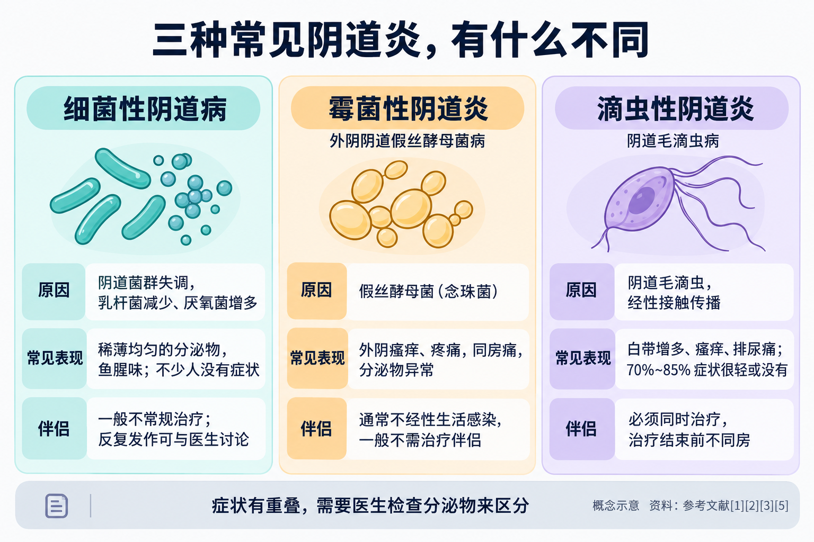
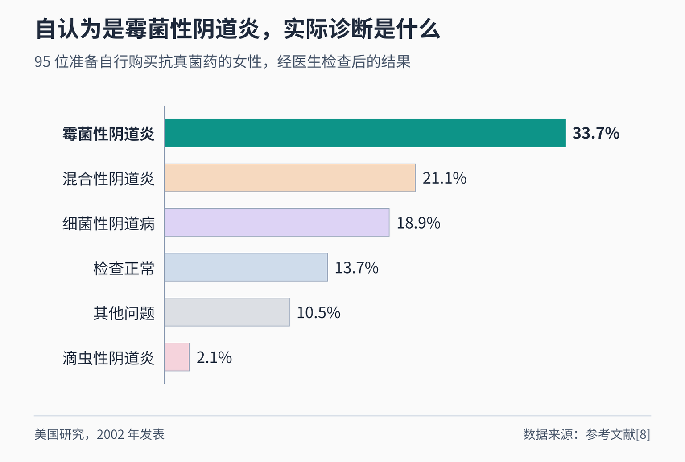
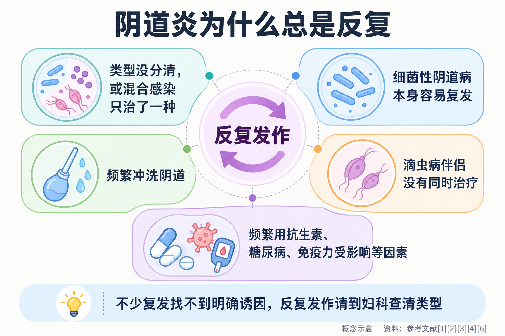
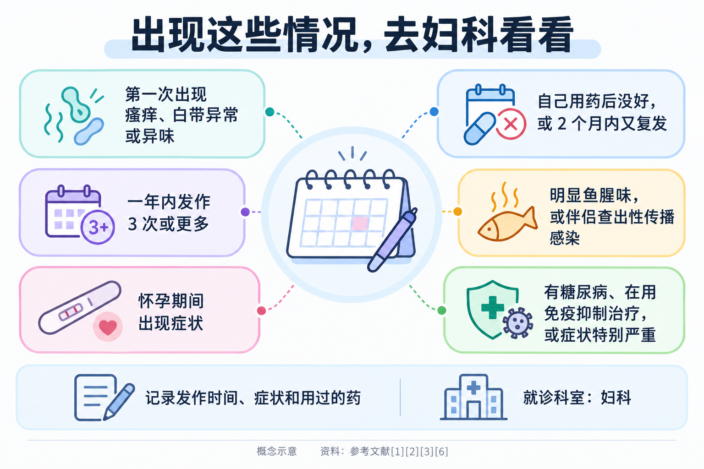

# 阴道炎为什么总是反复？先分清是哪一种

> 外阴痒、白带变多、有异味，上次去医院说是“阴道炎”，用了药好了，没过多久又来了。于是有人干脆凭经验去药店买一盒栓剂，有人天天用洗液冲洗，越洗越不舒服。阴道炎为什么这么容易反复？自己买药为什么常常不管用？伴侣要不要一起治？这篇文章把这些问题一次讲清楚。

## 01 “阴道炎”不是一种病，而是好几种

健康的阴道里住着大量以乳杆菌为主的细菌，它们产生乳酸等物质，帮助维持阴道内的平衡 [1]。这种平衡被打破，或者有外来的病原体进入，就可能出现阴道炎。

我国最新的阴道炎诊断流程指南列出了临床常见的几种类型：**细菌性阴道病、需氧菌性阴道炎、外阴阴道假丝酵母菌病、阴道毛滴虫病，以及同时有两种或以上感染的混合性阴道炎** [7]。其中最常见、也最容易被混淆的是下面三种：

**细菌性阴道病：阴道里的“好细菌”被“坏细菌”取代了。**它不是感染了某一种特定的病菌，而是原本占优势的乳杆菌减少，大量厌氧菌过度生长，属于阴道菌群失调 [1]。世界卫生组织（WHO）引用的系统评价显示，全球育龄女性中细菌性阴道病的患病率约为 **23%~29%** [4]，它也是全世界引起白带异常最常见的原因 [1]。典型表现是**稀薄、均匀、像牛奶一样的分泌物，带有明显的鱼腥味**，也可能有外阴瘙痒、刺激或排尿时灼热感；但**不少人完全没有症状** [1][4]。

**外阴阴道假丝酵母菌病：大家常说的“霉菌性阴道炎”。**它由假丝酵母菌（也叫念珠菌）引起，最常见的是白假丝酵母菌 [6]。主要表现是**外阴瘙痒、阴道疼痛、同房痛、排尿时外阴刺痛，以及分泌物异常** [2]。它非常常见：美国疾控中心（CDC）估计，**约 75% 的女性一生中至少得过一次，40%~45% 会得两次或更多** [2]。

**阴道毛滴虫病：一种性传播感染。**它由阴道毛滴虫引起，主要通过性接触在伴侣之间传播 [3][5]。WHO 估计，2020 年全球 15~49 岁人群中约有 **1.56 亿**新发病例 [5]。有症状的女性可能出现白带增多、外阴瘙痒、排尿痛或同房痛 [5]；但 CDC 指出，**70%~85% 的感染者症状很轻或完全没有症状** [3]，所以没有不舒服并不代表没有感染。

这三种阴道炎的原因不同，治疗用药也不同。**治错了方向，症状自然很难真正好起来。**

## 02 为什么不能凭感觉自己买药

很多女性得过一次“霉菌性阴道炎”以后，再出现瘙痒、白带多，就会自己去买抗真菌药。问题在于，**这几种阴道炎的症状有很多重叠，单凭感觉很难分清。**

美国一项研究在药店找到了 95 位**自认为得了霉菌性阴道炎、买了非处方抗真菌药准备自己用**的女性，请医生为她们做了检查和化验。结果发现，**真正是单纯霉菌性阴道炎的只有 33.7%**；其余的人里，21.1% 是混合性阴道炎，18.9% 是细菌性阴道病，2.1% 是滴虫性阴道炎，10.5% 是其他问题，还有 13.7% 检查结果正常 [8]。更值得注意的是，**以前被医生诊断过霉菌性阴道炎的女性，自我判断并没有更准；认真读过药品说明书的女性，也没有更准** [8]。这项研究的样本不大，时间也比较早，但它说明了一个很实际的问题：自己买药，很可能用错药，还会耽误正确的诊断。

CDC 也提醒，**不必要地使用非处方药物很常见，可能延误对其他原因阴道炎的治疗**；如果用了非处方药症状仍不消失，或者 **2 个月内又复发**，应该去医院检查 [2]。

**医生会怎么查？**通常会询问症状、做妇科检查，并取一点阴道分泌物做化验，比如在显微镜下看有没有假丝酵母菌的菌丝和孢子、有没有滴虫，或者评估阴道菌群的情况 [1][2][6]。我国指南强调，阴道炎的诊断要**把症状、妇科检查和实验室检查结合起来**，而不是只看症状或只看一项化验指标 [7]。检查本身并不复杂，但能帮你把方向找准。

## 03 阴道炎反复，常见的原因有哪些

阴道炎“好了又来”，背后的原因因类型而不同。

**原因一：一开始就没诊断准。**把细菌性阴道病当成霉菌性阴道炎来治，或者同时有两种感染只治了一种，症状就可能反复。我国指南建议，**合并混合感染时要同时治疗** [6]。

**原因二：细菌性阴道病本身就容易复发。**澳大利亚一项研究追踪了 139 位按标准方案口服甲硝唑治疗的女性，**12 个月内有 58% 再次出现细菌性阴道病** [9]。CDC 也指出，细菌性阴道病持续或复发很常见，症状再次出现时应回医院评估 [1]。对于反复发作的患者，医生可能会考虑一段时间的抑制性治疗，它能减少复发，但**停药后这种好处不一定能维持** [1]。

**原因三：滴虫病的伴侣没有一起治。**阴道毛滴虫病在伴侣之间来回传播，如果只治女方，很容易再次感染。CDC 强调，**所有性伴侣同时治疗对预防再感染至关重要**，并建议在双方都完成治疗之前不要同房 [3]。

**原因四：身体的易感因素。**CDC 把一年内有 **3 次或更多次**有症状的发作称为复发性外阴阴道假丝酵母菌病，这种情况**不到 5% 的女性**会遇到 [2]。部分复发与**频繁使用抗生素、糖尿病，或免疫力受影响（如使用糖皮质激素等免疫抑制治疗、艾滋病病毒感染）**有关；但**大多数复发的女性并找不到明确的诱因** [2]。此外，非白假丝酵母菌在复发患者中占 10%~20%，它们对常用药物的反应可能不同 [2]，我国指南推荐对治疗困难或反复发作的患者做真菌培养，再根据结果选药 [6]。

**原因五：清洁“过度”。**下面单独说。

## 04 治疗怎么做：不同类型，用药和伴侣处理都不一样

下面提到的药物都按通用名介绍，**具体是否适合你、用哪种剂型、用多久，必须由医生根据检查结果决定**，请不要自行购买使用。

**细菌性阴道病：**CDC 推荐的治疗包括口服甲硝唑，或阴道用甲硝唑凝胶、克林霉素乳膏 [1]。治疗期间建议**不同房，或者全程正确使用安全套** [1]。

伴侣要不要治，是近几年变化较大的问题。CDC 2021 年指南基于当时的研究，**不推荐常规治疗性伴侣** [1]。2025 年发表在《新英格兰医学杂志》的一项随机对照试验，纳入了女方患细菌性阴道病、只有一位固定男性伴侣的夫妇：男方同时口服甲硝唑并在阴茎皮肤上外用克林霉素乳膏 7 天，**12 周内女方复发的比例为 35%，而只治女方的对照组为 63%** [10]。不过，2026 年一项汇总了 6 项随机对照试验的荟萃分析发现，**只给男方口服药物并不能减少复发**；口服加外用的联合方案目前只有这一项试验支持，还需要更多高质量研究 [11]。所以，**反复发作的细菌性阴道病，可以和医生讨论伴侣是否需要一起检查和治疗**，但不要自己给伴侣买药。

**外阴阴道假丝酵母菌病：**单纯性的发作，用单个疗程的抗真菌药物治疗；CDC 指出，按疗程用完唑类药物后，**80%~90% 的患者症状缓解、培养转阴** [2]。复杂的情况（症状重、复发性、非白假丝酵母菌感染等）治疗方案差别较大，我国指南建议：**症状重的延长疗程，复发性的先强化治疗、再巩固治疗** [6]。它**通常不是通过性生活感染的，一般不需要治疗伴侣** [2]。

**阴道毛滴虫病：**CDC 推荐女性口服甲硝唑 7 天，WHO 指出甲硝唑或替硝唑是首选治疗 [3][5]。最关键的有三点：**性伴侣同时治疗；双方都治疗结束前不同房；治疗后约 3 个月复查一次** [3]。

**怀孕了怎么办？**孕期出现阴道炎症状，更要找医生处理，不要自己用药。我国指南指出，**孕期的霉菌性阴道炎禁用口服抗真菌药，推荐阴道用的唑类药物** [6]；CDC 建议有症状的孕妇治疗细菌性阴道病，并指出孕期应避免使用替硝唑 [1]。WHO 提示，细菌性阴道病与流产、早产等妊娠问题有关 [4]，这也是孕期出现症状要及时就医的原因之一。

## 05 日常护理：越洗越干净是个误区

很多人觉得，反复发炎是因为“不够干净”，于是每天用洗液冲洗阴道。事实恰恰相反。

**阴道有自己的清洁和保护机制，不需要冲洗。**WHO 指出，**阴道清洗和冲洗会增加患细菌性阴道病的风险**，往阴道里放草药或其他产品也属于危险因素 [4]。CDC 也提到，冲洗**可能增加细菌性阴道病复发的风险**，而且**没有证据支持用冲洗来治疗或缓解症状** [1]。WHO 还特别指出，如果不配合生活方式上的调整，比如避免过度清洗，**治疗效果会打折扣** [4]。

日常可以这样做：

- **不做阴道冲洗**，不往阴道里塞草药、偏方或其他产品 [4]；
- **按医嘱用完整个疗程**，症状消失了也不要提前停药；治疗期间不同房，或者全程正确使用安全套 [1]；
- **使用安全套**：细菌性阴道病与新的或多个性伴侣、不使用安全套有关 [1]，滴虫病通过无保护性接触传播 [5]；
- 糖尿病是霉菌性阴道炎反复的相关因素之一，有**糖尿病**的女性就诊时要告诉医生 [2]；
- **不滥用抗生素**，必须使用时按医嘱 [2]。

阴道炎不只是“难受”。WHO 和 CDC 指出，**细菌性阴道病会增加感染淋病、衣原体、艾滋病病毒等性传播感染的风险**，还与盆腔炎有关 [1][4]。所以，反复发作值得认真对待，而不是一次次自己买药“压下去”。

## 06 出现这些情况，请去妇科看看

建议到医院**妇科**就诊的情况 [1][2][3][6]：

- **第一次出现**外阴瘙痒、白带异常、异味等症状；
- 自己用了非处方药，**症状没有消失，或 2 个月内又复发**；
- **一年内发作 3 次或更多**；
- 白带有明显**鱼腥味**，或者伴侣被查出有滴虫等性传播感染；
- **怀孕期间**出现症状；
- 有糖尿病、正在使用糖皮质激素等免疫抑制治疗，或者症状特别严重。

就诊前，可以把这几次发作的时间、症状、用过什么药记下来，告诉医生。如果被诊断为滴虫病，**伴侣也需要去医院检查和治疗**。

阴道炎反复，往往不是因为“不够干净”，而是类型没分清、疗程没用完，或者该一起治的人没一起治。先查清是哪一种，再对症处理，才能真正让它少来几次。

---

## 参考文献

[1] Centers for Disease Control and Prevention. [Bacterial Vaginosis - STI Treatment Guidelines](https://www.cdc.gov/std/treatment-guidelines/bv.htm). 性传播感染治疗指南（2021），访问日期：2026-10-26.

[2] Centers for Disease Control and Prevention. [Vulvovaginal Candidiasis - STI Treatment Guidelines](https://www.cdc.gov/std/treatment-guidelines/candidiasis.htm). 性传播感染治疗指南（2021），访问日期：2026-10-26.

[3] Centers for Disease Control and Prevention. [Trichomoniasis - STI Treatment Guidelines](https://www.cdc.gov/std/treatment-guidelines/trichomoniasis.htm). 性传播感染治疗指南（2021），访问日期：2026-10-26.

[4] World Health Organization. [Bacterial vaginosis](https://www.who.int/news-room/fact-sheets/detail/bacterial-vaginosis). 官方事实清单（2025-11-21），访问日期：2026-10-26.

[5] World Health Organization. [Trichomoniasis](https://www.who.int/news-room/fact-sheets/detail/trichomoniasis). 官方事实清单（2025-11-21），访问日期：2026-10-26.

[6] 中华医学会妇产科学分会感染性疾病协作组. [Chinese guidelines for diagnosis and treatment of vulvovaginal candidiasis (2024 edition)](https://pubmed.ncbi.nlm.nih.gov/39056126/). 中华妇产科杂志, 2024, 59(7): 499-504. 临床指南（依据中文摘要），访问日期：2026-10-26.

[7] 国家妇产疾病临床医学研究中心, 国家卫生健康委临床检验中心. [Guidelines for standardized diagnostic procedures of common vaginitis (2025)](https://pubmed.ncbi.nlm.nih.gov/41765648/). 中华妇产科杂志, 2026, 61(2): 89-96. 临床指南（依据中文摘要），访问日期：2026-10-26.

[8] Ferris DG, Nyirjesy P, Sobel JD, et al. [Over-the-counter antifungal drug misuse associated with patient-diagnosed vulvovaginal candidiasis](https://doi.org/10.1016/s0029-7844(01)01759-8). Obstetrics & Gynecology, 2002, 99(3): 419-425. 原始研究，访问日期：2026-10-26.

[9] Bradshaw CS, Morton AN, Hocking J, et al. [High recurrence rates of bacterial vaginosis over the course of 12 months after oral metronidazole therapy and factors associated with recurrence](https://doi.org/10.1086/503780). The Journal of Infectious Diseases, 2006, 193(11): 1478-1486. 原始研究，访问日期：2026-10-26.

[10] Vodstrcil LA, Plummer EL, Fairley CK, et al. [Male-Partner Treatment to Prevent Recurrence of Bacterial Vaginosis](https://doi.org/10.1056/NEJMoa2405404). The New England Journal of Medicine, 2025, 392(10): 947-957. 随机对照试验，访问日期：2026-10-26.

[11] Pacheco Vieira LL, Suruagy-Motta RFO, Bomfim JQ, et al. [The efficacy of male partner treatment to prevent recurrence of bacterial vaginosis: a systematic review with meta-analysis of randomized controlled trials](https://doi.org/10.1016/j.ejogrb.2026.115047). European Journal of Obstetrics & Gynecology and Reproductive Biology, 2026, 321: 115047. 系统评价与荟萃分析，访问日期：2026-10-26.

*本文为健康科普，不能替代个人诊疗意见。出现外阴瘙痒、白带异常、异味或反复发作，请到妇科就诊；孕期出现症状尤其要及时就医。药物的选择和疗程请遵医嘱，不要自行购买使用。*
