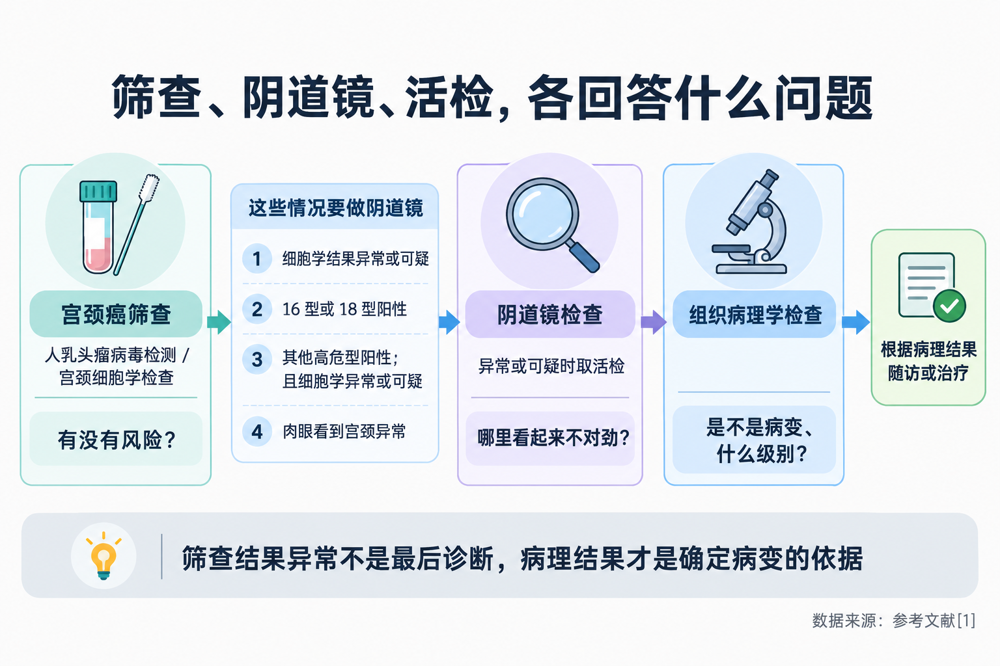
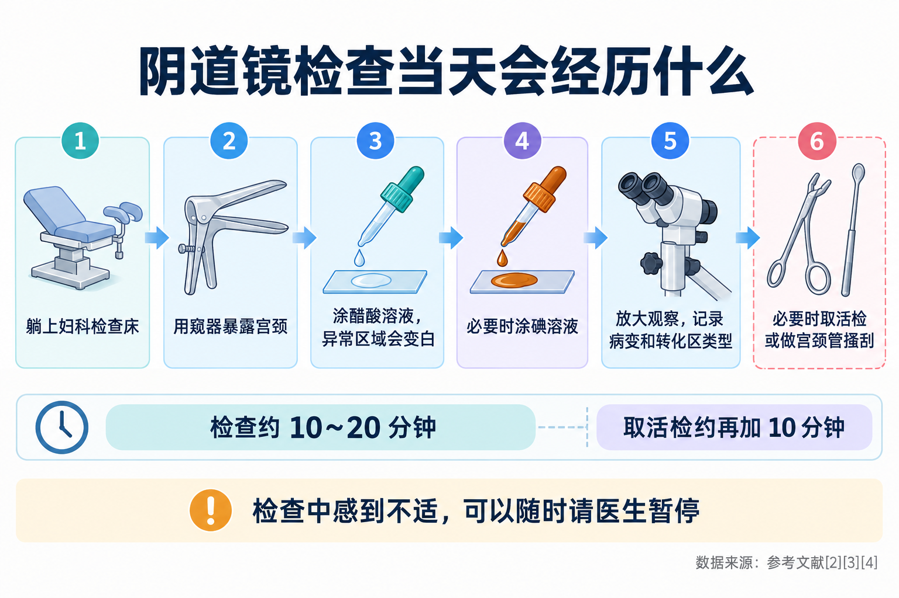
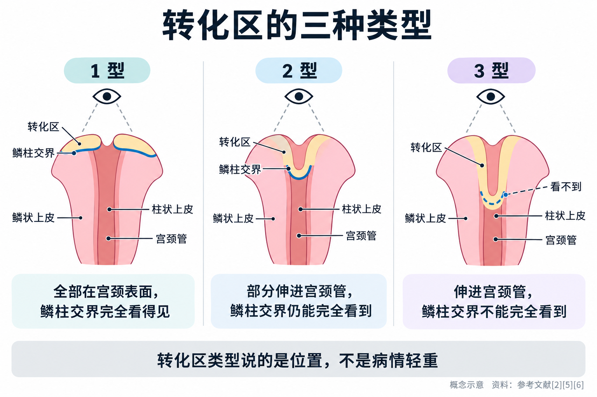
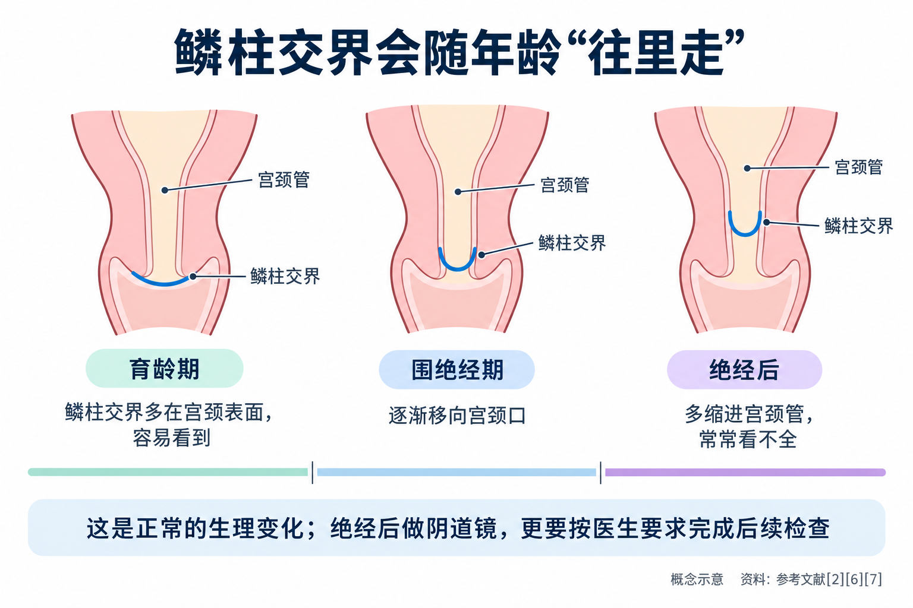

# 阴道镜检查是怎么回事：疼不疼、查多久、“转化区”是什么

> 筛查报告出来，医生说“去做个阴道镜吧”。很多人一听就紧张：是不是查出癌了？镜子要伸进去多深，会不会很疼？好不容易做完，报告上又写着“转化区 3 型”“鳞柱交界部分可见”，完全看不懂。这篇文章把阴道镜检查从头讲清楚：为什么要做、怎么做、做完要注意什么，以及报告上的“转化区”到底在说什么。

## 01 被叫去做阴道镜，不等于查出了癌

阴道镜检查的英文是 **Colposcopy（阴道镜检查）**。名字里有“镜”，但它其实是一台**放在身体外面的放大观察设备**，类似一台显微镜，医生通过它把宫颈表面放大来看；镜子本身不伸进身体，伸进阴道的是和做妇科检查时一样的窥器，以及涂药、取样用的器械 [3]。

要理解为什么让你做阴道镜，先把宫颈癌防治的三步分开看：

- **筛查**（人乳头瘤病毒检测、宫颈细胞学检查）回答的是“**有没有风险**”；
- **阴道镜检查**回答的是“**宫颈上哪里看起来不对劲**”，并在可疑的地方取样；
- **组织病理学检查**（活检）回答的是“**到底是不是病变、是什么级别**”。

国家卫生健康委《宫颈癌筛查工作方案》写得很清楚：**细胞学检查或人乳头瘤病毒检测结果异常，都不能作为疾病的最后诊断** [1]。方案规定，以下几种情况要转去做阴道镜检查 [1]：

- 宫颈细胞学检查结果**异常或可疑**；
- 人乳头瘤病毒分型检测 **16 型或 18 型阳性**；
- **其他高危型阳性，同时细胞学结果异常或可疑**；
- 妇科检查时**肉眼看到宫颈异常**。

阴道镜检查结果异常或可疑的，再做组织病理学检查 [1]。

除了筛查异常，**同房后出血等异常阴道出血**也可能需要做阴道镜，帮助查找原因 [3]。确诊宫颈病变 2 级、正在随访观察的女性，定期复查时也包括阴道镜检查 [2]。

所以，被叫去做阴道镜，意思是“**筛查发现了需要进一步看清楚的信号**”，而不是“已经确诊了什么病”。英国国家医疗服务体系（NHS）的患者资料也提到，阴道镜检查中**很少发现宫颈癌** [3]。

**它是怎么来的？**阴道镜的历史比很多人想的要长。上世纪 20 年代，德国妇科医生欣泽尔曼（Hinselmann）在汉堡借助光学厂商的技术人员改进放大镜，做出了后来被称为“阴道镜”的设备，**1925 年发表了关键论文** [8]。后来，阴道镜和巴氏涂片这类细胞学检查逐渐配合使用：细胞学从脱落细胞里发现异常线索，阴道镜帮助在宫颈上找到异常的位置，对**涂片异常的女性做出更准确的诊断** [8]。今天，筛查方法从涂片发展到了人乳头瘤病毒检测，但“筛查发现线索 → 阴道镜定位 → 病理确诊”的思路一直沿用。

## 02 检查当天：大约多久，会经历什么

**时间不长。**英国国家医疗服务体系的资料说，阴道镜检查一般**约 15~20 分钟**，做完通常就可以回家 [3]；美国国家医学图书馆的患者资料说**约 10~20 分钟**，如果需要取活检，大约再多 10 分钟 [4]。

检查的大致过程是 [3][4]：

1. **躺上妇科检查床**，和做妇科检查的体位一样；
2. 医生用**窥器**撑开阴道，暴露宫颈；
3. 在宫颈表面涂上**醋酸溶液**。醋酸会让异常的区域变白，医生称之为“醋白”，这样更容易看出哪里不对劲 [2][3]；
4. 有时还会再涂一层**碘溶液**（报告上可能写作“复方碘染色”），病变区域常常不着色，帮助医生把可疑区域和周围组织区分开 [2][4]；
5. 医生用阴道镜放大观察宫颈，记录病变的位置、范围、颜色、边界和血管等表现，同时判断**转化区的类型**（后面专门讲）[2][5]；
6. **必要时取活检**：在看起来最可疑的地方取一小块组织送病理。英国资料形容取下的组织**约针头大小** [3]。

**会取几块？**我国 2026 年发布的《子宫颈上皮内瘤变 2 级管理中国专家共识》提到，有一类较“薄”的高级别病变在阴道镜下容易被看成低级别，因此主张**无论阴道镜下印象是什么，都应在醋白区域多点活检** [2]。美国阴道镜和宫颈病理学会的阴道镜操作标准也建议，**针对可疑区域取 2~4 块活检**，以提高病变的检出率 [9]。所以，取了好几块并不说明情况更糟，而是为了**尽量不漏**。

**宫颈管搔刮是什么？**有的女性还会被做一项“宫颈管搔刮”，是用小刮匙从宫颈口里面刮取一点组织，用来查看**阴道镜看不到的宫颈管内部** [4]。它不是每个人都要做。共识认为，目前没有足够证据支持对所有病变 2 级的女性常规做宫颈管搔刮，但对于**转化区 3 型、病变向宫颈管里延伸、细胞学高度异常、16/18 型持续感染**的女性，应当重视 [2]。

## 03 疼不疼？检查前后要注意什么

**多数是不适，少数人会觉得疼。**英国资料坦白地说：阴道镜检查可能让人不舒服，有些人会觉得疼；涂醋酸时可能有**轻微刺痛或灼热感**，取活检时会有**轻微的夹痛**；**检查过程中随时可以要求暂停** [3]。宫颈管搔刮时，可能会有**夹痛或类似痛经的下腹坠痛** [4]。

紧张会让身体更僵硬，也会让窥器放置更不舒服。可以提前把担心告诉医生，问清楚每一步要做什么；检查时尽量放松呼吸。

**检查前：**

- 检查前一段时间内**避免同房、阴道冲洗、阴道用药和使用卫生棉条**。英国资料建议提前 24 小时 [3]，美国资料建议提前 48 小时 [4]，具体以预约时医院的要求为准；
- **月经期**：美国资料建议尽量避开月经期安排检查 [4]；英国资料则说经期也可以做，介意的话可以改约 [3]。预约时可以问清楚所在医院的做法；
- **怀孕或可能怀孕**，一定要提前告诉医生（详见第 05 部分）[3][4]；
- 可以带一片卫生巾或护垫，检查后可能有少量出血 [3]。

**检查后：**

- 只做了阴道镜、没取活检的，出血和分泌物一般**几天内**就会消失；取了活检的，可能持续更久 [3]，美国资料说**一周左右的少量出血和分泌物是正常的** [4]；
- 可能有几天类似经期的轻微下腹痛 [3]；
- 有出血、分泌物或疼痛期间，**避免同房、不用卫生棉条和月经杯**，改用卫生巾 [3]；取了活检的，美国资料建议**一周内**避免同房、阴道冲洗和卫生棉条，或按医生交代的时间 [4]。

**出现这些情况要尽快就医**：出血量比月经最多的时候还多，分泌物有臭味，或者发热、寒战、腹痛吃止痛药也不缓解、反复发作 [3][4]。

**结果什么时候出？**如果阴道镜下没看到异常，医生常常当场就会告诉你 [3]；取了活检的，要等病理科出报告，具体时间以就诊医院为准。

## 04 报告上的“转化区”和“鳞柱交界”是什么意思

这是很多人看报告最困惑的地方。

宫颈表面有两种上皮：**宫颈外面覆盖的是鳞状上皮，宫颈管里面是柱状上皮**，两者交界的那条线叫**鳞柱交界** [6]。青春期以后，在雌激素等因素影响下，交界附近的柱状上皮会逐渐被新生的鳞状上皮替代，这个过程叫“化生”；**原来的交界线和新的交界线之间的这片区域，就是转化区** [6]。

为什么医生这么在意它？因为**绝大多数宫颈病变就长在转化区，紧挨着鳞柱交界** [2]。阴道镜检查的关键之一，就是把这条交界线和整个转化区看清楚。

国际宫颈病理与阴道镜联盟 2011 年发布的阴道镜术语，按鳞柱交界的位置和能否看全，把转化区分成三型 [5]：

- **1 型**：转化区**全部在宫颈外表面**，没有伸进宫颈管的部分，鳞柱交界完全看得见；
- **2 型**：转化区有一部分**伸进了宫颈管**，但鳞柱交界**仍然能完全看到**（有时需要借助器械撑开宫颈口）；
- **3 型**：转化区伸进宫颈管，**即使借助器械，鳞柱交界也不能完全看到**。

报告上也可能写成“鳞柱交界完全可见 / 部分可见 / 不可见”[5]，意思相通。

**要特别说明的是：转化区类型是在描述宫颈的解剖位置，不是病情的轻重分级。**3 型不等于病变更严重，它只是说明“有一部分区域藏在宫颈管里，镜子看不到”。

**那为什么“看不全”会影响后续处理？**

- **可能漏掉藏在里面的病变。**共识引用的研究显示，鳞柱交界看不见时，宫颈癌漏诊的风险为 0.6%，看得见时为 0.3%；国内研究也显示，鳞柱交界看不见时，病变 2 级女性中漏诊的风险增加 9.6 倍 [2]；
- **可能需要补充检查。**比如前面提到的宫颈管搔刮，就是为了取到镜子看不到的地方 [2]；
- **影响能不能“观察等待”或选择保守治疗。**共识把鳞柱交界能不能看见，列为决定病变 2 级能否保守观察的关键因素之一；消融等保守性治疗，**至少要求转化区和病灶完全可见** [2]。观察期间如果病灶上界或鳞柱交界变得看不见，就应停止观察，考虑切除性治疗 [2]；
- **影响切除范围。**需要做切除性治疗时，切除深度要以**完整覆盖病变上界和转化区**为原则 [2]。

所以，报告上写着“3 型”，不必害怕，但要明白：**医生之后的建议可能更偏向补充检查或更稳妥的处理方式**，这是为了不漏诊，而不是因为病情更重。

## 05 绝经后为什么更容易“看不全”？孕期能不能做

### 绝经后：交界线“往里缩”了

鳞柱交界的位置并不是一辈子不变的。随着年龄增长、化生持续进行，新的鳞柱交界看起来会**逐渐向宫颈口移动，然后缩进宫颈管里**，这个过程**在绝经后完成** [6]。

一项汇总三个研究人群的分析发现，鳞柱交界的可见度**随年龄增长而下降**：**到 40 多岁后期，多数受检者的鳞柱交界最多只能部分看到**；45 岁时，至少有一半人的鳞柱交界看不全 [7]。研究者推测，这与围绝经期和绝经期的激素变化有关 [7]。

这意味着，**绝经后的女性做阴道镜，更常见的是 3 型转化区**。共识指出，绝经后由于雌激素缺乏，下生殖道萎缩，**病变多位于宫颈管内**，宫颈管搔刮的敏感性也较低，阴道镜下活检漏诊的风险增加 [2]。研究显示，45 岁及以上女性中，**54.5% 的病变 2 级及以上被漏诊** [2]。

因此，共识对绝经后女性更为谨慎：**在充分评估、排除手术禁忌后，绝经后病变 2 级的女性首选切除性治疗**；没有禁忌的，可以在治疗前用 1~2 周局部雌激素制剂做预处理 [2]。

绝经后的女性如果被建议做阴道镜，**一定要按时去**；拿到“鳞柱交界不可见”的报告，也要遵医嘱完成后续检查，不要因为“活检没发现问题”就自行放下。

### 孕期：可以做，但有讲究

怀孕本身不是做阴道镜的障碍。共识指出，孕期出现非产科原因的阴道出血或同房后出血、肉眼看宫颈有异常，或者宫颈癌筛查结果异常，**都应转诊阴道镜检查**；孕期做阴道镜的目的，主要是**发现和排除宫颈癌** [2]。

需要注意的几点 [2][4]：

- 时间上以**孕早期和孕中期**为宜，孕晚期宫颈暴露困难；
- 建议由**经验丰富的医生**操作，可疑高级别病变或更严重病变时才活检；
- **孕期禁止做宫颈管搔刮**；
- 孕期活检后出血风险会高一些，检查后**出血多或腹痛要及时就医**。

## 06 去哪里做，拿到结果之后

**去哪个科？**阴道镜检查在医院**妇科**做，很多医院设有**阴道镜门诊或宫颈疾病门诊**。参加当地“两癌”筛查、初筛结果异常的，可以按筛查机构的转诊安排去做 [1]。

**就诊时带上：**历次的人乳头瘤病毒检测和细胞学报告、以前的阴道镜和病理报告；告诉医生末次月经时间、是否怀孕或准备怀孕、是否绝经、有没有做过宫颈治疗。

**拿到结果之后，大致有这几种方向**（具体由医生结合年龄、筛查结果、病理和生育计划判断）[2][3][4]：

- **没有看到异常或活检正常**：按医生建议回到定期筛查或缩短间隔复查；
- **低级别病变**：大多数先随访观察，不急于治疗；
- **病变 2 级**：根据风险评估，选择观察随访或治疗；
- **病变 3 级等高级别病变**：一般需要治疗；
- **极少数发现宫颈癌**：转到专科团队进一步诊治。

阴道镜检查本身并不可怕，它是在筛查和诊断之间，帮医生把问题看清楚的那一步。按时去做、配合完成活检和复查，才能让前面的筛查真正发挥作用。

---

## 参考文献

[1] 国家卫生健康委员会. [宫颈癌筛查工作方案（含宫颈癌防治健康教育核心知识）](https://www.nhc.gov.cn/fys/c100078/202201/e4209b0a6e604f6aba3e793d8eddebf3/files/1733998298755_31891.pdf). 政府文件，2022，访问日期：2026-10-27.

[2] 中国优生科学协会阴道镜和宫颈病理学分会, 中华医学会妇科肿瘤学分会. [子宫颈上皮内瘤变 2 级（CIN 2）管理中国专家共识（2026 版）](https://www.obgyncn.com/CN/10.13390/j.issn.1672-1861.2026.01.030). 中国妇产科临床杂志, 2026, 27(1): 89-96. 专家共识，访问日期：2026-10-27.

[3] NHS. [Colposcopy](https://www.nhs.uk/tests-and-treatments/colposcopy/). 英国国家医疗服务体系患者资料（2026-09-01 审阅），访问日期：2026-10-27.

[4] MedlinePlus, U.S. National Library of Medicine. [Colposcopy](https://medlineplus.gov/lab-tests/colposcopy/). 美国国家医学图书馆患者资料（2024-08-08 更新），访问日期：2026-10-27.

[5] Quaas J, Reich O, Küppers V. [Explanation and Use of the Rio 2011 Colposcopy Nomenclature of the IFCPC (International Federation for Cervical Pathology and Colposcopy)](https://pmc.ncbi.nlm.nih.gov/articles/PMC4275313/). Geburtshilfe und Frauenheilkunde, 2014, 74(12): 1090-1092. 术语解读，访问日期：2026-10-27.

[6] Waxman AG; American Society for Colposcopy and Cervical Pathology. [The normal cervix: cytology, colposcopy, and histology](https://portal.asccp.org/Assets/414cb0dc-1e49-4717-bc61-6ce746a4302c/637401753899230000/01-the-normal-cervix-final-pdf). 美国阴道镜和宫颈病理学会教学课件，2020，访问日期：2026-10-27.

[7] Desai KT, Hansen N, Rodriguez AC, et al. [Squamocolumnar junction visibility, age, and implications for cervical cancer screening programs](https://pmc.ncbi.nlm.nih.gov/articles/PMC10922959/). Preventive Medicine, 2024, 180: 107881. 原始研究，访问日期：2026-10-27.

[8] Fusco E, Padula F, Mancini E, et al. [History of colposcopy: a brief biography of Hinselmann](https://pmc.ncbi.nlm.nih.gov/articles/PMC3279084/). Journal of Prenatal Medicine, 2008, 2(2): 19-23. 医学史综述，访问日期：2026-10-27.

[9] Wentzensen N, Schiffman M, Silver MI, et al. [ASCCP Colposcopy Standards: Risk-Based Colposcopy Practice](https://profiles.wustl.edu/en/publications/asccp-colposcopy-standards-risk-based-colposcopy-practice/). Journal of Lower Genital Tract Disease, 2017, 21(4): 230-234. 专业学会实践标准（依据摘要），访问日期：2026-10-27.

*本文为健康科普，不能替代个人诊疗意见。是否需要做阴道镜检查、是否取活检或做宫颈管搔刮，以及结果出来后的处理，请到妇科（阴道镜门诊或宫颈疾病门诊）由医生结合个人情况评估决定；检查后出血多、发热或腹痛，请及时就医。*
