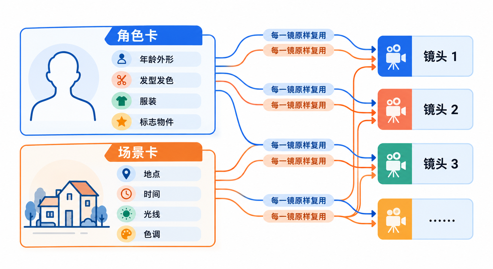

# AI短剧第一步：用大模型把剧本拆成镜头表，再交给视频工具

很多人第一次用 AI 做短剧，是打开一个视频生成工具，把整个故事塞进一句提示词，然后等它“出片”。结果往往是：画面单看还行，但一段只有几秒，人物换了张脸，剧情也接不上。

问题不在工具，而在少了一步：**分镜**。视频模型一次只拍一个镜头，你得先把故事拆成一个个镜头，再一个个交给它。这篇就讲这一步怎么做：用任意一个对话大模型，把一页剧本拆成一张镜头表，再把表里的每一行改写成视频工具能读懂的提示词。全程不花视频工具的积分，做完你手里就有一份能直接开拍的清单。

## 整个流程长什么样


先把全貌摆出来，后面每一节对应其中一步：

1. **一页剧本**：一个完整的小故事，有开头、冲突和结尾，台词写清楚。
2. **角色卡和场景卡**：把每个角色、每个场景的外观写成一段固定描述，后面每个镜头都原样复用。
3. **镜头表**：把剧本拆成一行一个镜头，每行写清时长、景别、运镜、画面、台词和音效。
4. **逐镜提示词**：把镜头表的每一行改写成一段视频提示词。

前三步都在对话大模型里完成，DeepSeek、豆包、Kimi、ChatGPT、Claude 都可以，用你手边最顺手的那个。第四步的产物才拿去视频工具里生成。

**这样分的好处是，最贵的环节放在最后。** 视频生成按次消耗积分或额度，而在大模型里改十遍镜头表几乎没有成本。故事讲不通、镜头太多、节奏拖沓，这些问题都应该在表格阶段解决，而不是生成了二十段视频之后才发现。

## 分镜是怎么来的，AI 又改变了什么

分镜不是 AI 时代的新发明。1930 年代，美国的动画工作室开始把一个个画面画在单独的纸上，按顺序钉在墙上讲故事，大家站在墙前讨论哪里该删、哪里该加，再动手画成动画。后来这个做法被电影、广告、电视剧普遍采用，成了开拍前的标准环节。

传统分镜有两种形态：一种是画出来的**故事板**（storyboard），一格一个画面；另一种是文字版的**镜头表**（shot list），一行一个镜头，写明景别、机位、运镜和时长，主要给摄影组照着拍。

到了 AI 视频这里，镜头表的地位变了。以前它是**给人看的计划**，摄影师读完自己去理解、去拍；现在它几乎就是**直接给机器的输入**：视频模型按“一段提示词生成一个镜头”的方式工作，镜头表里的每一行，改写一下就是一段提示词。以 Google 云端平台上的 Veo 3.1 为例，单次生成的视频只能是 4、6 或 8 秒，竖屏 9:16 和横屏 16:9 都支持。一集一分钟的竖屏短剧，少说也要十几个镜头，不先拆好，根本没法开始。

同时，传统分镜里靠摄影师“意会”的部分，在 AI 这里必须写成字。人类摄影师知道上一镜的女主穿的是灰色风衣，模型不知道；人类演员知道这场戏的情绪，模型只认你写下的描述。**所以 AI 时代的镜头表要比传统的更啰嗦：角色外观、光线、情绪，每一镜都要重新写一遍。**

## 三种拆法，比一比


把剧本变成镜头表，现在大致有三种做法。之所以把这三种放在一起比，是因为它们正好代表了“全靠自己”“人机协作”“交给平台”三个方向，新手一定会在其中纠结。

| | 自己手写 | 用对话大模型拆 | 用视频平台自带的故事/分镜功能 |
|---|---|---|---|
| 上手难度 | 高，要懂景别和运镜 | 低，会写要求就行 | 最低，按平台流程走 |
| 可控程度 | 最高，每个镜头自己定 | 高，表格可以逐行改 | 取决于平台给你留了多少修改空间 |
| 能不能换视频工具 | 能 | 能，表格和工具无关 | 一般只能在这个平台里继续 |
| 成本 | 只花时间 | 对话大模型的免费额度通常够用 | 按平台规则消耗积分 |
| 适合谁 | 有拍摄经验的人 | 大多数新手 | 想最快看到成片、不在意细节的人 |

**为什么推荐从“用对话大模型拆”开始**：它把最难的部分（景别、运镜这些专业词）交给模型去补，你只需要判断“这一镜对不对”。而且产物是一张普通表格，今天用这家视频工具，明天换另一家，表格照样能用。

**为什么有人放弃它**：大模型会写出“看起来很专业”但拍不出来的镜头，比如一个镜头里塞了三个动作，或者要求一段 4 秒的视频完成一次复杂的转场。这需要你在第三步里一行行检查，后面会给一份自查清单。

**平台自带功能的位置**：不少视频平台都在做“从故事到成片”的一体化功能，省事是真的省事，但镜头怎么拆、拆成几镜，往往由平台决定，换工具时也带不走。从定位上看，它更适合快速试一个想法；想认真做一部系列短剧，还是自己手里握着一张镜头表更踏实。

## 动手前先定三个规格

在让大模型写任何东西之前，先把这三件事定下来，写进每一次对话的开头：

- **画幅**：短剧平台以竖屏为主，一般选 **9:16**。确认你要用的视频工具支持竖屏输出。
- **单集时长**：第一次练手建议 **一分钟左右**，十几个镜头，能讲完一个小反转就够了。
- **单镜时长**：按你打算用的视频工具来定。去工具的官方页面查一下单次能生成几秒、有哪几档可选，镜头表里每一镜的时长就从这几档里挑。比如工具只支持 4、6、8 秒，镜头表里就不要出现 3 秒或 10 秒的镜头。

单镜时长这一条最容易被忽略。大模型不知道你用的是哪个工具，它可能随手写一个“2 秒”的镜头，你拿去生成时才发现最短也要 4 秒，只能再剪掉一半。**把工具的限制提前告诉大模型，比事后修表省事得多。**

## 第一步：写一页剧本

如果你已经有自己的故事，直接跳到下一步。如果还没有，可以让大模型帮你起一个。下面这段要求可以直接复制，把括号里的内容换成你的想法：

```text
帮我写一个原创竖屏短剧剧本，要求如下：
- 时长约 1 分钟，最多 2 个角色，最多 2 个场景
- 题材：（例如：都市温情 / 轻喜剧 / 悬疑）
- 结构：开头 5 秒内抛出冲突，中间一次误会或反转，结尾留一个让人想看下一集的钩子
- 角色和名字都是原创的，不要用真实人物或已有作品里的角色
- 每句台词不超过 15 个字，方便后面配字幕
- 先给我三个故事梗概，每个两三句话，等我选定一个再写完整剧本
```

最后一条很关键：**先让它出梗概，选定了再展开。** 一次性写完整剧本，你很难判断三个方向里哪个更好；梗概阶段改主意，成本几乎为零。

为了后面几步有东西可拆，这里用一个原创的小故事做示例：

```text
深夜的便利店，值班店员林小禾发现一位穿灰色风衣的老人每晚 11 点都来买一盒热牛奶，却从不喝，只是放在门口的长椅上。小禾以为他是在等人，偷偷观察了一周。最后一晚，老人没来，长椅上的牛奶旁多了一张纸条：“替我谢谢那只猫。”镜头一转，一只橘猫从长椅下钻出来。
```

这就是一个够用的一分钟故事：一个场景、两个人加一只猫、一次误会、一个结尾的小反转。

> **剧本和角色一定要原创。** 不要让 AI 改写正在热播的剧、网文或动漫，也不要把明星、网红或身边人的名字和长相写进角色设定。没有授权的改编和用真人形象做角色，发布时会有侵权风险，平台也可能直接下架。

## 第二步：给每个角色和场景写一张“卡”



这一步是后面画面能不能“接上”的关键。视频模型没有记忆，你在第一镜里写了“灰色风衣”，第五镜不写，它就可能给老人换一件夹克。Google 在介绍自家视频工具 Flow 的使用技巧时也专门提到：做多段连续的场景时，要让大模型在每一段提示词里重复前面的关键细节。

所以先让大模型把角色和场景“定死”：

```text
根据上面的剧本，为每个角色和每个场景写一张设定卡。
角色卡写：年龄和体型、脸部特征、发型发色、服装（上衣、下装、鞋）、一个标志性物件。
场景卡写：地点、时间、主光源和光线颜色、整体色调、背景里固定出现的物件。
每张卡控制在 60 字以内，用具体的名词和颜色，不要用“好看”“温馨”这种抽象词。
```

拿到之后，你要做的是**逐字检查一遍，然后把它当成“定稿”**。比如老人的卡可能是这样：

```text
老人：七十岁左右，清瘦，花白短发，戴圆框眼镜，穿及膝灰色风衣、深色长裤、黑色布鞋，手里总拿着一盒白色包装的热牛奶。
```

从这里开始，后面每一个出现老人的镜头，都把这段话原样贴进去，一个字都不改。描述越固定，模型生成的样子就越接近；但生成结果有随机性，只靠文字不能保证每一镜完全一样，很多工具另外提供了上传参考图来锁定角色的功能，那是下一篇要讲的事。

## 第三步：让大模型拆出镜头表


现在把剧本、设定卡和第三节定下的规格一起交给大模型，让它拆表。下面这段要求可以直接用：

```text
把上面的剧本拆成竖屏短剧的镜头表，用表格输出，列依次是：
镜号 | 时长 | 景别 | 角度 | 运镜 | 画面内容 | 台词/旁白 | 声音 | 转场

规则：
1. 画幅 9:16，总时长约 60 秒。
2. 每个镜头的时长只能从这几个值里选：4 秒、6 秒、8 秒。
3. 一个镜头只写一个主要动作，不要在一个镜头里安排两件事。
4. 景别从这些里选：远景、全景、中景、近景、特写；运镜从这些里选：固定、推、拉、摇、移、跟、升降。
5. 画面内容里出现角色或场景时，写角色名，我后面会替换成设定卡。
6. 开头第一个镜头就要让观众看到冲突或悬念。
7. 表格后面统计总时长，如果超过 65 秒，告诉我建议删掉哪几镜。
```

几条规则各有用处：第 2 条把工具的时长限制提前告诉模型；第 3 条是最重要的一条，**一个镜头只做一件事**，视频模型在几秒钟里处理一个动作的成功率，远高于处理一串动作；第 4 条把专业词限定在一个小范围里，方便你后面对照着改；第 7 条让它自己算账，免得拆出来两分钟的戏。

拆出来的表大致是这个样子（这是按示例故事手写的参考，不是某个模型的实际输出）：

| 镜号 | 时长 | 景别 | 角度 | 运镜 | 画面内容 | 台词/旁白 | 声音 | 转场 |
|---|---|---|---|---|---|---|---|---|
| 1 | 4 秒 | 远景 | 平视 | 固定 | 深夜街角，便利店亮着白光，门口一张空长椅 | 无 | 远处车声，便利店门铃 | 硬切 |
| 2 | 6 秒 | 中景 | 平视 | 跟 | 老人推门进店，从冷柜旁的保温柜里拿出一盒热牛奶 | 无 | 门铃声 | 硬切 |
| 3 | 4 秒 | 近景 | 平视 | 固定 | 林小禾在收银台后抬头，看着老人 | 小禾（内心）：又是他。 | 店内背景音乐 | 硬切 |
| 4 | 6 秒 | 全景 | 透过玻璃门 | 固定 | 老人把牛奶放在门口长椅上，转身离开 | 无 | 风声 | 硬切 |

表拿到手之后，不要急着往下走，按下面这几条逐行过一遍：

- **每一镜是不是只有一个动作？** 看到“然后”“接着”“同时”这类词，大多该拆成两镜。
- **台词放得下吗？** 把每句台词按正常语速念一遍、掐个表，念不完的要么删字，要么换成更长一档的镜头。
- **角色出场顺序对不对？** 前一镜还在店外，后一镜已经坐在店里，中间是不是缺了一镜。
- **景别有没有变化？** 连续三四个镜头都是中景，看起来会很平，适当穿插特写和全景。

> **镜头表改满意了再去生成。** 视频工具每生成一次都消耗积分或额度，而且单镜不满意时通常要重试好几次。镜头数量直接决定了花费：先在表格里把可有可无的镜头删掉，比生成完再剪掉划算得多。

## 第四步：把每一行改写成视频提示词


镜头表是给你看的，视频工具要的是一段完整的描述。Google 在 Veo 的官方提示词指南里，把一段好的视频提示词拆成几个部分：**主体**（拍谁、拍什么）、**动作**（在做什么）、**场景**（在哪里、什么时间）、**风格**（光线、色调、画面质感），再加上可选的**镜头运动**和**氛围**。指南里还给了一长串可以直接用的镜头词，比如 close-up（特写）、medium shot（中景）、wide shot（远景）、dolly in（推）、pan（摇）、truck（横移）。

对照一下就会发现，镜头表的每一列刚好能填进这些部分。让大模型帮你改写：

```text
把镜头表的第 2 镜改写成一段视频生成提示词，按这个顺序写：
1. 镜头：景别、角度、运镜
2. 主体：把角色名替换成角色卡的完整描述
3. 动作：只写这一镜的一个动作
4. 场景：把场景名替换成场景卡的完整描述
5. 风格：竖屏 9:16，写实电影感，统一的冷白色夜间灯光
6. 声音：单独用一句话写环境音和台词
不要出现“不要”“没有”这类否定说法，想避免的东西直接换成想要的描述。
```

最后那条规则也来自 Veo 的官方指南：**避免用“不要”“没有”这类指令式的否定词**，与其写“不要出现文字”，不如把画面里应该有什么写清楚。官方指南还建议，需要声音时明确说出来，并且用单独的句子描述声音。

改写出来的第 2 镜大概是这样：

```text
中景，平视，镜头跟随人物缓慢移动。一位七十岁左右的清瘦老人，花白短发，戴圆框眼镜，穿及膝灰色风衣、深色长裤、黑色布鞋，推开玻璃门走进便利店，走到收银台旁的保温柜前，拿出一盒白色包装的热牛奶。深夜的小便利店，货架整齐，顶部白色灯管照明，玻璃门外是昏暗的街道。写实电影感，冷白色调，画面干净。
声音：门口的电子门铃响一声，店内有轻微的冰柜嗡嗡声。
```

如果你用的是**图生视频**（先生成或上传一张首帧图，再让它动起来），提示词的重点要换一换：Runway 的官方帮助文档就提醒过，图生视频时提示词应该集中描述**动作和运镜**，画面里已经有的内容不需要再描述一遍。这时角色卡和场景卡用在生成首帧图那一步，视频提示词只留镜头、动作和声音。

每个视频工具对提示词的偏好不完全一样，中文还是英文效果更好、能写多长，都以你所用工具的官方说明为准。**好在镜头表不用跟着变**，换工具时只需要换第四步的改写规则。

## 写在最后

如果只记住一件事：**先表格，后视频。** 一页剧本、几张设定卡、一张镜头表，这些都可以在任何一个对话大模型里免费完成，做扎实了，后面不管用哪家视频工具，都是照着清单一镜一镜地生成。今晚就可以试试：挑一个你想讲的一分钟小故事，让大模型陪你把它拆成十几行，看看哪几镜是真正非拍不可的。

## 参考资料

<div class="sources">
<p>Google Cloud 官方文档：<a href="https://docs.cloud.google.com/vertex-ai/generative-ai/docs/video/video-gen-prompt-guide">Veo on Vertex AI video generation prompt guide（提示词组成、镜头角度与运镜词、声音与否定提示）</a>、<a href="https://docs.cloud.google.com/vertex-ai/generative-ai/docs/models/veo/3-1-generate">Veo 3.1 模型说明（视频时长、分辨率、画幅）</a>。</p>
<p>Google 官方：<a href="https://blog.google/technology/ai/flow-video-tips/">《5 tips for getting started with Flow》</a>（多段连续场景中重复关键细节的建议）、<a href="https://support.google.com/flow/answer/16935718?hl=en">Flow 帮助中心：Edit videos &amp; build scenes in Google Flow</a>。</p>
<p>Runway 帮助中心：<a href="https://help.runwayml.com/hc/en-us/articles/37425232841875-Getting-Started-with-Generative-Video">Getting Started with Generative Video</a>、<a href="https://help.runwayml.com/hc/en-us/sections/47313458960403-Prompting-Guides-Examples">Prompting Guides &amp; Examples</a>（图生视频提示词侧重描述运动）。</p>
<p>资料核对于 2026 年 10 月 14 日。文中步骤和提示词模板为写作示例，写作时未实际操作；示例故事、角色和镜头表均为原创，镜头表为手写参考而非模型输出。AI 生成结果有随机性，各视频工具的时长、画幅、积分规则更新频繁，以官方页面为准。配图为示意图，不是产品界面截图。</p>
</div>
