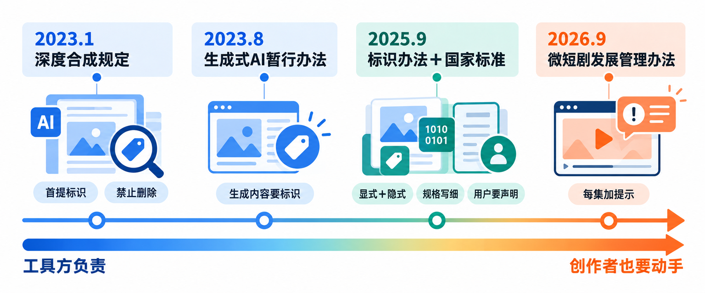
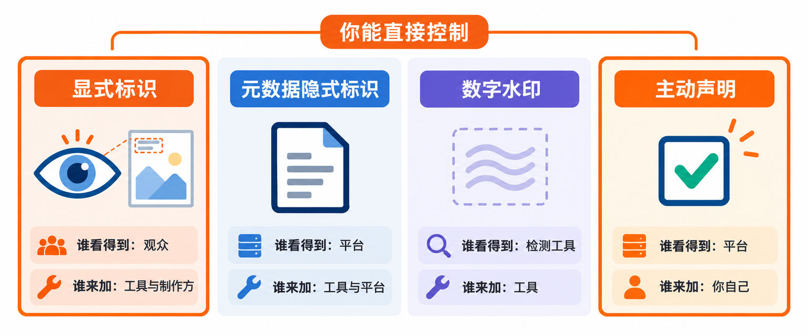
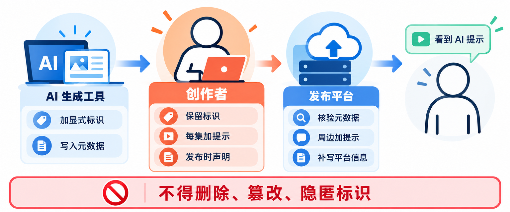
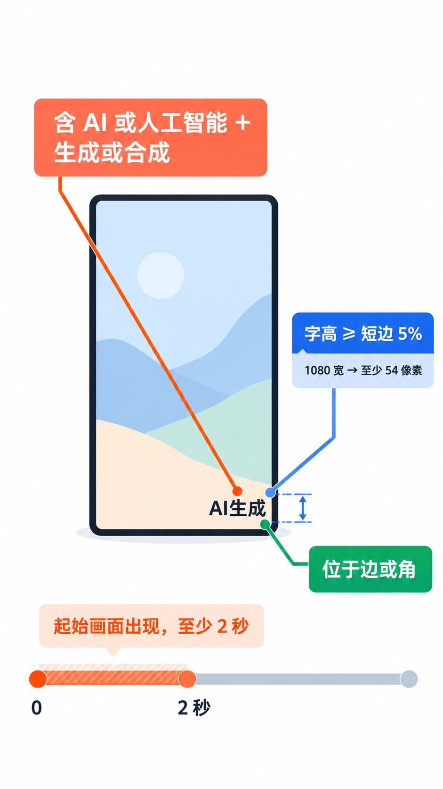
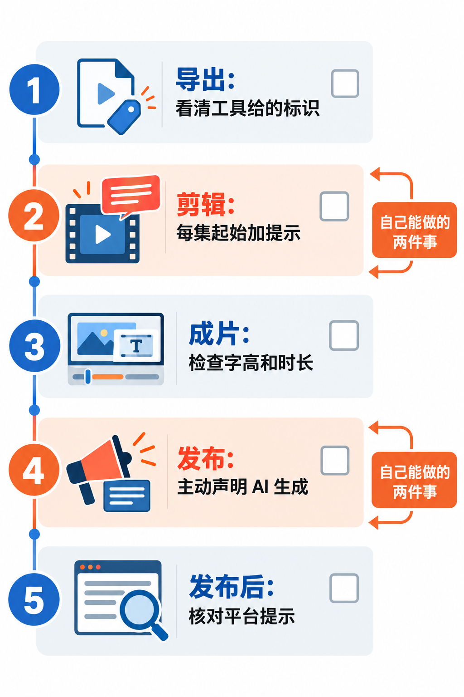

# AI短剧发布前必做：给每一集加上AI标识，显式、隐式和主动声明怎么做

前面几篇讲了怎么拆镜头表、怎么锁住角色长相、怎么用首尾帧把镜头接起来。片子剪完，离发出去还差最后一步：**告诉观众，这是 AI 生成的。**

这一步不是可选的礼貌。2025 年 9 月 1 日起，《人工智能生成合成内容标识办法》和配套的强制性国家标准同时施行；2026 年 9 月 1 日起，国家广播电视总局的《微短剧发展管理办法》也开始施行，其中专门有一条写给 AI 微短剧：**每集明显位置都要添加提示标识。**

这篇把这件事讲清楚：显式标识和隐式标识分别是什么、谁负责加；做 AI 短剧的人在导出、剪辑和发布三个环节各要做什么；以及画面里那行“AI 生成”字样，按国家标准应该多大、放哪、停留多久。看完你可以给自己的片子过一遍发布前检查。

## 这套规则是怎么一步步来的

AI 内容要标识，最早不是为短剧定的，而是为了防“以假乱真”。时间线大致是这样：

- **2023 年 1 月 10 日**，国家网信办、工信部、公安部的《互联网信息服务深度合成管理规定》施行。它第一次提出两类标识：一类是“不影响用户使用的标识”，由技术措施加在内容里；另一类是“显著标识”，针对合成人声、人脸生成和替换、智能对话等**可能让公众混淆或误认**的服务。规定同时写明，任何组织和个人不得用技术手段删除、篡改、隐匿这些标识。
- **2023 年 8 月 15 日**，七部门的《生成式人工智能服务管理暂行办法》施行，要求生成式 AI 服务提供者按深度合成规定对图片、视频等生成内容进行标识。
- **2025 年 9 月 1 日**，网信办、工信部、公安部、广电总局四部门的《人工智能生成合成内容标识办法》施行，同一天，强制性国家标准 GB 45438—2025《网络安全技术 人工智能生成合成内容标识方法》也开始实施。前两份规章只说了“要标识”，这两份文件把“怎么标”写成了具体规格：文字里必须出现哪些字、字要多大、放在画面哪里、停留几秒，元数据里写哪些字段。
- **2026 年 9 月 1 日**，广电总局令第 16 号《微短剧发展管理办法》施行。这是专门管微短剧的部门规章，第三十四条规定：使用人工智能技术生成、制作的微短剧，制作机构和播出单位应当遵守国家有关规定，在**每集**明显位置添加提示标识。

从这条线能看出一个关键变化：**早期规则的重心是“服务提供者”**，也就是做 AI 工具的公司，用户只要别去删标识就行；到了 2025 年的标识办法，发布内容的用户也有了明确义务，必须主动声明；而微短剧办法又把要求落到了“每一集”。做 AI 短剧的人，现在是这条链上要动手的一环。

## 显式、隐式、声明：几种标识放在一起比

“加标识”其实包括好几件不同的事。放在一起比，是因为做片子的人最容易把它们混为一谈，以为工具导出时带了水印，后面就什么都不用管了。

| | 显式标识 | 文件元数据隐式标识 | 数字水印 | 发布时主动声明 |
|---|---|---|---|---|
| 是什么 | 画面、声音或界面里看得见、听得见的提示，比如角落里的“AI 生成” | 写在文件元数据里的一段信息，记录这是 AI 内容、谁生成的、内容编号 | 嵌在画面或声音数据里的不可见信号 | 你在发布页告诉平台“这条内容含 AI 生成” |
| 谁看得到 | 观众 | 平台和检测工具 | 专门的检测工具 | 平台，平台再在内容周边给观众显示提示 |
| 谁来加 | 生成服务提供者，以及发布 AI 微短剧的制作方 | 生成服务提供者先写入，传播平台再补上自己的信息 | 鼓励服务提供者添加，国家标准不做强制要求 | 发布内容的用户自己 |
| 容易在哪丢 | 剪辑时被裁掉、被字幕挡住，或者导出了不带标识的版本 | 剪辑软件重新导出后，原素材的元数据不一定还在 | 一般不在你手里，你也看不到 | 发布时忘了勾 |

**这里面最值得记住的是：只有显式标识和主动声明是你能直接控制的。** 隐式标识写在文件里，剪辑软件把几十段素材拼成一条成片再导出，原来每段素材里的元数据未必会跟着进入新文件；数字水印则完全由工具一方决定。所以别指望“工具已经标过了”，**成片画面里的显式标识和发布时的声明，要自己做到。**

把视野放到国外，思路其实相近。YouTube 要求创作者在上传时，对逼真的 AI 生成或修改内容做披露，并且会对用自家 AI 工具做的内容、带有 C2PA 元数据的内容自动加标签；C2PA 是一套把内容来源信息写进文件的开放技术标准，作用和我们的文件元数据隐式标识类似。差别在于，国内这套是**规章加强制性国家标准**，样式规格写得非常具体，适用范围也更广，并不只限于“逼真”的内容；而 YouTube 明确写了奇幻场景这类不逼真的内容不需要披露。对做国内平台的 AI 短剧来说，按国内这套规格来做，最省心。

## 先弄清楚：哪些义务是你的

按《标识办法》，一条 AI 内容从生成到被观众看到，三方各有分工：

**AI 生成工具（服务提供者）**：在生成的视频起始画面和播放周边的适当位置加显著提示；在文件元数据里写入隐式标识，内容包括“这是生成合成内容”的属性信息、服务提供者名称或编码、内容编号；提供下载、导出功能时，要确保文件里带着显式标识；还要在用户协议里写明标识的方法和样式。

**发布平台（内容传播服务提供者）**：核验文件元数据。元数据明确是 AI 生成的，在内容周边加提示，告诉观众“这属于生成合成内容”；元数据里没有，但用户声明了，提示“可能为生成合成内容”；两者都没有，但平台检测到了显式标识或其他生成痕迹，提示“疑似生成合成内容”。平台还要提供标识功能，提醒用户主动声明，并在元数据里补写自己的平台名称或编码、内容编号。

**你（发布内容的用户）**：办法第十条写得很直接——用户使用网络信息内容传播服务发布生成合成内容的，**应当主动声明，并使用服务提供者提供的标识功能进行标识**。同时，任何组织和个人不得恶意删除、篡改、伪造、隐匿这些标识，也不得为别人做这些事提供工具或服务。

**做 AI 微短剧，还要多一条**：微短剧办法第三十四条要求在**每集明显位置**添加提示标识，责任主体是制作机构和播出单位。也就是说，片子本身就要带着提示，不能只靠平台在旁边挂一个标签。

还有一种情况值得单独说。办法第九条允许用户向工具申请**不带显式标识的版本**，条件是工具先通过用户协议明确用户的标识义务和使用责任，并留存相关日志不少于六个月。换句话说，你拿到“干净版”，标识的责任就转到了你身上。

> **想用无标识版本剪片，先想清楚后果。** 有些工具允许导出不带显式标识的成片，这通常意味着你在用户协议里接下了自己加标识的义务。拿干净素材剪完之后，必须在成片里重新加上显式标识，并在发布时主动声明。把工具加的标识裁掉、涂掉或者用字幕盖住，属于办法明令禁止的“删除、隐匿”行为。

## 画面里那行字：国家标准的规格

《标识办法》没有单独给创作者规定样式，但配套的国家标准 GB 45438—2025 对视频的显式标识写得非常具体。给自己的短剧加提示，直接照这个规格做，最不容易出问题。标准第 5.4 条的要求是：

1. **用文字提示**，不是图标，也不是一个单独的“AI”角标（单独的“AI”角标是给文本内容用的）。
2. **文字必须同时包含两个要素**：一是“人工智能”或“AI”，二是“生成”和/或“合成”。所以“AI 生成”“AI 合成”“人工智能生成合成”都符合，只写“AI”或者“本片使用了新技术”就不够。
3. **位置**：必须出现在视频**起始画面**，也可以再加在末尾和中间适当位置；放在画面的**边或角**。
4. **字型清晰可辨。**
5. **文字高度不低于画面最短边长度的 5%。**
6. **在正常播放速度下，持续时间不少于 2 秒。**

换算成短剧常用的规格，就很好操作了：

| 成片分辨率 | 最短边 | 标识文字最小高度 |
|---|---|---|
| 1080×1920 竖屏 | 1080 像素 | 54 像素 |
| 720×1280 竖屏 | 720 像素 | 36 像素 |
| 1920×1080 横屏 | 1080 像素 | 54 像素 |

标准附录里给的视频示例，就是在起始画面右下角放“人工智能生成合成”几个字。

**落到剪辑里，我的建议是这样做：** 在剪辑软件里新建一条文字轨道，写“AI 生成”或“本剧使用 AI 生成合成”，放在画面四个角之一，从每集第 0 秒开始，至少保留 2 秒；字高按上表留足，颜色和描边保证在亮、暗背景上都能看清。如果想更稳妥，可以让它整集常驻在一个角落，标准只要求起始画面必须有，并没有限制你加得更多。做成一个模板，每集套用，不容易漏。

竖屏短剧还有一个容易被忽略的坑：**平台界面会盖住画面的一部分。** 右下角常常是点赞、评论按钮，底部是标题和文案。标识放在被界面遮住的位置，等于没放。从使用习惯看，左上角或右上角通常更安全，发布前在手机上预览一遍再确认。

如果你的短剧有单独的配音或纯音频版本，标准对音频也有要求：在开头、末尾或中间适当位置，用正常语速的语音说出含“人工智能/AI”和“生成/合成”的提示，或者用“短长短短”的节奏音，这个节奏就是“AI”两个字母的摩斯码。

## 发布前，按这个顺序过一遍

把上面的规则串成一套动作，每集发布前过一遍：

**1. 导出素材时：先弄清楚工具给了你什么。** 打开你用的 AI 视频、图像、配音工具的用户协议或帮助中心，看它说明的标识方法和样式（办法要求工具必须写在用户协议里）。导出的素材带显式标识的，剪辑时不要裁掉、不要用其他画面盖住；导出的是无标识版本的，记住标识责任在你。

**2. 剪辑时：给每一集加上提示。** 按上一节的规格，在每集起始画面的边角加“AI 生成”文字，至少 2 秒，字高不低于短边的 5%。多集短剧最容易出的问题是第一集加了、后面几集忘了，或者只在合集封面上写了一句。

**3. 导出成片后：自己检查一遍。** 拖到第 0 秒看标识在不在、能不能看清；在手机上全屏预览，确认没有被平台按钮或字幕遮住。

**4. 发布时：主动声明。** 微信公告写明，用户发布的内容为 AI 生成合成的，发布时需主动声明；抖音上线了帮助创作者添加 AI 内容标识的功能，以及读写 AI 内容元数据标识的功能。具体入口在发布页里，各平台的名称和位置会随版本调整，以你发布时看到的界面为准。即便你画面里已经加了标识，声明这一步也不能省，**画面里的提示是给观众看的，声明是给平台的**，平台据此在内容周边加提示并补写元数据。

**5. 发布后：看一眼平台加的提示。** 平台在内容周边显示了 AI 提示，说明声明生效了。

> **不声明，平台也可能替你标，而且标得更难看。** 按办法，平台对元数据和声明都没有、但检测到生成痕迹的内容，会标为“疑似生成合成内容”。新华社报道的抖音规则里，疑似 AI 的内容会被加上“疑似使用了 AI 生成技术，请谨慎甄别”的提示。对一部用心做的短剧来说，主动声明换来的提示，比被系统判定为“疑似”要体面得多。

**关于备案和许可**，这里只说清楚规则本身。微短剧办法按投资额度和题材把微短剧分为一类、二类、三类：一类和二类在播出前要向省级以上广电主管部门申请内容审核和发行许可，三类由符合条件的播出单位进行播前审核并标注节目编号；没有取得许可证、批准文件，或者没有经过播出单位审核并标注节目编号的微短剧，不得播出。具体的分类标准由广电总局制定并适时调整。对于非专业制作、总时长较短的具有微短剧特征的内容，办法规定由播出单位履行内容管理职责。你的作品具体归哪一类、需要走什么流程，以主管部门和发布平台的最新要求为准。

> **标识解决的是“告诉观众这是 AI”，不解决内容本身合不合规。** 微短剧办法第二十五条列了十一类不得载有的内容，加了 AI 标识也不能豁免；用真实人物的脸或声音、未经授权改编影视剧和小说，也不会因为标了“AI 生成”就变得合法。广电总局在 2024 年就要求排查清理 AI“魔改”影视剧的短视频。角色、剧本和素材，从一开始就用原创的。

## 写在最后

给 AI 短剧加标识，说到底就两件自己能做的事：**每集起始画面的边角放一行至少 2 秒、字高够大的“AI 生成”，发布时在平台上主动声明。** 建议现在就把这行字做成剪辑模板，以后每一集直接套用。规则还在细化，发布前花一分钟看看平台的最新公告，比事后补救省事得多。

## 参考资料

国家互联网信息办公室等四部门：<a href="https://www.cac.gov.cn/2025-03/14/c_1743654684782215.htm">关于印发《人工智能生成合成内容标识办法》的通知（国信办通字〔2025〕2号）</a>（办法全文）、<a href="https://www.cac.gov.cn/2025-03/14/c_1743654685899683.htm">四部门联合发布《人工智能生成合成内容标识办法》</a>（发布说明、配套国家标准与实践指南）。

国家标准：<a href="https://std.samr.gov.cn//gb/search/gbDetailed?id=301E0388CB75788DE06397BE0A0AE1B4">GB 45438—2025《网络安全技术 人工智能生成合成内容标识方法》</a>（国家市场监督管理总局、国家标准化管理委员会 2025 年 2 月 28 日发布，2025 年 9 月 1 日实施；文中视频、音频显式标识规格和元数据隐式标识要素取自标准正文第 5、6 章及附录）。

国家广播电视总局：<a href="https://www.nrta.gov.cn/art/2026/7/31/art_113_73785.html">国家广播电视总局令第16号《微短剧发展管理办法》</a>（2026 年 9 月 1 日起施行，第五、十七、二十五、三十三、三十四条）、<a href="https://www.nrta.gov.cn/art/2024/12/10/art_3731_69779.html">广电总局要求规范 AI“魔改”短视频</a>。

此前的部门规章：<a href="https://www.cac.gov.cn/2022-12/11/c_1672221949354811.htm">《互联网信息服务深度合成管理规定》</a>（2023 年 1 月 10 日起施行，第十六至十八条）、<a href="https://www.cac.gov.cn/2023-07/13/c_1690898327029107.htm">《生成式人工智能服务管理暂行办法》</a>（2023 年 8 月 15 日起施行，第十二条）。

平台规则：<a href="http://www.news.cn/tech/20250909/fb164c6d092146aa8e13ddc283fe416a/c.html">新华网：《人工智能生成合成内容标识办法》正式施行 多平台出台内容管理细则</a>（微信、抖音的标识公告要点）；<a href="https://support.google.com/youtube/answer/14328491?hl=en">YouTube 帮助中心：Disclosing use of altered or synthetic content</a>；<a href="https://c2pa.org/about/">C2PA</a>。

资料核对于 2026 年 10 月 17 日。文中步骤依据官方文件原文整理，写作时未实际操作；各平台的声明入口和提示文案会随版本调整，以发布时的界面和平台最新公告为准。法规和标准的要求以最新规定为准，本文不构成法律意见。示例文字均为原创。配图为示意图，不是产品界面截图。

