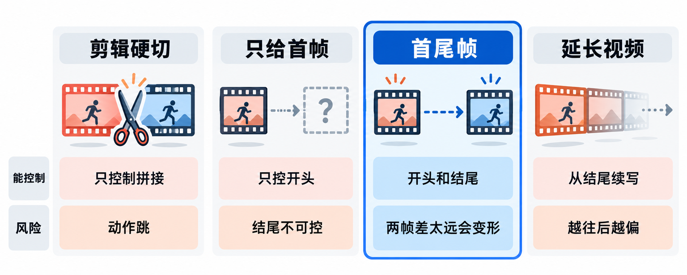
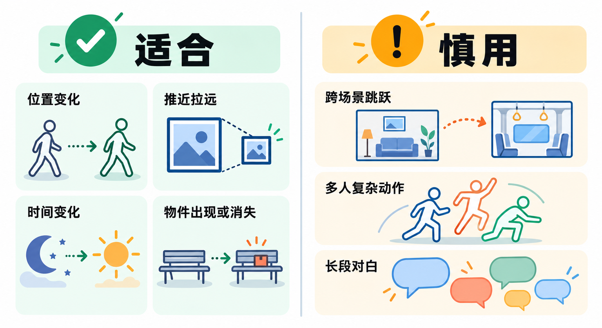
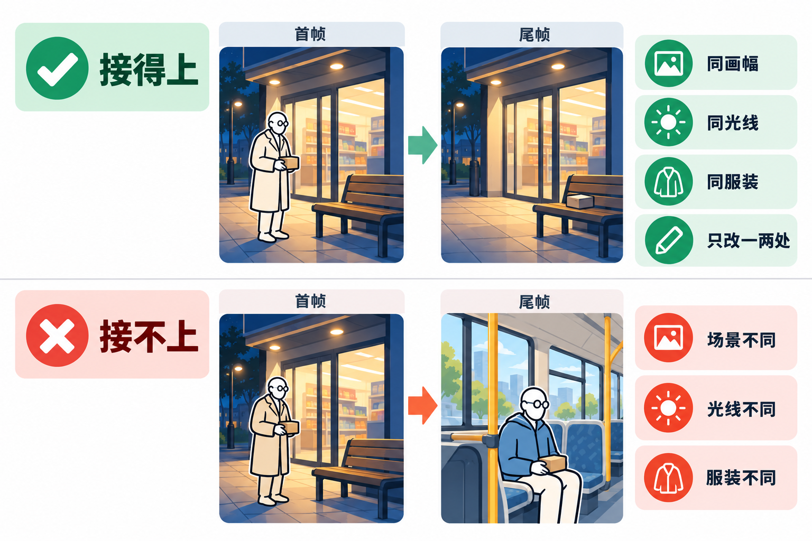
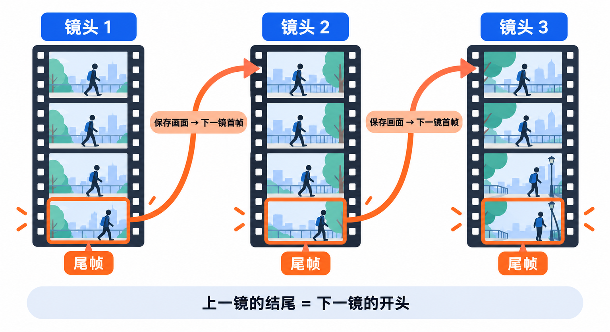

# AI短剧镜头接不上？用Veo 3.1的首尾帧，让上一镜自然过渡到下一镜

前两篇讲了怎么把剧本拆成镜头表，以及怎么让同一个角色演完每一镜。做到这一步，单个镜头已经像样了，但把它们排在一起一放，常常还是“一段一段的”：上一镜老人站在保温柜前，下一镜他已经坐在长椅上，中间那几步怎么走过去的，观众看不到，只觉得画面跳了一下。

这篇讲的就是解决这个问题的功能：**首尾帧**。你给视频模型两张图，一张当开头，一张当结尾，模型负责“补”出中间的动作和镜头运动。用 Google 的 Veo 3.1 来讲，因为它在创作者工具 Flow 和开发者接口里都支持这个功能。看完你能做到：设计出一对能接得上的首尾帧图，写好过渡提示词，生成一个把两个画面自然连起来的镜头，并且知道怎么让一整场戏的镜头一个接一个地“接力”下去。

## 首尾帧是怎么来的

在传统动画里，有一个很老的分工：资深动画师先画出动作开始和结束的**关键帧**，再由助手画出中间的过渡画面，这一步叫“中间画”（in-between）。首尾帧生成做的是同一件事，只不过画中间画的换成了视频模型。Google 的开发者文档里，干脆就把这个功能叫作 **interpolation（插值）**。

在 Google 这条线上，首尾帧经历了几次关键变化：

- **Veo 2 时期**：Google Cloud 上的 Veo 2 已经可以同时指定第一帧和最后一帧，单段时长 5 到 8 秒。那时它主要面向企业开发者，需要通过云平台的接口调用。
- **2025 年 5 月**：Google 推出面向创作者的 AI 影片制作工具 Flow。在 Flow 里，首尾帧叫 **Frames to Video**，是一个可以直接点选的模式：上传或生成图片，作为开头、结尾或首尾两帧，不用写代码。
- **2025 年 10 月 15 日**：Veo 3.1 发布，官方博客写明，给 Frames to Video、Ingredients to Video 和延长视频这些已有功能**加上了声音**。首尾帧生成的镜头，从此可以直接带环境音和音效。
- **2025 年 11 月 17 日**：Veo 3.1 和 Veo 3.1 Fast 在 Google Cloud 上进入正式版（GA），文档里明确列出“从首尾帧生成”这项能力。
- **现在**：Flow 里的 Veo 3.1 Lite、Fast、Quality 三档和 Gemini Omni Flash 1.1 都支持首尾帧，开发者也可以通过 Gemini API 调用。

这条路线留下的“包袱”也很清楚：**模型只负责补中间，两头必须由你定。** 首尾两张图如果差得太远，比如角色换了衣服、光线从白天跳到深夜、机位转了一百八十度，模型就得在几秒钟里硬拗出一个过程，结果往往是变形、闪烁，或者干脆变成一个生硬的溶解。所以这篇一半的篇幅都在讲怎么设计这两张图。

## 接镜头的四种办法，比一比



把两个画面接起来，常见的做法有四种。放在一起比，是因为做 AI 短剧的人通常都会经历这四种：先在剪辑软件里硬切，觉得太跳；再试图生视频，发现结尾控制不住；然后才会找到首尾帧和延长。

| | 剪辑时直接硬切 | 只给首帧（图生视频） | 首尾帧 | 延长视频（Extend） |
|---|---|---|---|---|
| 能控制什么 | 只能控制哪两段接在一起 | 开头的画面，结尾由模型自由发挥 | 开头和结尾的画面都由你定 | 从上一段视频的结尾继续往下生成 |
| 适合 | 景别、场景本来就不同的正常切换 | 镜头只需要一个起点，结果怎样都行 | 镜头必须停在某个指定画面，好接下一镜 | 同一个镜头想拉得更长 |
| 主要风险 | 动作不连贯，观众觉得跳 | 结尾停在哪不可控，下一镜很难接 | 首尾差太远时过渡生硬或变形 | 越往后越容易偏离原本的样子 |
| 在 Flow 里的限制 | 无 | 4、6、8 秒（Omni 还有 10 秒） | 同左 | 只有 8 秒的 Veo 3.1 片段能延长，而且要用 Lite 来延长 |

**为什么首尾帧值得学**：短剧的镜头之间最需要的是“落点”。上一镜的结尾，就是下一镜的开头。只给首帧时，你只能祈祷模型把动作停在你想要的位置；首尾帧把落点也交给你，这样每一镜都能和下一镜对上。

**为什么有人放弃它**：它要求你多准备一张图，而且两张图必须“对得上”，前期工作比图生视频多一倍。另外，首尾帧锁死了两头，模型自由发挥的空间就小了，有时候反而不如只给首帧来得自然。**我的看法是：普通的切镜照样硬切，只在“动作必须连贯”或“下一镜必须从这个画面开始”的地方用首尾帧。**一部短剧里，真正需要它的镜头通常只占少数。

## 动手前，先确认在哪用、花多少

**入口有两类。** 做短剧的创作者，主要用 **Google Flow**，界面操作，不用写代码。开发者或想批量生成的人，可以用 **Gemini API** 或 **Google Cloud 上的 Vertex AI**，后者的控制台（Media Studio）也有图形界面，但需要先开通云项目和计费。

**Flow 的使用条件。** 按帮助中心的说明，使用 Flow 需要年满 18 岁并完成年龄验证，人在支持的国家或地区，并订阅 Google AI Plus、Pro 或 Ultra，或者使用符合条件的 Google Workspace 企业和教育版套餐。支持地区里有香港、澳门和台湾，中国大陆不在名单内，官方也写明 VPN 不能让不支持地区的用户获得使用权限。Gemini Omni Flash 的首尾帧目前只能在 Flow 网页版上用。

**Flow 的积分消耗。** 帮助中心当前列出的每次生成消耗如下，首尾帧和普通生成一样计算：

| 模型 | 首尾帧可选时长 | 每次生成消耗的积分 |
|---|---|---|
| Veo 3.1 Lite | 4、6、8 秒 | 非 Ultra 订阅 10，Ultra 订阅 5 |
| Veo 3.1 Fast | 4、6、8 秒 | 非 Ultra 订阅 20，Ultra 订阅 10 |
| Veo 3.1 Quality | 以设置里显示为准 | 所有用户 100 |
| Gemini Omni Flash（720p） | 4、6、8、10 秒 | 4 秒 7，6 秒 10，8 秒 12，10 秒 15 |
| Gemini Omni Flash（360p） | 4、6、8、10 秒 | 4 秒 4，6 秒 5，8 秒 6，10 秒 7 |

每天有 50 个积分，Plus、Pro、Ultra 订阅每月另有一批积分，没用完的都不结转。

**API 按秒计费。** 在 Gemini API 里，Veo 3.1 没有免费额度，付费层按生成视频的**秒数**计费：Veo 3.1 标准版 720p 和 1080p 都是每秒 0.40 美元，4K 每秒 0.60 美元；Veo 3.1 Fast 的 720p 每秒 0.10 美元，1080p 每秒 0.12 美元，4K 每秒 0.30 美元。换算一下，用 Fast 生成一段 8 秒的 720p 首尾帧镜头是 0.80 美元，标准版是 3.20 美元。官方说明只有成功生成的视频才收费。

> **首尾帧最费钱的地方是“重来”。** 两张图对不上时，你很可能要生成好几次才能得到一条能用的。Flow 的积分按“每次生成”算，一次请求如果设置了多个输出，就会扣多份。建议先用最便宜的档位（Veo 3.1 Lite，或 Omni Flash 的 360p）试过渡是否成立，确认之后再换高档位正式生成。积分和价格都会调整，生成前在提示框右上角的设置里看一眼当前消耗。

## 第一步：判断这一镜适不适合用首尾帧



首尾帧不是所有镜头都需要。官方的说法是，它可以用来做**转场**、让一张图动起来，或者生成一段从指定画面开始、在指定画面结束的视频。从短剧的实际需要看，下面几类最适合：

- **同一场景里的位置变化。** 老人从保温柜前走到收银台，同一家店、同一个人，只是位置变了。
- **镜头推近或拉远。** 首帧是便利店门口的全景，尾帧是长椅上那盒热牛奶的特写，中间交给模型做一个推镜头。
- **光线和时间的变化。** 首帧是深夜的长椅，尾帧是同一张长椅的清晨，适合用来交代“过了一夜”。
- **物件的出现或消失。** 首帧长椅上空着，尾帧长椅上多了一盒牛奶，中间是有人放下它的动作。

下面几类则要慎用，或者干脆换别的办法：

- **跨场景的大跳跃。** 首帧在便利店里，尾帧在公交车上，模型只能硬造一个转场，结果常常像幻灯片溶解。这种情况用剪辑硬切更干净。
- **多人的复杂动作。** 两三个人同时走动、互相递东西，几秒钟里很难都对上位置。
- **长段对白。** 首尾帧的时长只有几秒，对白戏更适合先做好一个稳定的画面，再用图生视频或参考图来做。

还有一个简单的检验方法：**把首尾两张图并排放，问自己“几秒钟内，现实中能不能从左边变成右边”。** 一个人 4 秒内能走三五步、转个身、放下一样东西，但换不了一身衣服，也走不完一条街。时长选 4、6 还是 8 秒，就按这个动作在现实中需要多久来定。

## 第二步：做一对能接得上的首尾帧图



首尾帧的成败，八成在这两张图。官方的图生视频最佳实践里有一句话说得很透：**模型把源图当作一切的基础，包括角色细节、光线和整体风格**，源图越清晰、构图越好，视频就越连贯。首尾帧等于给了模型两个基础，这两个基础之间不能互相打架。

做图时按这几条来：

- **画幅一致。** 两张图都是 9:16 竖屏，或者都是 16:9 横屏，生成时的画幅也选同一个。
- **角色、服装、光线、风格一致。** 首帧里老人穿灰色风衣、戴圆框眼镜，尾帧里也必须是。光线方向和色调也要一样，除非“光线变化”本身就是这一镜要表现的内容。
- **变化只放在一两件事上。** 位置变了，或者手里的东西变了，或者机位推近了。一镜里同时改三四件事，模型很难全照顾到。
- **尾帧用首帧“改”出来，而不是重新画一张。** 这是最实用的一条。在 Flow 里先用图像模型生成首帧，满意后让图像模型在这张图的基础上只改你要变的部分，比如“把老人移到长椅旁边，手里的牛奶放到椅面上”。从同一张图改出来的两帧，背景和角色天然一致。Flow 内置的 Nano Banana 系列模型就是用来生成和编辑这类帧图的。

> **首尾帧图只用原创或你有权使用的素材。** 不要拿明星、网红或身边人的照片做帧图，也不要截取影视剧、动漫的画面当首帧或尾帧。Gemini API 的文档写明，用图片生成视频（包括首尾帧）时，人物生成只允许成年人。更重要的是，用别人的脸或别人的作品做短剧，本身就有侵权风险。

## 第三步：只写“中间发生了什么”

图片已经交代了人物、场景和风格，提示词的任务只剩一件：**描述两帧之间发生的动作和镜头运动。** 这一点 Google 的最佳实践写得很明确：图生视频时，不要在提示词里重复描述图里已有的角色、背景和光线，重复的描述反而会让模型困惑；要写的是镜头怎么动、主体怎么动、环境怎么变。提到画面里的人物时，用“the old man”“he”这样的泛称就够了。

帮助中心还有一条：**提示词要和你给的帧图对得上**，不要互相矛盾。

另外，Flow 帮助中心建议用英文写提示词，Gemini API 的文档也说明只有英文是完整支持的。下面的示例都给英文，附中文意思。

**例一：位置变化 + 放下物件**（首帧：老人站在便利店门口，手里拿着热牛奶；尾帧：同一机位，长椅上放着那盒牛奶，老人已经走出画面）

```text
The old man walks slowly to the wooden bench, bends down and gently places the carton of hot milk on the bench, then straightens up and walks out of frame to the right. The camera stays still. Quiet night, a faint hum from the store.
```

（意思：老人慢慢走到木长椅旁，弯腰把那盒热牛奶轻轻放在长椅上，然后直起身，从画面右侧走出去。镜头保持不动。安静的夜晚，便利店里传来轻微的嗡嗡声。）

**例二：镜头推近**（首帧：便利店门口全景，长椅上有一盒牛奶；尾帧：长椅上那盒牛奶的特写）

```text
Slow dolly in from the storefront toward the bench, ending on a close-up of the carton of milk. Nothing else moves. Soft night wind.
```

（意思：镜头从店门口缓慢推向长椅，最后停在那盒牛奶的特写上。画面里没有其他东西在动。轻柔的夜风声。）

**例三：时间变化**（首帧：深夜的长椅和牛奶；尾帧：同一机位的清晨，天色变亮）

```text
Time-lapse: the night sky over the street slowly brightens into early morning, the store lights switch off, the carton of milk stays on the bench. The camera stays still. Birds begin to chirp.
```

（意思：延时摄影，街道上空的夜色慢慢亮成清晨，店里的灯熄灭，那盒牛奶一直留在长椅上。镜头保持不动。鸟开始叫。）

注意三个例子的共同点：**一镜只写一件主要的事，并且写明镜头动不动。** 镜头固定、只有主体在动，是最稳妥的组合；人和镜头同时大幅运动，出错的概率会明显升高。

## 第四步：在 Flow 里生成



按 Flow 帮助中心的步骤：

1. 打开 Flow，进入这部短剧所在的项目。
2. 在提示框里点模型名称，选 **Video**，再选 **Frames**。
3. 把首帧图拖到 **+ Add start frame**，把尾帧图拖到 **+ Add end frame**。
4. 在提示框里写上一步准备好的过渡提示词。
5. 选择视频设置：画幅、输出数量、模型和时长。
6. 点生成。

设置这一步，按前面说的顺序来：先用便宜的档位试，确认过渡是成立的，再换成 Fast 或 Quality 出正式版本。帮助中心还写明，如果你选的模型不支持某个功能，Flow 会提示你。

**想让一整场戏“接力”下去**，关键是一个动作：**把上一镜的最后一帧，存下来当下一镜的首帧。** Flow 里打开一段视频，暂停在想要的画面，点 **Save frame**，这一帧就会存进项目，可以直接拿来当下一次生成的首帧或尾帧。这样，第 3 镜结束的画面正好是第 4 镜开始的画面，两镜之间就没有跳跃了。

## 开发者：用 Gemini API 调用首尾帧

如果你想用代码批量生成，Gemini API 的写法很简单：首帧作为 `image` 传入，尾帧放在配置里的 `last_frame`。下面的代码改编自 Gemini API 官方文档的示例，先用 `pip install google-genai` 安装官方 SDK，并把 API 密钥设到环境变量 `GEMINI_API_KEY` 里：

```python
import time
from google import genai
from google.genai import types

client = genai.Client()

first_image = types.Image(image_bytes=open("first.png", "rb").read(), mime_type="image/png")
last_image = types.Image(image_bytes=open("last.png", "rb").read(), mime_type="image/png")

operation = client.models.generate_videos(
    model="veo-3.1-generate-preview",
    prompt="The old man walks slowly to the wooden bench and places the carton of hot milk on it. The camera stays still.",
    image=first_image,
    config=types.GenerateVideosConfig(
        aspect_ratio="9:16",
        last_frame=last_image,
    ),
)

while not operation.done:
    time.sleep(10)
    operation = client.operations.get(operation)

video = operation.response.generated_videos[0]
client.files.download(file=video.video, destination="shot.mp4")
```

几条文档里的限制值得记住：

- 首尾帧这个功能**只有 Veo 3.1 系列支持**，`last_frame` 必须和 `image` 一起用，不能只给尾帧。
- 时长可选 4、6、8 秒，选 1080p 或 4K 时只能是 8 秒；画幅支持 16:9（默认）和 9:16，竖屏短剧记得显式写上 9:16。
- 一次请求生成一条视频，生成时间从十几秒到几分钟不等，高峰期更慢。
- 想让结果更可复现，可以加 `seed` 参数，官方说明它不能保证完全一样，只是“稍微”提高确定性。

> **生成的视频只在服务器上保存 2 天。** Gemini API 文档写明，生成结果 2 天后就会被删除，要保存必须在这之前下载到本地。批量生成时，最好在代码里生成一条就下载一条。

在 Google Cloud 上用 Vertex AI 时，模型 ID 是 `veo-3.1-generate-001` 和 `veo-3.1-fast-generate-001`，通过接口调用时首尾帧图片要先放进 Cloud Storage，格式只支持 JPEG 和 PNG，单张图片最大 20 MB。也可以在控制台的 Media Studio 里选 **Image-to-video** 任务，在 **Start** 和 **End** 两处分别上传首尾帧，不用写代码。

## 结果不对时，按这个顺序排查

即使两张图都准备好了，**生成结果仍然有随机性**，同一组首尾帧和提示词，每次出来的过渡都可能不一样。比较务实的做法是每个镜头多生成几条，挑最自然的一条。看到明显的问题，按下面这几条排查：

- **中间出现变形或闪烁**：首尾两帧差得太多。回到第二步，让尾帧只改一两件事，或者把这一镜拆成两镜。
- **像幻灯片一样直接溶解过去**：动作在现实中无法在这个时长里完成，或者提示词没写清楚中间的动作。加长时长，或者把动作写得更具体。
- **角色在中途换了样子**：检查两帧里的服装、发型、配饰是否完全一致，提示词里有没有写了和图片矛盾的描述。
- **镜头乱动**：在提示词里明确写“The camera stays still”，或者只写一种镜头运动。
- **没有声音或被拦截**：Gemini API 文档说明，Veo 3.1 有时会因为安全过滤或音频处理问题拦截生成，被拦截的不收费。换个说法重新生成即可。

## 发布前，知道这两件事

**水印。** Veo 生成的视频都带有不可见的 SynthID 数字水印，用来标识 AI 生成内容。Flow 里还可以在头像下拉菜单打开“可见水印”开关，给视频加上肉眼可见的水印。国内平台发布时还要做哪些 AI 生成内容标识，下一篇单独讲。

**能不能商用。** Flow 帮助中心的回答是以 Google 服务条款为准：部分服务允许你生成原创内容，Google 不会主张这些内容的所有权；同时必须遵守 Google 的生成式 AI 禁止使用政策。用 Gemini API 或 Vertex AI 的，适用各自的服务条款。打算商用之前，把对应的条款完整读一遍。

## 写在最后

首尾帧真正的用处，不是做花哨的转场，而是让镜头有“落点”。下次做短剧时，可以先在镜头表里标出哪几处动作必须连贯，只在这几处用首尾帧，其余照常硬切。第一组不妨就从“首帧原图 + 只改一处的尾帧 + 固定镜头”开始，这是最容易成功的组合。

## 参考资料

<div class="sources">
<p>Google Cloud 文档：<a href="https://docs.cloud.google.com/vertex-ai/generative-ai/docs/video/generate-videos-from-first-and-last-frames">Generate videos using first and last video frames</a>（支持的模型、Media Studio 步骤、接口参数）、<a href="https://docs.cloud.google.com/vertex-ai/generative-ai/docs/models/veo/3-1-generate">Veo 3.1 模型页</a>（模型 ID、正式版发布时间、时长、画幅、图片大小）、<a href="https://docs.cloud.google.com/vertex-ai/generative-ai/docs/video/best-practice">Video best practices</a>（图生视频最佳实践）、<a href="https://docs.cloud.google.com/vertex-ai/generative-ai/docs/video/video-gen-prompt-guide">Video generation prompt guide</a>、<a href="https://cloud.google.com/vertex-ai/generative-ai/pricing">Agent Platform Pricing</a>。</p>
<p>Gemini API 文档：<a href="https://ai.google.dev/gemini-api/docs/veo">Generate videos with Veo 3.1</a>（首尾帧示例、参数、限制、视频保留时间）、<a href="https://ai.google.dev/gemini-api/docs/pricing">Gemini Developer API pricing</a>（Veo 3.1 按秒计费）。</p>
<p>Google Flow 帮助中心：<a href="https://support.google.com/flow/answer/16353333?hl=en">Get started with Google Flow</a>（使用条件、水印、商用说明）、<a href="https://support.google.com/flow/answer/16353334?hl=en">Create videos in Google Flow</a>（添加首尾帧、最佳实践）、<a href="https://support.google.com/flow/answer/16352836?hl=en">Learn about Google Flow models &amp; supported features</a>（各模型的首尾帧时长）、<a href="https://support.google.com/flow/answer/16526234?hl=en">Manage your Google Flow credits</a>（积分规则与每次生成消耗）、<a href="https://support.google.com/flow/answer/16353544?hl=en">Where you can use Google Flow</a>（支持的语言、国家和地区）、<a href="https://support.google.com/flow/answer/16935718?hl=en">Edit videos &amp; build scenes in Google Flow</a>（保存画面）。</p>
<p>Google 官方博客：<a href="https://blog.google/technology/ai/google-flow-veo-ai-filmmaking-tool/">Meet Flow: AI-powered filmmaking with Veo 3</a>（2025 年 5 月）、<a href="https://blog.google/technology/ai/veo-updates-flow/">Introducing Veo 3.1 and advanced capabilities in Flow</a>（2025 年 10 月 15 日）。政策：<a href="https://policies.google.com/terms">Google 服务条款</a>、<a href="https://policies.google.com/terms/generative-ai/use-policy">Google 生成式 AI 禁止使用政策</a>。</p>
<p>资料核对于 2026 年 10 月 16 日。文中步骤来自官方文档，写作时未实际操作；按钮名称沿用官方文档的英文写法，实际界面以当前版本为准。Flow 的套餐、积分消耗、支持模型和地区，以及 API 的价格和模型状态更新频繁，以官方页面为准。示例故事、角色和提示词均为原创，不承诺生成效果；AI 生成结果有随机性。配图为示意图，不是产品界面截图。</p>
</div>
