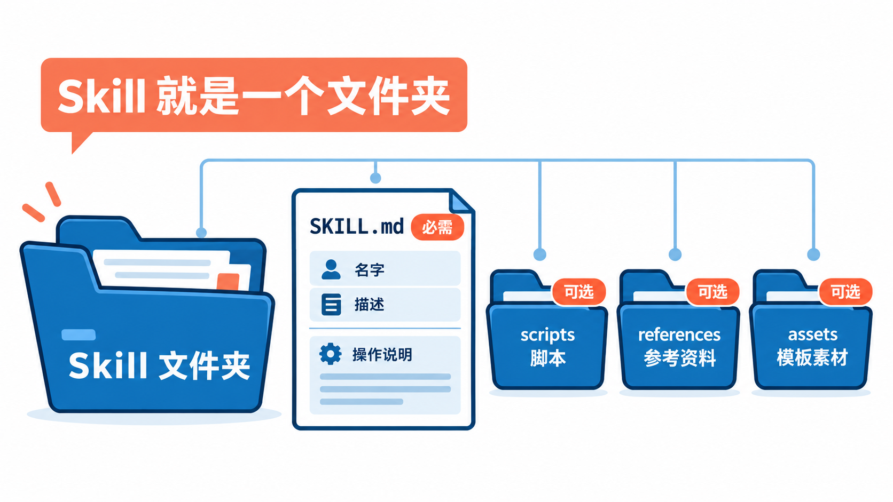
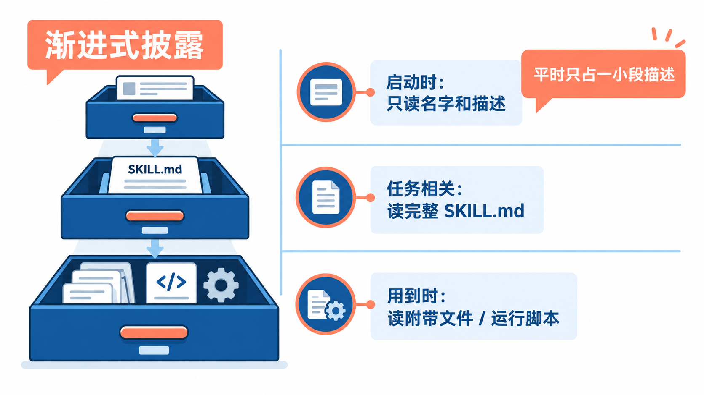
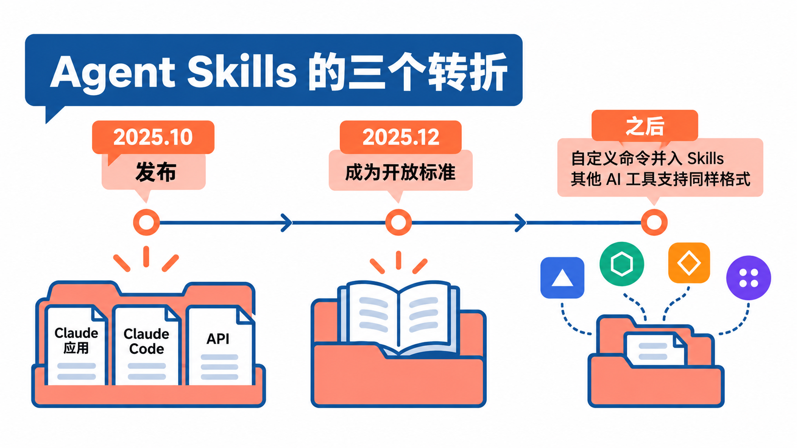
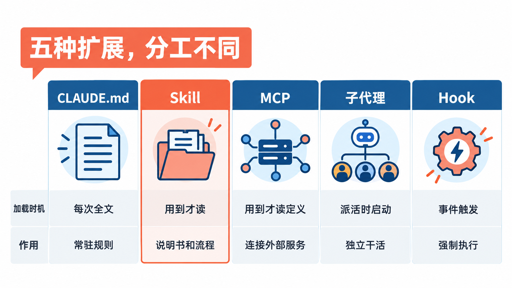
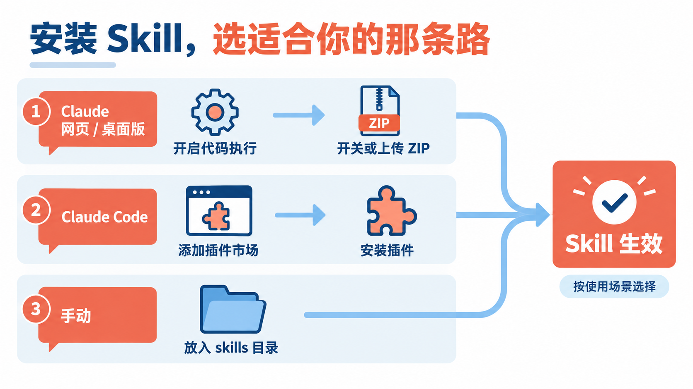
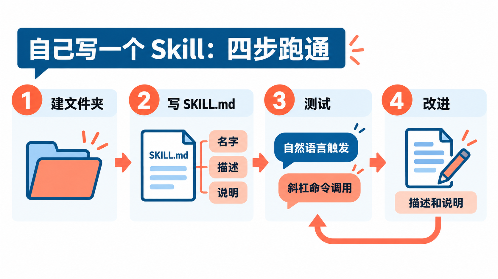
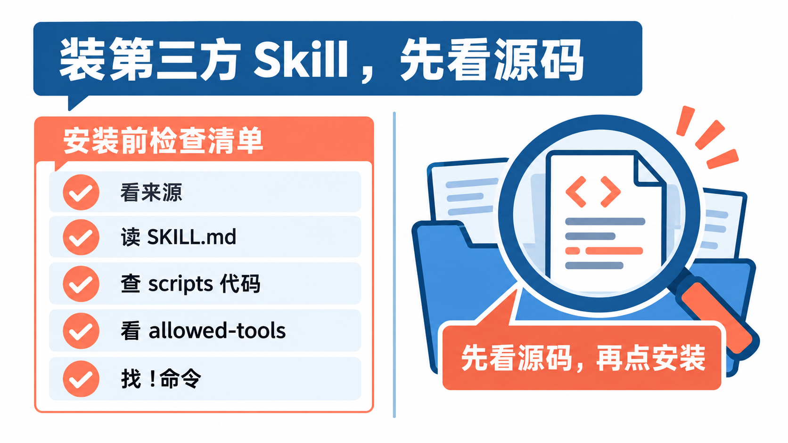

# 给Claude装「技能包」：Agent Skills入门，从安装到自己写一个

用 Claude 久了，你大概也有几段“每次都要重新贴一遍”的话：团队的代码规范、写周报的格式、提交前要过一遍的检查清单。贴多了嫌烦，不贴它又不按你的习惯来。

**Agent Skills（智能体技能，下文简称 Skill）** 就是为这件事准备的：把这些说明、参考资料和脚本装进一个文件夹，Claude 需要时自己去翻，不需要时只记得“有这么一本手册”。这篇讲清楚四件事：Skill 到底是什么、它是怎么来的、和 CLAUDE.md、MCP 这些东西有什么区别，以及怎么装别人的 Skill、怎么自己写一个。最后单独说一件很重要的事：**第三方 Skill 可以带可执行脚本，装之前一定先看源码。**

## Skill 就是一个文件夹



按官方的说法，Skill 是**一个装着说明、脚本和资源的文件夹**，Claude 会在需要时动态加载它，用来把某类专门的任务做得更好、更稳定。

一个 Skill 最少只需要一个文件 `SKILL.md`。开放标准里给出的完整结构是这样的：

```text
skill-name/
├── SKILL.md          # 必需：元数据 + 说明
├── scripts/          # 可选：可执行的代码
├── references/       # 可选：参考文档
├── assets/           # 可选：模板、素材等资源
└── ...               # 其他任意文件
```

`SKILL.md` 分两部分。开头是用两行 `---` 包起来的 YAML 元数据，最关键的是两个字段：

- **`name`**：Skill 的名字，只能用小写字母、数字和连字符，最长 64 个字符，并且要和文件夹同名。
- **`description`**：说清楚**它能做什么、什么时候该用**，最长 1024 个字符。Claude 就是靠这段话判断要不要用这个 Skill 的。

元数据下面就是普通的 Markdown 正文，写给 Claude 看的操作说明、示例和注意事项。

**它为什么不占地方？** 关键在一个叫“渐进式披露”（progressive disclosure）的设计。



- **第一层**：启动时，Claude 只把每个 Skill 的 `name` 和 `description` 读进来，相当于看一眼目录。
- **第二层**：当你的任务和某个 Skill 的描述对得上，Claude 才把整个 `SKILL.md` 读进上下文。
- **第三层**：`SKILL.md` 里提到的参考文档、模板，Claude 用到哪份读哪份；附带的脚本可以直接运行，脚本本身和它处理的文件不必塞进上下文。

所以你可以装很多 Skill，平时每个只花一小段描述的成本。官方举的例子是 PDF 技能：里面带了一个提取表单字段的 Python 脚本，Claude 直接运行它拿结果，不用把脚本和整份 PDF 都读一遍。**需要每次结果都一致的步骤，交给代码；需要判断的部分，交给 Claude**，这是 Skill 的基本思路。

## 它是怎么来的



### 起点：Agent 有能力，但缺“本单位的规矩”

Anthropic 在介绍 Skills 的工程文章里讲得很直白：模型越来越能干，但真到干活时，常常缺的是**具体的流程知识和你们公司、团队自己的上下文**。怎么按品牌规范做 PPT、财务报表按什么口径算、这个仓库发版前要过哪些检查，这些东西模型不可能天生就会。

以前的办法是写进系统提示词或者每次贴进对话，但内容一多，就既占上下文又容易互相干扰。Skill 用“文件夹 + 按需加载”解决了这个矛盾。

### 2025 年 10 月：随 Claude 全线发布

**2025 年 10 月 16 日**，Anthropic 发布 Agent Skills，同时覆盖三个地方：Claude 网页和桌面应用、Claude Code，以及 Claude API（API 里需要配合代码执行工具使用，并新增了管理 Skill 的接口）。官方同时在 GitHub 上维护着 [anthropics/skills](https://github.com/anthropics/skills) 示例仓库，放了一批可以直接装、也可以照着学的 Skill。

值得一提的是，Claude 应用里“生成 Word、Excel、PPT、PDF 文件”的能力，背后就是这几个文档类 Skill。示例仓库里把它们也放了出来，供开发者参考复杂 Skill 的写法。

### 2025 年 12 月：变成开放标准

**2025 年 12 月 18 日**，Anthropic 把 Agent Skills 作为**开放标准**发布，规范和文档放在 agentskills.io，同一天还加了组织级的 Skill 管理和合作伙伴 Skill 目录。

这是它最重要的一次转折。从这以后，Skill 不再只是 Claude 的功能，而是一种通用格式：OpenAI Codex 的官方文档写明它的 Skill 建立在这个开放标准之上，Gemini CLI 也支持同样结构的 `SKILL.md`。**你写的一个 Skill 文件夹，换个工具也有机会直接用。**

在 Claude Code 内部，原来的“自定义斜杠命令”也并进了 Skills：`.claude/commands/deploy.md` 和 `.claude/skills/deploy/SKILL.md` 都会生成 `/deploy` 命令，老文件照样能用，新写的建议直接用 Skill。

### 早期选择留下了什么

从设计上看，Skill 最早做的几个选择，今天既是优点也是包袱：

- **选了纯文件夹和 Markdown**：门槛极低，会写文档就会写 Skill，能放进 Git 管理、能被别的工具读懂，这是它能成为开放标准的前提。
- **选了“由模型自己判断何时使用”**：省去了手动调用，但触发全靠 `description` 写得好不好，写得含糊就会该用的时候不用、不该用的时候乱用。
- **选了“可以带脚本”**：能力上限一下子拉高了，但也意味着**装一个 Skill，可能就是装了一段会在你电脑上运行的代码**。后面的安全部分就是在讲这个代价。

## 和 CLAUDE.md、MCP、子代理有什么区别



刚接触 Skill 的人，最容易把它和 Claude Code 里另外几样东西搞混。它们都能“让 Claude 更懂你”，区别在于**什么时候加载、提供的是什么**：

| | CLAUDE.md | Skill | MCP | 子代理（Subagent） | Hook |
|---|---|---|---|---|---|
| 什么时候加载 | 每次会话都全文加载 | 平时只加载描述，用到时才读全文 | 启动时加载工具名，用到时再读完整定义 | 被派活时启动，有自己独立的上下文 | 到了指定事件就执行，不占上下文 |
| 提供的是什么 | 项目里“永远要遵守”的规则 | 知识、流程、参考资料、脚本 | 连接外部服务的工具和数据 | 一个隔离的“干活的人” | 一段一定会执行的脚本或检查 |
| 适合放什么 | 构建命令、代码约定、“不许做 X” | 部署清单、接口规范、写作模板 | 查数据库、发 Slack、控制浏览器 | 要翻很多文件的调研、并行任务 | 每次改完文件跑格式化、拦截危险命令 |

几个容易想不清的点，展开说一下：

**CLAUDE.md 和 Skill**：两者都是写给 Claude 的说明。**每次都必须知道的放 CLAUDE.md，偶尔才用到的放 Skill。** 官方建议 CLAUDE.md 控制在 200 行以内，越写越长时，就该把其中的“流程”和“参考资料”挪成 Skill。

**MCP 和 Skill**：MCP 是“接线”，让 Claude 能连上数据库、Slack 这类外部系统；Skill 是“说明书”，告诉 Claude 怎么把这些工具用好。两者经常搭配：MCP 连上你的数据库，Skill 里写清楚表结构和常用的查询方式。

**Hook 和 Skill**：Skill 里的规则是“请求”，Claude 会照着做，但不是百分之百。**必须每次都执行的规矩，比如“绝不能改 .env”，要用 Hook 来强制。**

**为什么选 Skill**：你有一套会反复用到的流程或资料，又不想让它常驻上下文；或者想把它分享给同事、带到别的项目和别的工具里。

**为什么不选 Skill**：只有一两句话的规则，直接写进 CLAUDE.md 更省事；需要连外部系统，先接 MCP；要求每次都绝对执行的检查，用 Hook。

## 在 Claude 网页版和桌面版里用



如果你主要在 claude.ai 或桌面应用里聊天，用 Skill 只要三步：

1. **先打开代码执行。** Skill 依赖代码执行能力。个人账号（Free、Pro、Max）在 **Settings > Capabilities** 里打开 **Code execution and file creation**；Team 和 Enterprise 由组织管理员在组织设置里统一开启。
2. **开启需要的 Skill。** 到 **Customize > Skills**，Anthropic 提供的 Skill 可以直接用开关打开或关闭。
3. **上传自己的 Skill。** 把 Skill 文件夹打成 ZIP 包，在同一页面点 **+**，选 **Create skill** 里的 **Upload a skill**，上传这个 ZIP。

开启后，Claude 会在任务相关时自动使用。想让它一定用某个 Skill，在请求里点名就行，比如“用我的品牌规范 Skill 做一份演示文稿”。

上传失败的常见原因官方也列了：ZIP 太大、文件夹名和 Skill 名不一致、缺少 `SKILL.md`、名字或描述里有不允许的字符。另外要注意，网页版和 API 只认开放标准里的那几个元数据字段（`name`、`description`、`license`、`compatibility`、`metadata`、`allowed-tools`），**多写了 Claude Code 专用的字段，上传会直接报错**。

## 在 Claude Code 里装官方 Skill

Claude Code 用户最省事的办法，是把官方示例仓库添加成插件市场，再按需安装。在 Claude Code 里输入：

```text
/plugin marketplace add anthropics/skills
```

然后可以用 `/plugin` 打开菜单浏览安装，也可以直接装其中一组：

```text
/plugin install document-skills@anthropic-agent-skills
/plugin install example-skills@anthropic-agent-skills
```

`document-skills` 是处理 Word、Excel、PPT、PDF 的那一组；`example-skills` 是其余示例，包括前端设计、网页应用测试、MCP 服务器生成、品牌规范、内部沟通写作等。装好后不用记命令，直接在对话里提到就行，比如官方示例里的“用 PDF skill 提取某个文件里的表单字段”。

两点提醒：

- 这个仓库里的 Skill **官方明确说是演示和学习用途**，Claude 实际的表现可能和仓库里的实现不同，用于重要任务前要自己测一遍。
- 许可证不一样：多数示例是 Apache 2.0 开源的，但 `docx`、`pdf`、`pptx`、`xlsx` 四个文档 Skill 是**源码公开（source-available）而非开源**，看和学没问题，拿去商用或改了再分发前要先读它们的许可条款。

## 自己写一个 Skill



### 先选位置

在 Claude Code 里，Skill 放在哪儿，决定了它在哪些会话里生效：

| 位置 | 路径 | 生效范围 |
|---|---|---|
| 个人 | `~/.claude/skills/<skill-name>/SKILL.md` | 这台电脑上你的所有项目 |
| 项目 | 项目里的 `.claude/skills/<skill-name>/SKILL.md` | 这个仓库，提交进 Git 后同事也能用 |
| 插件 | 插件里的 `skills/<skill-name>/SKILL.md` | 启用了这个插件的地方，命令名形如 `/插件名:技能名` |

个人目录下的 Skill 只在本机生效。如果你用 Claude Code 的云端会话或定时任务，它们读不到你电脑上的 `~/.claude/skills/`，需要把 Skill 提交进仓库的 `.claude/skills/`，或者在 claude.ai 账号里开启它。

### 跟着官方例子写第一个

下面是 Claude Code 文档里的入门例子：一个总结“未提交改动”并指出风险的 Skill。先建文件夹（macOS / Linux）：

```bash
mkdir -p ~/.claude/skills/summarize-changes
```

然后把下面的内容保存为 `~/.claude/skills/summarize-changes/SKILL.md`：

```markdown
---
description: Summarizes uncommitted changes and flags anything risky. Use when the user asks what changed, wants a commit message, or asks to review their diff.
---

## Current changes

!`git diff HEAD`

## Instructions

Summarize the changes above in two or three bullet points, then list any risks you notice such as missing error handling, hardcoded values, or tests that need updating. If the diff is empty, say there are no uncommitted changes.
```

这个例子没写 `name`，Claude Code 会用文件夹名 `summarize-changes` 当命令名。`` !`git diff HEAD` `` 这一行是 Claude Code 的“动态上下文注入”：**Skill 加载时，Claude Code 先在你的电脑上执行这条命令**，再把输出填进来交给 Claude，所以它拿到的是你真实的改动，而不是猜的。

测试有两种方式。打开一个 Git 项目，随便改一个文件，启动 `claude`，然后：

- 用自然语言问一句和描述对得上的话，比如“What did I change?”，看 Claude 会不会自己用上它；
- 或者直接输入 `/summarize-changes` 调用。

### 写好一个 Skill 的几条经验

这些来自官方文档的建议，对写任何 Skill 都适用：

- **description 最重要。** 把“做什么”和“什么时候用”都写上，带上用户自然会说的关键词。Claude Code 里描述加上补充字段最多显示 1536 个字符，**最关键的用途写在最前面**。
- **正文要精简。** Skill 一旦加载就会留在对话里，每多一行都是持续的成本。写“做什么”，少写“为什么”。`SKILL.md` 建议控制在 500 行以内，详细资料拆到 `references/` 里，在正文中写清楚每个文件是干什么的。
- **有副作用的操作，只允许手动触发。** 部署、发消息、提交代码这类 Skill，在元数据里加 `disable-model-invocation: true`，Claude 就不会自己决定去跑，只有你输入 `/名字` 才会执行。
- **不触发时怎么查。** 先问 Claude“What skills are available?”看它在不在列表里；YAML 写错时 Skill 仍会加载但没有元数据，用 `claude --debug` 启动可以看到解析错误。

想更省事，可以让 Skill 帮你写 Skill：示例仓库里有一个 `skill-creator`，专门用来帮你创建 Skill，Claude Code 官方插件市场里的同名插件还能帮你做“有它 / 没它”的对比测试，看这个 Skill 到底有没有让结果变好。

## 装别人的 Skill 之前，先看源码



GitHub 上第三方 Skill 越来越多，很多质量不错。但要记住官方在发布时就写明的一句话：**这个功能让 Claude 能执行代码**。一个 Skill 可以带脚本，Claude 会运行它；Skill 里的文字说明，Claude 也会照着做。

官方点名的两类风险是：

- **提示词注入**：Skill 里藏着的指令，诱导 Claude 去做你没想让它做的事。
- **数据外泄**：通过恶意代码或注入的指令，把你的文件、密钥发到外面的服务器。

所以官方的建议很明确：**只从可信的来源安装 Skill**；来源不那么确定的，哪怕是同事分享的，**启用之前也要先审一遍**。具体看这几样：

1. **看来源。** 优先官方仓库和你了解的作者，留意仓库的维护情况和 Issues。
2. **通读 `SKILL.md`。** 留意有没有让 Claude 读取 `~/.ssh`、`.env`、浏览器数据之类敏感位置的指令，或者让它把内容发到某个网址。
3. **逐个看 `scripts/` 里的代码和依赖。** 特别是联网请求、下载再执行、删除文件的操作。图片等资源文件也在官方提醒要检查的范围里。
4. **看元数据里的 `allowed-tools`。** 在 Claude Code 里，它会让列出的工具在调用这个 Skill 的那一轮里**不再弹出权限确认**。一个第三方 Skill 要求放行范围很宽的命令，就要多想一下为什么。
5. **找 `` !`命令` `` 这种写法。** 前面说过，它会在 Skill 加载时直接在你电脑上执行。Claude Code 会先拿它去对照你的权限规则，被拒绝或没被允许的命令会让这次调用中止，但你自己的权限规则放得越宽，这道关就越松。

另外两个习惯也值得养成：

- **用不到的 Skill 关掉或删掉。** 少一个 Skill，就少一份风险，也少一段占上下文的描述。
- **打开陌生的项目时，看一眼它的 `.claude/skills/`。** 项目里的 Skill 会随着你在这个目录启动 Claude Code 自动加载。

## 写在最后

如果你只想先感受一下，最简单的第一步是：在 claude.ai 打开代码执行，到 **Customize > Skills** 里打开一个官方 Skill 试试；用 Claude Code 的，照着上面的例子在 `~/.claude/skills/` 下建一个 `summarize-changes`，改几行代码问它一句“What did I change?”。**等你发现自己第三次往对话里贴同一段说明时，就是把它写成 Skill 的时候了。**

## 参考资料

<div class="sources">
<p>官方示例与安装：<a href="https://github.com/anthropics/skills">anthropics/skills（GitHub）</a>。Claude Code 用法：<a href="https://code.claude.com/docs/en/skills">《Extend Claude with skills》</a>、<a href="https://code.claude.com/docs/en/features-overview">《Extend Claude Code》（功能对比与上下文成本）</a>。Claude 应用内使用：<a href="https://support.claude.com/en/articles/12512180-using-skills-in-claude">《Using skills in Claude》</a>、<a href="https://support.claude.com/en/articles/12512198-creating-custom-skills">《How to create custom skills》</a>。</p>
<p>来历与设计：<a href="https://claude.com/blog/skills">《Introducing Agent Skills》（2025 年 10 月 16 日，含 2025 年 12 月 18 日更新）</a>、<a href="https://www.anthropic.com/engineering/equipping-agents-for-the-real-world-with-agent-skills">《Equipping agents for the real world with Agent Skills》</a>。开放标准：<a href="https://agentskills.io">agentskills.io</a>、<a href="https://github.com/agentskills/agentskills">agentskills/agentskills（GitHub，含规范）</a>。其他工具的支持：<a href="https://developers.openai.com/codex/skills">OpenAI Codex《Agent Skills》</a>、<a href="https://geminicli.com/docs/cli/skills/">Gemini CLI《Agent Skills》</a>。</p>
<p>资料核对于 2026 年 10 月 12 日。文中命令来自官方文档，写作时未实际运行。菜单名称、支持的套餐和字段限制会随产品更新变化，以官方页面为准。配图为示意图，不是产品界面截图。</p>
</div>
