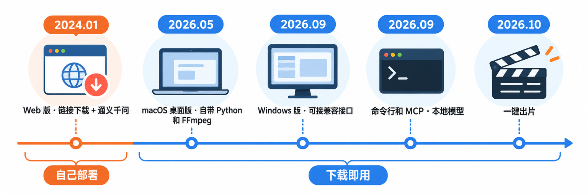
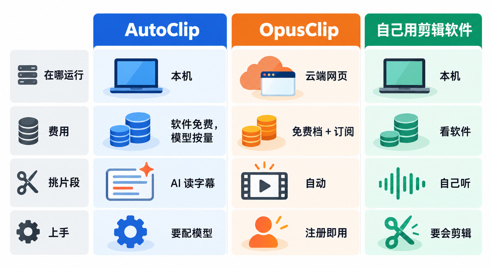
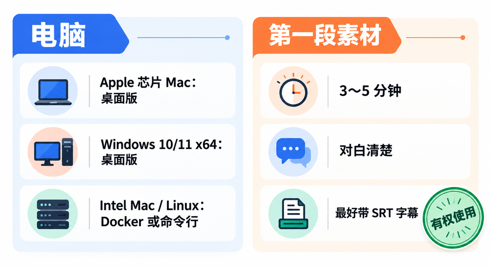
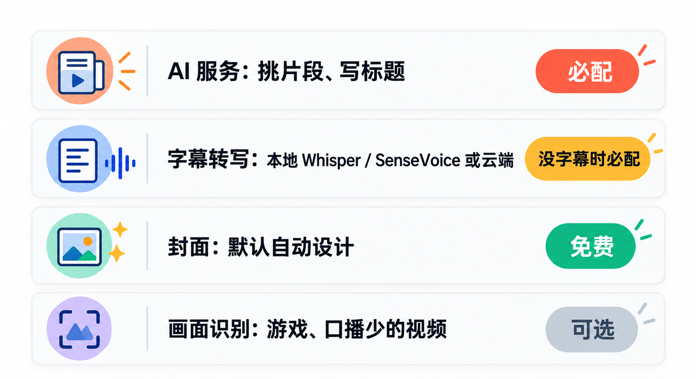
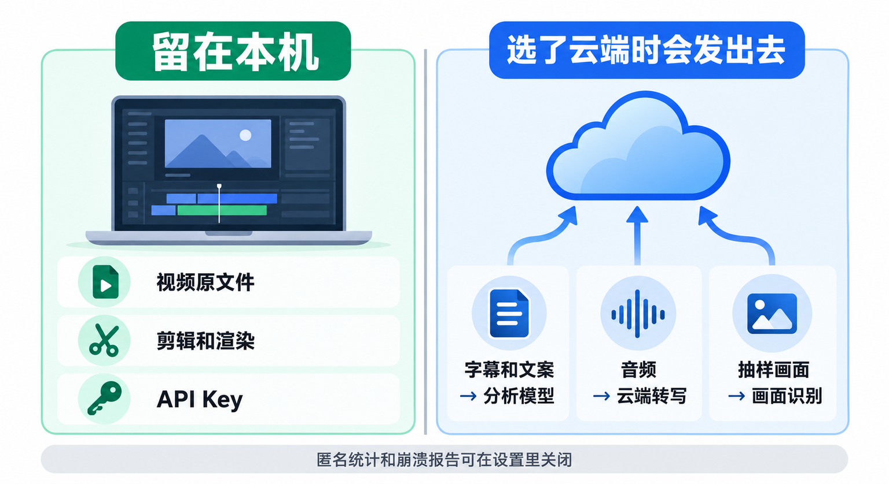

# 一小时播客剪成十条短视频：开源AutoClip入门，从配模型到导出发布包

录了一期一个多小时的播客，或者讲完一节两小时的课，想剪几条一分钟左右的短视频发抖音、小红书、B 站，最费时间的往往不是剪，而是**从头听一遍、找出值得剪的那几段**。

这篇介绍一个专门干这件事的开源工具 **AutoClip**：把长视频交给它，它用你选的大模型读字幕、挑片段，在你自己的电脑上剪好、配上字幕和标题，再按平台生成竖版或横版成片，连封面和发布文案一起打包。看完你能做成一件事：**在自己电脑上装好 AutoClip，配好 AI 服务，把一段自己的长视频剪成第一批可以发的短视频。**

## 先认识一下：它到底帮你做了哪几步


AutoClip 是一个开源的长视频切片工具，代码在 GitHub 的 `zhouxiaoka/autoclip` 仓库，**MIT 开源协议，软件本身免费**。AutoClip 不是缩写，就是项目名。

它把“长视频变短视频”拆成了几步，每一步你都能看到、能改：

- **拿到字幕**：视频有作者上传的字幕时直接用；没有的话，用本地的 Whisper、SenseVoice，或者你配置的云端语音识别转成带时间轴的字幕。
- **挑片段**：把字幕交给你选的大模型通读全文，找出能独立成立的观点、问答和故事，给每段打分。
- **剪辑和包装**：切点从一个问题或观点的第一句开始，到说话人明显停顿时结束；竖屏版本会跟着正在说话的人取景，加上字幕、标题和名牌。
- **出发布包**：每条成片配一张封面，按平台写好标题、简介和话题，可以打包成 ZIP 下载。

目标平台目前覆盖抖音、小红书、B 站、YouTube、YouTube Shorts、TikTok 和 Reels。每个平台默认先做评分最高的至多 10 条，其余的列为“备选”，想要再点一下生成。

它最适合的是**以说话为主的视频**：访谈、播客、课程、口播、直播回放。官方也写得很直白，默认路线靠字幕判断内容，音乐、舞蹈这类主要靠画面的视频，单靠字幕找不准精彩点。

## 它是怎么来的：从一套 Web 服务，到一个桌面应用



AutoClip 由个人开发者 zhouxiaoka 维护，项目说明里写明是业余时间维护。

**2024 年 1 月**，最早的 1.0 版本发布，形态是一套 Web 服务：后端 FastAPI，前端 React，用 Celery 和 Redis 排队处理视频，AI 分析接的是通义千问，支持本地上传和 B 站、YouTube 链接下载。想用它，得自己把这一整套服务在电脑或服务器上跑起来。

这个早期选择后来成了包袱。到 2026 年 9 月的 1.2.1 版，更新日志里还在集中修 Docker 跑不通、任务队列不干活的问题，开发者把那一版直接称为“止血版”。

转折发生在 2026 年：

- **5 月 31 日，1.1.0**：macOS 桌面版做到“零依赖安装”，安装包里自带 Python 和 FFmpeg，桌面模式不再需要 Redis。
- **9 月 6 日，1.2.1**：第一个 Windows 安装包；OpenAI 兼容接口可以自己填地址，智谱、DeepSeek、本地 Ollama 都能接。
- **9 月 20 日，1.3.0**：加入 `autoclip` 命令行和 MCP 服务，Claude、Cursor 这类 AI 工具可以直接调用它；设置页能直接选 Ollama、LM Studio 本地模型。
- **9 月 27 日，1.4.0**：游戏录屏可以另开“画面识别”，用多模态模型看画面找高光。
- **10 月 1 日，1.5.0**：“一键出片”，按平台直接生成带封面和文案的成片。开发者在更新日志里给出的数据是，一条有作者字幕的 2 小时访谈，从链接到成片由约 65 分钟缩短到 7～8 分钟，主要是把几十次逐段调用改成了让模型一次通读全文。

写这篇时，GitHub 上最新的正式版是 **1.5.6**，1.5.7 还是预发布版。这个项目更新非常频繁，几天一个版本，下面提到的界面和功能都以你下载时的版本为准。

## 横向比一比：和 OpusClip、手动剪，差在哪



想把长视频切成短视频，读者最可能拿来比较的有两个：一个是这个领域最常被提起的商业在线工具 **OpusClip**，一个是自己打开剪辑软件手动剪。

| | AutoClip | OpusClip | 自己用剪辑软件 |
|---|---|---|---|
| 在哪运行 | 自己电脑，剪辑渲染在本机 | 网页，视频传到云端处理 | 自己电脑 |
| 费用 | 软件免费，AI 服务按你选的服务商计费；本地模型不花 API 费 | 有免费档；付费档按月订阅 | 看软件本身 |
| 挑片段 | 大模型读字幕自动挑，可选画面识别 | 自动挑 | 全靠自己听 |
| 上手难度 | 要自己配 AI 服务和转写 | 注册即用 | 要会剪辑 |

OpusClip 官方定价页上，免费档的动态字幕模板带水印，素材只保存 3 天；去水印要上付费档，Starter 是每月 15 美元，Pro 是每月 29 美元。

**为什么选 AutoClip**：视频不用整段传到别人的服务器，模型可以自己选，用国产模型或者本地模型都行，按官方给的估算，一条两三个小时的访谈文字模型费用在几毛钱人民币；成片、封面和文案一起出，适合要往好几个平台发的人。

**为什么放弃它**：配置门槛是实打实的，你至少得弄懂“分析模型”和“字幕转写”两样东西；它是个人维护的项目，更新快也意味着偶尔会遇到新问题；macOS 版还没有经过苹果公证，Intel 芯片的 Mac 和 Linux 没有桌面安装包。如果你只是偶尔剪一两条，又不在意上传云端，注册一个在线工具可能更省事。

## 第一步：确认电脑和素材



桌面版目前提供两种安装包，到项目 Releases 页面下载：

- **macOS Apple Silicon（M 系列芯片）**：文件名带 `aarch64` 的 `.dmg`。
- **Windows 10 / 11 x64**：文件名带 `x64-setup.exe` 的安装包。

页面上的 `Source code` 是源码压缩包，不是安装包，别下错。Intel 芯片的 Mac 和 Linux 用 Docker 或命令行版，后面单独说。

处理长视频要占不少内存和硬盘：原视频、转写模型、临时文件和导出结果都要放得下。官方没有给出最低配置，**第一次先用一段 3～5 分钟、对白清楚的短视频试**，跑通了再上一小时的长片。手上如果有这段视频的 `.srt` 字幕文件，一起准备好，能省掉转写这一步。

> **只处理你有权使用的视频。** AutoClip 支持粘贴 B 站、YouTube 链接直接下载，但能下载不等于能二次剪辑发布。官方安装指南也要求“请确认你有权使用该媒体”。最稳妥的素材是你自己录的播客、课程和访谈；剪别人的内容，先拿到授权。

## 第二步：安装桌面版

**macOS**：打开 `.dmg`，把 AutoClip Desktop 拖进“应用程序”。因为这个版本还没有经过苹果公证，第一次打开会被系统拦下。官方给的做法是：在“应用程序”里右键 AutoClip Desktop，选“打开”，再在弹窗里点“打开”。

**Windows**：运行 `x64-setup.exe`，按向导安装。它装在当前用户下，平时不需要管理员权限；电脑里缺 WebView2 的话，安装器可能会联网下载。安装包没有做系统代码签名，Windows 也可能弹出提示。

> **先确认安装包来自官方 Releases 页面，再放行系统提示。** 未签名、未公证的软件，正是靠“来源可信”来保证安全的。不要为了装它去关闭系统全局的安全检查，也不要用网盘里别人转存的安装包。

## 第三步：配好 AI 服务，这是最关键的一步



第一次打开，AutoClip 会弹出“连接 AI 服务”的引导。设置里的 AI 模型分成四块，对应四件不同的事，弄清楚各管什么，就不会配错。

**1. AI 服务（必配）**：负责读字幕、挑片段、写标题和文案。你有两种选法：

- **云端模型**：设置里预置了通义千问、OpenAI、Gemini、DeepSeek、豆包 Seed、Kimi、GLM、Grok 等服务商。选一家，填上你在该服务商官网申请的 API Key，测试连接、保存，分析模型会自动选好。费用由服务商按用量收取。
- **本地模型**：先在电脑上装好 Ollama 或 LM Studio 并加载模型，在 AutoClip 里选对应的本地服务，不需要 API Key，但推理要靠你自己的电脑。

用 Ollama 的话，官方安装指南给的示例是先拉一个模型：

```bash
ollama pull qwen2.5:7b
```

处理长视频时，官方建议把模型的上下文长度调到 16384 以上（Ollama 用 `OLLAMA_CONTEXT_LENGTH` 环境变量或 `num_ctx` 参数，LM Studio 在加载模型时设置 Context Length），否则一小时的字幕放不进去。

**2. 字幕转写（视频没有字幕时必配）**：负责把说话声变成带时间轴的字幕。本地可以选 Whisper 或 SenseVoiceSmall，在设置里点一次“准备模型”，会安装组件、下载模型，第一次需要联网、要等一会儿；也可以绑定云端转写，比如 OpenAI 或阿里云百炼的语音识别。本地转写不上传音频，但慢一些：官方记录里一条近 3 小时的中文访谈，本地 Whisper 转了约 23 分钟，换成百炼云端转写约 4 分钟。

**3. 封面**：默认是**免费的自动设计**，从成片里挑画面、叠上标题和名牌，不调用付费的生图模型。你在设置里主动选了生图服务和模型，才会改用 AI 生成封面，按张计费。

**4. 画面识别（可选）**：用支持看图的模型抽几张画面辅助判断，适合游戏录屏、口播很少的内容。打开后会把抽样画面发给云端模型，费用另计；做访谈和课程，字幕路线通常就够了。

设置的供应商列表里还有项目的赞助方服务，本文只建议用模型官方的服务或本地模型，Key 自己去官网申请。

**API Key 只保存在你本机，也别外传。** 官方隐私说明写明密钥不会上传，但它存在本机数据目录的配置文件里。备份数据目录、截图求助、在 Issue 里贴日志时，记得把 Key 遮掉。

## 第四步：导入视频，生成第一批成片


1. **导入**：在首页用“文件导入”选你的视频，有 `.srt` 就一起选上；也可以用“链接导入”粘贴 B 站或 YouTube 链接。导入后先确认制作类型，确认之后才正式开始分析和剪辑，未确认的导入可以恢复。
2. **选平台**：选要发的平台。竖版成片有两种版式：抖音、小红书默认“访谈式”（上方标题、说话人小窗、下方字幕），TikTok、Reels、Shorts 默认“满屏播客式”（全屏跟着说话人走）；B 站和 YouTube 出横版。版式可以自己改，字幕和文案语言跟着平台走，比如英文素材投抖音会配中文字幕。
3. **等它出片**：进度页会显示下载、转写、分析、渲染各阶段。每个平台先生成评分最高的至多 10 条，其余进“备选片段”，需要时点“生成这条”。
4. **检查**：逐条预览，重点看**片段开头结尾有没有截断半句话、竖屏取景有没有把人裁掉、字幕有没有错字、标题是不是夸大了原意**。要调整就进编辑器改起止点、字幕样式和文案。
5. **下载**：每条成片可以复制发布文案，或者导出包含视频、封面、文案的发布包。

还有两个默认设置值得知道。一是**成片结尾默认会加一段约 1.8 秒的 AutoClip 品牌片尾动画**，不想要可以在设置里关掉；复制出来的发布文案不带 AutoClip 署名。二是 AutoClip 也能连接你的 B 站账号直接投稿，海外平台要通过你自己的 Upload-Post 账号；不连接就只是下载，**发不发、什么时候发，由你自己决定**。

> **自动出片不等于可以直接发。** 官方文档反复强调“输出仍需人工检查边界、裁切和文案”。AI 写的标题倾向于抓眼球，挑出的片段也可能脱离上下文，尤其是访谈嘉宾的话，发出去之前至少完整看一遍。

## 没有桌面版的电脑：Docker 和命令行

**Intel Mac、Linux，或者想放在服务器上跑**，用 Docker 部署 Web 版。官方 README 给出的命令是：

```bash
git clone https://github.com/zhouxiaoka/autoclip.git
cd autoclip
cp env.example .env
mkdir -p data logs uploads
docker compose up -d --build
```

启动后在浏览器打开 `http://localhost:3000` 进入界面。Docker 里要连宿主机上的 Ollama 时要注意，容器里的 `localhost` 指的是容器自己，需要改成容器能访问到的宿主机地址。

**想批量处理，或者让 AI 编程助手来调用**，可以用命令行版。它需要 Python 3.10 以上（建议 3.11），并且 FFmpeg 和 FFprobe 在系统路径里可用。按官方说明从源码安装（在克隆好的仓库根目录执行）：

```bash
python3 -m venv .venv
source .venv/bin/activate
python -m pip install -r requirements.txt
python -m pip install --no-deps .
autoclip --version
```

模型配置可以复用桌面版的设置。之后一条命令出片，已有字幕就用 `--srt` 跳过转写：

```bash
autoclip produce talk.mp4 --srt talk.srt --platform douyin --json
```

`talk.mp4` 和 `talk.srt` 换成你自己的文件。官方 CLI 文档里，同一条命令可以写多个 `--platform` 一次出多个平台的版本；`autoclip mcp` 则以 MCP 服务的形式启动，供支持 MCP 的 AI 客户端调用，详细接法看仓库里的 CLI / MCP 指南。

## 隐私和数据：哪些留在本机，哪些会发出去



AutoClip 的定位是“本地优先”，但本地处理不等于什么都不联网，按官方隐私说明，分清楚这几点：

- **留在本机**：视频文件、剪辑和渲染、项目文件和 API Key。
- **你选了云端服务时会发出去**：字幕路线把相关字幕和文案发给分析模型；云端转写会上传提取的音频；画面识别会发送抽样画面。这些数据直接发给你选的服务商，不经过 AutoClip 的服务器。全部用本地模型和本地转写时，核心处理不需要云端模型服务，但下载视频、安装组件和更新仍要联网。
- **默认开启的统计**：软件会通过 PostHog 发送匿名使用统计，并可通过 Sentry 发送崩溃报告，官方说明里写明不含视频内容、字幕和密钥。两项都可以在设置里关闭。

处理内部培训、客户访谈这类不方便外传的录音，**分析模型和转写都选本地**，是最稳的组合。

## 写在最后

如果你手上正好有一期自己录的播客或一节课，最省事的试法是：**挑一段 3～5 分钟带字幕的片段，配一家你已经有账号的国产模型 API，选抖音或小红书出一版**，看看它挑的段落和你自己会挑的是不是同一段。觉得靠谱，再把整期丢给它，记得每条发之前自己看一遍。

## 参考资料

<div class="sources">
<p>AutoClip 官方：<a href="https://github.com/zhouxiaoka/autoclip">zhouxiaoka/autoclip（GitHub，README、LICENSE）</a>、<a href="https://github.com/zhouxiaoka/autoclip/releases">Releases</a>、<a href="https://github.com/zhouxiaoka/autoclip/blob/main/CHANGELOG.md">更新日志</a>、<a href="https://zhouxiaoka.github.io/autoclip_intro/">官网</a>。</p>
<p>官方文档：<a href="https://github.com/zhouxiaoka/autoclip/blob/main/docs/USER_INSTALLATION_GUIDE.md">安装与第一次出片</a>、<a href="https://github.com/zhouxiaoka/autoclip/blob/main/docs/AI_MODEL_CONFIGURATION.md">AI 模型配置</a>、<a href="https://github.com/zhouxiaoka/autoclip/blob/main/docs/FAQ.md">常见问题与排错</a>、<a href="https://github.com/zhouxiaoka/autoclip/blob/main/docs/PRIVACY.md">隐私说明</a>、<a href="https://github.com/zhouxiaoka/autoclip/blob/main/docs/COST_PER_VIDEO.md">成本与时间</a>、<a href="https://github.com/zhouxiaoka/autoclip/blob/main/docs/CLI_AND_MCP.md">CLI / MCP 指南</a>、<a href="https://github.com/zhouxiaoka/autoclip/blob/main/DOCKER.md">Docker 指南</a>。</p>
<p>对比参照：<a href="https://www.opus.pro/pricing">OpusClip 官方定价页</a>。</p>
<p>资料核对于 2026 年 10 月 19 日。文中命令来自官方文档，写作时未实际运行。版本号、支持的平台和服务商、费用估算以官方仓库和各服务商当前页面为准；处理耗时和模型费用为开发者公布的测试记录，会随素材、硬件和模型变化。配图为示意图，不是产品界面截图。</p>
</div>
