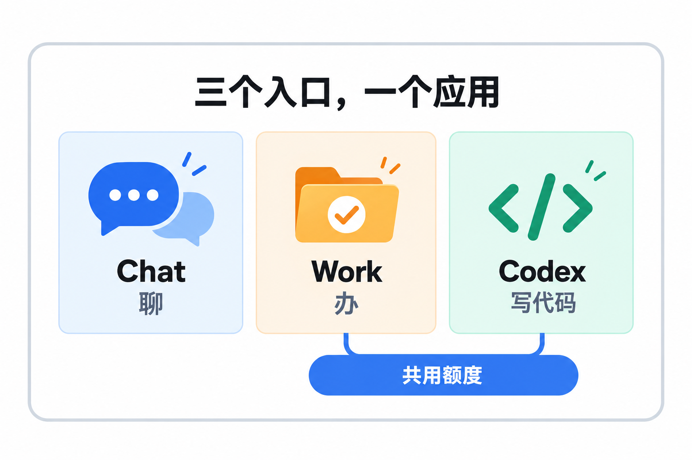
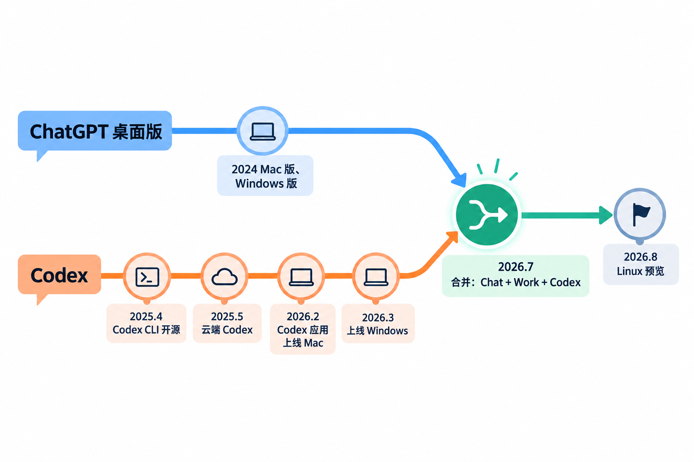
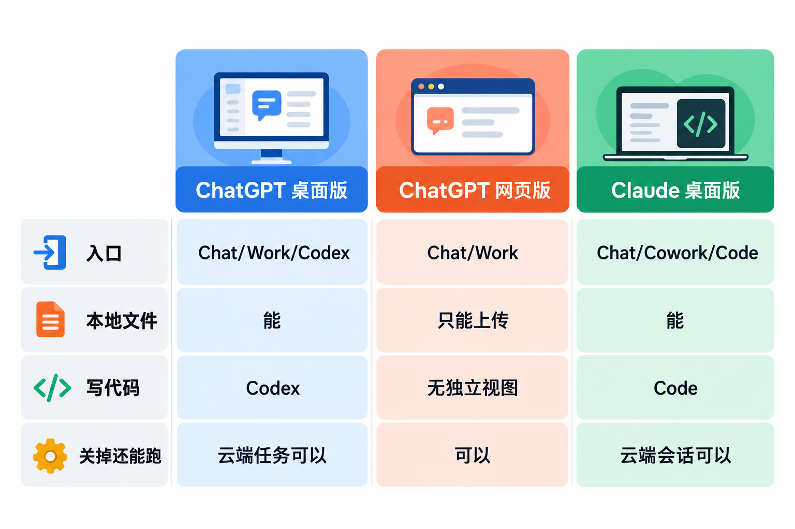
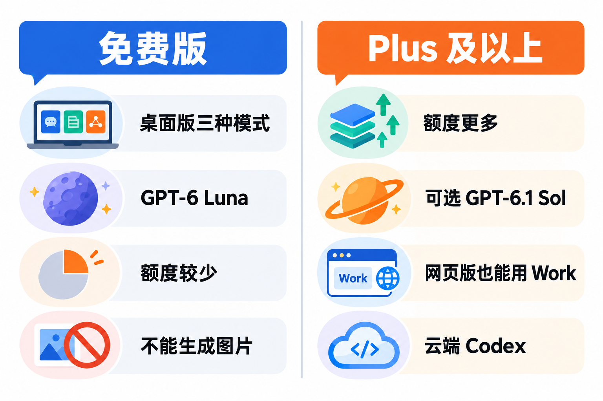
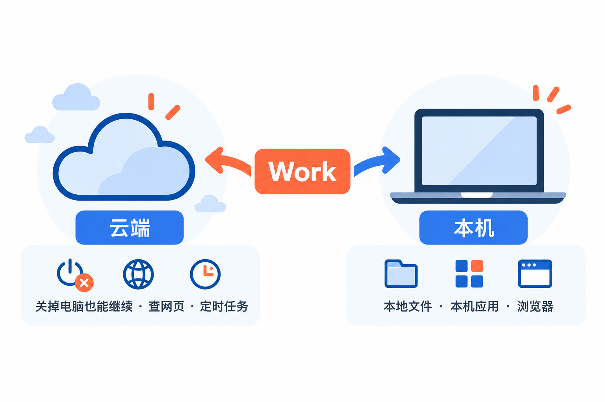
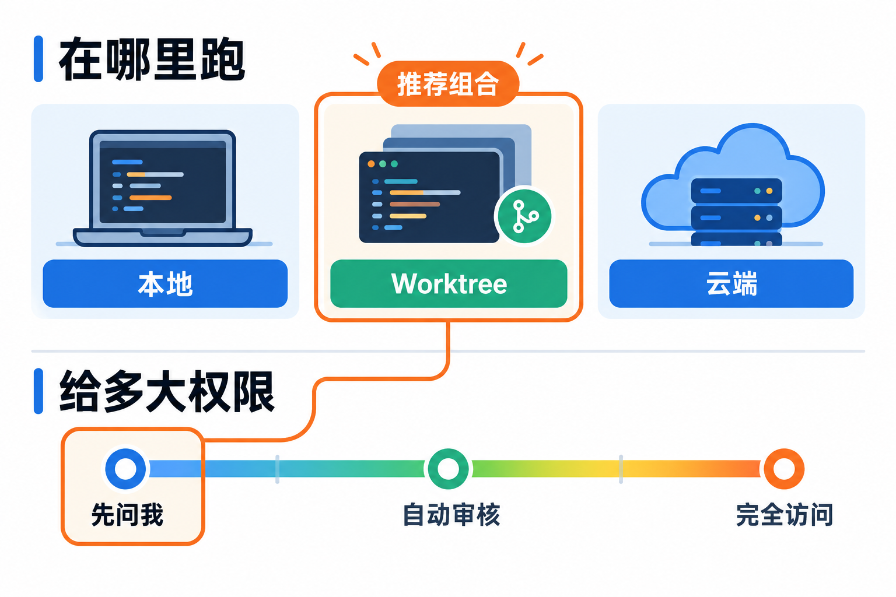
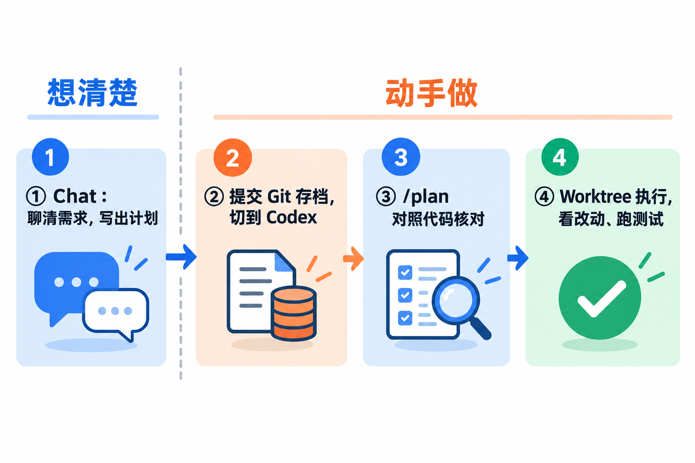

# ChatGPT桌面版三合一：Chat、Work、Codex分别什么时候用

如果你最近打开电脑上的 ChatGPT，会发现它变了样：同一个窗口里，除了熟悉的聊天，还多了 **Work** 和 **Codex**。原来单独下载的 Codex 应用，也被并进了这个桌面版。

很多人第一反应是：三个入口，我到底该点哪个？这篇就讲清楚这件事：三种模式各自是干什么的、免费用户能用到哪些、本地和云端怎么选，以及一个我觉得最顺手的用法——**先在 Chat 里把计划聊清楚，再交给 Codex 动手。**

## 先认识一下：三个入口，一个应用



先说名字。**GPT = Generative Pre-trained Transformer（生成式预训练 Transformer 模型）**，ChatGPT 就是基于这类模型的对话产品。现在的 ChatGPT 桌面应用支持 macOS 和 Windows，Linux 版处于预览阶段。

打开应用后，顶部有一个产品选择：**ChatGPT** 或 **Codex**。选 ChatGPT 时，输入框上方还有一个切换开关：**Chat** 或 **Work**。所以实际是三种用法：

| 模式 | 适合做什么 | 官方举的例子 |
|---|---|---|
| **Chat** | 一问一答、来回讨论 | 提问、搜网页、头脑风暴、起草消息、比较选项 |
| **Work** | 给它一个目标，拿回一份能检查的成果 | 做一份演示文稿、分析一堆文件、写报告、做项目计划 |
| **Codex** | 用开发者工具，看到技术细节 | 调试代码、跑测试、审 PR、实现一个功能 |

一句话区分：**Chat 是“聊”，Work 是“办”，Codex 是“写代码”。**

Work 和 Codex 的能力其实有不少重叠，两边都能读文件、跑命令、做文档。区别主要在“给谁看”：Work 会把 Git、命令行这些技术细节藏起来，说话更偏日常语言，最后交给你一份成品；Codex 则把改动对比（diff）、代码审查面板、PR 面板都摆出来，适合要自己盯着代码的人。官方也说了，如果你习惯用 Codex 做调研、写文档，继续用它完全没问题。

> **Work 和 Codex 共用同一份额度。** 在 Work 里跑一个大任务，和在 Codex 里写代码，消耗的是同一个用量池。想知道还剩多少，去 ChatGPT 的 Codex 用量页面看，别等到关键任务做到一半才发现用完了。

## 它是怎么变成今天这样的



这次合并不是突然冒出来的，它是两条线汇到了一起。

**第一条线是 ChatGPT 桌面版本身。** 它 2024 年先后上了 Mac 和 Windows，最早就是一个“不用开浏览器的 ChatGPT”，主要还是聊天。

**第二条线是 Codex。** Codex 这个名字 OpenAI 在 2021 年就用过，当时指一个代码模型。今天的 Codex 是另一回事，是一个会自己读代码、改代码、跑命令的编程智能体：

- **2025 年 4 月 16 日**，OpenAI 发布开源的 Codex CLI，在终端里干活；
- **2025 年 5 月 16 日**，发布云端的 Codex，可以在云上同时跑多个编程任务；
- **2026 年 2 月**，Codex 应用在 macOS 上线，带来多项目并行对话、内置 Git 审查、worktree、技能（Skills）、定时任务；
- **2026 年 3 月**，Codex 应用上线 Windows，原生支持 PowerShell 和沙箱。

到这一步，OpenAI 手里有两个桌面应用：一个偏聊天，一个偏写代码。而 Codex 应用里那套“读文件、跑命令、长时间干活”的能力，其实不只对程序员有用。

**2026 年 7 月**，两条线并在了一起。ChatGPT Work 发布，主打“把一件真正的工作交给 ChatGPT，它可以拆步骤、连续干几个小时，你随时看进度、改方向、批准关键操作”。**7 月 9 日**，Codex 应用正式并入 ChatGPT 桌面版，官方说明更新后的桌面应用面向**所有套餐开放，包括免费版**。随后一周，Chat 和 Work 的对话被放进同一个列表，Codex 保留自己独立的视图和历史记录。**8 月**，Linux 版进入预览。

从这条路线能看出两个“历史遗留”：

- **Work 继承了 Codex 的底子。** 所以它天生会用文件、终端和浏览器，也天生和 Codex 共用额度。
- **Codex 保留了独立视图。** 老 Codex 用户的工作流和历史没有被打乱，可以把 Codex 设成默认视图，甚至把应用图标换回 Codex 的 Logo。代价是新用户第一次打开时，会面对一个不太直观的“ChatGPT / Codex”加“Chat / Work”的两层切换。

## 横向比一比：和谁比，为什么选它



读者最可能拿来比的有两个：一个是**网页版 ChatGPT**，因为大多数人一直在网页上用；另一个是 **Claude 桌面版**，它也是“一个应用、三个标签”的结构（Chat、Cowork、Code），思路非常接近。

| | ChatGPT 桌面版 | ChatGPT 网页版 | Claude 桌面版 |
|---|---|---|---|
| 入口 | Chat、Work、Codex | Chat、Work | Chat、Cowork、Code |
| 能不能直接用电脑上的文件 | 能，可以打开本地文件夹 | 不能，只能上传 | 能，Cowork 和 Code 可以 |
| 写代码 | Codex：本地、worktree、云端三种跑法 | 无独立的编程视图 | Code：本地、云端、SSH 等 |
| 关掉应用还能继续吗 | 选云端运行的任务可以 | Work 在云端运行，可以 | 云端会话可以 |

**为什么选 ChatGPT 桌面版**：你本来就是 ChatGPT 用户，想让它直接处理电脑上的文件、表格、代码，又不想再装一个单独的编程工具。一个账号、一份额度，聊天、办事、写代码都在一个窗口里切换。

**为什么还用网页版**：你只是偶尔问问题，或者在公司电脑上不方便装软件。网页版也有 Work，但它只在云端跑，碰不到你本机的文件。

**为什么选 Claude 桌面版**：如果你的主力是 Claude，Claude 桌面版是对位的产品，没必要为了“三合一”换阵营。反过来，如果你在 Claude Code、Claude Cowork 或 Cursor 里攒了一套设置，ChatGPT 桌面版在 **设置 > Import** 里提供了导入功能，可以把指令、技能、插件、项目和最近的工作搬过来，导入不会改动原来那边的设置。

## 免费用户能用到哪些



这是很多人最关心的问题，按官方资料说清楚：

- **桌面应用本身对免费版开放**，Chat、Work、Codex 三个入口都在。
- **免费版和 Go 套餐在桌面应用里用的是 GPT-6 Luna**，这是 GPT-6 系列里最快、成本最低的型号，官方给免费版的定位是“在快速的小型编程任务上体验 Codex”。功能按灰度逐步开放，你的账号里暂时没有某个选项是正常的。
- **免费版不能生成图片。** Plus 及以上才有。
- **网页版的 ChatGPT Work、云端的 Codex、更强的 GPT-6.1 Sol 模型**，都从 Plus（每月 20 美元）开始提供。
- **用量**：Work 和 Codex 的消耗取决于模型、任务大小、本地还是云端运行，同样看起来差不多的任务，消耗也可能差很多。官方没有给免费版公布固定条数，以自己账号的用量页面为准。

所以免费用户的合理期待是：**能在桌面版里体验三种模式，适合做小任务、感受一下流程**；真要让它连续干几个小时的大活，额度和模型都不够用。

## Chat：聊天，也是“想清楚”的地方

Chat 就是你熟悉的那个 ChatGPT：问问题、查资料、改文案、比较方案。它没变，但在三合一之后多了一个用处：**在动手之前，把需求聊清楚。**

官方文档里有几句很实用的追问，在 Chat 里随时可以用：

- “先问我几个问题再继续。”
- “你做了哪些假设？”
- “给我三种不同的方案。”

这些话的作用是让 AI 先把它的理解摆出来，而不是上来就给一个看似完整、其实方向不对的答案。后面讲的“先 Chat 再 Codex”，就是从这里开始的。

## Work：把一件事交出去，拿回一份成果



选 ChatGPT，再把输入框上方的开关切到 **Work**，就进入了 Work 模式。它适合这样的任务：**要用到好几份资料或好几个工具、自己做要花不少时间、最后要交出一份你会检查和再用的东西。** 官方列出的能力包括：

- 搜网页、读文件、分析数据，做成对比和总结；
- 直接生成文档、演示文稿、表格和 PDF，可以预览、提修改、下载；
- 通过插件连接 Google Drive、Slack、SharePoint 等工具，在提示词里用 `@插件名` 指定；
- 设置定时任务，比如每周一早上汇总一次项目进展；
- 在桌面版里使用浏览器、本机应用和文件。

在桌面版里，Work 的任务可以选在哪里跑：

- **云端**：在一个隔离的托管环境里运行，关掉桌面应用也能继续，还能在网页版或手机上接着看。适合查网页、做调研、定时检查网站这类不依赖你电脑的任务。
- **本机**：可以用你电脑上的文件、应用和浏览器。需要账号或工作区开通了这个能力才会出现。

给 Work 写任务，官方的建议是写清楚五件事：**要什么结果、用哪些资料、有什么限制、怎样算做好、什么时候停下来等你确认。** 对比一下：

不太好的写法：

```text
帮我做一个关于客户调研的演示文稿。
```

更好的写法（官方示例的意思）：

```text
阅读附件里的访谈记录和问卷结果，为产品负责人会议做一份 8 页的演示文稿。聚焦客户最常遇到的三个问题，每个问题附上证据，把发现和建议分开写，标出证据不足的说法。先给我一份草稿审阅，不要直接当成终稿。
```

最后一句很关键。Work 会在需要信息或需要你批准的时候停下来，**关键操作批准之前要看清楚，成品拿去用之前也要检查一遍**，尤其是数字、人名、日期和引用。

## Codex：写代码的专用视图



在顶部的产品选择里切到 **Codex**，就是原来 Codex 应用那套界面：改动对比可以直接编辑、侧边栏审 PR、一个项目可以挂多个代码仓库。

开一个新对话之前，有两个选择要先做。

**第一，在哪里跑：**

- **Local（本地）**：直接在你当前的项目目录里改。
- **Worktree**：用 Git worktree 复制出一份独立的工作区来改，不影响你手头正在改的代码。需要项目是 Git 仓库。改好后可以用 Handoff 把对话挪回 Local，Codex 会处理中间的 Git 操作。
- **Cloud（云端）**：在云端的独立工作区里跑，需要先有一个发布好的云端环境。你电脑上的文件、正在运行的程序、浏览器登录状态都不会自动带过去。

**第二，给多大权限。** 输入框下方有权限控制，常见的三档：

- **Ask for approval**：在当前工作区内自己干活，要越界（比如访问工作区外的文件、联网）时停下来问你。**官方建议大多数情况从这一档开始。**
- **Approve for me**：边界和上一档一样，只是越界请求交给自动审核，而不是每次都问你。
- **Full access**：不受项目目录限制。

> **别一上来就开“完全访问”。** 官方在 Windows 文档里写得很直白：完全访问模式下，Codex 不受项目目录限制，可能做出意料之外的破坏性操作，导致数据丢失。保持沙箱边界，有特殊需要时用规则单独放行。另外，让 Codex 改项目之前，先把手头的改动提交到 Git，改坏了才能一键回到原样。

## 最顺手的用法：先在 Chat 里定计划，再交给 Codex



把前面几节串起来，这是我推荐的一个工作流，特别适合“想做个小功能，但还没想清楚”的时候。

**第一步：在 Chat 里聊需求。** 先别打开代码。直接说你想做什么，然后加一句：

```text
先问我几个问题，把需求弄清楚。弄清楚之后，写一份实现计划：要改哪些地方、按什么顺序做、每一步怎么验证。
```

来回几轮，直到它写出的计划你看得懂、也同意。Chat 不碰你的文件，在这里改主意没有任何成本。

**第二步：提交代码，切到 Codex。** 在终端里先把当前改动提交：

```bash
git add -A
git commit -m "开始新功能之前的存档"
```

然后在应用顶部切到 Codex，打开这个项目文件夹。

**第三步：让 Codex 对照代码核对计划。** 把 Chat 里定好的计划粘贴进来，先在输入框输入 `/plan`。官方的说明是：多步骤的任务，用 `/plan` 让 Codex 先调查、提出做法，再动手改。这一步的意义在于，Chat 没看过你的代码，计划里可能有和实际代码对不上的地方，让 Codex 先指出来。

**第四步：在 Worktree 里执行，看完再合并。** 计划确认后，选 **Worktree**、权限选 **Ask for approval**，让它开工。做完后在改动对比里一处处看，跑一遍测试，没问题再挪回本地或者合并。如果你的账号里有 `/goal`，也可以在计划之后用它设一个带完成标准的目标，让 Codex 自己检查有没有做完。

为什么要分成两段？**Chat 擅长把模糊的想法问清楚，Codex 擅长在真实代码里干活。** 把“想清楚”和“动手做”分开，Codex 拿到的是一份明确的计划，返工会少很多；你在 Chat 里改十次主意，也不会在代码里留下十轮半成品。

## 写在最后

如果你只想记住一件事：**问问题用 Chat，要成品用 Work，改代码用 Codex，拿不准的大活先在 Chat 里聊成计划。** 免费用户可以先下载桌面版，在 Chat 里聊一个小需求，再让 Codex 在一个提交过的小项目里试一次，感受一下这套流程适不适合你。

## 参考资料

<div class="sources">
<p>OpenAI 官方：<a href="https://openai.com/index/chatgpt-for-your-most-ambitious-work/">《ChatGPT is now a partner for your most ambitious work》</a>、<a href="https://help.openai.com/en/articles/6825453-chatgpt-release-notes">ChatGPT release notes</a>、<a href="https://help.openai.com/en/articles/20001275-chatgpt-work-and-codex">Help Center：ChatGPT Work and Codex</a>、<a href="https://help.openai.com/en/articles/20001276-moving-to-the-new-chatgpt-desktop-app">Help Center：Moving to the new ChatGPT desktop app</a>。</p>
<p>ChatGPT Learn 文档：<a href="https://learn.chatgpt.com/docs/app">ChatGPT desktop app</a>、<a href="https://learn.chatgpt.com/docs/quickstart">Quickstart</a>、<a href="https://learn.chatgpt.com/docs/use-chatgpt">Use ChatGPT（三种模式与 Work/Codex 对比）</a>、<a href="https://learn.chatgpt.com/docs/get-started-with-work">Get started with ChatGPT Work</a>、<a href="https://learn.chatgpt.com/docs/pricing">Pricing（套餐、额度与功能可用性）</a>、<a href="https://learn.chatgpt.com/docs/models">Models</a>、<a href="https://learn.chatgpt.com/docs/environments/modes">Codex environments</a>、<a href="https://learn.chatgpt.com/docs/environments/git-worktrees">Worktrees</a>、<a href="https://learn.chatgpt.com/docs/permission-modes">Permissions</a>、<a href="https://learn.chatgpt.com/docs/sandboxing">Sandbox</a>、<a href="https://learn.chatgpt.com/docs/windows/windows-app">ChatGPT desktop app for Windows</a>、<a href="https://learn.chatgpt.com/docs/prompting">Prompting</a>、<a href="https://learn.chatgpt.com/docs/long-running-work">Long-running work</a>、<a href="https://learn.chatgpt.com/docs/import">Import from another agent</a>、<a href="https://learn.chatgpt.com/docs/whats-new">What's new</a>。</p>
<p>Codex 历史：<a href="https://openai.com/index/openai-codex/">OpenAI：Introducing Codex（含 2025 年 4 月 Codex CLI 与 5 月云端 Codex 的更新说明）</a>、<a href="https://github.com/openai/codex">openai/codex（GitHub）</a>。对比参照：<a href="https://code.claude.com/docs/en/desktop">Claude Code Desktop 文档</a>。</p>
<p>资料核对于 2026 年 10 月 14 日。文中命令来自官方文档，写作时未实际运行；Git 提交命令为通用写法。ChatGPT 的功能、模型、套餐和额度更新频繁，并按地区和灰度逐步开放，以官方页面和自己账号里的实际界面为准。配图为示意图，不是产品界面截图。</p>
</div>
