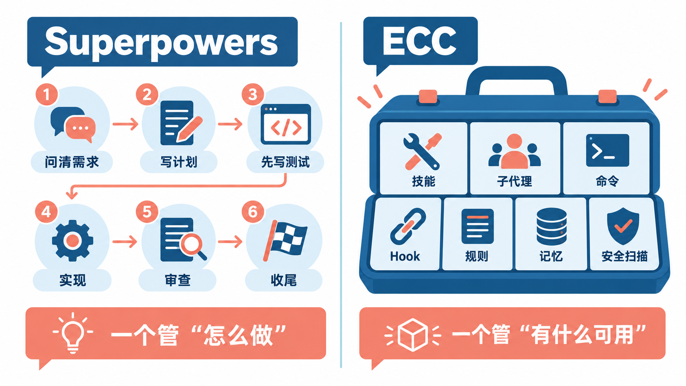
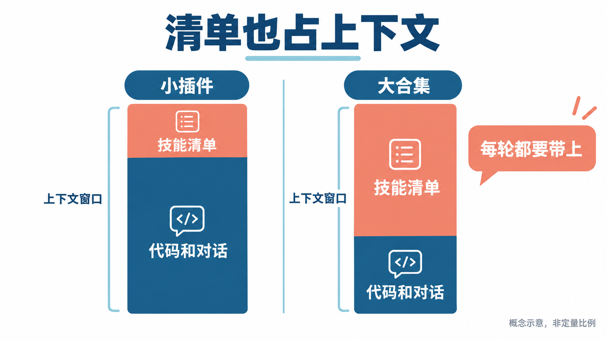
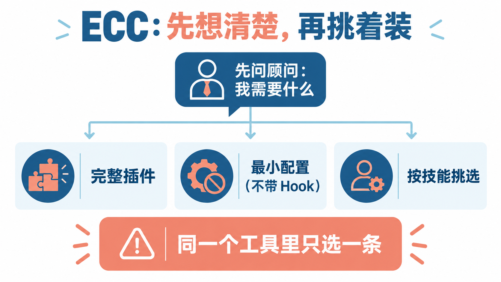

# Superpowers还是ECC？两个最火的Claude Code技能合集，别一次全装

上一篇讲了怎么给 Claude 装单个 Skill。真去 GitHub 上找，你会发现星标最高的往往不是单个 Skill，而是一整套“合集”：装一次，Claude Code 就多出几十上百个技能、命令和自动化脚本。其中最火的两个是 **Superpowers** 和 **ECC**，2026 年 10 月时两个仓库的星标都在 27 万以上。

这篇不是让你两个都装上。它们的思路很不一样：Superpowers 给你一套**固定的开发流程**，ECC 给你一个**很大的工具箱**。装错了、装多了，最直接的代价是每次对话都背着一堆用不上的技能描述，还多了一批你没细看过的自动脚本。下面讲清楚两者各是什么、怎么来的、适合谁，以及怎么只装自己要的那部分。

## 先看清两者是什么



**Superpowers** 不是缩写，就是“超能力”的意思。它的官方定位是“给编程智能体用的一整套软件开发方法论”，由一组能相互配合的 Skill，加上一段保证 Claude 一定会去用这些 Skill 的启动说明组成。它的核心是一条主线：

1. **brainstorming（头脑风暴）**：动手写代码之前，先追问你到底想做什么，把理解复述给你确认；小改动在对话里对齐，大项目写成一份设计文档。
2. **using-git-worktrees**：设计确认后，开一个独立的 Git 工作区和新分支，跑一遍测试确认起点是干净的。
3. **writing-plans**：把工作拆成每个 2~5 分钟的小任务，每个任务写清文件路径、代码和验证步骤。
4. **subagent-driven-development 或 executing-plans**：按计划执行。前者给每个任务派一个新的子代理，做完一个审一个，最彻底；后者在当前会话里一口气做完，最后整体审一次，最省。
5. **test-driven-development**：强制“先写失败的测试，再写刚好让它通过的代码”。
6. **requesting-code-review**：任务之间按计划做代码审查，严重问题会挡住进度。
7. **finishing-a-development-branch**：全部做完后验证测试，让你选合并、开 PR、保留还是丢弃。

除了主线，还有系统化排查 Bug、完成前再验证一遍、并行派子代理、写新 Skill 等技能。总量不大，十几个，每个都服务于这条流程。

**ECC = Everything Claude Code（Claude Code 全家桶）**。这是它最初的全名，现在项目统一自称 ECC，介绍自己是“智能体运行框架的操作系统”。它也有一条主线：计划 → 测试 → 实现 → 审查 → 验证 → 记住 → 改进。但它更大的特点是量：当前版本 2.2.3 带了 **71 个子代理、311 个 Skill、97 个兼容旧版的斜杠命令**，外加 Hook、规则（rules）、跨会话记忆、从会话里自动提炼经验的“持续学习”，以及一个扫描智能体配置安全问题的 AgentShield。覆盖面从 TDD、安全审查、前端、数据、机器学习，一直延伸到运营和视频制作。

一句话区分：**Superpowers 管“怎么做”，ECC 管“有什么可用”。**

## 它们是怎么来的


### Superpowers：一个老程序员把自己的工作习惯写成了技能

Superpowers 的作者是 Jesse Vincent（GitHub 上的 obra），现在由他和 Prime Radiant 团队维护。2025 年 10 月，他一直在琢磨怎么把自己和编程智能体协作的习惯“抽出来、固定下来”。那时 Anthropic 刚给 Claude 上线了文档类 Skill，他注意到这种“按需加载的说明书”正好是他要的形式。原本打算周末慢慢写文档，结果 **2025 年 10 月 9 日** Claude Code 的插件系统上线，他当天就把 Superpowers 作为插件发了出来。

它最早的几个设计，今天仍是它的样子：

- **用启动 Hook 注入一段“你有超能力”的说明。** 每次会话开始，Claude 都会先读到一条规则：有对应的 Skill，就必须用。这让它的流程“自动生效”，代价是**它会很积极地介入**，哪怕你只想改一行代码，它也倾向于先过一遍头脑风暴。
- **流程优先于技能数量。** 作者明确表示一般不接受新增 Skill 的贡献，改动还必须在它支持的所有编程智能体上都能用。所以它一直很克制，没有越长越大。
- **给 Skill 也做测试。** 作者把“用子代理在压力场景下检验 Skill 是否真的被遵守”当作 Skill 的 TDD，`writing-skills` 这个技能就是这套方法。

之后它从 Claude Code 扩展到十几种编程智能体：已经进入 Anthropic 官方插件市场和 OpenAI 官方的 Codex 插件市场，也能装进 Cursor、Gemini CLI、GitHub Copilot CLI、Kimi Code、Qwen Code 等。开源协议是 MIT。

### ECC：从黑客松冠军的个人配置，长成一个大工具箱

ECC 的作者是 Affaan Mustafa。按他在仓库里的介绍，他从 Claude Code 实验阶段就开始用，**2025 年 9 月**和搭档一起赢下 Anthropic 与 Forum Ventures 合办的黑客松，用的就是这套靠智能体工作流搭出来的配置。**2026 年 1 月**，仓库以 everything-claude-code 的名字开源，起初就是“一个人打磨过的全套 Claude Code 配置”。

之后它长得很快：

- **2026 年 6 月**，2.0 正式版发布，加入 worktree 生命周期管理、编排类技能和社区。
- **2026 年 8 月起**的 2.2 系列，重点放在“装得稳”：引导式安装、安装状态记录、`doctor` 体检、`repair` 修复和 `uninstall` 卸载，支持 Claude Code、Codex 和 Kimi Code。
- 插件标识缩短成 `ecc@ecc`，原因是长名字会让工具名和命令前缀在一些严格校验里超长。仓库现在的地址是 affaan-m/ECC。

从这条路线能看出它的包袱：**它是从“全都给你”起家的**。ECC 在自己的平台支持表里写得很坦白：Claude Code 插件会把已安装的整个目录告诉模型，**在意上下文占用时，应该用选择性安装或手动挑选**。它后来补上的一大堆安装选项，基本都是在解决“东西太多”这件事。

ECC 本体是 MIT 开源、免费的；另外有付费的 ECC Pro，是给私有仓库做分析和 PR 审查的托管 GitHub App，和本地装的这套不是一回事。

## 横向比一比：该选哪个


拿这两个比，是因为它们是同一类东西里最火的两个，而且读者最常问的就是“装哪个”。再加上一个参照：**什么都不装**，只用 Claude Code 自带的计划模式和你自己的 CLAUDE.md。

| | Superpowers | ECC | 什么都不装 |
|---|---|---|---|
| 定位 | 一套固定的开发方法论 | 覆盖面很广的工具箱 | Claude Code 原生能力 |
| 规模 | 十几个 Skill | 311 个 Skill、71 个子代理、97 个命令，另有 Hook 和规则 | 无额外内容 |
| 上手方式 | 官方插件市场一条命令 | 引导式安装向导、插件命令或从源码挑选，选项多 | 无 |
| 能不能只装一部分 | 基本是整套装 | 可以按技能、按能力、按配置档挑 | — |
| 强项 | 流程完整、纪律性强，适合从零做功能 | 什么场景都能找到对应工具，安全审查、构建修复、记忆等一应俱全 | 最轻、最可控 |
| 短板 | 小改动也会被“请”进流程，节奏偏重 | 全装时占上下文多，选项多、学习成本高 | 流程和规范全靠自己写 |

**为什么选 Superpowers**：你经常让 Claude 从头做一个功能，又苦于它“上来就写、写完不测”。它会把你和 Claude 都按进“先问清楚、再写计划、先写测试”的节奏里。从定位上看，它更像请了一位严格的技术负责人。

**为什么放弃 Superpowers**：你大多数时候只是让 Claude 修个小 Bug、改段文案、问个问题。这种时候它的完整流程会显得笨重。

**为什么选 ECC**：你需要的是某几样具体能力，比如安全审查、构建失败修复、长会话的上下文管理、跨会话记忆，或者你同时在用 Claude Code、Codex、Kimi Code，想让它们共享一套技能。

**为什么放弃 ECC**：全装之后内容太多，你说不清哪些在生效；或者你只用其中两三样，却要为整套目录付出每轮对话的上下文成本。

至于**两个一起装**：两者都有自己的“计划 → 测试 → 审查”主线，同时生效时，Claude 面对同一个需求会看到两套都想接管流程的说明。我的建议是**选一个当主流程**；如果主流程选了 Superpowers，又确实需要 ECC 里的某个具体能力，就只从 ECC 里挑那一两个 Skill。

## 为什么“别一次全装”



这里要先说清楚一个机制。Claude Code 官方文档写得很明白：**插件只要处于启用状态，它的所有 Skill、子代理和命令的名字与描述，都会进入每一次会话的上下文**，不管你这次用没用到，这部分 token 都算在你的用量里。一个技能的全文要用到时才加载，但“目录”是一直在的。

这就是“合集”和“单个 Skill”的区别：装一个 Skill，多一行描述；装一个几百项的合集，每轮对话都先背上一大段清单。剩给代码和对话的空间少了，用量也涨了。

好在你可以直接看到这个数字。装好插件后，**在终端里**（不是在 Claude Code 会话里）运行：

```bash
claude plugin details <插件名>
```

输出里的 `Always-on` 一行，就是这个插件给每次会话固定增加的 token 数，下面的分项表还会列出哪个 Skill 或子代理占得最多。插件带的 MCP 工具不算在里面，要看它们占多少，在会话里输入 `/context`，看 `MCP tools` 那一项。

如果你从 Anthropic 官方插件市场装，安装前的详情页还会直接显示 **Context cost**：`Every turn` 是每轮固定增加的量，`When invoked` 是用到时额外加载的量。

> **合集不只占上下文，还会在你电脑上跑脚本。** 两个合集都带 Hook：Superpowers 每次会话启动时会执行一段脚本注入说明；ECC 的 Hook 更多，会在编辑、执行命令、会话结束等时机自动运行。装之前先在 `/plugin` 的详情页看清它要装哪些 Hook 和 MCP 服务器，只从官方仓库和官方插件市场安装。

## 装 Superpowers：一条命令，整套生效


Superpowers 已经进了 Anthropic 官方插件市场，在 Claude Code 里输入：

```text
/plugin install superpowers@claude-plugins-official
```

这条命令会打开插件详情页，先别急着回车，看一眼它要装的技能和 Hook，以及 Context cost。然后选安装范围：

- **只给自己、所有项目都用**：选用户范围。
- **只想在某个项目里用**：选本地范围（local scope），只在当前仓库对你生效。

如果你主要做小修小补，只在“要从零做功能”的那几个项目里开，是更合适的用法。

装好后开一个新会话，说一句你想做的东西，比如官方文档里的例子 `Let's make a react todo list`。装好的话，它不会直接开始写代码，而是先进入 brainstorming 开始问你问题。

几个用之前要知道的点：

- **它会自己开 Git 工作区和分支**，任务完成时会让你选合并、开 PR 还是丢弃。所以最好在一个已经用 Git 管理、改动都提交过的项目里用。
- **TDD 技能会删掉“先于测试写出的代码”**，这是它刻意的设计，不是 Bug。
- **子代理驱动的执行很耗用量**：每个任务一个新子代理、外加审查，官方说它常能连续自主工作几个小时。用量有限的话，执行阶段选 `executing-plans` 这条更省的路线。
- 它的头脑风暴有一个可选的可视化页面，默认会从作者网站加载 Logo，请求里带版本号，但不带你的项目内容。不想要的话，设置环境变量 `SUPERPOWERS_DISABLE_TELEMETRY` 为真值即可；它也认 Claude Code 自带的 `DISABLE_TELEMETRY` 设置。
- 如果哪次会话里它表现不对劲，比如该触发不触发、反复做同一件事，直接对 Claude 说“figure out what went wrong with superpowers in this session”，它会调用诊断技能分析这次会话的记录。

## 装 ECC：先想清楚要什么，再挑着装



ECC 的安装选项很多，先记住它自己反复强调的一条：

> **同一个工具里只用一种方式装 ECC。** 比如已经用插件装了，就不要再从源码完整安装一遍；两种方式叠加会让技能、命令和 Hook 重复，Hook 甚至会执行两次。已经叠了的话，按官方顺序清理：先卸插件，再在安装时的目录运行 ECC 的卸载命令，删掉多余的规则文件夹，最后只用一种方式重装。

ECC 的引导安装需要 **Node.js 18 或更新版本**；装成 Claude Code 插件还需要 Git 和 **Claude Code 2.1 或更新版本**。可以先确认：

```bash
node --version
git --version
claude --version
```

### 第一步：先问它“我该装什么”

ECC 带了一个“顾问”命令，描述你要做的事，它会返回匹配的组件、相关配置档和预览、安装命令：

```bash
npx ecc-universal@2.2.3 consult "security reviews" --target claude
```

把引号里的内容换成你关心的方向。先看结果，再决定往下走哪条路。

### 第二步：三条路选一条

**路线一：完整插件。** 想要 ECC 的全部能力，用官方推荐的引导式安装：

```bash
npx ecc-universal@2.2.3 setup
```

向导会先清点你已有的安装，再让你选范围和 Hook 配置档。个人使用的典型选择是“Global user”加“Standard”Hook。之后想改范围、换 Hook 配置或升级，重跑同一条命令即可。也可以在 Claude Code 里用原生插件命令，两种方式装的是同一个 `ecc@ecc` 插件，二选一：

```text
/plugin marketplace add https://github.com/affaan-m/ECC
/plugin install ecc@ecc
```

**路线二：最小配置，不带 Hook 运行时。** 想要 ECC 的规则、子代理和核心工作流，但不想让一堆 Hook 在后台跑：

```bash
npx ecc-universal@2.2.3 install --profile minimal --target claude
```

**路线三：按技能挑。** 只要其中几个 Skill，比如 TDD 工作流和安全审查，从官方仓库克隆后用安装脚本指定：

```bash
git clone https://github.com/affaan-m/ECC.git
cd ECC
./install.sh --target claude --skills tdd-workflow,security-review
```

如果 `consult` 给你推荐的是一整类能力，也可以按能力装，例如机器学习相关：

```bash
npx ecc-universal@2.2.3 install --profile minimal --target claude --with capability:machine-learning
```

### 第三步：规则只加你用得上的

ECC 的规则（rules）是**每次会话都全文加载**的，插件也不会帮你装。需要的话先按路线三的前两行把仓库克隆下来，在 ECC 目录里手动复制。官方建议只放通用规则加你实际用的那一门语言或框架：

```bash
mkdir -p ~/.claude/rules/ecc
cp -R rules/common ~/.claude/rules/ecc/
cp -R rules/typescript ~/.claude/rules/ecc/
```

第二行的 `typescript` 换成你自己的技术栈。

### 装好以后从哪儿用起

ECC 官方的建议是**从你手头的工作开始，而不是从目录开始**。几个常见入口：

| 你在做什么 | 从这里开始 |
|---|---|
| 做一个新功能 | `/ecc:plan "描述这个功能"`，再用 `tdd-workflow` |
| 修 Bug | 先写一个能复现的失败测试，再用 `tdd-workflow` |
| 审查新代码 | `/code-review`，用一个全新的上下文来审 |
| 构建失败 | `/build-fix` |
| 看上下文是不是太满 | `/context-budget` |
| 结束一个长会话 | `/save-session` 或 `/learn-eval` |
| 下次接着做 | `/resume-session` |

想检查或撤掉安装，用同一个包的管理命令。卸载前建议先加 `--dry-run` 看它会删哪些文件，它只删自己记录在案的文件：

```bash
npx ecc-universal@2.2.3 list-installed
npx ecc-universal@2.2.3 doctor
npx ecc-universal@2.2.3 uninstall --dry-run
npx ecc-universal@2.2.3 uninstall
```

> **只认官方渠道。** ECC 在仓库首页专门提醒：第三方转传和非官方镜像不受项目审核，可能带恶意代码。官方渠道只有 GitHub 仓库 affaan-m/ECC、npm 包 `ecc-universal` 和 `ecc-agentshield`、插件标识 `ecc@ecc` 和官网 ecc.tools。另外，命令里固定版本号只是锁定版本，不等于安全审计，它会在你电脑上执行代码，跑之前值得看一眼源码。

## 装完之后，定期做一次减法

不管装了哪个，过一两周回头看一次：

1. **在终端运行 `claude plugin details <插件名>`**，看它每轮固定占多少。
2. **打开 `/plugin`，按 Tab 切到 Installed**。Claude Code 会把你装了但最近没用过的插件放在 **Not used recently** 下面，详情里也有 **Last used**。
3. **用不上的就关掉或卸载**。在 Installed 列表里选中插件按空格就能启用或停用，详情菜单里有 **Uninstall**。只在少数项目里用的，改成本地范围安装。

## 写在最后

如果你经常让 Claude 从零做功能，又希望它像个靠谱的工程师那样先问、再计划、先写测试，从 **Superpowers** 开始，只在需要的项目里开。如果你缺的是某几样具体能力，先跑一次 ECC 的 `consult`，**按它的建议挑两三个 Skill 装，而不是把 300 多个技能一次搬进来**。装好后用 `claude plugin details` 看一眼数字，你就知道这次装得值不值。

## 参考资料

<div class="sources">
<p>Superpowers：<a href="https://github.com/obra/superpowers">obra/superpowers（GitHub，含 README、技能列表与安装方式）</a>、<a href="https://blog.fsck.com/2025/10/09/superpowers/">《Superpowers: How I'm using coding agents in October 2025》（作者发布文章，2025 年 10 月 9 日）</a>、<a href="https://claude.com/plugins/superpowers">Claude 插件市场 Superpowers 页面</a>。</p>
<p>ECC：<a href="https://github.com/affaan-m/ECC">affaan-m/ECC（GitHub，含 README、安装选项、平台支持与安全说明）</a>、<a href="https://github.com/affaan-m/ECC/blob/main/CHANGELOG.md">ECC CHANGELOG</a>、<a href="https://www.npmjs.com/package/ecc-universal">npm：ecc-universal</a>、<a href="https://ecc.tools">ecc.tools</a>。</p>
<p>Claude Code 插件机制：<a href="https://code.claude.com/docs/en/discover-plugins">《Discover and install plugins》（安装范围、管理已装插件）</a>、<a href="https://code.claude.com/docs/en/plugins/measure">《Measure plugin cost and usage》（claude plugin details 与上下文成本）</a>。</p>
<p>资料核对于 2026 年 10 月 13 日。文中命令来自官方文档，写作时未实际运行。两个项目更新频繁，技能数量、版本号、安装选项和星标数以官方仓库当前页面为准；ECC 命令中的版本号 2.2.3 是核对时的最新版本。配图为示意图，不是产品界面截图。</p>
</div>
