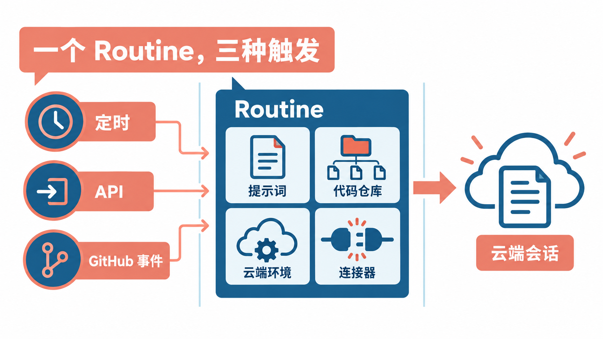
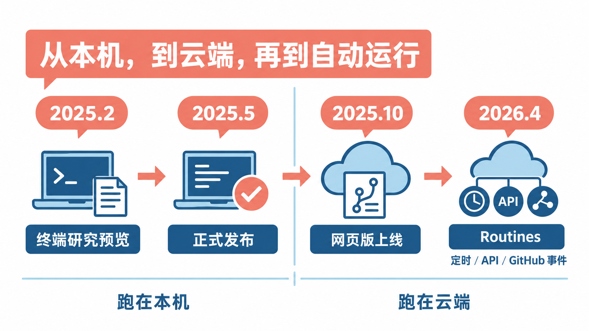
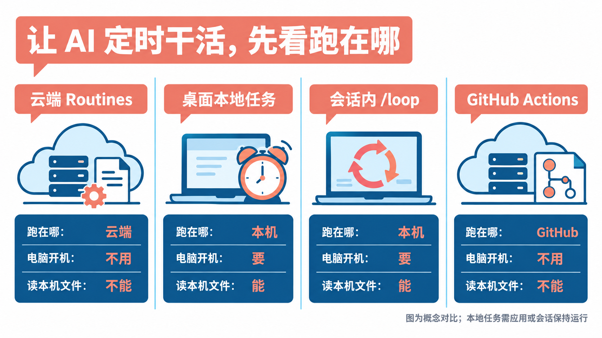
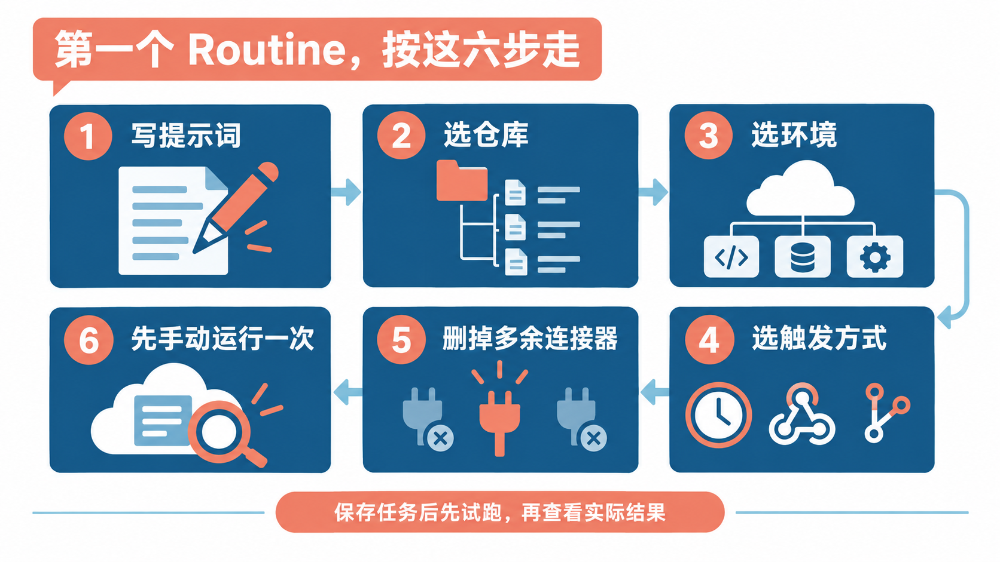
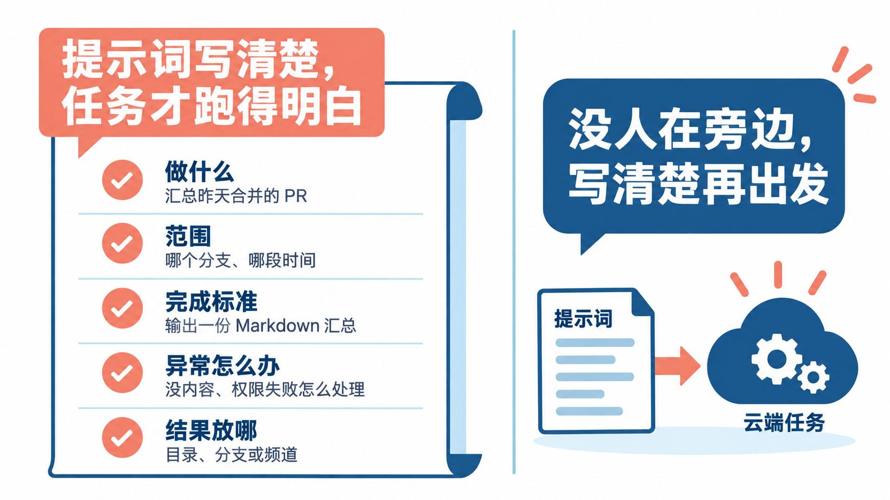
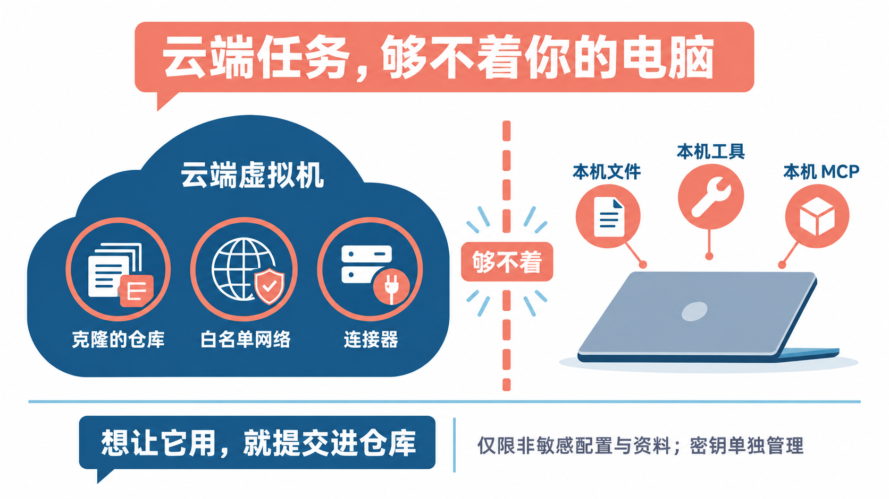

# 电脑关机了，AI也照样按时干活：Claude Code云端定时任务Routines入门

有些活不难，就是得天天做：每天早上看一眼昨天合并了哪些 PR，每周查一遍文档有没有跟着接口改，每个新 PR 先按团队的清单过一遍。交给 AI 做没问题，麻烦在于**得有人每天打开电脑、把任务交给它**。

Claude Code 的 **Routines（云端例行任务）** 解决的就是这件事：把一段提示词、要操作的代码仓库和需要用到的外部服务打包存好，之后让它按时间表自动运行，或者在收到一个 API 请求、仓库里出现新 PR 时自动开工。它跑在 Anthropic 的云上，**你的电脑合上盖子、甚至关机，它照样按时干活。**

这篇讲清楚四件事：它是怎么来的、和其他“定时让 AI 干活”的办法差在哪、怎么创建第一个 Routine，以及它够不着什么、要注意什么。先说一句：Routines 目前处于**研究预览（research preview）**阶段，官方明确说行为、限额和接口都可能调整，文中的入口和限额以当前页面为准。

## Routine 到底是什么



按官方的定义，一个 Routine 就是**一份存起来的 Claude Code 配置**，由这几样东西组成：

- **提示词**：每次运行时 Claude 要做的事。它是整个 Routine 最重要的部分。
- **代码仓库**：一个或多个 GitHub 仓库，每次运行开始时都会重新克隆一份。
- **云端环境**：决定这次运行能上哪些网、有哪些环境变量、要先装什么工具。
- **连接器**：你在 claude.ai 上接好的外部服务，比如 Slack、Linear、Google Drive，让 Claude 能读写这些服务里的内容。

配好之后，给它挂上一个或多个**触发方式**：

- **定时**：每小时、每天、工作日、每周，或者在未来某个时间点只跑一次。
- **API**：每个 Routine 有一个专属的网址，带上它的令牌发一个 HTTP POST 请求，就会启动一次运行。适合接在报警系统、部署脚本后面。
- **GitHub 事件**：仓库里有 PR 被创建、合并，或者有新版本发布时自动启动，还可以按作者、标题、分支、标签等条件过滤。

同一个 Routine 可以同时挂几种触发方式。比如一个代码审查的 Routine，可以每晚定时跑一次，也可以在每个新 PR 出现时各跑一次。

每次运行都会生成一个**完整的 Claude Code 云端会话**，和你自己在网页上开的会话一样：能看到 Claude 每一步做了什么、改了哪些代码，也能接着和它对话，或者直接创建 PR。

## 它是怎么来的



### 起点：一个跑在你终端里的编程助手

Claude Code 最早是一个命令行工具。**2025 年 2 月 24 日**，Anthropic 发布 Claude 3.7 Sonnet 时一起推出了它，当时是有限的研究预览，定位是让开发者在终端里把大块的工程任务交给 Claude。**2025 年 5 月 22 日**，随 Claude 4 系列一起，Claude Code 宣布正式可用。

这个阶段的 Claude Code 有一个天然的前提：**它跑在你的电脑上**。你得打开终端、开着会话，它才能干活；电脑一睡眠，事情就停了。

### 转折一：会话搬到了云上

**2025 年 10 月 20 日**，Anthropic 推出了网页版 Claude Code（Claude Code on the web），同样从研究预览起步。这一步的关键变化是：任务不再跑在你的电脑上，而是跑在 Anthropic 管理的云端虚拟机里。每个任务有独立的沙箱，网络和文件系统都有限制，代码从 GitHub 克隆进去，改完推回去。

这个早期选择，直接决定了今天 Routines 的样子。**好处是它不依赖你的电脑**，云端会话可以在你关掉笔记本之后继续跑；代价是它**只能看到克隆下来的仓库**，看不到你本机上的文件、本机装的工具和只配在本机的 MCP 服务器，能访问哪些网站也由环境的网络策略决定。

### 转折二：从“手动派活”到“定时自动派活”

有了云端会话，下一步自然是让它自己按时启动。在 CLI 里，`/schedule` 命令可以创建云端的定时任务。

**2026 年 4 月 14 日**，Anthropic 发布 Routines，同样是研究预览。它把原来的定时任务扩展成一个更完整的概念：一份配置，三种触发方式。官方公告里写明，**之前用 `/schedule` 创建的任务，从这时起就变成了定时触发的 Routine**。除了定时，它还多了 API 触发和 GitHub 事件触发，让外部系统也能“叫醒”Claude。

从定位上看，Routines 补上的是 Claude Code 里“无人值守”的那一块：前面的产品解决的是“我派活，AI 干”，Routines 解决的是“**我不在，AI 也按约定干**”。

## 和其他几种“定时让 AI 干活”的办法比一比



想让 Claude 定时干活，Claude Code 自己就提供了三种方式：云端的 Routines、桌面版的本地定时任务、CLI 会话里的 `/loop`。另外，很多开发者会想到用 GitHub Actions 的定时工作流来跑 Claude。这四个放在一起比，是因为**它们都能做到“到点自动跑 Claude”，区别全在跑在哪、能碰到什么**。

| | 云端 Routines | 桌面版本地定时任务 | 会话内 `/loop` | GitHub Actions 定时工作流 |
|---|---|---|---|---|
| 跑在哪 | Anthropic 的云 | 你的电脑 | 你的电脑 | GitHub 的运行器 |
| 电脑要开着吗 | 不用 | 要，且桌面应用开着、电脑没睡眠 | 要，且会话一直开着 | 不用 |
| 能读本机文件吗 | 不能，每次重新克隆仓库 | 能 | 能 | 不能，只有工作流里检出的代码 |
| 最短间隔 | 1 小时 | 1 分钟 | 1 分钟 | 由 GitHub 的定时规则决定 |
| 运行时会停下来等你确认吗 | 不会，全自动 | 每个任务单独设置 | 沿用当前会话 | 只能用你在工作流里放行的工具 |
| 怎么计费 | 计入你的 Claude 订阅用量 | 计入订阅用量 | 计入订阅用量 | Claude 用 API Key 或订阅令牌，另外消耗 GitHub Actions 分钟数 |

几个值得展开的点：

**桌面版本地定时任务**最大的优势是能直接读写本机文件、用本机的工具。但它只在桌面应用开着、电脑醒着时才会跑。电脑睡过了预定时间，这次就跳过；醒来后，它只会补跑一次最近错过的那一轮。

**`/loop`** 是会话内的轮询，适合“接下来一小时每 5 分钟看一眼 CI”这种临时需求。会话关了它就停，而且循环任务创建 7 天后会自动过期。

**GitHub Actions** 和 Routines 一样不依赖你的电脑，而且整个流程写在仓库里的工作流文件中，团队成员都能看到、改动可追溯。代价是要自己维护 YAML、配置密钥，还要占用 GitHub Actions 的分钟数；GitHub 只从默认分支运行定时工作流，公开仓库 60 天没有活动还会自动停用定时。

**为什么选 Routines：**任务需要在你不在场时稳定运行，又不想自己写工作流、管密钥；它还能直接用你在 claude.ai 上接好的连接器，一条提示词就能“读 Linear 的工单、改代码、发 Slack 消息”。

**为什么不选 Routines：**任务要读本机文件或本机才有的工具，用桌面版本地任务；需要比一小时更密的间隔，用桌面版或 `/loop`；希望配置跟着仓库走、团队共享、走公司的 API 账单，用 GitHub Actions。另外，Routine 属于你个人的 claude.ai 账号，**不能分享给队友**。

## 哪些活适合交给它

官方给出的几个典型用法，基本都是“无人值守、可重复、结果明确”的活：

- **整理待办**：每个工作日晚上读一遍新开的 issue，打标签、按涉及的代码分配负责人，再往 Slack 发一份汇总。
- **报警初查**：监控系统在错误超过阈值时调用 Routine 的 API，把报警内容传进去；Claude 去查堆栈、对照最近的提交，开一个附带修复思路的草稿 PR。
- **定制化代码审查**：每个新 PR 出现时，按团队自己的检查清单过一遍，留下行内评论和总结。
- **部署后检查**：每次上线后由部署流水线调用，跑冒烟检查、扫一遍错误日志，给出能不能放行的结论。
- **文档跟进**：每周扫一遍合并的 PR，找出引用了已改接口的文档，开 PR 更新。

对个人开发者来说，可以从更小的事开始：**每天早上汇总一下昨天合并的 PR 和新开的 issue**，或者**每周一检查一遍项目依赖有没有需要关注的更新**。这类任务失败了也没什么损失，正好用来熟悉 Routine 的脾气。

## 开始之前：确认这三样

**第一，套餐。** Routines 面向 Pro、Max、Team 和 Enterprise 套餐，免费账号用不了。Team 和 Enterprise 的组织管理员可以统一关掉这个功能，关掉后已有的 Routine 也会停止运行。

**第二，GitHub 授权。** Routine 每次运行都要克隆仓库，所以你的 claude.ai 账号需要有对应仓库的 GitHub 访问权限。如果要用 GitHub 事件触发，还需要在仓库上安装 Claude GitHub App；只在 CLI 里运行 `/web-setup` 授权克隆是不够的，它不会安装这个 App，也收不到 PR 事件。

**第三，云端环境。** 系统默认提供一个名为 **Default** 的环境，网络访问级别是 **Trusted**：只允许访问一份默认白名单里的域名，主要是 npm、PyPI 这类软件包仓库、GitHub、云厂商的接口和常见开发网站，访问白名单之外的地址会直接返回 403。**你的 Routine 如果要访问自己的服务器或其他网站，得先改环境的网络设置。**

## 方法一：在网页上创建



打开 [claude.ai/code/routines](https://claude.ai/code/routines)，点 **New routine**，按表单一项项填：

1. **名字和提示词。** 名字写清楚它是干什么的。提示词要能独立看懂，写明要做什么、做到什么程度算完成（下一节细说）。提示词框里还能选模型，之后每次运行都用这个模型。
2. **选仓库。** 添加一个或多个 GitHub 仓库。Claude 默认从仓库的默认分支开始，改动推到以 `claude/` 开头的分支上，除非你在提示词里另有要求。
3. **选环境。** 一般先用 Default；需要额外的网络访问或安装依赖，再换成自己配的环境。
4. **选触发方式。** 在 **Select a trigger** 里选 Schedule（定时）、GitHub event 或 API。定时可以选预设频率，也可以设一个一次性的运行时间。时间按你本地的时区填写，系统会自动换算。
5. **检查连接器。** 表单最下面的 **Connectors** 默认会**把你所有已连接的连接器都带上**。用不到的一定要删掉，原因见后文。
6. **创建。** 点 **Create**。之后它会在触发条件满足时自动运行；想马上试一次，就在详情页点 **Run now**。

桌面版 Claude 的 **Code** 页里也能创建：侧边栏点 **Routines**，再点 **New routine**，选 **Cloud**。注意别选成 **Local**，那会创建一个只在你电脑上跑的本地定时任务。三个入口写的是同一个云端账号，在哪创建，其他地方都能立刻看到。

**定时的一个小技巧：**别把时间设在整点。官方说明里提到，设在 9:00 这样的整点可能会晚几分钟才开始，想准时一点就设成 9:07 这种整点过几分的时间。

## 方法二：在终端里用 /schedule 创建

如果你平时就在终端里用 Claude Code，可以在任意会话里输入 `/schedule`，用对话的方式创建定时 Routine。它也可以直接带上描述，官方给的例子是：

```text
/schedule daily PR review at 9am
```

一次性的任务也能用自然语言描述时间，Claude 会把它换算成具体的时间点，确认后再保存：

```text
/schedule tomorrow at 9am, summarize yesterday's merged PRs
```

正常情况下，Claude 会接着追问时间表、仓库和提示词，问完才保存。`/schedule` 还有一个别名 `/routines`。

几个限制要知道：

- `/schedule` 要求用 **claude.ai 订阅账号登录** Claude Code。如果你用的是 Console 的 API Key，或者走 Amazon Bedrock 这类云厂商，这个命令会显示为未知命令。shell 里设置了 `ANTHROPIC_API_KEY` 或 `ANTHROPIC_AUTH_TOKEN` 也会抢在订阅登录前面生效，要先去掉。
- CLI 只能设置定时触发，**API 触发要到网页上加**；GitHub 触发网页和 CLI 都能加，CLI 方式要求 Claude Code v2.1.225 或更新版本。
- 预设里没有的间隔，比如每两小时、每月 1 号，可以先在网页上选个最接近的预设，再用 `/schedule update` 改成具体的 cron 表达式。**最短间隔是一小时**，更频繁的会被拒绝。

## 提示词怎么写，决定了它能不能干好



Routine 跑起来时**没有人在旁边**，它不会停下来问你“是这个意思吗”。所以提示词要写得像交给一个第一天上班、但很能干的同事：

- **做什么**：具体到动作，比如“汇总昨天合并到 main 的 PR”，而不是“看看仓库”。
- **范围**：只看哪个分支、哪段时间、哪个目录。
- **完成标准**：结果是什么形式，比如一份 Markdown 汇总、一个草稿 PR、一条 Slack 消息。
- **异常怎么办**：没有新内容时做什么，遇到权限错误、网络被拦时怎么报告。
- **结果放哪**：推到哪个分支、发到哪个频道。

一个可以直接参考的写法：

```text
汇总这个仓库昨天（按 UTC+8 计算）合并到 main 分支的所有 PR。
每个 PR 写一行：标题、作者、一句话说明改了什么。
把汇总写进 reports/daily/ 目录下以日期命名的 Markdown 文件，提交并推送到 claude/daily-report 分支。
如果昨天没有合并任何 PR，就不要创建文件，只在会话里说明“昨天没有合并”。
不要修改 reports/ 以外的任何文件。
```

还有一点和 API 触发有关：通过 API 或 **Run now** 传进来的附加文本，Claude 收到时会被标记为**不可信的数据**，默认不会照着里面的指令做。如果你希望 Claude 根据传进来的报警内容去排查，提示词里要明确写出来，比如“排查本次触发附带的报警内容”。这是官方有意的设计：万一令牌泄露，别人塞进来的文字也不会被当成命令执行。

## 最容易踩的几个坑



### 它看不到你电脑上的任何东西

这是最常见的误会。Routine 每次都从一份**全新克隆的仓库**开始，只有提交进仓库的东西它才看得到。具体来说：

- 仓库里的 `CLAUDE.md`、`.claude/` 下的技能、子代理和命令，**能用**。
- 你本机 `~/.claude/` 下的个人配置、技能，**用不了**。
- 用 `claude mcp add` 在本机加的 MCP 服务器，**用不了**。要么在 claude.ai 上把它加成连接器，要么用项目级的 `.mcp.json` 提交进仓库。
- 需要浏览器登录的认证，比如 AWS SSO，**不支持**。

所以，**想让 Routine 遵守某些规则，就把规则写进仓库**；想读的资料，先提交进仓库或者通过连接器接进来。

### 它会全自动执行，而且以你的身份执行

Routine 运行时**没有权限确认环节**：它会直接执行命令、调用仓库里的技能、使用你加进来的连接器，包括连接器里的写入操作，都不会停下来问你。

而且它做的一切都**以你的名义**：提交和 PR 挂的是你的 GitHub 账号，发出去的 Slack 消息、建的 Linear 工单，用的也是你关联的账号。

因此有三件事建议一开始就做：

- **连接器只留必需的。**表单默认把所有连接器都带上，一个只需要读 GitHub 的 Routine，没必要能往你的 Slack 发消息。
- **仓库只给需要的。**每多一个仓库，就多一处它能改的地方。
- **给重要分支上保护。**它默认推到 `claude/` 开头的分支，但提示词可以让它推到别的分支。想限制它能推哪些分支，用 GitHub 的分支保护规则或规则集。注意：这些规则作用于你连接的 GitHub 权限，如果你的账号本身能绕过某条规则，Routine 也能绕过。

### 环境变量里别放密钥

云端环境的环境变量和初始化脚本，**所有使用这个环境的人都能看到**。Pro 和 Max 用户要给 Routine 用 API 密钥时，官方建议放在环境的“网络密钥”（network secrets）里，由代理在请求时自动附上，而不是写进环境变量。

### 绿色的“成功”不代表任务做成了

运行列表里显示绿色，只说明这次会话正常启动、正常结束，没有出基础设施错误。**它不代表提示词里的任务完成了。**网络被拦、连接器工具缺失、任务本身失败，都只会体现在会话记录里。前几次运行，一定要点进去看看 Claude 实际做了什么。

## 用量和限制

**用量从订阅里扣。**Routine 的运行和你平时用 Claude Code 一样消耗订阅用量，可以在 [claude.ai/settings/usage](https://claude.ai/settings/usage) 查看。用量到顶后，开了用量额度（usage credits）的账号可以继续按量付费运行，没开的话后续运行会被拒绝，等用量窗口重置。

**另有按小时计的次数限制。**这部分不能加钱突破：

| 启动方式 | 上限 | 超出后 |
|---|---|---|
| 定时运行（含一次性运行） | 每个账号每小时 100 次 | 排队等到限额重置 |
| 手动 Run now、API 触发、重设一次性任务 | 每个 Routine 每小时合计 30 次 | 操作失败，等限额重置 |
| GitHub 事件 | 每个 Routine、每个账号都有每小时上限 | 超出的事件直接丢弃 |

对个人用户来说，每天跑几次的定时任务离这些上限很远，真正要留意的是**订阅用量**：一个提示词写得太宽泛的 Routine，每次都可能让 Claude 做很多事，用量消耗也会更快。

还有两个状态要知道：**GitHub 连接失效**时，Routine 会跳过到期的运行，最多等 72 小时，期间重新连接就会自动恢复，超过 72 小时就会自动关闭，要手动重新打开；**订阅暂停**期间，Routine 也会暂停，订阅恢复后要自己把它们重新打开。

## 日常管理

在 [claude.ai/code/routines](https://claude.ai/code/routines) 点进某个 Routine，详情页能看到它的仓库、连接器、提示词、触发方式和历次运行记录。常用操作有：

- **Run now**：立刻跑一次，不等下一个时间点。
- **开关**：页面顶部的开关可以暂停或恢复，暂停后配置都还在。
- **Edit**：改名字、提示词、仓库、环境、连接器和触发方式。
- **Delete**：删除这个 Routine。

在终端里也能管理：

```text
/schedule list
/schedule update
/schedule run
```

分别是列出所有 Routine、修改某一个、立即运行某一个。Claude Code v2.1.227 及以后的版本，还可以直接问它某次运行的情况，比如官方给的例子：

```text
/schedule why did my nightly review do nothing this morning?
```

Claude 会列出这个 Routine 最近的运行记录，读日志告诉你发生了什么，包括工具报错、权限被拒和最终结果。

## 进阶：用 API 从外部触发

如果你想让部署脚本或监控系统在特定时刻“叫醒”一个 Routine，就给它加 API 触发。这一步只能在网页上做：编辑 Routine，在 **Select a trigger** 里点 **Add another trigger**，选 **API**，复制网址，再点 **Generate token** 生成令牌。**令牌只显示一次**，要马上存到安全的地方，比如报警工具的密钥管理里；之后可以在同一个弹窗里重新生成或吊销。

调用方式是向 `/fire` 地址发 POST 请求，官方示例如下，网址里的 ID 和令牌要换成你自己复制的：

```bash
curl -X POST https://api.anthropic.com/v1/claude_code/routines/trig_01ABCDEFGHJKLMNOPQRSTUVW/fire \
  -H "Authorization: Bearer sk-ant-oat01-xxxxx" \
  -H "anthropic-beta: experimental-cc-routine-2026-04-01" \
  -H "anthropic-version: 2023-06-01" \
  -H "Content-Type: application/json" \
  -d '{"text": "Sentry alert SEN-4521 fired in prod. Stack trace attached."}'
```

请求成功会返回新会话的 ID 和网址，打开就能实时看它干活。这个接口挂在一个带日期的 beta 请求头下面，官方说明研究预览期间请求格式和限额都可能变化，接入前以当前文档为准。

## 写在最后

如果你手头有一件“每天都得记着做、但做起来不难”的事，Routines 很值得一试。**第一步不必复杂**：挑一个不重要的仓库，用 Default 环境、删掉所有用不到的连接器，写一个“汇总昨天合并的 PR”的提示词，设成每天整点过几分运行，创建后先点一次 Run now，点进会话看看它到底做了什么。跑顺了，再慢慢把更有价值的活交给它。

## 参考资料

<div class="sources">
<p>Routines 功能与操作：<a href="https://code.claude.com/docs/en/routines">Claude Code 文档《Automate work with routines》</a>；发布公告：<a href="https://claude.com/blog/introducing-routines-in-claude-code">《Introducing routines in Claude Code》（2026 年 4 月 14 日）</a>、<a href="https://code.claude.com/docs/en/whats-new/2026-w16">Claude Code What's new：Week 16 · April 13–17, 2026</a>。</p>
<p>对比与边界：<a href="https://code.claude.com/docs/en/desktop-scheduled-tasks">《Schedule recurring tasks in Claude Code Desktop》</a>、<a href="https://code.claude.com/docs/en/scheduled-tasks">《Run prompts on a schedule》（/loop）</a>、<a href="https://code.claude.com/docs/en/github-actions">《Claude Code GitHub Actions》</a>、<a href="https://code.claude.com/docs/en/cloud-environments">《Configure cloud environments》</a>、<a href="https://code.claude.com/docs/en/claude-code-on-the-web">《Claude Code on the web》文档</a>。</p>
<p>来历：<a href="https://www.anthropic.com/news/claude-3-7-sonnet">Anthropic《Claude 3.7 Sonnet and Claude Code》（2025 年 2 月 24 日）</a>、<a href="https://www.anthropic.com/news/claude-4">《Introducing Claude 4》（2025 年 5 月 22 日）</a>、<a href="https://www.anthropic.com/news/claude-code-on-the-web">《Claude Code on the web》（2025 年 10 月 20 日）</a>。</p>
<p>资料核对于 2026 年 10 月 11 日。文中命令来自官方文档，写作时未实际运行；提示词示例为作者按官方建议编写的参考写法。Routines 处于研究预览阶段，功能、入口、限额和接口可能调整，以官方页面为准。配图为示意图，不是产品界面截图。</p>
</div>
