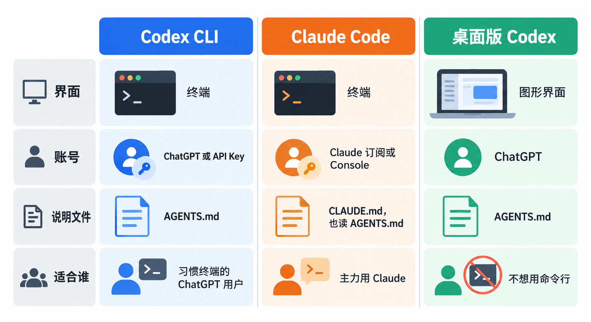
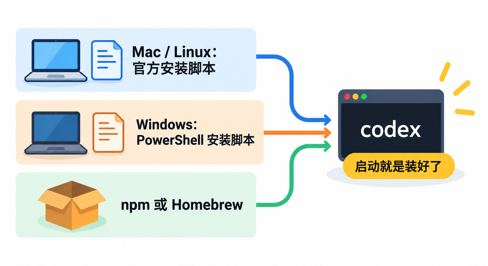

# 在终端里让AI读代码、改代码：OpenAI Codex CLI入门，从安装到第一次改动

想让 AI 帮你改代码，最常见的做法是把代码复制进聊天框，再把回答复制回编辑器。文件一多、改动一大，这样来回粘贴很快就乱了。**Codex CLI 换了个思路：让 AI 直接待在你的项目目录里，自己读文件、自己改、自己跑命令，你只负责提要求和把关。**

这篇讲清楚：Codex CLI 是什么、它从哪来、和 Claude Code 这类工具怎么选；然后一步步走完安装、登录、提交 Git 存档、让它读懂项目、改一处小地方、检查改动的全过程。最后讲权限和 `AGENTS.md`，这两样决定了你能不能放心地把项目交给它。

## 先认识一下：住在终端里的编程助手


**CLI = Command-Line Interface（命令行界面）**。Codex CLI 就是 OpenAI 的编程智能体 Codex 的命令行版本，官方的描述是“一个在你自己电脑上本地运行的编程智能体”。代码在 GitHub 的 `openai/codex` 仓库，采用 **Apache-2.0 开源协议**。

它和网页上聊天的最大区别，是**它能动手**：

- **读项目**：你在哪个目录启动它，它就能看那个目录里的代码，回答“这个项目是干什么的”“登录逻辑在哪”这类问题。
- **改文件**：你说要改什么，它直接在文件里改，改完给你看改了哪些地方。
- **跑命令**：编译、跑测试、看报错，它自己执行，失败了接着改。
- **有边界**：命令默认在系统沙箱里执行，越过边界时会停下来问你。

启动后是一个全屏的终端界面：底部输入需求，上方滚动显示它在读哪些文件、准备执行什么命令、改了什么。你随时可以打断、追问、换方向。

## 它是怎么来的


“Codex”这个名字 OpenAI 在 2021 年就用过，当时指一个代码模型。今天说的 Codex 是另一回事，是一个会自己干活的编程智能体，而 Codex CLI 是它最早落地的形态。

- **2025 年 4 月 16 日**：Codex CLI 作为开源项目发布，最初用 TypeScript 写成，要通过 npm 安装。
- **2025 年 5 月 30 日**：团队在仓库里发帖宣布“Codex CLI is Going Native”，用 Rust 重写。理由写得很直接：原来要求 Node.js 22 以上，对一些用户来说麻烦甚至装不上；Linux 沙箱本来就是 Rust 写的，用原生代码做安全隔离更顺手；没有垃圾回收，内存占用更低。
- **2025 年 8 月**：CLI 和编辑器插件支持用 ChatGPT 账号一键登录，不用再自己管理 API Key。同期推出了 VS Code 等编辑器里的 Codex 插件。
- **2025 年 9 月**：推出专门为编程智能体优化的 GPT-5-Codex 模型。
- **2025 年 10 月 6 日**：Codex 正式发布（GA）。
- **2026 年**：2 月 Codex 桌面应用上线 macOS，3 月上线 Windows，原生支持 PowerShell 和 Windows 沙箱；后来 Codex 应用并入 ChatGPT 桌面版。8 月，CLI 加入 `/import`，可以把 Claude Code 和 Cursor 里的设置与最近对话导入进来。

这条路线留下了几个今天还看得到的痕迹：

- **Rust 重写成了今天的“单文件安装”。** 现在官方首推独立安装脚本，装下来就是一个可执行文件，不依赖 Node.js；npm 安装方式保留了下来，给习惯 npm 的人用。
- **沙箱是从一开始就有的设计。** macOS、Linux、Windows 各用系统自带的隔离机制，这也是它默认敢让 AI 跑命令的底气。
- **同一个名字覆盖了好几个产品。** CLI、编辑器插件、桌面应用、云端 Codex 都叫 Codex，共用一个账号和额度，但能力并不完全一样。新手容易混，后面对比一节会讲清楚。

## 横向比一比：Codex CLI、Claude Code、桌面版 Codex



读者最可能拿来比的有两个：**Claude Code**，Anthropic 的编程智能体，同样主打在终端里干活，是 Codex CLI 最直接的同类；以及 **ChatGPT 桌面版里的 Codex 视图**，同一个 Codex、同一份额度，只是换成图形界面。

| | Codex CLI | Claude Code（终端版） | ChatGPT 桌面版的 Codex |
|---|---|---|---|
| 界面 | 终端全屏界面 | 终端界面 | 图形界面，改动对比可直接看 |
| 账号与计费 | ChatGPT 账号，或 OpenAI API Key 按量计费 | Claude 订阅，或 Anthropic Console 按量计费 | ChatGPT 账号 |
| 项目说明文件 | `AGENTS.md` | `CLAUDE.md`，也能读 `AGENTS.md` | `AGENTS.md` |
| 默认安全边界 | 系统沙箱 + 越界时询问 | 操作前按权限设置询问 | 本地 / Worktree / 云端三种运行位置，可选权限档位 |
| 能不能写进脚本 | `codex exec` 非交互运行 | `claude -p` 非交互运行 | 不适合 |
| 适合谁 | 已有 ChatGPT 订阅、习惯终端的开发者 | 主力用 Claude 的开发者 | 不想碰命令行的人 |

**为什么选 Codex CLI**：你已经在用 ChatGPT，订阅里本来就含 Codex，不用再多付一份钱；你习惯在终端里工作，或者要在服务器、SSH 远程机器上用；你看重开源，想看它到底怎么实现沙箱的。

**为什么选 Claude Code**：你的主力模型是 Claude，或者团队已经在 Claude Code 里攒了技能、钩子这一套配置。两者在“读代码、改代码、跑命令”这个核心上思路接近，**从定位上看，选哪个主要取决于你手里是哪家的订阅**，而不是功能上谁压倒谁。

**为什么还是用桌面版**：你想用鼠标逐行看改动、点按钮批准，不想记命令。桌面版和 CLI 共用账号和额度，CLI 里输入 `/app` 还能把当前会话接到桌面应用里继续。

## 用之前：账号和费用怎么算


Codex CLI 有两种登录方式，计费方式完全不同：

- **用 ChatGPT 账号登录**：消耗的是你 ChatGPT 套餐里自带的 Codex 额度。官方页面写明，**Free、Go、Plus、Pro、Business、Edu、Enterprise 套餐都包含 Codex**。免费版的定位是“在快速的小型编程任务上体验 Codex”，官方没有公布免费版的具体额度；Plus 及以上额度更多、可选的模型更强，Pro 目前没有 5 小时用量上限。
- **用 OpenAI API Key 登录**：按 API 标准价格按量计费，扣的是 OpenAI 开发者平台账户的钱，和 ChatGPT 订阅额度无关。本地的读代码、改代码都能用，但依赖 ChatGPT 账号的云端功能用不了。

对个人开发者，**官方推荐用 ChatGPT 账号登录**；API Key 主要留给 CI/CD 这类自动化场景。具体能选哪些模型、还剩多少额度，以登录后 `/model` 和 `/status` 里显示的为准。

## 第一步：安装



官方 README 给的安装方式有四种，任选一种。

**macOS 和 Linux**，在终端运行官方安装脚本：

```bash
curl -fsSL https://chatgpt.com/codex/install.sh | sh
```

**Windows**，在 PowerShell 里运行：

```powershell
powershell -ExecutionPolicy ByPass -c "irm https://chatgpt.com/codex/install.ps1 | iex"
```

已经装了 Node.js 的，也可以用 npm：

```bash
npm install -g @openai/codex
```

Mac 上习惯 Homebrew 的：

```bash
brew install --cask codex
```

这类“下载脚本直接执行”的命令，只从官方 README 或官方文档复制。想升级时，用独立安装脚本装的可以重新运行一遍安装命令，或者运行 `codex update`。

系统方面：macOS 和 Linux 直接可用；Windows 推荐 Windows 11，Windows 10 至少要 1809 版本，在 PowerShell 里运行时 Codex 使用原生的 Windows 沙箱；已经在 WSL2 里开发的，也可以装在 WSL2 里，用的是 Linux 那套沙箱。内存方面，官方仓库写的是最少 4GB、推荐 8GB。另外建议装好 Git，后面的“存档”全靠它。

## 第二步：登录

装好后，进入任意一个项目目录，运行：

```bash
codex
```

第一次启动会让你选登录方式，选 **Sign in with ChatGPT**，浏览器会打开 ChatGPT 的登录页，登录授权后回到终端就能用了。

几种特殊情况：

- **远程服务器上没有浏览器**：在 ChatGPT 的安全设置里开启设备码登录（目前是测试功能），然后运行 `codex login --device-auth`，在任意设备上打开它给的链接、输入一次性代码。
- **要用 API Key**：官方给的写法是先把 Key 放进环境变量 `OPENAI_API_KEY`，再通过管道交给 Codex：

```bash
printenv OPENAI_API_KEY | codex login --with-api-key
```

- **确认自己登录的是哪种方式**：

```bash
codex login status
```

> **`~/.codex/auth.json` 要当密码看待。** 登录信息默认缓存在这个文件里（也可能存进系统的凭据管理器），里面是访问令牌。不要把它提交进 Git、贴进工单或发给别人；在公共或不受信任的环境里，也不要运行 Codex。

## 第三步：动手之前，先给项目存个档


这一步不起眼，却是整篇最重要的一步。官方的 CLI 文档也专门写了：**在任务开始前和结束后各建一个 Git 存档点，需要时才能撤回改动。**

项目还不是 Git 仓库的话，先初始化：

```bash
git init
```

然后把当前状态完整提交一次：

```bash
git add -A
git commit -m "交给 Codex 之前的存档"
```

存档还有一个附带好处：**Codex 会根据目录是不是 Git 仓库来决定默认权限**。在 Git 仓库里，默认是“Auto”档，可以在项目目录里改文件、跑常规命令；不在版本控制下的文件夹，默认只读。所以没有 Git 的项目，它一开始只能看不能改。

> **顺序不能反：先提交，再让 Codex 动手。** Codex 改的是你磁盘上的真实文件。手头有没提交的改动时，它的修改会和你的混在一起，事后很难分清哪些是谁改的，更没法干净地撤回。

## 第四步：先让它读懂项目，再改一处小地方


在项目目录里启动 `codex`，**第一个任务别急着让它改东西，先让它讲讲项目**。官方快速入门里的示例就是这一句：

```text
Tell me about this project
```

用中文问也一样：

```text
讲讲这个项目是做什么的，目录结构是怎样的，怎么编译和运行测试。
```

它会去读 README、构建文件和主要代码，然后给你一个概览。这一步不改任何文件，正好用来判断它对项目的理解靠不靠谱。

理解没问题，再给它一个**小而具体**的任务。官方最佳实践建议把要求写成四部分：**目标、背景、限制、完成标准**。以一个 Java 项目为例：

```text
目标：给 StringUtils 类加一个 isBlank(String s) 方法，null、空字符串和只有空白字符时返回 true。
背景：StringUtils 在 src/main/java 下，测试用的是 JUnit 5。
限制：不要改动其他已有方法，不要新增依赖。
完成标准：补上对应的单元测试，并运行测试确认全部通过。
```

接下来它会去找文件、改代码、写测试、跑测试。遇到需要越过边界的操作，比如访问项目目录以外的文件、联网下载依赖，它会停下来问你，**看清它要执行的命令再批准**。

改完之后，在 Codex 里输入：

```text
/diff
```

它会显示 Git 视角下的全部改动，包括新建的文件。也可以输入 `/review`，让 Codex 换个角度审一遍当前改动、找问题。你自己在另一个终端里看也一样：

```bash
git status
git diff
```

**满意就提交，不满意就撤回**：

```bash
# 满意：提交这次改动
git add -A
git commit -m "新增 StringUtils.isBlank 及测试"

# 不满意：撤销对已有文件的修改
git restore .
```

`git restore .` 只会撤销已有文件的修改，Codex 新建的文件会以“未跟踪文件”的形式出现在 `git status` 里，确认不需要后手动删掉即可。

任务比较大、自己也没想清楚的时候，先输入 `/plan` 切换到计划模式。官方的建议是：任务复杂、模糊或很难描述清楚时，先让 Codex 做计划，它会收集上下文、问你几个澄清问题，计划确认后再动手。

## 看懂权限：沙箱管能做什么，审批管什么时候问你


Codex 的安全设计分两层，理解了就知道该怎么调。

**第一层是沙箱，决定命令“能做什么”**，有三种模式：

- `read-only`：只能读文件和运行只读的命令，不能改东西。适合只想让它讲解代码、出方案的时候。
- `workspace-write`：可以在当前工作目录里改文件、跑常规命令。Git 仓库里默认的“Auto”档就是这个。
- `danger-full-access`：没有沙箱，读写任何文件、联网都不受限制。

而且**默认不联网**。官方文档写明，智能体默认在关闭网络访问的状态下运行。

**第二层是审批，决定“什么时候停下来问你”**。默认的 `on-request` 是：沙箱允许的事直接做，要越出沙箱或要联网时先问你。

在 Codex 里输入 `/permissions` 就能切换档位。启动时也可以用参数指定，比如只想让它看不想让它改：

```bash
codex --sandbox read-only
```

> **别图省事开 `--yolo`。** `--dangerously-bypass-approvals-and-sandbox`（简写 `--yolo`）会同时关掉沙箱和审批，官方文档把它标为“高风险、不推荐”。官方最佳实践也把“还没弄懂工作流程就给 Codex 整台电脑的权限”列为常见错误。新手从默认权限开始，只在信任的项目、确有需要时再单独放宽。

联网也一样谨慎。用 `--search` 打开实时网页搜索、或者放开网络访问时，网页上的内容可能夹带诱导 AI 执行的指令（提示词注入），所以只在确实需要时打开。

## 用 AGENTS.md 让它记住项目的规矩

每次都要告诉它“测试用 `mvn test` 跑”“不要动 generated 目录”，很快就烦了。**`AGENTS.md` 就是写给 AI 看的 README**，Codex 每次启动会自动读取。

最省事的做法是在 Codex 里输入：

```text
/init
```

它会为当前项目生成一份 `AGENTS.md` 草稿，你再按实际情况改。Codex 读取的规则是这样的：

- **全局**：`~/.codex/AGENTS.md`，写对所有项目都适用的个人习惯。
- **项目**：从项目根目录（通常是 Git 根目录）一路往下读到你启动的目录，每层目录最多取一个文件，越靠近当前目录的越靠后，也就越优先。
- **临时覆盖**：同一目录下有 `AGENTS.override.md` 时，优先用它。
- **大小**：所有文件加起来默认最多读 32 KiB，超过的部分不会读进去。

官方最佳实践的建议很实在：**一份简短、准确的 `AGENTS.md`，比一份写满空泛规则的长文件更有用**。Codex 反复犯同一个错时，让它复盘一下，再把教训补进 `AGENTS.md`。一个 Java 项目的 `AGENTS.md` 可以短到这样：

```markdown
# 项目说明

- 构建工具是 Maven，运行测试用 `mvn test`。
- 修改 Java 代码后必须运行测试，全部通过才算完成。
- 不要修改 `src/main/generated/` 下的文件，它们是自动生成的。
- 不要新增第三方依赖，确实需要时先说明理由。
```

`AGENTS.md` 是开放格式，不只 Codex 认，Claude Code 等其他编程工具也能读。写一份，换工具也不浪费。

## 几个常用命令，放在手边

在终端里：

| 命令 | 作用 |
|---|---|
| `codex` | 启动交互界面 |
| `codex "要做的事"` | 带着一句需求直接启动 |
| `codex resume --last` | 接着当前目录下最近一次对话 |
| `codex exec "要做的事"` | 不进界面、直接执行一次，默认只读，适合写进脚本 |
| `codex -m 模型名` | 指定这次用的模型 |
| `codex login status` | 查看当前登录方式 |
| `codex logout` | 删除本机保存的登录信息 |

在 Codex 界面里输入：

| 命令 | 作用 |
|---|---|
| `/init` | 生成 `AGENTS.md` |
| `/plan` | 切换到计划模式 |
| `/diff` | 查看 Git 改动，包括新建文件 |
| `/review` | 审查当前改动、找问题 |
| `/permissions` | 选择 Codex 被允许做什么 |
| `/model` | 选择模型和推理强度 |
| `/status` | 查看当前会话配置和用量 |
| `/compact` | 压缩对话，避免超出上下文 |
| `/new` | 开一个新对话 |
| `/quit` | 退出 |

`codex exec` 默认在只读沙箱里运行，要让它改文件得显式加上 `--sandbox workspace-write`。以前教程里常见的 `--full-auto` 参数已经不再支持，看到旧文章时注意别照抄。

## 写在最后

最短的上手路线是：**装好 Codex CLI，用 ChatGPT 账号登录，找一个自己的小项目先 `git commit` 存档，然后让它讲讲这个项目，再给它一个写清了完成标准的小任务，最后用 `/diff` 看看它改了什么。** 走完一遍，你就知道它在你的项目里靠不靠谱；觉得顺手，再用 `/init` 给项目写一份 `AGENTS.md`，让它越用越懂你的规矩。

## 参考资料

<div class="sources">
<p>Codex CLI 官方：<a href="https://github.com/openai/codex">openai/codex（GitHub，README、LICENSE）</a>、<a href="https://github.com/openai/codex/blob/main/docs/install.md">Installing &amp; building（系统要求）</a>、<a href="https://github.com/openai/codex/discussions/1174">Codex CLI is Going Native（Rust 重写说明）</a>、<a href="https://github.com/openai/codex/blob/main/codex-rs/tui/src/slash_command.rs">CLI 斜杠命令定义</a>、<a href="https://www.npmjs.com/package/@openai/codex">@openai/codex（npm）</a>。</p>
<p>官方文档：<a href="https://developers.openai.com/codex/cli">Codex CLI</a>、<a href="https://developers.openai.com/codex/auth">Authentication</a>、<a href="https://developers.openai.com/codex/pricing">Pricing</a>、<a href="https://developers.openai.com/codex/agent-approvals-security">Agent approvals &amp; security</a>、<a href="https://developers.openai.com/codex/sandboxing">Sandboxing</a>、<a href="https://developers.openai.com/codex/windows">Windows sandbox</a>、<a href="https://developers.openai.com/codex/agent-configuration/agents-md">AGENTS.md</a>、<a href="https://developers.openai.com/codex/developer-commands">Commands reference</a>、<a href="https://developers.openai.com/codex/non-interactive-mode">Non-interactive mode</a>、<a href="https://developers.openai.com/codex/learn/best-practices">Best practices</a>、<a href="https://developers.openai.com/codex/changelog">Changelog</a>。</p>
<p>对比参照：<a href="https://code.claude.com/docs/en/overview">Claude Code 文档</a>。</p>
<p>资料核对于 2026 年 10 月 17 日。文中命令来自官方文档和官方仓库，写作时未实际运行；示例里的 Java 项目、类名和 AGENTS.md 内容是演示用的写法。套餐、模型、额度和命令变化较快，以官方页面和登录后的显示为准。配图为示意图，不是产品界面截图。</p>
</div>
