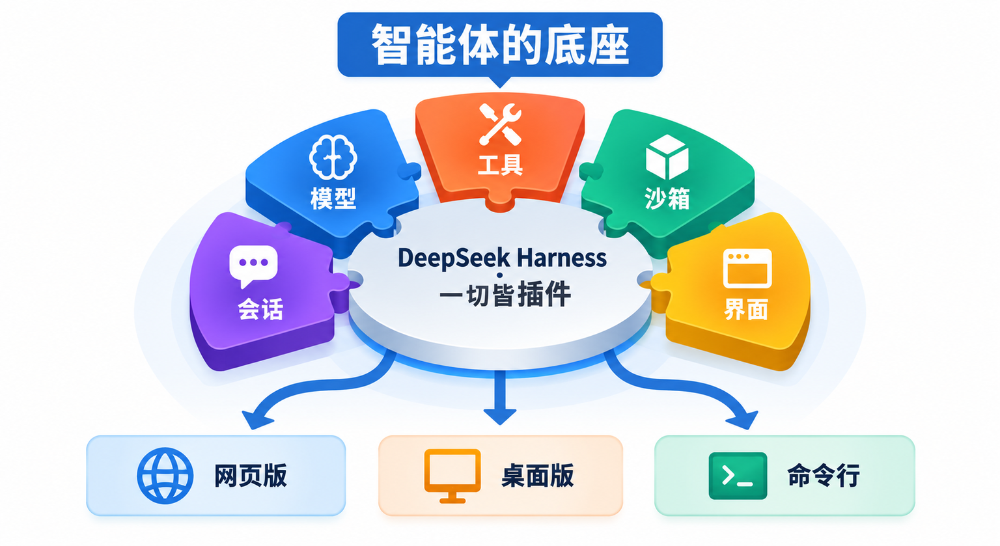
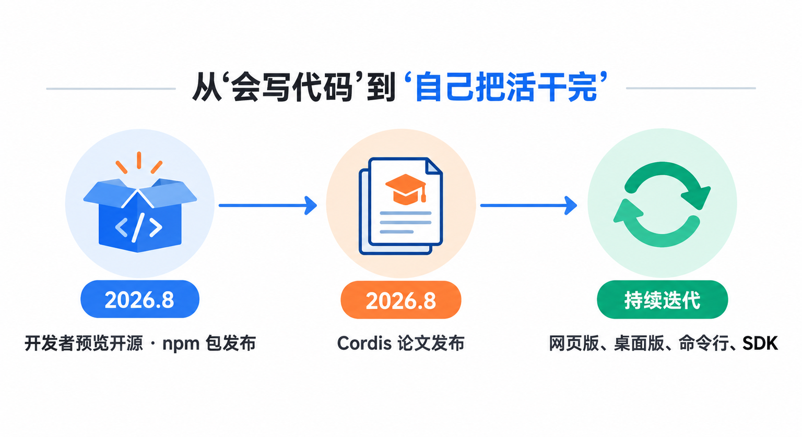
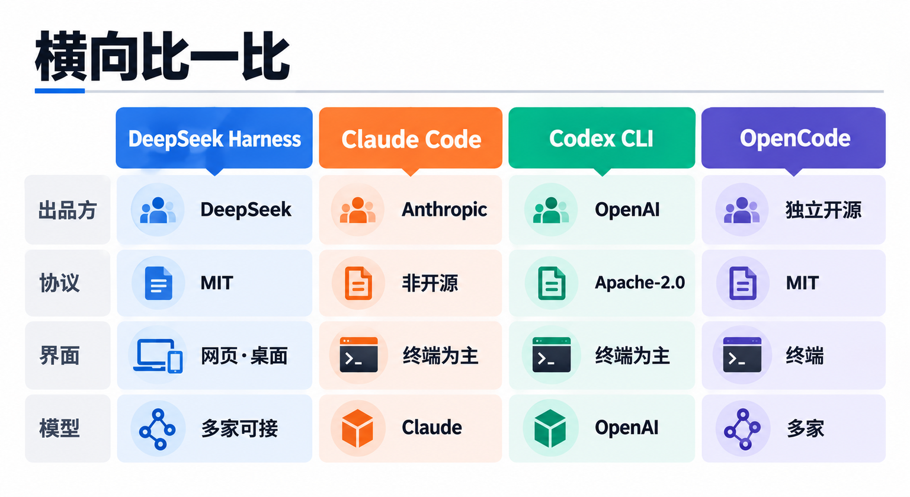
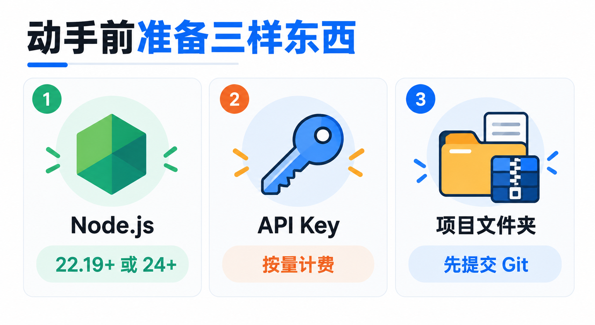
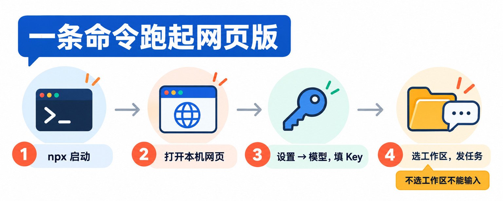
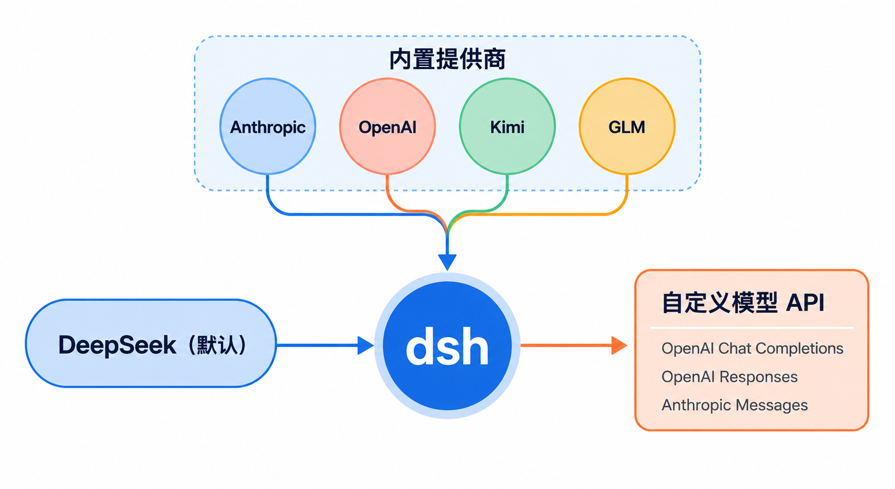
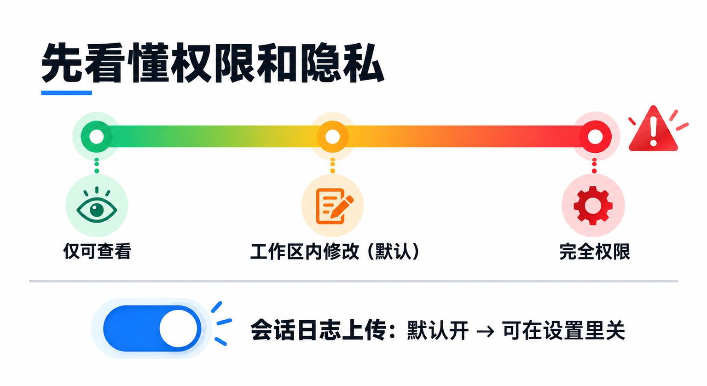

# DeepSeek官方开源的AI智能体：DeepSeek Harness入门，一条命令跑起网页版

DeepSeek 除了模型和 API，现在还开源了一个自己的 AI 智能体：**DeepSeek Harness**，命令叫 `dsh`。它能在你指定的项目文件夹里读代码、改文件、跑命令、拆计划，用的是浏览器里的网页界面，不用记一堆终端快捷键。

这篇讲清楚四件事：它是什么、和 Claude Code、Codex 这些工具比有什么不同、怎么用一条命令在自己电脑上跑起来，以及第一次用之前一定要知道的几个风险。它目前还在**开发者预览**阶段，适合愿意尝鲜、能接受版本变动的开发者。

## 先认识一下：它是“智能体的底座”



先说名字。**dsh = DeepSeek Harness（DeepSeek 智能体框架）**。Harness 原意是“挽具”，在 AI 圈里指包在大模型外面的那一层程序：模型只会“想”和“说”，Harness 负责把它的想法变成真实动作，比如读文件、执行命令、调用搜索、记住对话进度、在关键操作前问你一句。

DeepSeek Harness 由 DeepSeek 开发，采用 **MIT 开源协议**，代码在 GitHub 的 `deepseek-ai/deepseek-harness` 仓库。官方对它的一句话定位是：**一切皆插件**。模型、工具、技能、会话、沙箱、文件系统、界面，都是可以替换、增减的插件。

对普通用户来说，你能直接用到的是这几种形态：

- **网页版（Web UI）**：一条命令在本机启动，用浏览器操作。这是官方首推的入门方式，也是本文的主角。
- **桌面版**：官网提供 macOS（Apple 芯片）和 Windows（64 位）安装包，本质是网页版外面包了一层桌面应用。
- **一次性任务模式（headless）**：在命令行里丢一个任务给它，跑完打印结果就退出，适合脚本和自动化。
- **Python SDK 和 ACP 协议**：给想把它嵌进自己程序或编辑器的开发者用。

> **它现在是“开发者预览”，官方原话是“未来将出现破坏兼容性的变更”。** 配置文件格式、插件接口、会话记录都可能在升级后变化。别拿它跑生产环境，也别把重要工作流只押在它身上。

## 它是怎么来的



过去一年，AI 编程工具的竞争重点从“模型会不会写代码”转到了“模型能不能自己把活干完”。Anthropic 有 Claude Code，OpenAI 有 Codex，这类工具的核心都不是模型本身，而是模型外面那层负责读文件、跑命令、管权限、记进度的程序。业内把这层叫作 harness。

DeepSeek 一直以开放模型权重和低价 API 出名，但在 Harness 这一层，它之前没有自己的官方产品，用户只能把 DeepSeek 的 API 接到第三方工具里用。**2026 年 8 月**，DeepSeek 把自己的 Harness 以开发者预览的形式开源，npm 包 `@deepseek-ai/dsh` 也在同月发布。

它有一个和别家不太一样的出发点：底层用的是一个叫 **Cordis** 的元框架。2026 年 8 月发布的论文《A Programming Paradigm for Spatiotemporal Composability》（作者来自北京大学和 DeepSeek）讲的就是 Cordis 的设计：插件被卸载时，它带来的所有改动能被完整撤回；插件之间的依赖能被自动管理，依赖满足就启用，不满足就停用。

这个早期选择直接决定了 dsh 今天的样子：

- **能力**：模型、工具、界面都能热插拔，改了配置文件下一次请求就生效，不用重启；第三方可以给它写插件，官方建议给插件仓库打上 `dsh-plugin` 话题方便被发现。
- **包袱**：架构很新，Cordis 本身也还在 4.0 的候选版本阶段，接口没有定型。对只想“装上就用”的人来说，dsh 的配置概念（profile、patch、插件包）比同类工具多，文档也明显是写给开发者看的。

## 横向比一比：和 Claude Code、Codex、OpenCode



读者最可能拿来比较的是三个：**Claude Code** 和 **Codex CLI** 是两家头部模型公司的官方智能体，dsh 的定位和它们最接近；**OpenCode** 是热门的开源、多模型编程智能体，想“开源 + 不绑定一家模型”的人通常会先看到它。

| | DeepSeek Harness | Claude Code | Codex CLI | OpenCode |
|---|---|---|---|---|
| 出品方 | DeepSeek | Anthropic | OpenAI | 独立开源项目 |
| 开源协议 | MIT | 非开源 | Apache-2.0 | MIT |
| 主要界面 | 网页版、桌面版 | 终端，另有桌面、网页、IDE 插件 | 终端，另有 ChatGPT 桌面版里的 Codex | 终端为主 |
| 能接的模型 | DeepSeek 为主，也能接 Anthropic、OpenAI、Kimi、GLM 和自定义兼容接口 | Claude 系列 | OpenAI 系列为主 | 多家提供商 |

**为什么选 dsh**：你本来就在用 DeepSeek API，想要一个官方出品、对 DeepSeek 模型适配最直接的智能体；或者你不喜欢终端界面，想在浏览器里看对话、看计划、批改动；又或者你是开发者，想研究一个“一切皆插件”的智能体怎么搭，自己写插件扩展它。MIT 协议也意味着改了、嵌进自己产品里都比较自由。

**为什么暂时不选它**：它还在预览期，会有破坏性更新；配置和概念比 Claude Code、Codex 重；如果你主要用 Claude 或 GPT 模型，直接用对应厂商的官方工具，体验和文档会更成熟。从定位上看，dsh 现在更像一个“给开发者的智能体平台”，而不是一个打磨好的消费级产品。

## 动手前先准备三样东西



**1. Node.js。** 官方的启动方式是用 `npx` 运行 npm 包，所以电脑上要有 Node.js。仓库声明的版本要求是 **22.19 及以上的 22.x，或者 24 及以上**。先在终端里看一下版本：

```bash
node -v
```

版本太旧的话，去 Node.js 官网下载新的 LTS 版本安装。

**2. 一个模型的 API Key。** 最直接的是 DeepSeek 开放平台（platform.deepseek.com）的 API Key。DeepSeek API 是**按用量计费**的，需要先充值；智能体干一个任务会来回调用模型很多次，消耗比普通聊天大，价格以开放平台当前页面为准。设置页里还有 DeepSeek 账号登录的入口，可用模型以账号里实际显示的为准。

**3. 一个练手用的项目文件夹。** 第一次用，别直接拿重要项目开刀。找一个小项目，或者新建一个，先用 Git 存个档：

```bash
git init
git add -A
git commit -m "交给 AI 之前的存档"
```

已经是 Git 仓库的项目，只需要后两行。这样 AI 改坏了，一条 `git checkout .` 或 `git reset --hard` 就能回到原样。

## 一条命令跑起网页版



**第一步：在项目目录里启动。** 打开终端，先进入你准备好的项目文件夹（`dsh` 会把启动时所在的目录当作默认位置），然后运行：

```bash
npx @deepseek-ai/dsh web
```

第一次运行会先下载 npm 包，稍等一会儿。启动后网页版默认地址是 `http://127.0.0.1:3080`，在本机启动时会自动用默认浏览器打开。如果你只想启动服务、不想自动弹浏览器，加上 `--no-open`：

```bash
npx @deepseek-ai/dsh web --no-open
```

**第二步：填模型 Key。** 在网页里打开 **设置 → 模型**，在 DeepSeek 卡片里填入 API Key 并保存，不需要重启。官方说明，Key 保存后页面只拿到脱敏后的信息，密钥本身存在本机用户目录下的 dsh 配置文件夹里。

**第三步：选择工作区。** 点 **选择工作区**，添加刚才启动 `dsh` 的那个项目文件夹，然后选中它。**没选工作区之前，输入框是不能用的**，这是新手最容易卡住的地方。

**第四步：发第一个任务。** 新建一个会话，先从只读的任务开始，比如：

```text
总结一下这个项目的结构，说明主要有哪些模块、各自负责什么。
```

它会读文件、整理结果。等你对它的工作方式有了感觉，再让它做“要动文件”的事，比如“给某个函数补上单元测试并运行”。用完在终端里按 `Ctrl+C` 停止服务。

## 能接哪些模型



dsh 默认围绕 DeepSeek 模型设计，但并不只认 DeepSeek。在 **设置 → 模型** 里点 **添加模型提供商**，有两条路：

- **第三方模型提供商**：dsh 自带一份提供商目录，选好后填 Key 就行，端点和模型列表由目录提供。官方文档举的例子有 `anthropic`、`openai`，以及 Kimi 对应的 `moonshotai`、GLM 对应的 `zai`。
- **自定义模型 API**：适合公司网关、自己部署的模型服务，或者目录里没有的提供商。要填 Provider ID、接口地址、协议和至少一个模型。协议可选 **OpenAI Chat Completions、OpenAI Responses、Anthropic Messages** 三种，必须选你的服务实际支持的那一种。

几个配置时容易忽略的细节：

- **Provider ID 定了就不能改。** 会话记录、默认模型、凭据都用它来认人，想改名只能新建一个、删掉旧的。
- **“获取可用模型”不是每个服务都支持。** 拿不到列表时，手动填模型 ID，效果一样。
- **地址和 Key 都对、请求却一直被拒**，多半是服务的请求格式和 OpenAI 不完全一样。官方排错文档给的第一步，是在配置文件里给这个提供商加上 `supportsDeveloperRole: false` 和 `maxTokensField: max_tokens` 两个兼容开关。

选好的模型会出现在输入框旁的模型选择器里，选中后也会成为新会话的默认模型；DeepSeek 自家模型还能在这里选推理等级。

## 第一次用之前，务必看懂权限和隐私



dsh 会执行模型生成的命令，所以这一节比安装步骤更重要。

**权限有三档预设**，在输入框的权限控件里切换，也可以在对话里输入 `/permission` 打开选择器：

- **仅可查看**：命令在只读沙箱里运行，碰不了文件。
- **工作区内修改**：只能写当前工作区，越界的操作会先弹窗问你。这是默认档。
- **完全权限**：不受沙箱限制，也不再逐项询问。

沙箱在 Linux 上用 bwrap 或 Landlock，macOS 用 Seatbelt，Windows 用受限令牌。但官方的安全说明写得很直白：**沙箱、审批提示和权限控制只能降低风险，不保证隔离**；错误的模型输出、恶意输入或不可信的插件，都可能修改或删除文件、泄露数据和凭据。

> **别一上来就开“完全权限”，也别在存着重要资料和密钥的目录里启动它。** 官方建议：只给最小权限，优先在虚拟机、容器或专用环境里运行，提前备份它能访问的文件，装插件和批准命令前先看清楚内容。

还有一个很多人不会注意到的默认设置：**使用 DeepSeek 官方模型 API 时，dsh 默认会随请求上传会话日志**（Session Log），内容是当前会话的事件记录。如果你处理的项目不方便外传，到 **设置 → 通用**，关掉 **“在使用官方模型 API 时上传 Session Log”** 这个开关，修改从下一次请求开始生效。

> **涉及公司代码或私人资料时，先关掉会话日志上传，再开始干活。** 这个开关默认是开的，关掉只影响之后的请求，之前已经发出去的不受影响。

## 进阶：不开网页，在命令行跑一次性任务

如果你想把它放进脚本，可以用一次性任务模式：给它一个任务，它跑完打印最终答案就退出，不开端口，也不留后台进程。官方命令格式是 `dsh --profile headless "任务"`，用 npx 运行就是：

```bash
npx @deepseek-ai/dsh --profile headless "总结这个仓库的主要模块"
```

任务完成时退出码为 0，中止或出错时为 1，方便脚本判断。它和网页版用的是同一套模型、工具和安全默认值，所以同样建议先在练手项目里试。

## 写在最后

如果你已经有 DeepSeek API Key，又想试试“DeepSeek 官方版的 Claude Code”是什么样子，DeepSeek Harness 值得花半小时跑一遍：**找一个提交过 Git 的小项目，运行 `npx @deepseek-ai/dsh web`，填好 Key、选好工作区，先关掉会话日志上传，再让它从一个只读任务开始。** 它还在快速迭代，遇到问题可以去官方 GitHub Discussions 反馈，升级前记得看一眼更新说明。

## 参考资料

<div class="sources">
<p>DeepSeek 官方：<a href="https://github.com/deepseek-ai/deepseek-harness">deepseek-ai/deepseek-harness（GitHub，README、SAFETY 安全说明、LICENSE）</a>、<a href="https://www.deepseek.com/en/harness/">DeepSeek Harness 官网页面</a>、<a href="https://deepseek-harness.github.io/deepseek-harness/en/guide/quickstart">DeepSeek Harness 文档：Quickstart</a>、<a href="https://api-docs.deepseek.com/">DeepSeek API 文档</a>、<a href="https://platform.deepseek.com/">DeepSeek 开放平台</a>。</p>
<p>仓库内文档：<a href="https://github.com/deepseek-ai/deepseek-harness/blob/master/docs/user/guide/index.zh.md">使用 Web UI</a>、<a href="https://github.com/deepseek-ai/deepseek-harness/blob/master/docs/user/guide/providers.zh.md">配置模型</a>、<a href="https://github.com/deepseek-ai/deepseek-harness/blob/master/apps/cli/README.zh.md">dsh 命令行入口模式</a>、<a href="https://github.com/deepseek-ai/deepseek-harness/blob/master/packages/bundle/headless/README.zh.md">一次性任务模式 dsh-headless</a>、<a href="https://github.com/deepseek-ai/deepseek-harness/blob/master/packages/interaction/permission-presets/README.zh.md">权限预设</a>、<a href="https://github.com/deepseek-ai/deepseek-harness/blob/master/packages/sandbox/README.zh.md">进程沙箱</a>、<a href="https://github.com/deepseek-ai/deepseek-harness/blob/master/packages/session/session-log-deepseek/README.zh.md">会话日志上传</a>。npm 包：<a href="https://www.npmjs.com/package/@deepseek-ai/dsh">@deepseek-ai/dsh</a>。</p>
<p>来历与底层框架：<a href="https://arxiv.org/abs/2608.25512">A Programming Paradigm for Spatiotemporal Composability（arXiv）</a>、<a href="https://github.com/cordiverse/cordis">cordiverse/cordis（GitHub）</a>。对比参照：<a href="https://github.com/openai/codex">openai/codex（GitHub）</a>、<a href="https://code.claude.com/docs/en/overview">Claude Code 文档</a>、<a href="https://github.com/anomalyco/opencode">OpenCode（GitHub）</a>。</p>
<p>资料核对于 2026 年 10 月 15 日。文中命令来自官方文档，写作时未实际运行；Git 存档命令为通用写法，npx 运行一次性任务的命令由官方 <code>dsh --profile headless</code> 格式套用 npx 得到。DeepSeek Harness 处于开发者预览阶段，功能、配置项、菜单名称和默认值变化较快，以官方仓库和当前界面为准；DeepSeek API 价格以开放平台页面为准。配图为示意图，不是产品界面截图。</p>
</div>
