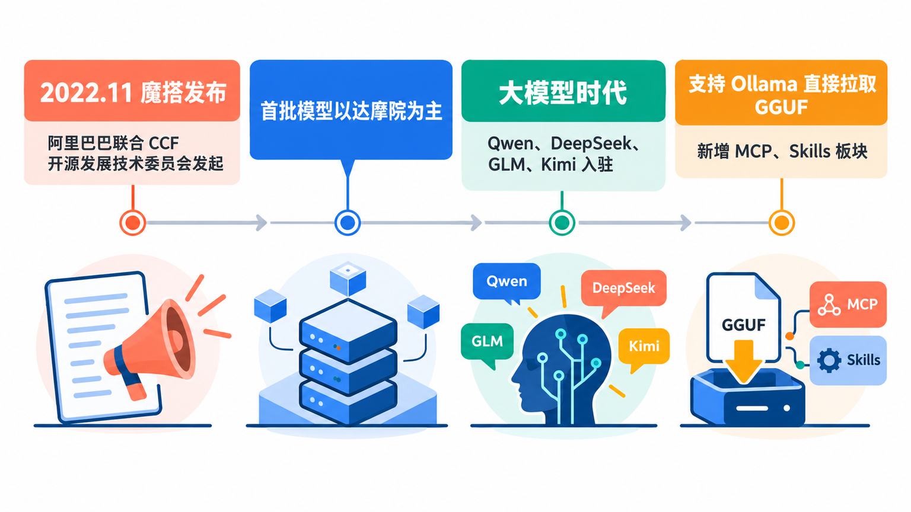
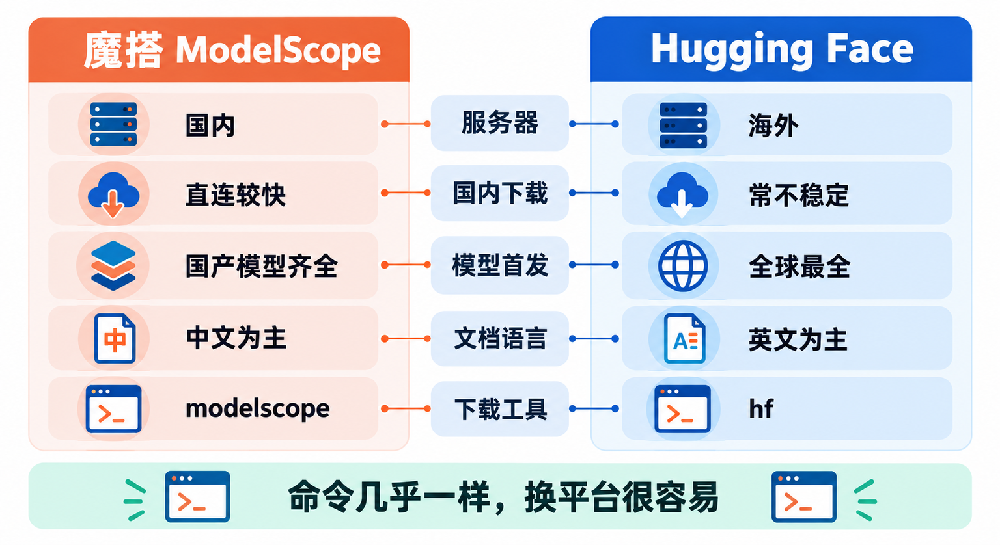
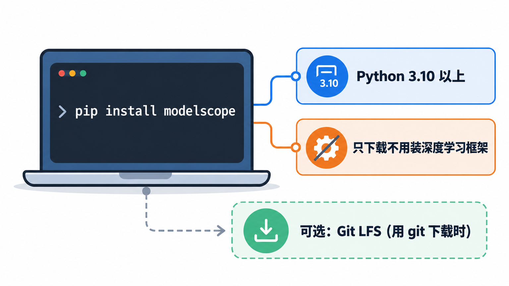
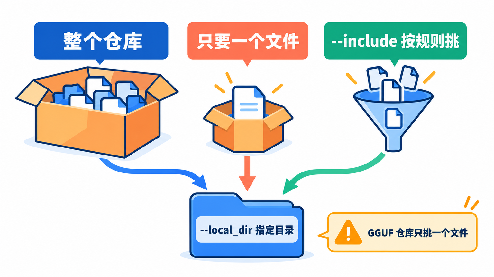
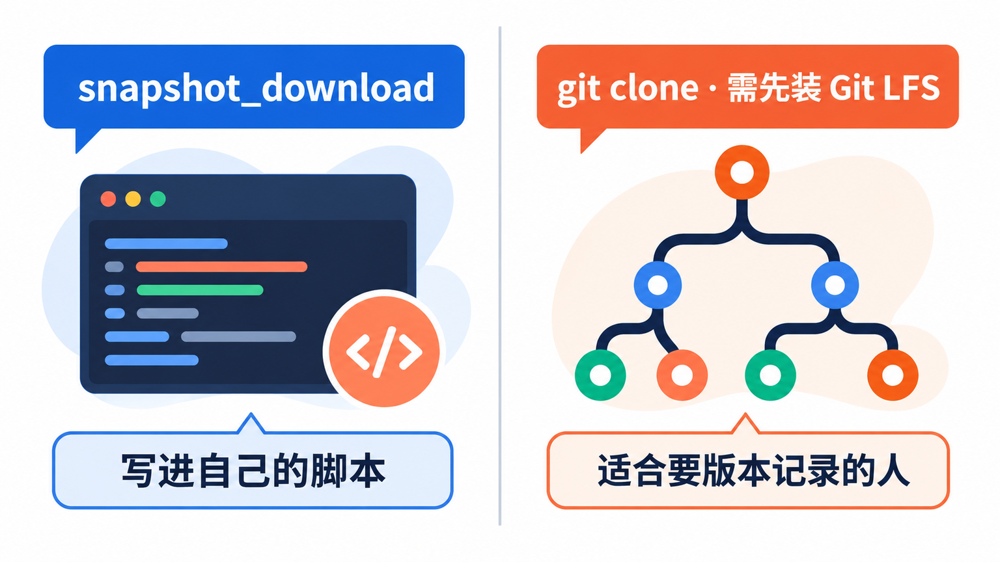
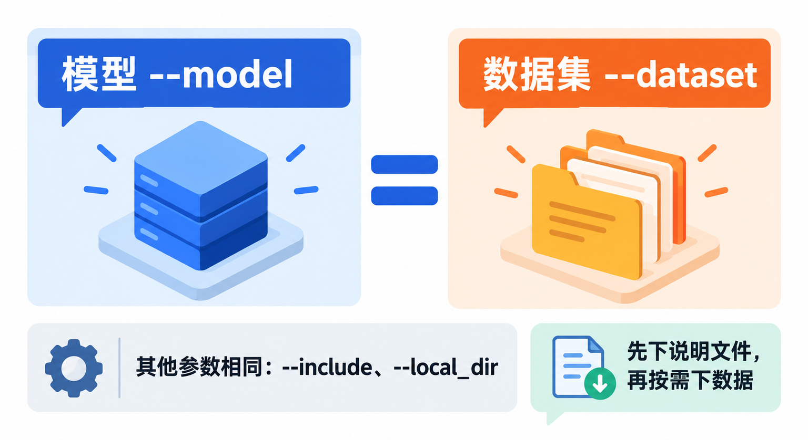
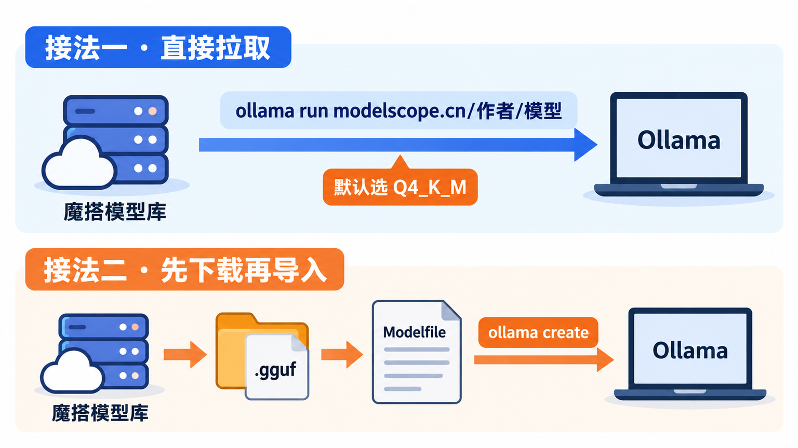
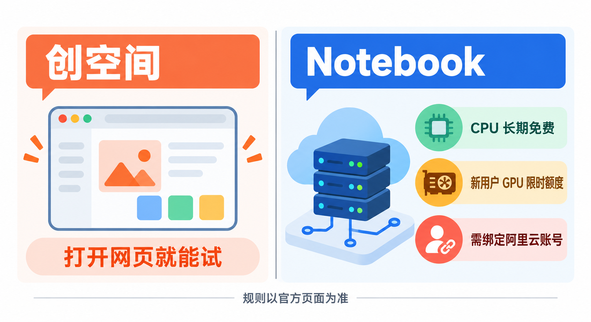

# 开源模型去哪下：魔搭ModelScope入门，从命令行下载到交给Ollama运行

上一篇讲 Ollama，解决的是“模型怎么在自己电脑上跑起来”。但很多教程里还有一句轻描淡写的“先去 Hugging Face 下载模型”，到这一步不少人就卡住了：页面打不开、下载断断续续，几 GB 的文件下一晚上。

这篇讲的是**模型从哪来**。国内下载开源模型和数据集，最顺手的地方是阿里巴巴发起的**魔搭社区（ModelScope）**。看完你能做成这几件事：知道魔搭是什么、和 Hugging Face 有什么不同；用官方命令行或 Python 代码把模型、数据集下载到指定文件夹；只挑需要的那一个文件下载；把下好的模型交给 Ollama 运行；以及弄清在线体验和免费算力该怎么用。

## 先认识一下：魔搭是个什么地方


魔搭的英文名 ModelScope 不是缩写，就是产品名。官方对自己的定位是“模型即服务”（MaaS）的开源共享平台：把各家开源的模型、数据集集中托管起来，让开发者在一个地方免费体验、下载和使用。

它主要由四块组成：

- **模型库**：托管各领域的开源模型，大语言模型、语音、图像、多模态都有。每个模型有一个 `作者/模型名` 形式的 ID，比如 `Qwen/Qwen3-8B-GGUF`，下载时就靠这个 ID。
- **数据集**：托管自然语言、视觉、语音等领域的数据集，下载方式和模型基本一样。
- **创空间（Studio）**：开发者用社区模型搭好的在线小应用，打开网页就能试，不用下载。
- **Notebook**：一个云端的 Jupyter 开发环境，预装好魔搭的开发包，注册用户可以拿到一定的免费算力。

模型分三种公开范围：**公开模型**人人可见可下载；**非公开模型**只有所有者和组织成员能看能下；**申请制模型**需要先在页面上提交申请，模型所有者同意后才能下载。你在魔搭上遇到的绝大多数热门模型都是公开模型，不登录也能直接下载。

另外，魔搭的模型和数据集都用 Git 存储和管理版本，这一点决定了后面会讲到的几种下载方式。

## 它是怎么来的



魔搭社区在 **2022 年 11 月初正式发布**，由阿里巴巴联合中国计算机学会（CCF）开源发展技术委员会共同发起。发布的时间点值得留意：那时 ChatGPT 还没上线，大模型热潮尚未到来，魔搭最初的目标更朴素，就是把预训练模型集中起来，**减少开发者重复研发的成本**。首批上架的模型主要来自阿里达摩院，覆盖视觉、语音、自然语言等任务，所以你今天在魔搭上还能看到大量 `damo/`、`iic/` 开头的老模型。

后来大模型爆发，魔搭的重心也跟着变了。阿里自家的通义千问 Qwen 系列把魔搭当作主要的发布渠道之一，DeepSeek、智谱 GLM、月之暗面 Kimi 等国产模型也都在上面开了官方账号，魔搭逐渐成了**国内下载开源大模型的主要入口**。再往后，它打通了和 Ollama 的连接，平台上的 GGUF 格式模型可以用一条 `ollama run` 命令直接拉到本地运行；网站导航里也陆续出现了 MCP、Skills 这类和 AI 智能体相关的新板块。

早期的选择在今天留下了两面影响。好的一面是，**用 Git 存储模型、配一套自己的 Python 库**，让魔搭从一开始就有完整的下载、版本管理和推理工具链；包袱是，早期那套 `modelscope` 库为了兼容各种任务，装上全部功能会依赖一大堆深度学习框架。好在今天如果只是下载模型，**只装基础包就够了**，后面会讲。

## 横向比一比：魔搭和 Hugging Face



说到下载开源模型，读者最常拿来和魔搭比的就是 **Hugging Face**。它是全球最大的开源模型托管平台，早年做聊天机器人起家，后来凭开源的 Transformers 库转型，成了今天开源 AI 社区的中心。两者做的事情几乎一样：托管模型和数据集、提供在线体验、提供下载工具。差别主要在下面几处。

| | 魔搭 ModelScope | Hugging Face |
|---|---|---|
| 运营方 | 阿里巴巴发起的国内社区 | 美国公司 Hugging Face |
| 国内访问 | 国内服务器，下载直连 | 访问常常不稳定，大文件容易中断 |
| 模型数量与首发 | 主流国产模型基本都有官方仓库，海外模型有的由社区搬运 | 全球最全，大多数开源模型第一时间在这里发布 |
| 中文资料 | 网站和文档以中文为主 | 以英文为主 |
| 下载工具 | `modelscope` 命令行和 Python SDK | `hf` 命令行和 `huggingface_hub` |
| 在线体验 | 创空间、Notebook 免费算力 | Spaces 在线应用 |

**为什么选魔搭**：人在国内，下载速度和稳定性是最实际的理由；Qwen、DeepSeek、GLM 这些国产模型都有官方账号直接发布，不用担心下到二手搬运的版本；文档是中文，Notebook 还送一段免费 GPU 时长。

**为什么还要用 Hugging Face**：一些海外的小众模型、最新的研究模型只发在 Hugging Face，魔搭上没有，或者要等社区搬运；Hugging Face 的社区讨论、模型卡片和配套生态也更丰富。

从定位上看，两者并不是二选一的关系。**命令和概念几乎可以平移**：两边都用 `作者/模型名` 当 ID，下载命令都是 `xxx download 模型ID`，魔搭的 Python 接口还特意兼容了 Transformers 的写法。我的建议是：**国产模型优先上魔搭找，找不到再去 Hugging Face**。下载前留意模型页上的作者账号，优先选模型官方发布的仓库。

## 第一步：安装魔搭的命令行工具



魔搭的下载工具就是官方的 `modelscope` Python 包，装好后既有命令行，也能在 Python 代码里调用。开源协议是 Apache 2.0。

先确认电脑上有 Python。目前 PyPI 上最新版本的 `modelscope` 要求 **Python 3.10 或更新**，在终端里看一下：

```bash
python3 --version
```

Windows 上一般用 `python --version`。版本够了就安装：

```bash
pip install modelscope
```

这个基础包只负责下载和管理模型，不会顺带装 PyTorch 之类的大框架，几分钟就能装好。装完确认一下命令可用：

```bash
modelscope download --help
```

能看到参数说明就说明装好了。如果你打算在 Python 里直接加载模型做推理、训练，或者用 `MsDataset` 加载数据集，才需要按官方文档装额外的依赖，比如数据集功能用的是 `pip install modelscope[framework]`。只是下载文件的话，不用装这些。

**建议先建一个虚拟环境再装。** 直接装进系统自带的 Python，容易和别的项目的依赖互相打架。用 `python3 -m venv .venv` 建一个环境、激活后再 `pip install`，以后不想要了整个文件夹删掉就干净了。

## 第二步：用命令行下载模型



先在魔搭网站上找到想要的模型，复制它的模型 ID。下面用 Qwen3 的 8B 模型的 GGUF 版本 `Qwen/Qwen3-8B-GGUF` 举例，这是通义千问官方账号发布的仓库，协议是 Apache 2.0，里面放着几种不同量化精度的模型文件。

**下载整个仓库到指定文件夹**：

```bash
modelscope download --model Qwen/Qwen3-8B-GGUF --local_dir ./qwen3-8b-gguf
```

**只下载其中一个文件**，在模型 ID 后面直接写文件名：

```bash
modelscope download --model Qwen/Qwen3-8B-GGUF Qwen3-8B-Q4_K_M.gguf --local_dir ./qwen3-8b-gguf
```

**按通配符挑文件或排除文件**，用 `--include` 和 `--exclude`：

```bash
modelscope download --model Qwen/Qwen3-8B-GGUF --include '*Q4_K_M.gguf' --local_dir ./qwen3-8b-gguf
```

这里有个很实用的判断：**GGUF 仓库千万别整个下载**。像 `Qwen/Qwen3-8B-GGUF` 这个仓库，Q4_K_M、Q5_K_M、Q6_K、Q8_0 等几种精度的文件，每个都在 5GB 到 9GB 之间，全部下载加起来超过 30GB，而你实际只会用其中一个。先在网页上的“模型文件”里看清文件名和大小，再用上面单文件的写法只下那一个。

几个参数说明：

- `--local_dir`：下载到你指定的文件夹，文件直接放在里面，方便你自己找、交给别的工具用。
- 不写 `--local_dir` 时，模型会进入默认的缓存目录 `~/.cache/modelscope/hub`。想换位置，可以设置环境变量 `MODELSCOPE_CACHE`，之后下载的模型都会放到它指定的目录。
- `--cache_dir` 和 `--local_dir` 同时写的时候，以 `--local_dir` 为准。
- `--revision`：指定版本、分支或标签，不写就用默认版本。

官方文档说明，命令行下载**支持断点续传**，网断了重新执行同一条命令就会接着下。

> **下载大模型前先看硬盘空间。** 默认缓存目录在用户目录下，Windows 上就是 C 盘。动辄几十 GB 的模型很容易把系统盘塞满，C 盘紧张的话，要么每次用 `--local_dir` 指到别的盘，要么先设置好 `MODELSCOPE_CACHE` 再下载。

## 另外两种下载方式：Python 代码和 Git



**在 Python 代码里下载**，适合把下载写进自己的程序或脚本里。官方用的是 `snapshot_download`：

```python
from modelscope import snapshot_download

model_dir = snapshot_download('Qwen/Qwen3-8B-GGUF', allow_patterns='*Q4_K_M.gguf', local_dir='./qwen3-8b-gguf')
print(model_dir)
```

`allow_patterns` 和 `ignore_patterns` 对应命令行里的 `--include` 和 `--exclude`，函数会返回模型所在的文件夹路径。只要一个文件的话，也可以用 `modelscope.hub.file_download` 里的 `model_file_download`，传入模型 ID 和文件名。

如果你的代码本来是用 Transformers 加载模型的，魔搭还提供了兼容写法：把 `from transformers import AutoModelForCausalLM` 换成 `from modelscope import AutoModelForCausalLM`，模型就会从魔搭下载。这需要额外装好 `transformers` 和 PyTorch，适合已经在写 Python 推理代码的读者。

**用 Git 克隆**，因为模型本身就存在 Git 仓库里。先装好 Git 和 Git LFS（Git 的大文件扩展），然后：

```bash
git lfs install
git clone https://www.modelscope.cn/Qwen/Qwen3-8B-GGUF.git
```

Git 方式会把整个仓库连同所有大文件一起拉下来，没法只挑一个文件。官方给了一个办法：在命令前加上 `GIT_LFS_SKIP_SMUDGE=1`，只拉文件的“占位指针”，不下载真正的大文件。对新手来说，**下载模型还是命令行最省事**，Git 方式更适合需要看版本记录、或者要往魔搭上传自己模型的人。

## 下载数据集：命令几乎一样



数据集的下载命令和模型几乎一样，只是把 `--model` 换成 `--dataset`。下面用官方文档里的通义数据集 `Tongyi-DataEngine/SA1B-Dense-Caption` 举例，先只下它的说明文件看看结构：

```bash
modelscope download --dataset Tongyi-DataEngine/SA1B-Dense-Caption README.md dataset_infos.json --local_dir ./sa1b-caption
```

确认需要后，再用 `--include` 按文件名规则下一部分：

```bash
modelscope download --dataset Tongyi-DataEngine/SA1B-Dense-Caption --include 'data/train-000*' --local_dir ./sa1b-caption
```

数据集同样可以用 Git 克隆，地址多了一段 `datasets/`，格式是 `https://www.modelscope.cn/datasets/作者/数据集名.git`。

数据集往往比模型还大，**先下说明文件、再按需下数据**，是比较稳妥的顺序。另外，数据集和模型一样都有自己的许可证，有的只允许研究用途，打算商用的话先在数据集页面看清楚。

## 交给 Ollama：两种接法



模型下好了，怎么用起来？如果你已经按上一篇装好了 Ollama，有两种接法。

**接法一：让 Ollama 直接从魔搭拉取**，这是最省事的。魔搭打通了和 Ollama 的连接，平台上的 GGUF 模型可以直接用 `ollama run` 运行，格式是 `ollama run modelscope.cn/作者/模型名`：

```bash
ollama run modelscope.cn/Qwen/Qwen3-8B-GGUF
```

一个 GGUF 仓库里通常有多种精度的文件。官方文档说明，**仓库里有 Q4_K_M 版本时默认自动选它**，在精度、速度和资源占用之间比较平衡；想要别的精度，在后面加冒号指定：

```bash
ollama run modelscope.cn/Qwen/Qwen3-8B-GGUF:Q5_K_M
```

这种方式下，魔搭会根据模型信息自动生成 Ollama 需要的对话模板和参数，模型作者在仓库里配置了的话以作者的配置为准，所以拉下来就能直接聊。官方建议 Ollama 版本不低于 0.3.12，看图的多模态模型要 0.4.0 以上。

**接法二：先用魔搭下载 GGUF 文件，再导入 Ollama**。适合你已经下好了文件，或者想把模型文件放在自己管理的文件夹里。以前面下载的 `Qwen3-8B-Q4_K_M.gguf` 为例，在同一个文件夹里新建一个名为 `Modelfile` 的文本文件，内容只有一行：

```text
FROM ./Qwen3-8B-Q4_K_M.gguf
```

然后在这个文件夹里执行：

```bash
ollama create qwen3-8b-local -f Modelfile
ollama run qwen3-8b-local
```

`qwen3-8b-local` 是你给它起的名字，可以随便改。Ollama 官方文档提醒，**导入 GGUF 时不会再帮你量化**，文件是什么精度就是什么精度，所以要在下载时就挑好合适的版本。

要注意的是，魔搭上很多模型只有原始权重（通常是一堆 `.safetensors` 文件），没有 GGUF 版本。这种模型体积大得多，适合用 Python 推理框架加载；直接给 Ollama 用，最省事的还是去找同一模型带 `-GGUF` 后缀的仓库。

> **选文件大小要对照自己的显存。** 和上一篇讲的一样，GGUF 文件要能完整装进显存（Mac 看统一内存）才跑得快。8B 模型的 Q4_K_M 文件约 5GB，适合 8GB 以上显存或 16GB 统一内存的电脑；电脑配置低就换更小的模型，比如 `Qwen/Qwen3-4B-GGUF`。

## 不想下载？先在线试一试



下载几 GB 的模型之前，先确认它到底合不合用，能省不少时间。魔搭有两个在线入口。

**创空间**：别人用社区模型搭好的在线应用，比如语音识别、图片生成、文档问答，打开网页就能试。各个应用由不同开发者维护，能不能用、要不要排队，以页面当时的状态为准。

**Notebook**：一个云端的 Jupyter 环境，和阿里云的 PAI-DSW 合作提供算力，预装好了魔搭的开发包，适合想写代码跑模型、但自己电脑没有显卡的人。官方文档列出的新用户免费资源是：

- **CPU 环境**：8 核 32G 内存，长期免费使用。
- **GPU 环境**：8 核 32G 内存、24G 显存，免费限额 36 小时。
- **存储**：免费 100G 持久化存储，挂在 `/mnt/workspace` 目录。

使用 Notebook 需要先登录魔搭账号，再按提示**授权绑定一个阿里云账号**，才能拿到免费额度。免费资源的规格和时长会调整，**以 Notebook 页面和官方文档当前的说明为准**。

Notebook 有两个限制值得提前知道。一是**访问外网受限，包括 Hugging Face**，所以在 Notebook 里下载模型要用魔搭自己的下载方式；二是只有 `/mnt/workspace` 目录里的文件会保留，放在别处的文件在实例关闭后会被清除。

> **重要文件别只放在免费存储里。** 官方明确说明免费存储不提供 SLA 保障，不要存敏感隐私数据和重要数据，账号长时间（365 天以上）无活动时，持久化存储的数据可能被清除。训练出来的结果、自己写的代码，记得下载到本地或另外备份。

## 写在最后

如果只想马上体验一下，最短的路径是：**`pip install modelscope` 装好工具，在魔搭上搜你想要的模型，带 `-GGUF` 后缀的仓库只挑一个 Q4_K_M 文件下载；已经装了 Ollama 的话，干脆直接运行 `ollama run modelscope.cn/Qwen/Qwen3-8B-GGUF`。** 以后再看到教程里写“先去 Hugging Face 下载模型”，先把模型 ID 拿到魔搭上搜一下，多半能找到，下载也快得多。

## 参考资料

<div class="sources">
<p>魔搭官方文档：<a href="https://modelscope.cn/docs/overview">概览</a>、<a href="https://modelscope.cn/docs/intro/quickstart">快速开始</a>、<a href="https://modelscope.cn/docs/models/intro">模型库介绍</a>、<a href="https://modelscope.cn/docs/models/download">模型的下载</a>、<a href="https://modelscope.cn/docs/datasets/download">数据集的下载</a>、<a href="https://modelscope.cn/docs/models/advanced-usage/ollama-integration">Ollama 加载 ModelScope 模型</a>、<a href="https://modelscope.cn/docs/notebook/intro">Notebook 介绍</a>。</p>
<p>魔搭官方仓库与软件包：<a href="https://github.com/modelscope/modelscope">modelscope/modelscope（GitHub，README、LICENSE）</a>、<a href="https://pypi.org/project/modelscope/">modelscope（PyPI）</a>、<a href="https://modelscope.cn/models/Qwen/Qwen3-8B-GGUF">Qwen/Qwen3-8B-GGUF 模型页</a>、<a href="https://modelscope.cn/models/Qwen/Qwen3-4B-GGUF">Qwen/Qwen3-4B-GGUF 模型页</a>。</p>
<p>Ollama 官方文档：<a href="https://docs.ollama.com/import">Importing a Model</a>、<a href="https://docs.ollama.com/modelfile">Modelfile Reference</a>。对比参照：<a href="https://huggingface.co">Hugging Face 官网</a>、<a href="https://huggingface.co/docs/huggingface_hub/guides/cli">Hugging Face 命令行文档</a>。</p>
<p>资料核对于 2026 年 10 月 25 日。文中命令来自官方文档，写作时未实际运行。Notebook 免费算力规格、软件版本要求和模型文件大小会变化，以官方页面当前显示为准；“国产模型优先上魔搭找”是作者的使用建议。配图为示意图，不是产品界面截图。</p>
</div>
