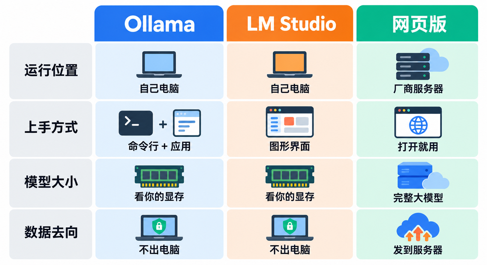
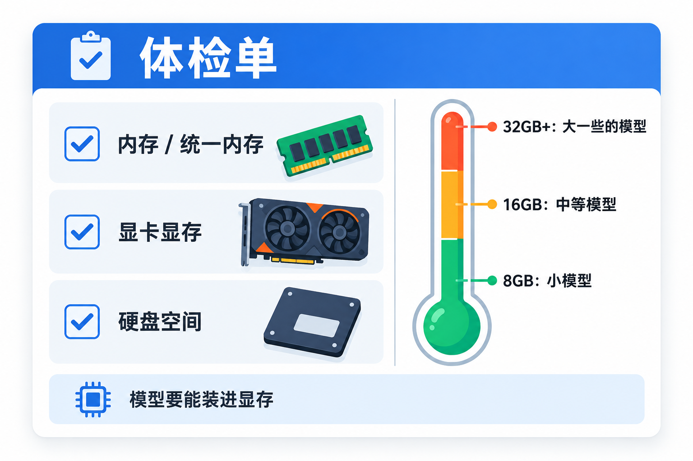
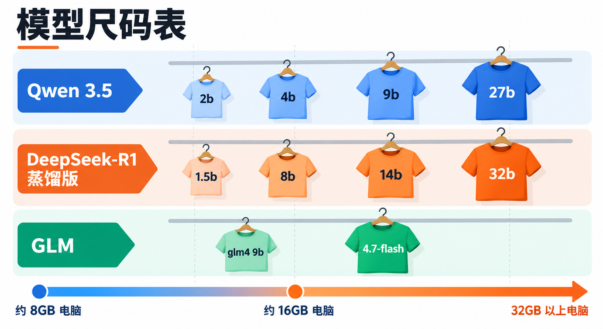
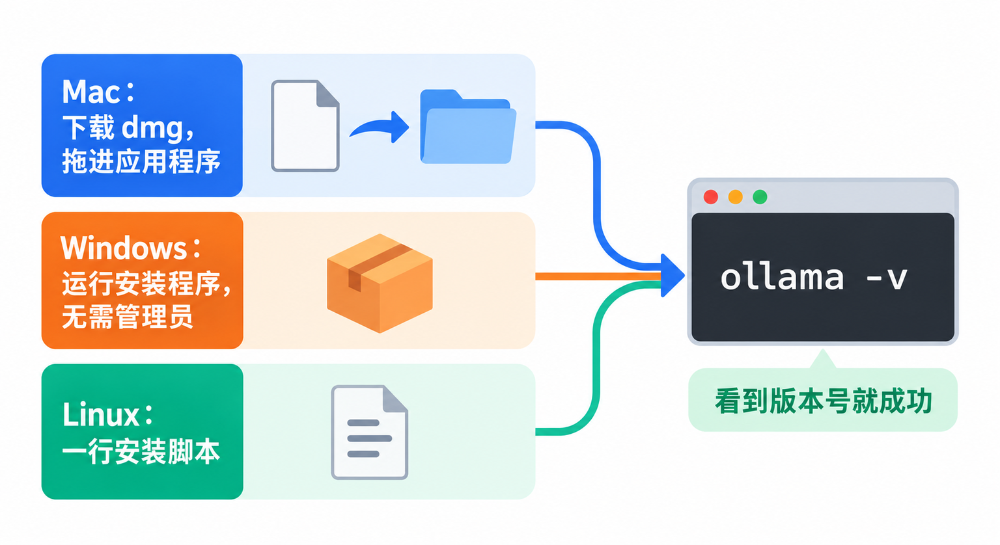
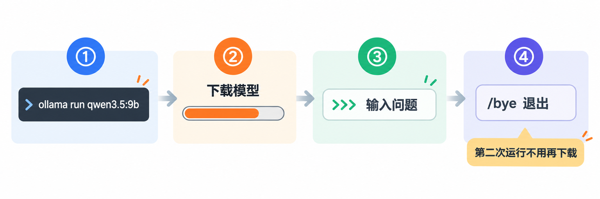

# 在自己电脑上跑Qwen、DeepSeek、GLM：Ollama入门，从看配置到第一次对话

网页上聊 DeepSeek、通义千问很方便，但总有些时候你会想：**能不能让模型直接跑在自己电脑上？** 资料不想上传、出差路上没网、想写个小程序随便调用又不想按次付费，这些场景都指向同一个工具：**Ollama**。

这篇讲清楚五件事：Ollama 是什么、它和 LM Studio、网页版比各有什么取舍、怎么看自己电脑能跑多大的模型、从安装到第一次对话的完整步骤，以及本地模型和网页版到底差在哪。看完你就能在自己电脑上和 Qwen、DeepSeek 或 GLM 聊上第一句。

## 先认识一下：把大模型装进自己电脑的“应用商店”


Ollama 是一个免费开源的本地大模型运行工具，代码在 GitHub 的 `ollama/ollama` 仓库，采用 **MIT 开源协议**，支持 macOS、Windows 和 Linux。Ollama 不是缩写，就是产品名。

它做的事情可以用一句话概括：**把“下载模型、加载到显卡、开始对话”压缩成一条命令**。开源大模型的权重文件本来就能免费下载，但要把它们跑起来，过去得自己挑格式、配推理程序、调参数。Ollama 把这些都包了：

- **模型库**：官网 ollama.com 上有现成的模型目录，Qwen、DeepSeek、GLM、Gemma、gpt-oss 等都在里面，每个模型按参数规模分好了版本，复制名字就能下载。
- **一条命令对话**：`ollama run 模型名`，没下载过就先下载，下载完直接进入对话。
- **本机接口**：Ollama 在后台开一个本机服务，默认地址是 `http://localhost:11434`，自己写的程序、编辑器插件、AI 编程工具都能接上来用本地模型。
- **桌面应用**：macOS 和 Windows 版自带一个应用，可以在窗口里选模型、直接聊天，还能拖文件进去让模型读。

在本机跑模型，**不需要注册账号、不需要 API Key，也不按量计费**。官方的说法很直接：在本地运行时，他们看不到你的提示词和数据。

## 它是怎么来的


Ollama 的两位创始人 Jeff 和 Michael 在大学里就一起创业，做过一个叫 **Kitematic** 的工具，让 Docker 变得“傻瓜式”好用。2015 年 Kitematic 被 Docker 收购，他们的工作后来成了 2016 年推出的 **Docker Desktop**。

做 Ollama 的出发点和当年做 Kitematic 如出一辙。开源大模型越来越强，权重也能免费下载，但真要跑起来门槛很高；而闭源模型只要一个 API 就能调用。他们想让“跑一个开源模型”变得和“运行一个普通软件”一样简单。所以你会发现 Ollama 的用法处处带着 Docker 的影子：`pull` 下载、`run` 运行、`ps` 看正在跑的、`rm` 删除，模型像镜像一样有名字和标签。

几个关键节点：

- **2023 年**：Ollama 推出，同年 10 月发布官方 Docker 镜像，Linux 上的容器也能用显卡加速。
- **2024 年**：2 月推出 Windows 预览版，同月兼容 OpenAI 的 Chat Completions 接口，原本为 OpenAI 写的程序改个地址就能接本地模型；3 月起支持 AMD 显卡。
- **2025 年**：5 月推出自研新引擎，支持看图的多模态模型；7 月推出 macOS 和 Windows 的新桌面应用；9 月推出**云端模型预览**，大模型可以放到 Ollama 的服务器上跑。
- **2026 年**：1 月兼容 Anthropic 的 Messages 接口，新增 `ollama launch` 命令，一键让 Claude Code、Codex 等工具用上开源模型；3 月 Apple 芯片上改由苹果的 MLX 框架加速；6 月的 0.30 版通过 llama.cpp 加强了对 GGUF 格式模型的兼容，并默认开启 Vulkan，更多 AMD、Intel 显卡也能用上 GPU 加速；7 月宣布完成 8800 万美元融资，官方称服务着 890 万开发者。

**早期“像 Docker 一样用模型”的选择**，变成了它今天最大的优势：命令好记、模型有统一的名字和版本，几乎所有本地 AI 工具都把“支持 Ollama”当成标配。代价是，它的模型库是自己整理的一套体系，想用库里没有的模型，需要自己导入；而随着云端模型加入，同一个命令行里既有本地模型、也有云端模型，**新手需要分清自己跑的到底是哪一种**，后面会专门讲。

## 横向比一比：Ollama、LM Studio、网页版



想在本地跑模型，读者最常拿来和 Ollama 比的是 **LM Studio**，它是另一款热门的本地大模型工具，主打图形界面；而大多数人现在实际在用的是**各家的网页版或 App**，所以也放进来一起比。

| | Ollama | LM Studio | 网页版 / App |
|---|---|---|---|
| 在哪里运行 | 自己电脑（另有可选的云端模型） | 自己电脑 | 厂商的服务器 |
| 上手方式 | 命令行为主，另有桌面应用 | 图形界面为主，另有命令行 `lms` | 打开网页就用 |
| 能跑多大的模型 | 受自己电脑的显存和内存限制 | 受自己电脑的显存和内存限制 | 厂商的完整大模型 |
| 联网和搜索 | 本地模型默认不联网 | 本地模型默认不联网 | 通常自带联网搜索 |
| 数据去向 | 本地运行不出电脑 | 本地运行不出电脑 | 发到厂商服务器 |
| 接自己的程序 | 本机接口，兼容 OpenAI、Anthropic 格式 | 本机接口，兼容 OpenAI 格式 | 需另开通 API，按量付费 |

**为什么选 Ollama**：命令简单、生态最广，Claude Code、Codex、VS Code 插件、各种开源 AI 应用基本都能直接接 Ollama；开源协议是 MIT；如果你是开发者，想在自己的程序里调用本地模型，它的本机接口几乎零配置。

**为什么选 LM Studio**：完全不想碰命令行，喜欢在图形界面里搜模型、点下载、调参数；它在 Apple 芯片上同样支持 MLX。

**为什么还是回到网页版**：本地能跑的模型，参数规模远小于厂商线上的完整模型，复杂问题的回答质量差距明显；网页版还有联网搜索、长文档、深度思考这些配套功能。从定位上看，**本地模型更适合“隐私、离线、免费、可编程”这几类需求，而不是替代网页版**。

## 第一步：看看你的电脑能跑多大的模型



本地跑模型，**能跑多大，主要看“模型能不能完整装进显存”**。官方快速入门里拿一个下载大小约 7GB 的模型举例，建议准备 **8GB 可用显存，或 Mac 上 8GB 的统一内存**；显存不够时，Ollama 会借用系统内存，但回答会变慢。

所以先查三样东西：

- **Mac**：点左上角苹果菜单 → **关于本机**，看“内存”。Apple 芯片的 Mac 内存和显存是共用的（统一内存），这个数字就是你能给模型用的上限，还要扣掉系统和其他软件占的部分。Ollama 要求 **macOS 14 Sonoma 或更新**；Intel 芯片的 Mac 只能用 CPU 跑，会比较慢。
- **Windows**：打开任务管理器的“性能”页，看内存大小，以及显卡的“专用 GPU 内存”（这就是显存）。系统要求是 **Windows 10 22H2 或更新**；NVIDIA 显卡需要 **551.61 或更新**的驱动，AMD 显卡支持 ROCm 或 Vulkan 加速。
- **硬盘**：模型文件动辄几 GB 到几十 GB，下载前确认剩余空间够。

拿到数字后，我自己的经验法则是：**选一个文件大小明显小于可用显存（Mac 看统一内存）的版本，留出几 GB 余量**。余量是给对话上下文用的，聊得越长、塞的文档越多，占的内存越多。

> **别一上来就下最大的版本。** 模型库里同一个模型往往从 1GB 到几百 GB 都有，超过显存的版本要么跑不起来，要么慢到没法用。先从小的试，嫌不够聪明再往上换。

## 第二步：挑一个国产开源模型



Ollama 模型库里国产开源模型很多，下面挑三个家族说清楚怎么选。文件大小来自官方模型库，同一版本的不同量化格式大小会略有差异，**下载前以模型页当前显示为准**。

**通义千问 Qwen 3.5（`qwen3.5`）**：阿里巴巴的开源模型系列，能看图、能调用工具、支持思考模式，规格最全，是新手的首选。

| 版本 | 文件大小 | 适合的电脑 |
|---|---|---|
| `qwen3.5:2b` | 约 2.7–3.1GB | 8GB 内存的轻薄本 |
| `qwen3.5:4b` | 约 3.3–4.0GB | 8GB 显存或 16GB 内存 |
| `qwen3.5:9b`（默认版本） | 约 6.6–7.6GB | 8GB 以上显存，或 16GB 统一内存的 Mac |
| `qwen3.5:27b` | 约 17–20GB | 24GB 显存，或 32GB 以上统一内存 |

更新的 **Qwen 3.6**（`qwen3.6`）目前只有 27b 和 35b 两档，主打写代码和智能体任务，文件在 18GB 以上，适合 32GB 以上内存的 Mac 或大显存显卡。

**DeepSeek-R1（`deepseek-r1`）**：DeepSeek 的推理模型，回答前会先“想一想”。要特别说明：**模型库里的小版本不是网页版那个完整的 DeepSeek-R1**。默认的 `deepseek-r1:8b` 是 DeepSeek-R1-0528-Qwen3-8B，用 R1 的推理能力“蒸馏”到 Qwen3-8B 上得到的小模型，约 5.2GB；`1.5b`、`7b`、`14b`、`32b` 同样是蒸馏版。完整的 671b 版本文件约 404GB，个人电脑基本跑不动。模型权重采用 MIT 协议，可以商用。

**智谱 GLM（`glm-4.7-flash`）**：智谱的 GLM-4.7-Flash 是一个 30B 总参数、每次只激活约 3B 参数的混合专家模型，约 19GB，适合 32GB 以上内存的电脑。内存不够的话，旧一些的 `glm4`（9B，约 5.5GB）也能跑。

我的建议很简单：**8GB 内存选 `qwen3.5:2b` 或 `deepseek-r1:1.5b` 体验一下；16GB 选 `qwen3.5:9b` 或 `deepseek-r1:8b`；32GB 以上再考虑 `qwen3.5:27b`、`glm-4.7-flash`、`qwen3.6`。**

## 第三步：安装 Ollama



**Mac 和 Windows**：到官网 ollama.com/download 下载安装包。Mac 版是一个 `.dmg`，把 Ollama 拖进“应用程序”文件夹，第一次打开时如果系统里还没有 `ollama` 命令，它会请求权限把命令加进去；Windows 版是 `OllamaSetup.exe`，**不需要管理员权限**，默认装在用户目录，装完 Ollama 会在后台运行。

官网也给了命令行一键安装的方式。macOS 和 Linux 在终端运行：

```bash
curl -fsSL https://ollama.com/install.sh | sh
```

Windows 在 PowerShell 里运行：

```powershell
irm https://ollama.com/install.ps1 | iex
```

这类“下载脚本直接执行”的命令只从官网复制；不放心的话，用上面的手动下载方式效果一样。

装好后打开终端（Windows 用 PowerShell 或命令提示符），确认一下：

```bash
ollama -v
```

能看到版本号就说明装好了。Linux 上如果提示服务没在运行，先执行 `ollama serve` 再开一个终端继续。

## 第四步：下载模型，开始第一次对话



在终端里输入（以 Qwen 3.5 的 9B 版本为例，换成上一步你选的版本）：

```bash
ollama run qwen3.5:9b
```

第一次运行会先下载模型，几 GB 的文件需要等一会儿。下载完会出现 `>>>` 提示符，直接用中文提问就行，比如：

```text
用三句话给我讲讲什么是 Java 的虚拟线程。
```

想输入多行内容时，用三个双引号 `"""` 把内容包起来。聊完输入 `/bye` 退出。再次运行同一条命令时不用重新下载，几秒就能开始对话。

不习惯命令行的话，打开 Mac 或 Windows 上的 Ollama 应用，在窗口里选模型、直接对话也可以，应用还支持把文本、PDF 拖进去让模型读。具体的界面和选项以你安装的版本为准。

几条日常管理命令，全部来自官方命令参考：

```bash
ollama ls          # 看已经下载了哪些模型
ollama ps          # 看正在运行的模型，以及用的是 GPU 还是 CPU
ollama stop qwen3.5:9b   # 让某个模型退出，释放内存
ollama rm qwen3.5:9b     # 删除模型，释放硬盘
```

**觉得回答特别慢？先跑一下 `ollama ps`**。看 `PROCESSOR` 那一列，显示 `100% GPU` 说明模型完整装进了显存；如果出现 CPU 的比例，说明显存不够、有一部分在用内存和 CPU 硬算，换一个更小的版本会快很多。

模型默认存在用户目录下的 `.ollama/models` 里（Linux 用安装脚本装的话在 `/usr/share/ollama/.ollama/models`）。C 盘紧张的 Windows 用户，可以在“编辑账户的环境变量”里新建 `OLLAMA_MODELS`，指向别的盘的文件夹，然后从托盘退出 Ollama 再重新打开。

## 本地模型和网页版，到底差在哪


第一次用本地模型，很多人会觉得“怎么没网页版聪明”。这很正常，差别主要在四个地方：

**一是模型规模。** 网页版背后是厂商的完整大模型，跑在数据中心里；你电脑上的 9B、14B 模型，参数规模往往小得多。日常问答、翻译、改写、总结、写简单代码，小模型够用；复杂推理、长篇写作、专业问题，差距会很明显。

**二是联网。** 本地模型只知道训练时学到的东西，问它最近发生的事，它不知道，甚至会一本正经地编。需要最新信息时，还是用网页版。

**三是上下文长度。** Ollama 会按显存大小自动设定上下文长度：**显存小于 24GB 时默认只有 4K**，24–48GB 是 32K，48GB 以上是 256K。所以把一篇长文档整个塞进去，前面的内容可能会被“忘掉”。桌面应用的设置里有一个上下文长度滑块可以调大，但调得越大越占内存。

**四是隐私和成本。** 这是本地模型最大的优势：**本地运行时数据不离开你的电脑**，下载完之后断网也能用，聊多少都不额外花钱。处理不方便上传的文档、离线环境、想让自己的程序随便调用模型做批量处理，都是它最合适的场景。

## 用之前务必分清：本地模型和云端模型


Ollama 现在除了本地模型，还提供**云端模型**：模型跑在 Ollama 自己的服务器上，速度快、不占你的电脑，但需要登录 Ollama 账号。免费账号也能用本地模型，并带有少量云端额度；更多云端用量需要按量购买额度或订阅付费套餐，价格以官网 Pricing 页面为准。

区分方法很简单：**在命令行和应用里，云端模型的名字以 `:cloud` 结尾**，比如 `gemma4:cloud`。直接输入 `ollama`（不带参数）时，它会弹出引导，让你选择登录用云端模型还是选择本地模型，看清楚再选。

官方对云端模型的说明是：会处理你的提示词和回答来提供服务，但不保存、不记录内容，也不用来训练模型。即便如此，你来本地跑模型多半就是图数据不出电脑。

> **想确保所有请求都只在本地跑，就把云端功能关掉。** 官方给的方法是在 `~/.ollama/server.json` 里写入 `{"disable_ollama_cloud": true}`，或者设置环境变量 `OLLAMA_NO_CLOUD=1`，然后重启 Ollama。关掉之后云端模型和联网搜索都不能用，日志里会出现 `Ollama cloud disabled: true`。

还有一点：Ollama 的本机服务默认只监听 `127.0.0.1`，也就是只有你自己的电脑能访问。网上有教程教你改 `OLLAMA_HOST` 让局域网里其他设备也能用，这样做之前要想清楚：

> **不要把 Ollama 的端口直接暴露到公网。** 本机接口默认不需要密码，谁能访问到这个端口，谁就能用你的电脑跑模型。确实需要远程用，至少放在有访问控制的内网或反向代理后面。

## 写在最后

如果你只想先体验一下，最短的路径是：**到 ollama.com/download 装好 Ollama，按自己电脑的内存选一个版本，16GB 的电脑直接运行 `ollama run qwen3.5:9b`，问它一个你平时会问网页版的问题，对比一下。** 觉得够用，就把它留下来处理那些不方便上传的资料；想再进一步，可以试试让自己写的程序通过 `http://localhost:11434` 调用它，或者用 `ollama launch` 把本地模型接进 Claude Code、Codex 这类编程工具。

## 参考资料

<div class="sources">
<p>Ollama 官方：<a href="https://ollama.com">Ollama 官网</a>、<a href="https://ollama.com/download">下载页</a>、<a href="https://github.com/ollama/ollama">ollama/ollama（GitHub，README、LICENSE）</a>、<a href="https://ollama.com/pricing">Pricing 价格页</a>。</p>
<p>官方文档：<a href="https://docs.ollama.com/quickstart">Quickstart</a>、<a href="https://docs.ollama.com/cli">CLI Reference</a>、<a href="https://docs.ollama.com/macos">macOS</a>、<a href="https://docs.ollama.com/windows">Windows</a>、<a href="https://docs.ollama.com/linux">Linux</a>、<a href="https://docs.ollama.com/gpu">Hardware support</a>、<a href="https://docs.ollama.com/context-length">Context length</a>、<a href="https://docs.ollama.com/cloud">Cloud</a>、<a href="https://docs.ollama.com/faq">FAQ</a>。</p>
<p>官方模型库：<a href="https://ollama.com/library/qwen3.5">qwen3.5</a>、<a href="https://ollama.com/library/qwen3.6">qwen3.6</a>、<a href="https://ollama.com/library/deepseek-r1">deepseek-r1</a>、<a href="https://ollama.com/library/glm-4.7-flash">glm-4.7-flash</a>、<a href="https://ollama.com/library/glm4">glm4</a>。</p>
<p>来历与发展：<a href="https://ollama.com/blog">Ollama 官方博客</a>，包括 <a href="https://ollama.com/blog/all-aboard-open-models">Ollama: all aboard open models</a>、<a href="https://ollama.com/blog/windows-preview">Windows preview</a>、<a href="https://ollama.com/blog/openai-compatibility">OpenAI compatibility</a>、<a href="https://ollama.com/blog/multimodal-models">Ollama's new engine for multimodal models</a>、<a href="https://ollama.com/blog/new-app">Ollama's new app</a>、<a href="https://ollama.com/blog/cloud-models">Cloud models</a>、<a href="https://ollama.com/blog/claude">Claude Code with Anthropic API compatibility</a>、<a href="https://ollama.com/blog/launch">ollama launch</a>、<a href="https://ollama.com/blog/mlx">Ollama is now powered by MLX on Apple Silicon in preview</a>、<a href="https://ollama.com/blog/improved-performance-and-model-support-with-gguf">Improved performance and model support with GGUF</a>。对比参照：<a href="https://lmstudio.ai/docs/app">LM Studio 文档</a>。</p>
<p>资料核对于 2026 年 10 月 16 日。文中命令来自官方文档，写作时未实际运行。模型版本、文件大小、系统要求和云端价格变化较快，以官方模型库和当前页面为准；“文件大小明显小于可用显存”的选型方法是作者的经验建议。配图为示意图，不是产品界面截图。</p>
</div>
