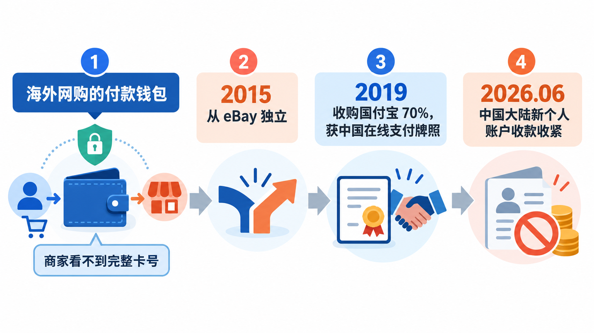
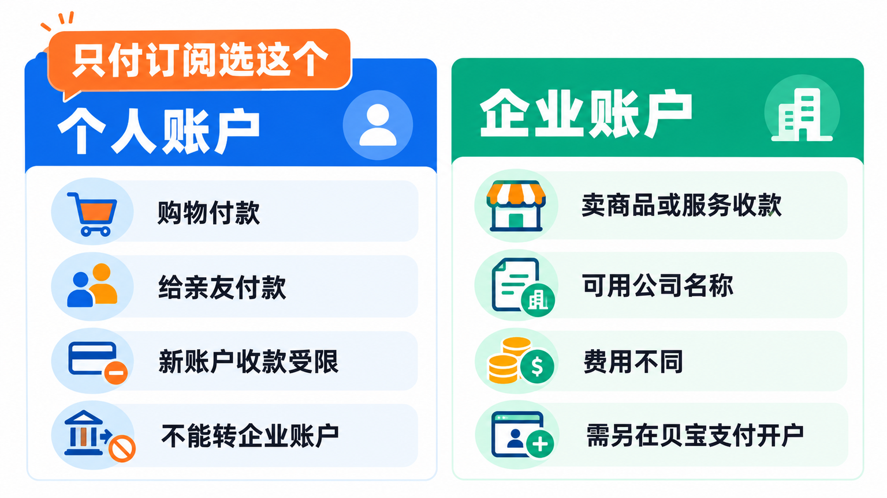
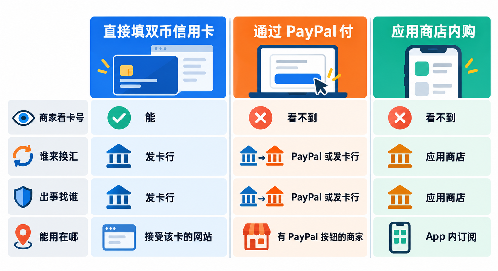
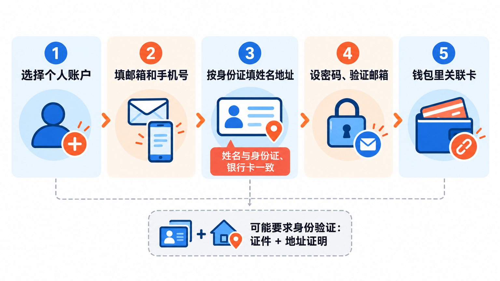
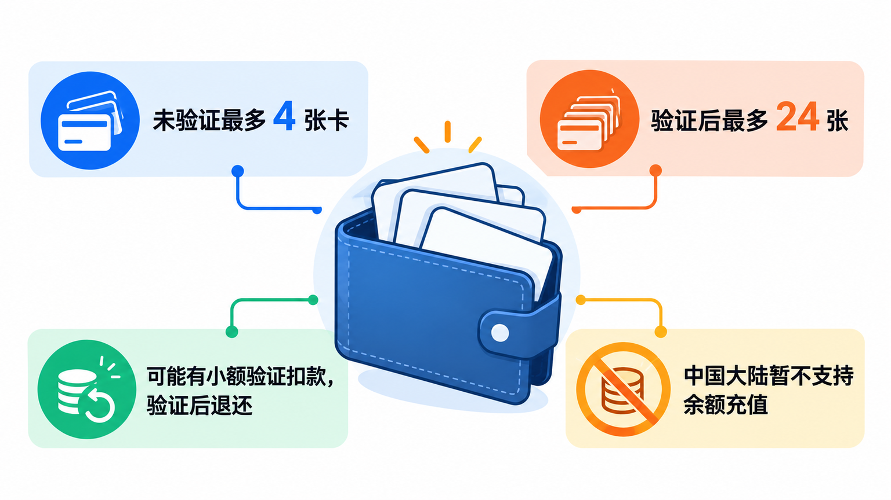
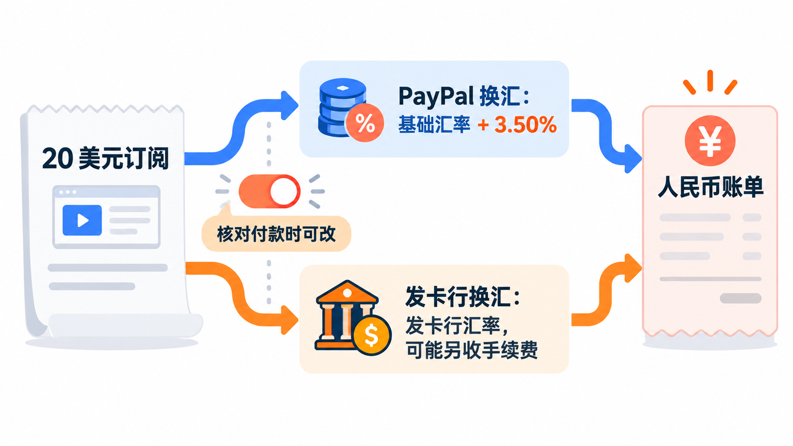
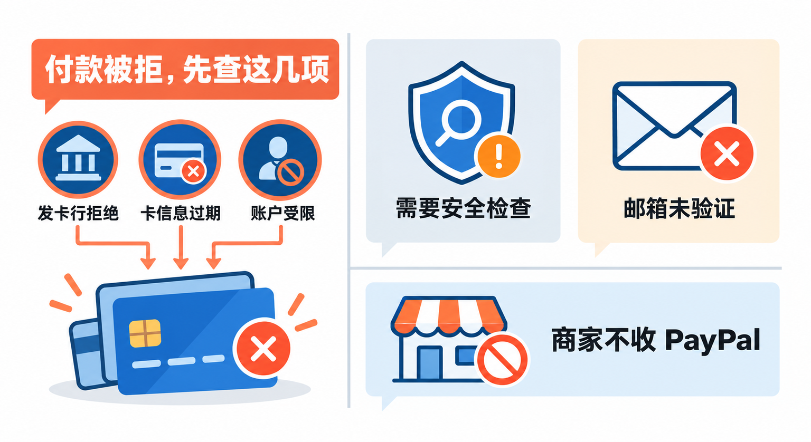

# 用PayPal付海外AI订阅：中国账户怎么注册、绑什么卡、汇兑费怎么算

想订一个海外的 AI 工具、开发者服务或者软件会员，结账页上除了填信用卡，常常还有一个黄色的 PayPal 按钮。不少人会想：注册一个 PayPal，是不是就能绕开“国内卡付不了美元”的麻烦？

这篇讲清楚四件事：**PayPal 中国账户该开个人版还是企业版、注册要准备什么、能绑哪些国内卡、付美元时到底多扣了多少钱**，最后再说说付款失败最常见的几个原因。只讲用本人真实信息注册中国大陆账户，不涉及注册其他国家或地区的账户。

先说一个容易被误解的前提：**PayPal 解决的是“怎么付钱”，不解决“能不能用”。** 一个海外服务在你所在的地区能不能用、它的结账页接不接受 PayPal，是服务商自己决定的。比如 Claude 的官方帮助写明，订阅目前只接受银行卡付款；ChatGPT 和 Claude 的官方支持地区列表里也都没有中国内地。PayPal 帮不了这一层，后文也不会教任何绕过地区限制的办法。

## PayPal 是怎么来的，又是怎么进中国的

**PayPal 的核心设计，是在买家和商家之间加一层“钱包”**：你把卡绑在 PayPal 里，付款时商家只看到 PayPal，看不到你的完整卡号。PayPal 中国站首页把这一点写得很直接：商家无法看到买家的完整财务信息。这个设计让它在早年的海外网购里流行起来，也成了今天很多海外网站结账页上的标配按钮。

几个关键节点：

- **2015 年 7 月 17 日**，PayPal 从 eBay 拆分出来，成为独立上市公司。此后它不再只是 eBay 的付款工具，而是面向所有商家的独立支付平台。
- **2019 年第四季度**，PayPal 完成对国付宝（GoPay）70% 股权的收购。按 PayPal 当时的公告，这让它成为**第一家获得在中国提供在线支付服务牌照的外资支付平台**。
- **2026 年 6 月 30 日起**，PayPal 用户协议里针对中国大陆的条款收紧了个人账户的收款功能，同时要求企业账户另外在关联公司贝宝支付（北京）有限公司开户。这一条下一节细说。

需要分清的是：你在 PayPal 中国站注册的账户，签约方是 **PayPal Pte. Ltd.**，一家新加坡公司，持有新加坡金融管理局颁发的支付牌照。它主要做的是**跨境**收付款，和支付宝、微信支付这类境内支付工具不是一回事。

## 个人账户还是企业账户：只付钱就选个人

PayPal 只有两种账户：**个人账户**和**企业账户**（中文圈常说的“商家账户”就是企业账户）。

按用户协议的说法，**个人账户适合主要用来购物、给亲友付款的人**；**企业账户适合主要用 PayPal 卖商品或服务的个人和组织**，可以用公司名称作为账户名、让员工访问部分功能，费用也和个人账户不同。

对中国大陆用户，2026 年 6 月 30 日之后还有几条专门的规定：

- 这个日期之后注册的个人账户，**除了接收亲友的个人付款，用来接收商品和服务款项的功能会受到限制**；
- 这个日期之后注册的个人账户，**不能再变更为企业账户**；
- 已有企业账户的用户，需要同时在贝宝支付（北京）有限公司开设账户，否则 PayPal 保留暂停服务或注销账户的权利。

所以选择很简单：**你只是想付海外订阅、在海外网站买东西，开个人账户就够了**。如果你是想接海外单子、卖数字产品收美元，那是另一套流程，PayPal 中国站的“卖家”栏目下有企业和个人卖家的单独入口，审核和费率都按商家规则走，不在本文范围内。

**想做生意的话，一开始就别用个人账户凑合。** 按现在的中国大陆条款，新注册的个人账户以后不能再转成企业账户，收款功能也受限，开错了只能重新来过。

## 和其他付款方式比一比

付一个海外订阅，读者最可能拿来比较的是这三种方式：

| | 直接填双币信用卡 | 通过 PayPal 付 | 应用商店内购 |
|---|---|---|---|
| 商家能看到卡号吗 | 能，卡信息交给商家的支付通道 | 看不到完整卡号 | 看不到，由苹果或谷歌收款 |
| 谁来换汇 | 发卡行和卡组织 | 默认 PayPal 换，部分卡可以改成发卡行换 | 应用商店收款，价格以商店显示为准 |
| 出问题找谁 | 发卡行拒付申诉 | PayPal 调解中心，或发卡行 | 应用商店的退款流程 |
| 能用在哪里 | 接受这类卡的网站 | **只限结账页有 PayPal 的商家** | 只限 App 内订阅 |

**为什么选 PayPal**：卡号不交给每一个小网站，换一张卡只要在 PayPal 里改一次；订阅出问题时多了一条申诉渠道；所有自动扣款能在一个地方集中查看和取消。对同时订了好几个海外服务的人，这一点很省心。

**为什么不选 PayPal**：商家不接受，它就派不上用场，Claude 订阅就是例子；PayPal 换汇要额外收一笔费用，后面会算给你看；注册、绑卡和身份验证的环节也比直接填卡多。

从定位上看，**PayPal 更像一个“把卡藏起来、把扣款管起来”的中间层**，而不是一把能打开所有海外服务的钥匙。

## 注册个人账户：准备真实信息

PayPal 中国站的帮助中心列出，开设个人账户需要提供**姓名、地址、电话号码和邮箱地址**，还要设置密码和两个密码提示问题。大致流程是：

1. 打开 PayPal 中国站，点击“注册”，选择**个人账户**。
2. 填写常用邮箱和本人手机号，按提示完成手机验证。
3. 姓名、地址按**身份证上的信息**如实填写。用户协议要求你正确填写居住的国家或地区，并提供准确、最新的个人信息。
4. 设置密码，登录邮箱点击 PayPal 发来的验证链接。帮助中心把“尚未验证电子邮箱地址”列为付款被拒的原因之一，这一步别拖。
5. 到“钱包”里关联借记卡或信用卡，下一节细说。

注册时还会遇到几条硬性规定：个人账户要求**年满 18 周岁**；出于监管要求，PayPal 可能要你完成身份验证（官方叫“客户身份认证方案”），通常要上传**政府签发的身份证件副本和过去 12 个月内的地址证明**，审核一般在 2 个工作日内完成。不完成验证的话，可能用不了收付款等功能。

> **姓名一定和身份证、银行卡保持一致。** PayPal 要求关联的银行账户姓名必须与 PayPal 账户上的姓名一致，信息对不上，后面绑卡、身份验证都会卡住。用别人的信息注册，或者为了“方便”随便填，是最容易导致账户受限的做法。

## 绑卡：能绑什么，有哪些限制

按帮助中心的步骤，网页端是在“**钱包**”里点“**关联借记卡或信用卡**”，按说明填写；App 里是“我”→“账户”→“已关联银行账户和卡”旁边的加号，选“借记卡和信用卡”，可以扫描卡片或手动输入。

几条要知道的规则：

- **能绑借记卡、信用卡和银行账户**。未验证的账户最多关联 4 张卡，验证之后最多 24 张。
- **中国大陆目前不能给 PayPal 余额充值**。付款时直接从关联的卡里扣，不需要先往 PayPal 里存钱。
- **绑卡时可能有一笔小额验证扣款**。费用页写明，部分用户关联和验证卡时会被收取一笔验证费，美元卡是 1.95 美元，验证成功后退还。
- **关联银行账户有额外要求**：必须开在与 PayPal 账户同一国家或地区的银行、使用当地币种，户名与 PayPal 账户一致；一个银行账户在有效期内最多关联 3 个 PayPal 账户；多数纯网银账户和预付银行账户与 PayPal 不兼容。

**付海外订阅，一般首选一张能做外币交易的信用卡。** 国内的双币信用卡（印有 Visa 或 Mastercard 标识，同时支持人民币和外币）是最常见的选择。至于这类卡的外币交易手续费怎么收、为什么会被风控拒付，各家发卡行规定不同，以发卡行官网为准。

## 付美元时多扣了多少钱：看清“谁来换汇”

这是最多人没注意到的一笔钱。

PayPal 费用页写得很清楚：**只要不涉及币种兑换，用 PayPal 购物本身不收费**。问题在于，你的卡是人民币账户、商家收的是美元，中间一定有人换汇。这时有两条路：

**第一条，由 PayPal 换汇。** PayPal 会用自己的“交易汇率”，它等于基础汇率（外汇批发市场的汇率）再加上一笔币种兑换费。写作时中国大陆个人账户的费用页上，付款时兑换成**美元的加价是 3.50%**，欧元、英镑、日元、港币等多数币种是 4.00%。也就是说，一笔 20 美元的订阅，PayPal 换汇部分大约多付 0.7 美元。

**第二条，由发卡行换汇。** 用户协议写明，用借记卡或信用卡付款时，你有权选择由发卡机构完成币种兑换（前提是发卡机构和卡组织支持）。按帮助中心的说法，在核对付款页面找到“**通过 PayPal 兑换币种**”的选项，把它改成“**通过发卡机构兑换币种**”即可。选了这条路，汇率和费用由发卡行决定，付款时你看不到准确汇率，要等账单出来再看。

两条路哪条更便宜，取决于你的卡：有的卡外币交易免手续费，有的收一定比例，还要叠加卡组织的汇率。**建议拿同一张卡分别看一次账单，比一比实际扣了多少人民币**，再决定以后默认用哪种。

还有两种情况要留意：

- **如果付款页面上没有这个选项**，说明你的卡只支持其中一种兑换方式；用 PayPal 余额付款时，也总是由 PayPal 换汇。
- **退款也可能有汇率损失**。按用户协议，PayPal 换过汇的交易，如果在付款 1 天内退款，按原汇率退；超过 1 天，按退款当天的交易汇率（同样含兑换费）退，所以**退回来的人民币可能比付出去的少**。

> **自动续费的订阅，汇率是每次扣款时重新算的。** 授权了自动付款并由 PayPal 换汇的话，每个月扣款都用当时的交易汇率。订之前先想好默认由谁换汇，免得每个月都多付一笔自己没注意到的钱。

## 订阅开了之后：在哪里查、在哪里取消

通过 PayPal 订的会员，大多是一份“**自动付款**”协议：商家可以在你授权后定期从 PayPal 扣款。管理入口在 PayPal 的“设置”→“付款”→“**定期付款和已保存商家**”或“**自动付款**”，选中商家就能查看条款、更换扣款的卡或者取消。

用户协议写明，可以在**下次预定付款日期前的 3 个工作日内**取消自动付款。取消之后，未来的自动扣款都会停止；但如果你已经用了服务、还欠商家钱，这笔账仍然要另外结清。

> **在 PayPal 里取消自动付款，不等于在服务那边取消了订阅。** 最稳妥的顺序是：先到服务的账户设置里取消订阅，再到 PayPal 的自动付款页面确认这家商家已经停止。只在一边操作，可能出现服务被停但账号欠费，或者服务没停却扣不到钱的情况。

如果订阅出了问题，比如付了钱没开通，先联系商家；解决不了，再到 PayPal 的“调解中心”提出争议。买家保障计划规定，“物品未收到”的争议要在**付款之日起 180 天内**提出。同一笔用信用卡付的交易，你也可以选择找发卡行申请拒付，但**两边只能选一边**，不能同时申请。

## 付款失败，先查这几项

PayPal 帮助中心列出的付款被拒最常见原因有这些：

- **被银行或发卡机构拒绝**。为保护隐私，发卡行不会告诉 PayPal 拒绝的原因，只能你自己打发卡行客服问。常见的情况是卡没有开通外币或境外网上交易，或者被发卡行风控拦了下来。
- **卡信息过期**。卡换了新的有效期，或者账单地址变了，要在 PayPal 里更新。
- **PayPal 账户受限**。需要按提示解除限制。
- **需要通过安全检查**。PayPal 可能要求你验证身份，确认是本人在用。
- **邮箱还没验证**。

另外还有一点：**付款被拒后，那笔金额的授权冻结可能还会在卡上挂几天**，看到“已扣款”别急着重复付款，等它自动释放，或者问发卡行确认。

如果以上都没问题，还是付不了，就回到开头那个前提：这个服务可能根本不支持 PayPal，或者不对你所在的地区提供服务。这时换什么付款方式都解决不了。

## 写在最后

如果你经常给海外的开发者服务、软件或工具付费，可以花十几分钟用本人信息开一个 PayPal 个人账户，绑一张双币信用卡。**第一次付款时，记得在核对页面看一眼“由谁换汇”**，等账单出来比一比，再决定以后默认用哪条路。

## 参考资料

PayPal 中国站：<a href="https://www.paypal.com/c2/home">PayPal 中国首页</a>、<a href="https://www.paypal.com/c2/legalhub/paypal/useragreement-full">PayPal 用户协议</a>（2026 年 6 月 30 日版，“开设账户”“币种兑换”“自动付款”“退款”及“中国大陆”条款）、<a href="https://www.paypal.com/c2/digital-wallet/paypal-consumer-fees">个人费用</a>（中国大陆，最后更新 2021 年 7 月 30 日）、<a href="https://www.paypal.com/c2/legalhub/paypal/buyer-protection">PayPal 买家保障计划</a>（2026 年 1 月 26 日版）。

PayPal 中国帮助中心：<a href="https://www.paypal.com/c2/cshelp/article/%E8%A6%81%E5%BC%80%E8%AE%BEpaypal%E4%B8%AA%E4%BA%BA%E8%B4%A6%E6%88%B7%EF%BC%8C%E9%9C%80%E8%A6%81%E6%8F%90%E4%BE%9B%E5%93%AA%E4%BA%9B%E4%BF%A1%E6%81%AF%EF%BC%9F-help328">《要开设PayPal个人账户，需要提供哪些信息？》</a>、<a href="https://www.paypal.com/c2/webapps/mpp/kyc">《如何验证我的身份？（客户认证方案）》</a>、<a href="https://www.paypal.com/c2/cshelp/article/%E5%A6%82%E4%BD%95%E5%B0%86%E5%80%9F%E8%AE%B0%E5%8D%A1%E6%88%96%E4%BF%A1%E7%94%A8%E5%8D%A1%E4%B8%8E%E6%88%91%E7%9A%84paypal%E8%B4%A6%E6%88%B7%E7%9B%B8%E5%85%B3%E8%81%94%EF%BC%9F-help155">《如何将借记卡或信用卡与我的PayPal账户相关联？》</a>、<a href="https://www.paypal.com/c2/cshelp/article/%E5%A6%82%E4%BD%95%E4%BD%BF%E7%94%A8%E9%93%B6%E8%A1%8C%E8%B4%A6%E6%88%B7%E5%90%91%E6%88%91%E7%9A%84paypal%E4%BD%99%E9%A2%9D%E5%85%85%E5%80%BC%EF%BC%9F-help114">《如何使用银行账户向我的PayPal余额充值？》</a>、<a href="https://www.paypal.com/c2/cshelp/article/%E4%B8%BA%E4%BB%80%E4%B9%88%E4%B8%8D%E8%83%BD%E5%B0%86%E9%93%B6%E8%A1%8C%E8%B4%A6%E6%88%B7%E5%85%B3%E8%81%94%E5%88%B0%E6%88%91%E7%9A%84paypal%E8%B4%A6%E6%88%B7%EF%BC%9F-help199">《为什么不能将银行账户关联到我的PayPal账户？》</a>、<a href="https://www.paypal.com/c2/cshelp/article/%E5%A6%82%E4%BD%95%E4%BD%BF%E7%94%A8%E5%85%B6%E4%BB%96%E5%B8%81%E7%A7%8D%E4%BB%98%E6%AC%BE%EF%BC%9F-help108">《如何使用其他币种付款？》</a>、<a href="https://www.paypal.com/c2/cshelp/article/%E4%BB%80%E4%B9%88%E6%98%AF%E8%87%AA%E5%8A%A8%E4%BB%98%E6%AC%BE%EF%BC%9F%E5%A6%82%E4%BD%95%E6%9B%B4%E6%96%B0%E6%88%96%E5%8F%96%E6%B6%88%E8%87%AA%E5%8A%A8%E4%BB%98%E6%AC%BE%EF%BC%9F-help240">《什么是自动付款？如何更新或取消自动付款？》</a>、<a href="https://www.paypal.com/c2/cshelp/article/%E6%88%91%E7%9A%84%E4%BB%98%E6%AC%BE%E4%B8%BA%E4%BD%95%E8%A2%AB%E6%8B%92%E7%BB%9D%EF%BC%9F-help419">《我的付款为何被拒绝？》</a>。

PayPal 公司资料：<a href="https://newsroom.paypal-corp.com/2019-12-19-PayPal-Completes-Acquisition-of-GoPay">PayPal Completes Acquisition of GoPay</a>（2019 年 12 月 19 日）、<a href="https://www.sec.gov/Archives/edgar/data/1633917/000163391721000018/pypl-20201231.htm">PayPal Holdings 2020 年度报告（Form 10-K）</a>。

其他服务商：<a href="https://support.anthropic.com/en/articles/8325619-are-alternate-payment-options-available">Anthropic：Are alternate payment options available?</a>、<a href="https://www.anthropic.com/supported-countries">Anthropic Supported Regions Policy</a>、<a href="https://developers.openai.com/api/docs/supported-countries">OpenAI Supported countries and territories</a>。

资料核对于 2026 年 10 月 28 日。文中步骤依据 PayPal 官方帮助中心和用户协议整理，写作时未实际操作；费率、条款、菜单名称和各服务商的付款方式会更新，以官网和付款页面当前显示为准。本文不涉及注册其他国家或地区的账户，也不讨论绕过服务地区限制的方法。配图为示意图，不是产品界面截图。

