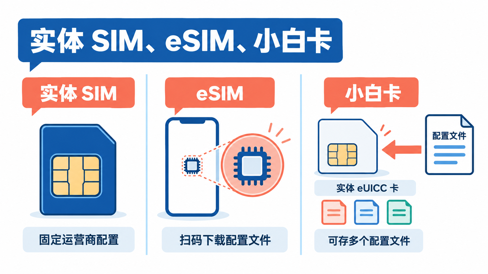
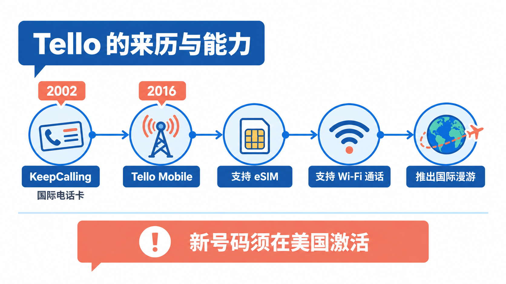
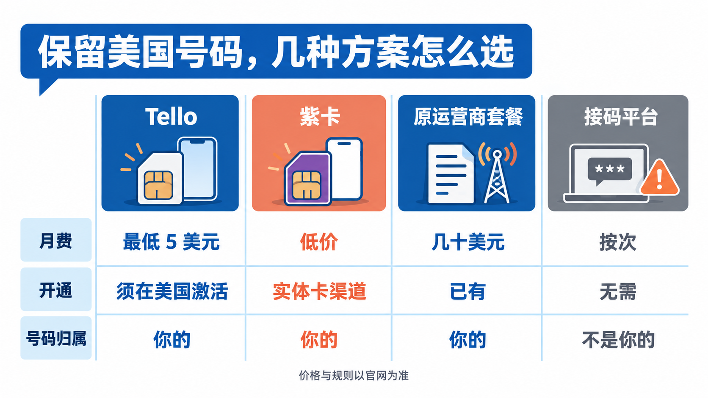
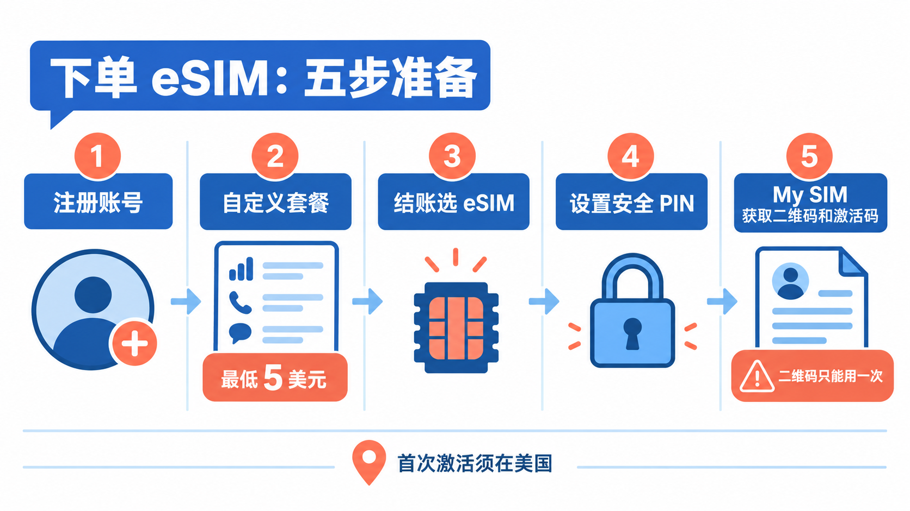
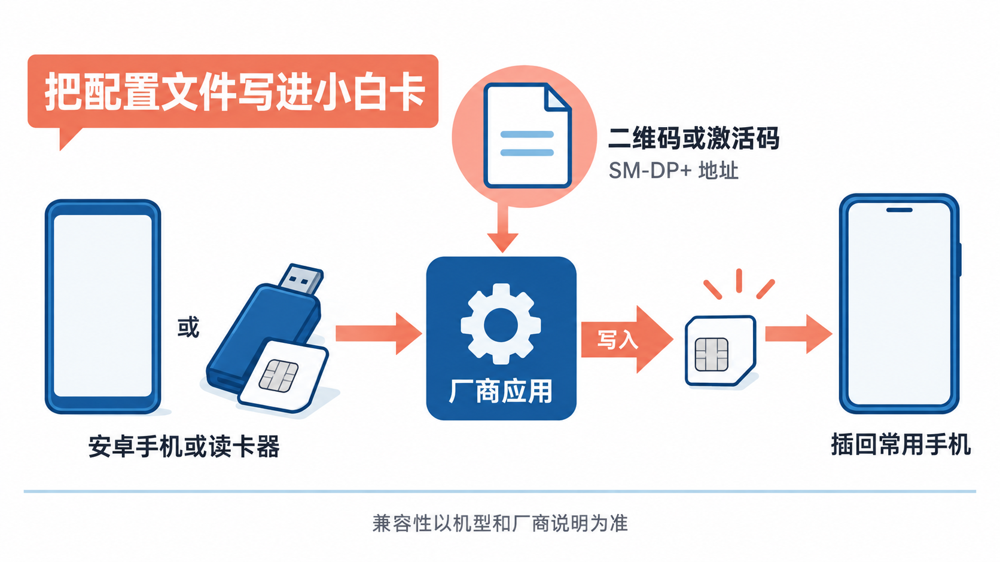
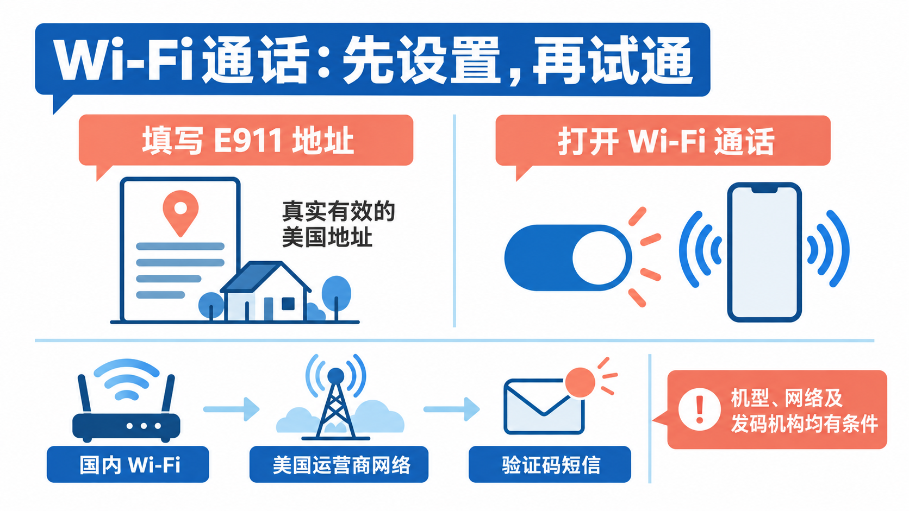
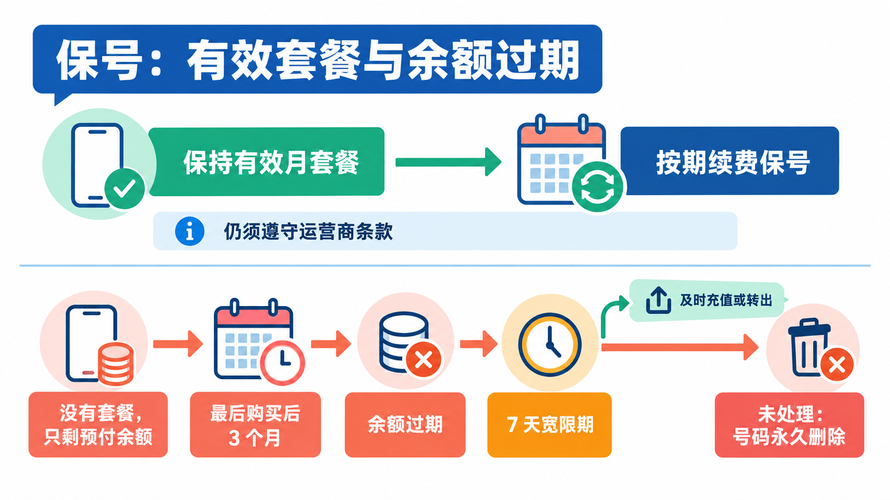

# 回国后怎么保住美国手机号：小白卡+Tello eSIM，国行手机也能收验证码

在美国读过书、工作过或者常去出差的人，回国时多半会遇到同一个问题：美国的银行卡、券商、Apple ID、各种账号都绑着一个美国手机号，**号码一停，验证码就收不到了**。原来的后付费套餐每月几十美元，回国后继续交又不划算。

这篇讲一个成本较低的办法：**用美国虚拟运营商 Tello 的 eSIM 保住一个美国号码**，再借助一张“小白卡”，把 eSIM 装进不支持 eSIM 的国行手机里，回国后连上 Wi-Fi 就能收短信验证码。

先把最重要的前提放在这里：**按 Tello 官方的规定，新号码必须人在美国时才能激活**，它的服务条款还写明用户应当居住在美国、主要在美国网络上使用。所以这篇适合**人在美国、或者回国前还有机会在美国开通**的读者；从没去过美国、想在国内直接办一个美国号的，Tello 并不是为你准备的，后文也不会教任何绕过这条规定的办法。

## 先把几个概念说清楚

讲操作之前，先把几个常出现的词理清楚，后面就不容易混。

**eSIM = embedded SIM（嵌入式 SIM）**。传统 SIM 卡是一张插进卡槽的塑料卡，号码信息写死在卡里；eSIM 则是焊在手机里的芯片，运营商把号码信息做成一个“配置文件”（profile），用户扫一个二维码就能下载进去，不用换卡。

**eUICC = embedded Universal Integrated Circuit Card（嵌入式通用集成电路卡）**。这是 eSIM 背后的芯片技术：一块能**反复写入、存放多个运营商配置文件**的芯片。手机里的 eSIM 芯片就是一块 eUICC。

**小白卡**是中文圈对**实体 eUICC 卡**的俗称，也有人叫它“eSIM 适配卡”。它长得和普通 SIM 卡一样，插在卡槽里，但里面是一块空白的 eUICC 芯片，可以把运营商的 eSIM 配置文件写进去。这样一来，**不支持 eSIM 的手机，也能通过卡槽用上 eSIM 号码**。常见的品牌有 9eSIM、ESTKme、eSIM.me 等，一张卡能存十几到几十个配置文件，价格在十几到二十几美元之间，具体以各家官网为准。

**MVNO = Mobile Virtual Network Operator（移动虚拟网络运营商）**。它自己不建基站，而是租用大运营商的网络，再用自己的品牌卖套餐。Tello 就是一家 MVNO，用的是 T-Mobile 的网络。

**Wi-Fi Calling（Wi-Fi 通话，也叫 VoWiFi）**。手机通过 Wi-Fi 连回运营商的核心网，在没有当地信号的地方照样能打电话、收发短信。人在国外时，**收美国号码的验证码主要靠它**。

**紫卡**是中文圈对 Ultra Mobile 预付费套餐的俗称，它同样跑在 T-Mobile 网络上，过去在“美国保号卡”的讨论里很常见。后面做比较时会提到它。

## Tello 是怎么来的

### 从卖国际电话卡起步

Tello 的母公司叫 **KeepCalling**，2002 年成立，最早的生意是**在网上卖国际电话卡**，主要服务在美国、需要往家里打国际长途的人。

**2016 年**，KeepCalling 推出 **Tello Mobile**，开始做完整的手机通信服务，总部在美国亚特兰大。它早期跑在 Sprint 的网络上，如今使用的是 T-Mobile 的网络。

这段出身直接决定了 Tello 今天的样子：**套餐便宜、可以按需自己拼，而且很重视国际通话**。现在 Tello 所有套餐都包含免费拨打 60 多个国家和地区的通话额度，中国也在其中。

### 关键转折：eSIM、Wi-Fi 通话和国际漫游

之后几年，Tello 陆续补齐了几项对“海外保号”很关键的能力：

- **eSIM**：可以在官网下单后直接拿到二维码，不用等实体卡寄送。
- **Wi-Fi 通话**：人在海外，连上 Wi-Fi 就能收发普通短信、接打电话。Tello 官方明确写着，开启 Wi-Fi 通话后，**人在美国境外也能收到银行发来的一次性验证码**。
- **国际漫游**：在部分国家和地区可以直接用当地网络，费用从预付余额里扣。

官方也专门做了“出国保留美国号码”的页面，最低 5 美元一个月的套餐就能维持号码。

### 留下的包袱：激活必须在美国

和这些便利相伴的，是越来越明确的限制。Tello 帮助中心对“人在国外能不能激活”的回答是**不能**：手机第一次必须连上美国的基站，激活和携号转网都要人在美国完成。服务条款里还写着：用户需要**居住在美国**，**主要在美国网络上使用**，服务**不适用于长期在国外使用**，出现异常使用或大量漫游时，Tello 可以限速、暂停或终止服务。

所以，**Tello 适合“在美国开通、偶尔或一段时间在国外用”的人**，不适合把它当成一个“国内直接办的美国号”。

## 为什么选 Tello，又为什么可能不选它

想在国内继续收美国号的验证码，读者最可能拿来比较的有这几种：

| | Tello | 紫卡（Ultra Mobile） | 原运营商后付费套餐 | 接码平台 / 临时号码 |
|---|---|---|---|---|
| 是什么 | T-Mobile 网络上的预付费号码 | T-Mobile 网络上的预付费号码 | AT&T、T-Mobile、Verizon 等的正式套餐 | 别人的号码，按次借用 |
| 月费 | 自定义套餐最低 5 美元 | 低价套餐，以官网为准 | 通常要几十美元 | 按次付费 |
| 怎么开通 | 官网下单，可选 eSIM，**须在美国激活** | 多靠实体卡渠道购买 | 已有，不用折腾 | 不用开通 |
| 在国内收短信 | Wi-Fi 通话或国际漫游 | 取决于套餐和设置 | 多数支持 Wi-Fi 通话和漫游 | 网页上看 |
| 号码是不是你的 | 是 | 是 | 是 | **不是** |

逐个说一下：

**原运营商后付费套餐**最省心，号码不用换，但每月花费最高。如果你回国后只是为了收几条验证码，这笔钱不太值得。

**紫卡**过去是很多人的首选，但从近期中文社区的反馈看，购买渠道越来越少，新开卡也不如以前顺利。它和 Tello 用的是同一张网络，区别主要在购买和开通方式上。

**接码平台**最不建议用在重要账号上。号码不属于你，下次换绑、找回账号时很可能再也收不到码，别人也可能用同一个号码收到你的验证码。

**为什么选 Tello**：可以直接在官网买 eSIM，套餐能拼到每月 5 美元，官方支持用 Wi-Fi 通话在海外收验证码，号码也真正属于你，还能转出到别的运营商。

**为什么不选 Tello**：你人不在美国，没法完成首次激活；你需要在国外长期、频繁使用这个号码打电话、上网，这和它的条款冲突；你不想承担“号码因为长期在国外而被暂停”的风险。这几种情况下，保留原运营商的套餐会更稳妥。

## 开始前确认三件事

**第一，人在美国。** 下单可以提前，但激活这一步一定要在美国完成，最好安排在回国前一两周，留出出问题时补救的时间。

**第二，你的手机和卡。** Tello 帮助中心写明，**国行 iPhone 不支持 Tello 的 eSIM**；国内多数安卓手机也没有 eSIM 功能。这正是小白卡要解决的问题。手机还必须是**无锁机**（没有绑定运营商）。iPhone 可以在“设置 > 通用 > 关于本机”里看“运营商锁”一项，显示“无 SIM 卡限制”就可以。

**第三，小白卡要不要用。** 如果人在美国，**最简单的办法其实是直接买 Tello 的实体 SIM 卡**，插进国行手机就能用，不需要小白卡。小白卡的好处是：可以在 Tello 官网直接拿 eSIM、不用等寄卡，一张卡还能同时存好几个国家的号码，换手机时把卡拔出来插到新手机即可。需要说明的是，**小白卡不在 Tello 官方列出的支持方式里**，下单时 Tello 会要求填写设备 IMEI 做兼容性检查，用小白卡出现问题时，客服也不一定能帮你处理。

## 第一步：注册 Tello，下单 eSIM

1. 打开 Tello 官网，注册账号。
2. 选套餐。只为保号收验证码的话，可以用 **Build Your Own Plan（自定义套餐）** 拼一个最便宜的组合，最低每月 5 美元；**所有套餐都包含不限量短信**，收验证码不额外花钱。如果在美国这段时间还要上网，可以先选带流量的套餐，回国前再降级。
3. 结账时选择 **eSIM**，按提示完成付款。账单地址如实填写。
4. 设置 **Security PIN（安全 PIN）**，以后换 eSIM、改设置都会用到，记在安全的地方。
5. 订单处理完成后几分钟，到账户里的 **My SIM** 页面，就能看到 eSIM 的二维码；扫码不方便时，同一页面还会显示 **SM-DP+ 地址**和**激活码**，可以手动输入。

这里有一条一定要记住：**Tello 的 eSIM 二维码只能用一次。** 一旦被某台设备或某张小白卡成功下载，再扫就会提示“不再有效”。如果下载失败或者删掉了配置文件，需要在 My SIM 里重新生成。二维码和激活码等同于你的号码，**不要截图发到群里或网上**。

## 第二步：把 eSIM 写进小白卡

不同品牌的小白卡操作界面不一样，但思路相同：**用厂商提供的应用，把 Tello 的配置文件下载进卡里**。

1. **准备写卡的设备。** 安卓手机可以直接把小白卡插进卡槽，再安装厂商的应用；iPhone 本身不能直接给小白卡写入配置文件，通常需要一台安卓手机，或者厂商的 USB 读卡器配合电脑上的工具，有的型号带蓝牙可以单独完成。以你所买型号的官方说明为准。
2. **打开厂商应用，选择添加配置文件。** 扫描 Tello 的二维码，或者手动填入 SM-DP+ 地址和激活码。
3. **等下载完成，然后启用这个配置文件。** 一张小白卡可以存很多个配置文件，但同一时间通常只能启用其中一个。
4. **把小白卡插回你平时用的手机。** 之后切换号码，一般在手机的 SIM 卡工具（STK）菜单或厂商应用里操作。

写卡时尽量连着稳定的网络，一次成功。**不要因为一时没信号就反复删除、重新下载**，每删一次都要回 Tello 重新生成二维码。

## 第三步：在美国完成激活

小白卡插进手机后，人在美国、开着蜂窝网络，等手机连上 Tello 的信号，就完成了首次激活。建议**马上打一个电话、发一条短信**，确认号码正常工作。

Tello 官方说明，激活完成之后，这个号码才能在世界任何地方通过 Wi-Fi 通话或国际漫游使用；国际漫游也要求这条线路**之前在美国用过**。所以这一步跳不过去，也是整件事里唯一必须在美国做的一步。

## 第四步：设置 E911 地址，打开 Wi-Fi 通话

Wi-Fi 通话是回国后收验证码的主要方式，**最好在美国就设置好、试通**。

1. **在 Tello 账户里填写 E911 紧急地址。** 进入账户的 **My Settings**，在 Wi-Fi Calling 部分填一个**真实有效的美国地址**。这是美国监管要求的紧急呼叫地址，用来在你拨打 911 时定位。没有这个地址，手机上的 Wi-Fi 通话开关会打不开。
2. **在手机上打开这个号码的 Wi-Fi 通话。** iPhone 在“设置 > 蜂窝网络”里选中 Tello 这条线路，打开“无线局域网通话”；安卓手机一般在 SIM 卡或移动网络设置里，名称可能叫 Wi-Fi 通话、WLAN 通话或 VoWiFi，不同品牌位置不同。
3. **测试一下。** 关掉蜂窝数据，只连 Wi-Fi，让朋友给你发条短信。iPhone 开启成功后，状态栏的运营商名称后面通常会显示 Wi-Fi 字样。

**国产安卓手机要多留意一点。** 能不能对美国运营商打开 Wi-Fi 通话，取决于手机型号和系统，有的机型设置里根本没有这个选项。这种情况下，回国后只能靠国际漫游收短信，费用会高一些。买小白卡前，可以先查一下自己的机型有没有其他人用美国号码成功开启的例子。

## 回国后：怎么收验证码

**优先用 Wi-Fi 通话。** 连上 Wi-Fi、开着 Wi-Fi 通话，收普通短信和在美国一样，用的是套餐里的短信额度，不另收漫游费。需要注意两点：一是只支持普通短信，**彩信收不到**；二是通话质量和能否连上，取决于你所在的 Wi-Fi 网络，Tello 不对境外网络负责。

**国际漫游作为备用。** 在 Tello 账户里打开国际漫游，并保持预付余额至少 5 美元，就能在中国用当地网络收发短信。官方页面上中国的漫游资费是短信每条 1 美分、流量每 MB 1 美分，**收短信是否收费以账户里的实际扣费为准**，漫游费用最多可能延迟 7 天才显示。

**不要同时开着漫游和 Wi-Fi 通话。** Tello 官方专门提醒：Wi-Fi 一旦断开哪怕一秒，手机可能自动切到漫游网络，开始扣预付余额。只靠 Wi-Fi 通话收码的话，**把国际漫游和漫游流量都关掉**。

**有些验证码可能收不到。** 号码能收短信，不代表每家机构都会往这个号码发码。个别银行、服务对预付费号码或虚拟运营商号码有限制，这和 Tello 无关，只能以各家的实际情况为准。重要账号最好再绑定一种验证方式，比如身份验证器应用或备用邮箱。

## 怎么保号，号码什么时候会丢

**最稳的办法：一直保持一个有效的月套餐。** 回国前把套餐降到最便宜的自定义组合，每月 5 美元左右，打开自动续费，绑一张能在海外支付的卡。按 Tello 的说明，只要套餐有效，预付余额也一直有效。

**只剩预付余额、没有套餐时，要特别小心。** Tello 帮助中心写明：没有套餐时，预付余额在**最后一次购买后 3 个月**过期；过期后还有 **7 天宽限期**，宽限期内要么充值，要么把号码转到别的运营商；**一旦过期，号码会被永久删除，Tello 也无法找回**。

所以建议在手机日历里设两个提醒：每月检查一次扣费是否成功，每隔几个月登录一次账户，看看套餐和余额状态。

## 几条使用上的提醒

- **只给自己名下、合法使用的账号收码。** 这个号码登记在你名下，别用它批量注册账号，也不要转借给别人收码。
- **注意条款里的风险。** Tello 条款写明服务不适用于长期在国外使用，出现异常使用、大量漫游时可以暂停服务。长期待在国内的话，要有号码某天被停用的心理准备：**重要账号别只绑这一个号**。
- **保管好安全 PIN 和 eSIM 激活信息。** 有人拿到你的激活码，就等于拿到了你的号码。
- **小白卡别乱插拔、乱删配置文件。** 写好之后尽量固定在一台手机里用；换手机时整张卡一起换过去即可。
- **地址如实填写。** 账单地址和 E911 地址都要真实有效，随便编造的地址可能导致开通失败或订单被拒。

## 写在最后

如果你还在美国、准备回国，现在就是办这件事最合适的时候：先在 Tello 官网下单 eSIM，把它写进小白卡并在美国激活，填好 E911 地址、试通 Wi-Fi 通话，再把套餐降到最便宜的一档。**等人回到国内，只要连上 Wi-Fi，美国的验证码照样能收到。**

## 参考资料

Tello 官方：<a href="https://tello.com/help_center/activate-port-in/can-i-activate-tello-while-i-m-abroad">《Can I activate Tello while I'm abroad?》</a>、<a href="https://tello.com/help_center/esim-install-activate/is-my-phone-esim-compatible">《Is my phone eSIM compatible?》</a>、<a href="https://tello.com/help_center/esim-install-activate/how-can-i-activate-my-tello-esim">《How can I activate my Tello eSIM?》</a>、<a href="https://tello.com/help_center/esim-install-activate/why-does-it-say-my-esim-code-is-no-longer-valid">《Why does it say my eSIM code is no longer valid?》</a>、<a href="https://tello.com/help_center/device-settings/what-is-the-e911-emergency-address">《What is the E911 Emergency Address?》</a>、<a href="https://tello.com/help_center/account-payments/when-will-my-phone-number-expire">《When will my phone number expire?》</a>、<a href="https://tello.com/help_center/pay-as-you-go/can-i-use-pay-as-you-go-without-a-plan">《Can I use Pay As You Go without a plan?》</a>、<a href="https://tello.com/us_phone_number_for_abroad">《Keep Your US Phone Number While Abroad》</a>、<a href="https://tello.com/international_roaming/China">《Tello International Roaming：China》</a>、<a href="https://tello.com/buy/custom_plans">自定义套餐页面</a>、<a href="https://tello.com/terms">服务条款</a>。

Tello 官方博客：<a href="https://blog.tello.com/news/about-tello-mobile-the-big-history-behind-the-small-phone-bills/">《About Tello Mobile: the big history behind the small phone bills》</a>、<a href="https://blog.tello.com/news/esim-now-available-at-tello/">《eSIM now available at Tello》</a>、<a href="https://blog.tello.com/tutorials/how-to-keep-your-us-number-while-abroad/">《How to keep your US number while abroad》</a>、<a href="https://blog.tello.com/news/traveling-with-tello-international-roaming-and-wi-fi-calling/">《Traveling with Tello: International Roaming and Wi-Fi Calling》</a>。

小白卡厂商：<a href="https://www.9esim.com">9eSIM</a>、<a href="https://store.estk.me/">ESTKme</a>、<a href="https://www.esim.me">eSIM.me</a>。

资料核对于 2026 年 10 月 12 日。文中步骤依据官方帮助中心和厂商说明整理，写作时未实际操作；套餐价格、漫游资费、激活规则和菜单名称会随时间变化，以 Tello 官网和账户内显示为准。紫卡的现状参考了中文社区近期的公开讨论。配图为示意图，不是产品界面截图。

