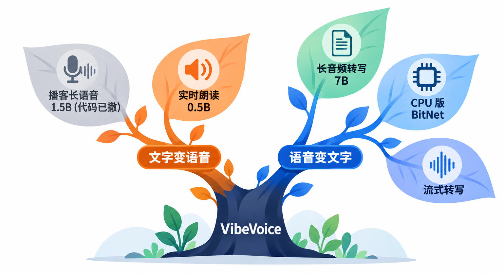
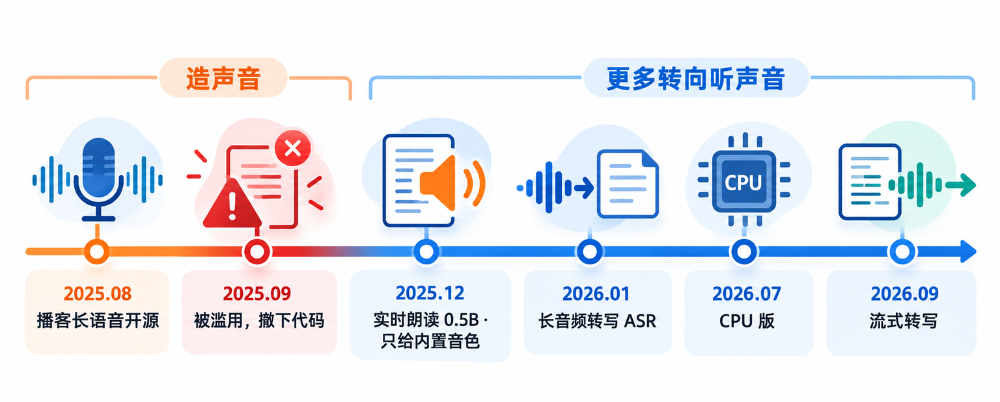
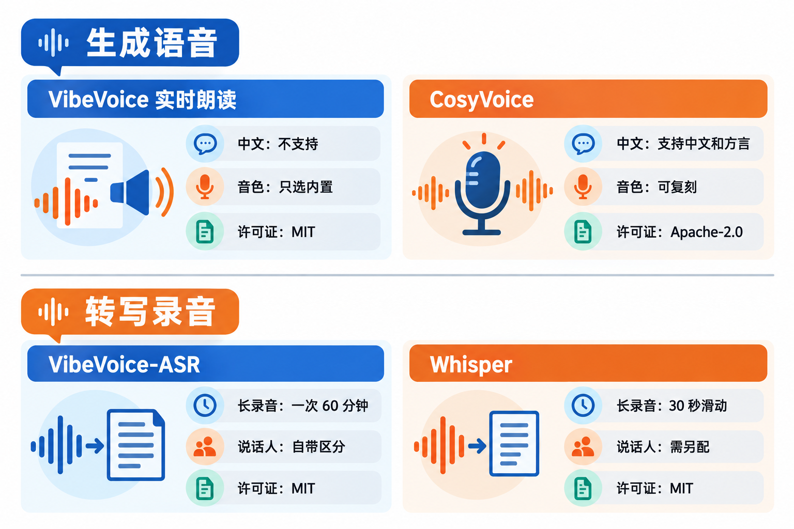
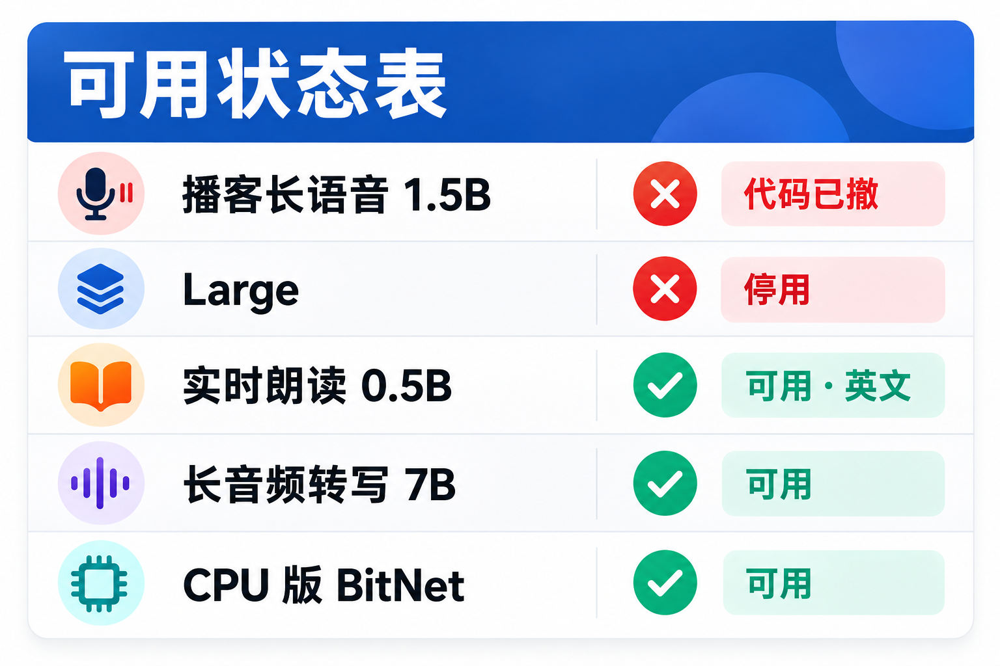
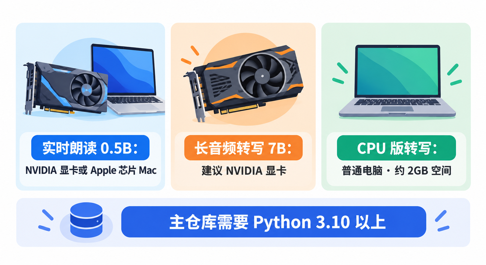
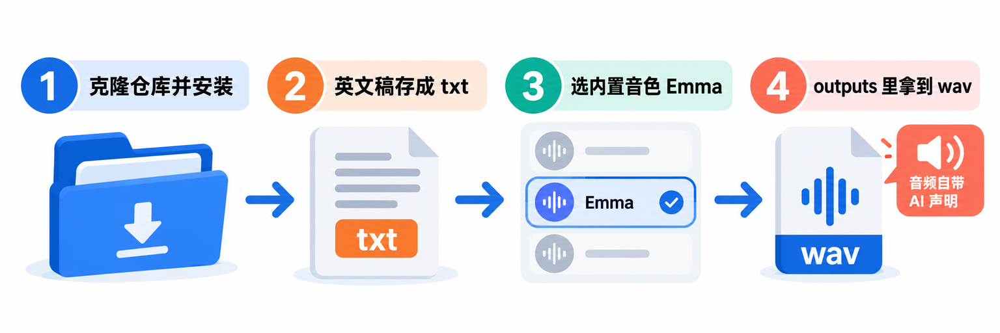
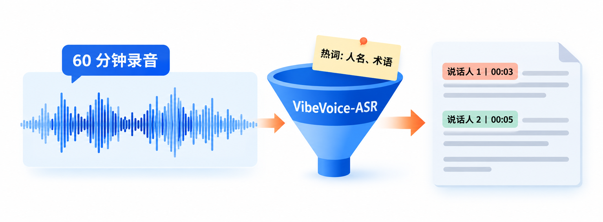
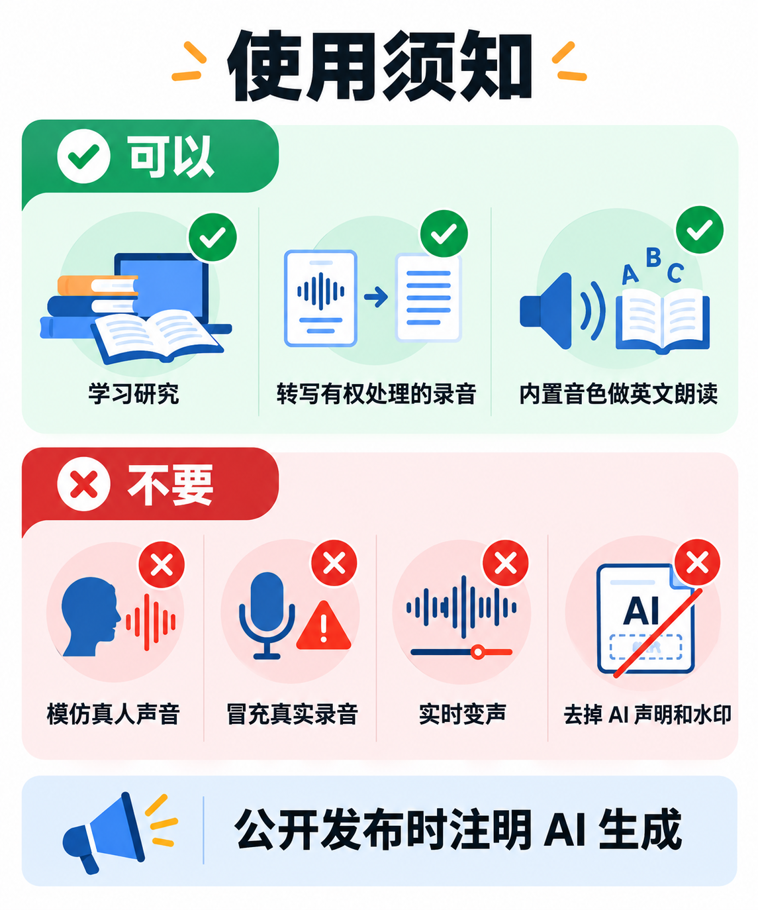

# 微软开源VibeVoice：播客长语音为什么下架了，本地还能拿它做什么

去年 8 月，微软开源了一个叫 **VibeVoice** 的语音模型：给它一段写好的对话稿，它能一口气生成最长 90 分钟、最多 4 个人轮流说话的“播客”。如果你当时收藏过教程，现在再打开仓库，会发现播客那部分的代码已经没了。

这篇把事情讲清楚：VibeVoice 到底是什么、播客模型为什么被微软自己撤下、现在官方仓库里还能在本地跑的是哪几样、需要什么电脑，以及许可证和使用限制。看完你可以做成两件事里的任意一件：**用它在本地生成一段英文长朗读**，或者**把一小时的播客、会议录音转成带“谁在什么时候说了什么”的文字稿**。

## 先认识一下：一个语音模型家族，不只是“播客生成器”



VibeVoice 是微软研究院（Microsoft Research）开源的一组语音模型，代码在 GitHub 的 `microsoft/VibeVoice` 仓库，采用 **MIT 开源协议**。VibeVoice 不是缩写，就是项目名。

它一开始只有“文字变语音”，现在已经变成一个家族，分两类：

- **文字变语音**：最早的 **VibeVoice-TTS**（1.5B 参数），主打长篇、多人对话的播客式语音；后来的 **VibeVoice-Realtime-0.5B**，主打边输入文字边出声音的实时朗读。
- **语音变文字**：**VibeVoice-ASR**（7B 参数），一次吃下 60 分钟的录音，输出带说话人和时间戳的文字稿；还有能在普通 CPU 上跑的 **BitNet 版**，以及边听边转写的**流式版**。

它的核心思路是把声音压缩成每秒只有 7.5 帧的连续“声音词元”，再让一个大语言模型去理解上下文和对话节奏，最后由一个扩散模块补出声音细节。帧率压得这么低，**处理一小时级别的长音频才算得动**，这也是整个家族都在强调“长”的原因。几个模型底下的语言模型都来自通义千问 Qwen2.5。

## 它是怎么来的：一次高调开源，一次主动下架



**2025 年 8 月 25 日**，VibeVoice-TTS 开源，技术报告第二天挂上 arXiv。它要解决的是传统语音合成的老问题：大多数模型只擅长一两个人、几十秒的短句，一旦要做几十分钟、几个人来回对话的内容，就会出现音色漂移、接话生硬。VibeVoice 在 64K 的上下文里一次生成最长 90 分钟、最多 4 个说话人的语音，这篇论文后来入选了 ICLR 2026 的口头报告（Oral）。

问题出在它的用法上：**你给一小段某个人的声音当“参考”，它就能用这个音色说话。** 这让它做播客很方便，也让它很容易被拿去模仿真人。

**2025 年 9 月 5 日**，微软在仓库首页写明：发布后发现这个工具被用在了与初衷不符的地方，出于负责任 AI 的原则，**删除了 VibeVoice-TTS 的代码**。现在文档里这部分的安装和用法只剩一句“因广泛滥用而停用”；1.5B 的模型页还在，更大的 Large 版本直接标成了停用。

之后的版本，能明显看出微软在换思路：

- **2025 年 12 月 3 日**，开源 **VibeVoice-Realtime-0.5B**。只支持单人、以英文为主，**音色只能从官方内置的几个里选**，用户无法再拿任意录音做出新音色；每段生成的音频里自动加一句能听见的 AI 声明，并嵌入听不见的水印。12 月 16 日又补了 9 种语言的实验音色和 11 个英文风格音色，其中没有中文。
- **2026 年 1 月 21 日**，开源 **VibeVoice-ASR**，方向从“造声音”转到“听声音”。3 月进入 Hugging Face Transformers 库，也上了微软的 Azure AI Foundry Labs。
- **2026 年 7 月 23 日**，发布 **VibeVoice-ASR-BitNet** 和配套的 `VibeASR.cpp`，把转写模型压到 1.58GB，普通 CPU 就能实时转写。
- **2026 年 9 月 3 日**，发布 **VibeVoice-ASR-Streaming**，录音还在进来时就开始输出“谁说了什么”。

**早期“给一段声音就能模仿”的设计**，让它在播客生成上出了名，也直接导致了下架；后来的实时朗读模型把这个能力收了回去，换来的是更安全，但也意味着你没法让它用自己想要的声音说话。

## 横向比一比：想生成语音、想转写，各该看谁



读者最可能拿来比较的，生成语音这边是阿里通义实验室开源的 **CosyVoice**，它是国内最常被推荐的开源中文语音合成模型；转写这边是 OpenAI 在 2022 年开源的 **Whisper**，几乎是本地语音转文字的默认选择。

| | VibeVoice 实时朗读 0.5B | CosyVoice 3 |
|---|---|---|
| 中文 | 不支持，以英文为主 | 支持中文和 18 种以上方言口音 |
| 音色 | 只能选官方内置音色 | 支持用参考音频复刻音色 |
| 特点 | 长篇朗读稳定，首段声音出得快 | 支持语气、方言、语速等指令控制 |
| 许可证 | 代码和模型 MIT，官方定位研究用途 | Apache-2.0 |

| | VibeVoice-ASR | Whisper |
|---|---|---|
| 中文 | 支持，50 多种语言，可中英混说 | 支持多语言 |
| 长录音 | 一次处理最长 60 分钟 | 按 30 秒一段滑动处理 |
| 区分说话人 | 自带，输出“谁、何时、说了什么” | 不自带，需要另配工具 |
| 自定义词 | 可给人名、术语等热词 | 可用提示词引导 |
| 许可证 | MIT | MIT |

**为什么选 VibeVoice**：转写这边，它把“区分说话人、打时间戳、整段理解上下文”合到了一个模型里，处理多人播客和会议录音正对路子；朗读这边，适合需要一段较长英文语音的场景，比如给英文文章配朗读、做英语听力素材。

**为什么放弃它**：要中文配音，Realtime 模型帮不上，CosyVoice 这类中文模型更合适；要自己的音色，它也不提供。从定位上看，**VibeVoice 现在最值得本地部署的其实是转写，而不是生成**。

## 第一步：看清现在能用的是哪几个



| 模型 | 做什么 | 现在的状态 |
|---|---|---|
| VibeVoice-TTS-1.5B | 播客式长语音，最多 4 人、约 90 分钟 | 模型页还在，官方代码已删除 |
| VibeVoice-Large | 同上，更大更稳 | 停用 |
| VibeVoice-Realtime-0.5B | 单人实时朗读，约 10 分钟 | 可用，以英文为主 |
| VibeVoice-ASR-7B | 一次转写 60 分钟录音，带说话人和时间戳 | 可用 |
| VibeVoice-ASR-BitNet | ASR 的 CPU 压缩版 | 可用，配合 VibeASR.cpp |

所以“在本地生成播客式的多人长语音”这件事，**用微软官方的代码现在已经做不到了**。

> **别去找“恢复版”代码来跑播客模型。** 网上能搜到一些第三方保存下来的 VibeVoice-TTS 代码，它们不是微软维护的版本。微软撤下它就是因为被滥用，模型页也明确写着：不得在未经本人明确、留有记录的同意下模仿真人声音，不得把生成的音频当成真人真实录音传播。

## 第二步：看看电脑够不够



三个能用的模型，对电脑的要求差别很大：

- **实时朗读 0.5B**：官方测试里，**NVIDIA T4 显卡和 M4 Pro 芯片的 Mac** 能做到实时生成；脚本也支持 Apple 芯片的 `mps` 和纯 CPU，只是更弱的设备速度需要自己试。没有合适的电脑，官方还提供了 Colab 笔记本，可以在浏览器里先听效果。
- **长音频转写 7B**：官方推荐用 NVIDIA 的 PyTorch 容器来管理 CUDA 环境，也就是说**主力是带 NVIDIA 显卡的 Linux 机器**。没有显卡的话，直接看下面的 CPU 版。
- **CPU 版转写 BitNet**：模型压缩到 1.58GB，代码加模型约 2GB 硬盘空间，需要 Python 3.9 以上、CMake 3.14 以上和 GCC 或 Clang 编译器。官方测试里，Apple M4 和 Intel i7-13700 都能实时转写。Windows 上不支持微软自家的 MSVC 编译器，要用 MinGW。

VibeVoice 主仓库要求 **Python 3.10 或更新**。

## 第三步：在本地生成一段英文长朗读



下面的命令来自官方文档，在 macOS 或 Linux 的终端里执行。先建一个独立的 Python 虚拟环境，免得和电脑里其他项目的依赖打架：

```bash
git clone https://github.com/microsoft/VibeVoice.git
cd VibeVoice/
python3 -m venv .venv
source .venv/bin/activate
pip install -e ".[streamingtts]"
```

`[streamingtts]` 外面的双引号是为了兼容 macOS 默认的 zsh，在 bash 里加不加都一样。这一步会装上 PyTorch 等一大批依赖，需要等一会儿。

然后把你要朗读的**英文**稿子存成一个文本文件，比如 `my_script.txt`，放在 `VibeVoice` 目录下。仓库里自带了一个示例 `demo/text_examples/1p_vibevoice.txt`，第一次可以直接用它。运行：

```bash
python demo/realtime_model_inference_from_file.py --model_path microsoft/VibeVoice-Realtime-0.5B --txt_path my_script.txt --speaker_name Emma
```

第一次运行会从 Hugging Face 下载模型。跑完后，音频保存在 `outputs/my_script_generated.wav`，终端里还会打印生成用时和实时率。

`--speaker_name` 用来选音色，仓库自带的英文音色有 Carter、Davis、Emma、Frank、Grace、Mike 和 Samuel。想试别的语言，可以先运行官方脚本下载实验音色：

```bash
bash demo/download_experimental_voices.sh
```

几个实用的小提醒：稿子里**不要放代码、公式和生僻符号**，模型读不了，先改成普通文字；**特别短的输入（三个词以内）不稳定**；单次能生成的长度约 10 分钟，更长的内容拆成几段分别生成。想要边打字边出声的网页演示，可以运行 `python demo/vibevoice_realtime_demo.py --model_path microsoft/VibeVoice-Realtime-0.5B`，它默认用 NVIDIA 显卡，Apple 芯片的 Mac 在命令末尾加上 `--device mps`。

> **它只适合英文。** Realtime 模型以英文训练，中文稿子会得到不可预期的结果，官方提供的实验语言里也没有中文。需要中文配音，换用支持中文的模型。

## 第四步：把一小时的播客或会议录音转成文字稿



这是 VibeVoice 现在对中文用户最有用的部分。它一次吃下最长 60 分钟的音频，**同时完成转写、区分说话人和打时间戳**，不用先切段、再拼接、再另配说话人识别工具。还可以提前告诉它热词，比如嘉宾的名字、行业术语，减少同音字错误。

**最省事：先在网页上试。** 官方提供了在线体验页 `aka.ms/vibevoice-asr`，上传一段音频就能看效果。注意这意味着录音会传到在线服务上处理。

**有 NVIDIA 显卡：跑完整的 7B 模型。** 在同一个 `VibeVoice` 目录下（这次装完整依赖）：

```bash
pip install -e .
python demo/vibevoice_asr_inference_from_file.py --model_path microsoft/VibeVoice-ASR --audio_files 你的录音.wav
```

想要网页界面，官方也提供了 Gradio 演示，需要先装好 ffmpeg：

```bash
python demo/vibevoice_asr_gradio_demo.py --model_path microsoft/VibeVoice-ASR
```

**只有普通电脑：用 CPU 版 VibeASR.cpp。** 按官方的手动构建方式，先编译，再下载已经量化好的模型（macOS 上把 `$(nproc)` 换成 `$(sysctl -n hw.ncpu)`）：

```bash
git clone --recursive https://github.com/microsoft/VibeASR.cpp.git
cd VibeASR.cpp
cmake -B build -DCMAKE_BUILD_TYPE=Release
cmake --build build -j$(nproc)
pip install huggingface_hub
huggingface-cli download microsoft/VibeVoice-ASR-BitNet --local-dir models/vibeasr
```

然后用官方命令转写一个 wav 文件，`-t 4` 表示用 4 个 CPU 线程：

```bash
./build/bin/asr_infer \
    --vae-model models/vibeasr/vibeasr-vae-encoder-i8_s.gguf \
    --lm-model models/vibeasr/vibeasr-lm-i2_s-embed-q6_k.gguf \
    --audio input.wav -t 4
```

CPU 版把底下的语言模型从 Qwen2.5-7B 换成了 Qwen2.5-1.5B，再经过量化压到 1.58GB，代价是准确率略有下降，在部分中文会议测试集上下降得更明显。**先用 CPU 版跑通，觉得错字多再考虑上显卡跑 7B**，是比较稳妥的顺序。

> **只转写你有权处理的录音。** 别人的会议、通话录音，转写前先征得参与者同意；涉及隐私的录音别传到在线体验页，用本地方式处理。

## 许可证和使用限制：MIT 不等于什么都能做



VibeVoice 的代码和模型权重都是 **MIT 协议**，这是最宽松的开源协议之一。但模型页上还写了几条必须知道的边界：

- **官方定位是研究和开发用途。** 微软明确表示，不建议未经进一步测试和开发就用在商业或真实生产场景。
- **明确不允许的用法**：未经本人明确、留有记录的同意就模仿真人声音；把生成的音频当成真人或真实事件的录音传播；电话、视频会议里的实时变声；以及任何绕过、禁用安全措施的做法，包括去掉水印和 AI 声明。
- **生成的音频自带标记。** 每段音频里会有一句能听到的 AI 声明，还有听不见的水印，第三方可以据此验证来源。
- **公开分享时注明是 AI 生成。** 这是官方给出的建议做法，国内平台对 AI 生成内容也有标识要求。

转写模型不涉及合成声音，限制少很多，但处理别人的录音时，隐私和授权同样要自己把关。

## 写在最后

如果你手上正好有一段长录音，最值得先试的是转写：**没有显卡就用 VibeASR.cpp 在 CPU 上跑，有 NVIDIA 显卡就直接上 7B 模型**，看看它分出来的说话人和时间戳是不是比你现在用的工具省事。想听听它的朗读水平，用 Realtime 模型和内置的 Emma 音色读一段英文就够了；需要中文配音，就把目光转向 CosyVoice 这类中文模型。

## 参考资料

<div class="sources">
<p>VibeVoice 官方：<a href="https://github.com/microsoft/VibeVoice">microsoft/VibeVoice（GitHub，README、LICENSE）</a>、<a href="https://microsoft.github.io/VibeVoice">项目主页</a>、<a href="https://github.com/microsoft/VibeVoice/blob/main/docs/vibevoice-tts.md">VibeVoice-TTS 文档</a>、<a href="https://github.com/microsoft/VibeVoice/blob/main/docs/vibevoice-realtime-0.5b.md">VibeVoice-Realtime-0.5B 文档</a>、<a href="https://github.com/microsoft/VibeVoice/blob/main/docs/vibevoice-asr.md">VibeVoice-ASR 文档</a>、<a href="https://github.com/microsoft/VibeVoice/blob/main/docs/vibevoice-asr-streaming.md">VibeVoice-ASR-Streaming 文档</a>。</p>
<p>模型页（Hugging Face）：<a href="https://huggingface.co/microsoft/VibeVoice-1.5B">VibeVoice-1.5B</a>、<a href="https://huggingface.co/microsoft/VibeVoice-Realtime-0.5B">VibeVoice-Realtime-0.5B</a>、<a href="https://huggingface.co/microsoft/VibeVoice-ASR">VibeVoice-ASR</a>、<a href="https://huggingface.co/microsoft/VibeVoice-ASR-BitNet">VibeVoice-ASR-BitNet</a>；CPU 推理：<a href="https://github.com/microsoft/VibeASR.cpp">microsoft/VibeASR.cpp</a>；在线体验：<a href="https://aka.ms/vibevoice-asr">VibeVoice-ASR Playground</a>。</p>
<p>论文：<a href="https://arxiv.org/abs/2508.19205">VibeVoice Technical Report</a>、<a href="https://openreview.net/forum?id=FihSkzyxdv">ICLR 2026 页面</a>、<a href="https://arxiv.org/pdf/2601.18184">VibeVoice-ASR Technical Report</a>、<a href="https://arxiv.org/abs/2607.21075">VibeVoice-ASR-BitNet Technical Report</a>。</p>
<p>对比参照：<a href="https://github.com/FunAudioLLM/CosyVoice">FunAudioLLM/CosyVoice（GitHub）</a>、<a href="https://github.com/openai/whisper">openai/whisper（GitHub）</a>。</p>
<p>资料核对于 2026 年 10 月 18 日。文中命令来自官方文档，写作时未实际运行。模型状态、可用音色和硬件要求以官方仓库当前页面为准。配图为示意图，不是产品界面截图。</p>
</div>
