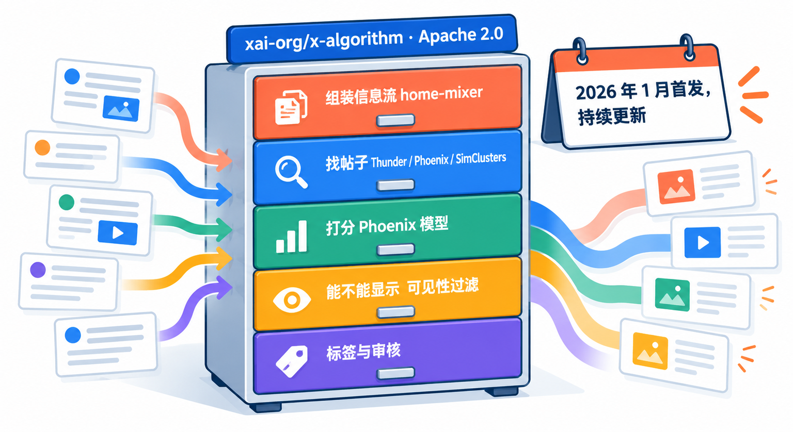
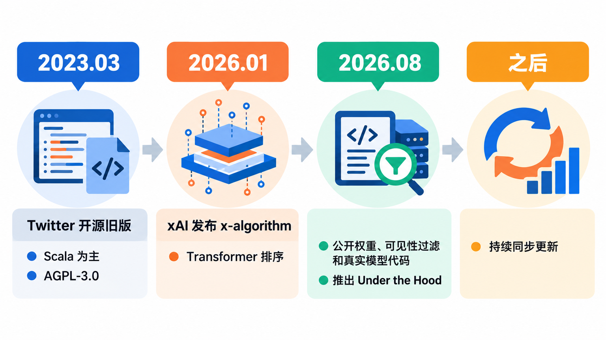
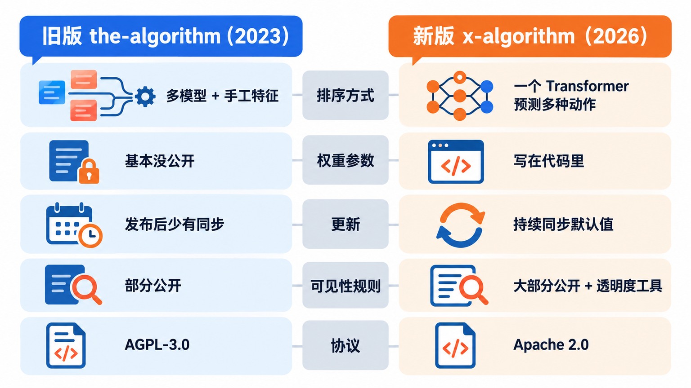
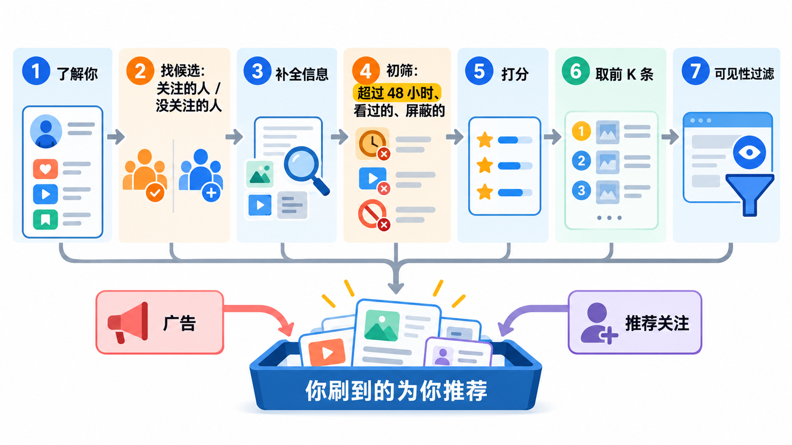
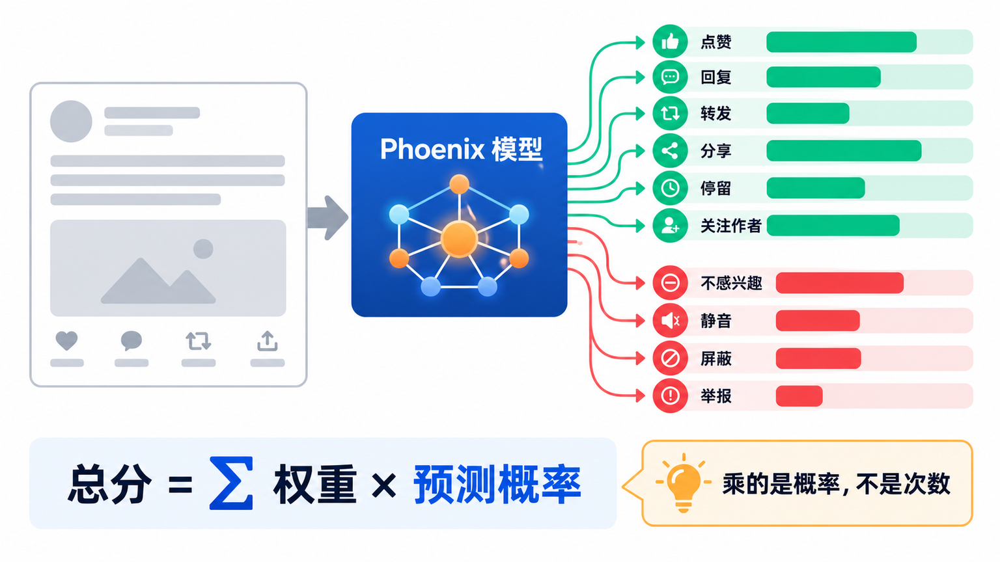
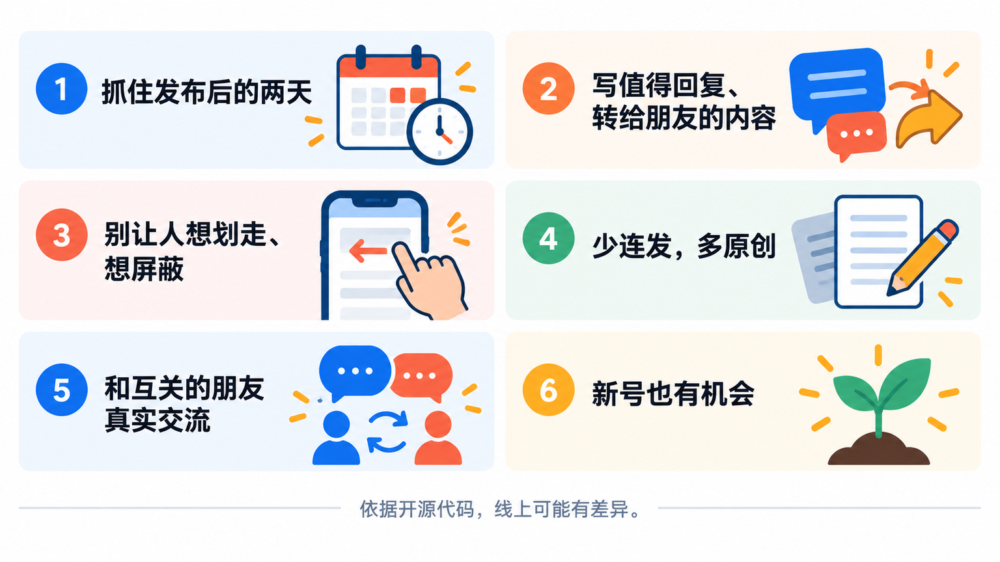

# X的推荐算法开源了：「为你推荐」怎么给帖子排序，写帖子该注意什么

在 X（原 Twitter）上发帖，最常听到的说法是“带链接会被限流”“一天发太多会被降权”“被举报一次就完了”。这些说法大多来自猜测。现在不用猜了：xAI 把 X「为你推荐」（For You）信息流的核心代码放在了 GitHub 上，连打分用的权重都写在代码里，而且一直在更新。

这篇带你读懂这个仓库：一条帖子从发出到出现在别人的「为你推荐」里，要经过哪几关；模型怎么打分，哪些行为加分、哪些扣分；最后根据代码给出几条写帖子的建议。所有结论只依据仓库代码和官方说明，看完你也可以自己去仓库里核对。

## 先看清楚：这个仓库是什么



仓库地址是 `xai-org/x-algorithm`，由 xAI 发布，开源协议是 Apache 2.0。官方 README 第一句就说明了范围：这里是**决定一个人在「为你推荐」里看到哪些帖子的核心代码**。它只管「为你推荐」这一条信息流，不包括搜索、通知，也不包括广告怎么投放。

仓库里的东西可以分成五块：

- **home-mixer**：组装信息流的总调度，负责把下面各个环节串起来，打分权重也放在这里。
- **候选来源**：从哪里找帖子，包括 Thunder、Phoenix 检索、SimClusters 和一份热门帖子列表。
- **Phoenix 模型**：一个 Transformer 模型，预测你看到某条帖子后会做出各种动作的概率，训练和推理代码都在，用 JAX 写模型、用 Rust 写服务层。
- **可见性过滤**：决定一条帖子能不能给你看、要不要加提示，和排序是两套独立的系统。
- **内容理解与标签**：给帖子和账号打标签的各种分类器和规则，比如识别垃圾内容、成人内容、不真实的账号行为。

仓库还附带了一份合成数据生成代码，Phoenix 可以在本地用假数据完整跑一遍训练和推理。不过对大多数人来说，**读懂它比运行它更有用**。

## 它是怎么来的：从 Twitter 的旧仓库到今天



X 开源推荐算法不是第一次。**2023 年 3 月 31 日**，当时还叫 Twitter 的公司在 GitHub 上发布了 `twitter/the-algorithm`，同时在工程博客上写了一篇说明。那个仓库以 Scala 和 Java 为主，开源协议是 AGPL-3.0，覆盖了「为你推荐」和推荐通知，里面有 SimClusters（社区聚类）、TwHIN（用户与帖子的向量表示）、real-graph（预测两个用户互动的可能性）、tweepcred（用 PageRank 算账号信誉）等一大批组件。不过那次发布没有公开模型权重和训练数据，很多关键参数也只露出了名字。旧仓库之后基本没有再跟着线上一起更新。

新仓库 `xai-org/x-algorithm` 在 **2026 年 1 月**首次发布。第一版 README 写得很直接：系统里**去掉了所有手工设计的特征和大部分规则**，排序交给一个基于 Grok 的 Transformer 模型，它的实现移植自 xAI 之前开源的 Grok-1。模型直接读你最近的互动历史（点赞、回复、转发等），判断哪些帖子和你相关。

**2026 年 8 月**是一次大更新。官方补上了三样东西：打分用的关键配置参数（包括各种动作的权重）；决定帖子会不会被过滤掉的各个系统，比如可见性过滤和给账号打标签的规则；以及把 Phoenix 的演示模型换成了线上真正用的模型代码。同时上线了一个叫 **Under the Hood** 的透明度工具，让人能看到自己的账号和帖子被打了哪些会影响曝光的标签。之后 README 又陆续记录了几次更新，比如 9 月起报告里会显示帖子是否因为某国的法律要求被限制显示。

从这条线看，新仓库和旧仓库最大的不同在于**它是持续同步的**。官方说明，很多可调的数值放在配置系统里，他们用定时脚本把仓库代码里的默认值同步成线上的主要取值；占到较大流量（比如 10% 以上）的实验，目标也是在仓库里能看到。仓库里还专门放了一份文档，用“互关好友回复加权”这个改动做例子，演示一次算法调整会在代码里留下怎样的痕迹。

## 横向比一比：新旧两个仓库



想研究 X 的推荐，读者最可能拿来比较的就是这两个仓库：网上很多“X 算法解读”文章引用的其实是 2023 年的旧版，和今天线上的系统已经不是一回事。用同一组维度比一下：

| | 旧版 `twitter/the-algorithm` | 新版 `xai-org/x-algorithm` |
|---|---|---|
| 发布 | 2023 年 3 月，Twitter | 2026 年 1 月首发，xAI |
| 主要语言 | Scala、Java、Python | Rust、Python（JAX） |
| 排序思路 | 轻量排序加重排序模型，配大量手工特征 | 一个 Transformer 读互动历史，预测多种动作概率 |
| 权重参数 | 大多没有公开 | 打分权重写在代码里 |
| 模型代码 | 没有权重和训练数据 | 公开训练与推理代码，附合成数据 |
| 更新 | 发布后很少跟进 | 定期同步线上默认值 |
| 开源协议 | AGPL-3.0 | Apache 2.0 |

**为什么看新版**：它对应的是今天的「为你推荐」，权重和过滤规则都能直接查到，改动也有记录。**旧版还有什么用**：新版里的 SimClusters、用 PageRank 给账号算分的 user-cred-v2，都能在旧版里找到前身；想了解这些组件的来龙去脉，旧版的文档更完整。

从实用角度说，**看到别人引用“X 算法”时，先确认他引用的是哪个仓库、哪个时间点的代码**。旧版里的结论放到今天，很可能已经不成立了。

## 一条帖子要过几关



每次你刷新「为你推荐」，home-mixer 都会现场组装一份信息流，大致分七步：

1. **了解你**：取出你最近的互动序列（这是模型最主要的输入），以及关注列表、屏蔽和静音的账号、静音关键词、已经看过的帖子、关注的话题等。
2. **找候选帖子**：几个来源同时查。**关注圈内**的帖子来自 Thunder，它在内存里保存着各账号最近发布的帖子；**关注圈外**的帖子来自 Phoenix 检索（把你和每条帖子都变成向量，找离你最近的）、SimClusters（按“谁和什么内容互动”把账号和帖子分成社区，再从社区里找），以及一份共享的近期热门帖子列表。
3. **补全信息**：给每条候选帖子补上正文、图片视频、作者信息和账号标签、语言、互动数等。
4. **初筛**：去掉各来源重复的帖子、**发布超过 48 小时的帖子**、你自己的帖子、你屏蔽或静音的账号、命中你静音关键词的帖子、你已经看过的帖子，还有你没关注的人发的转发和回复。
5. **打分**：Phoenix 模型给每条帖子算出各种动作的概率，再加权合成一个总分，下一节细讲。
6. **选出前 K 条**：按总分排序，留下排在前面的。
7. **可见性过滤**：顺序定好之后，再逐条检查这条帖子能不能给你看，有的直接拿掉，有的加上提示或遮罩。

最后，排好的帖子会和广告、“推荐关注”等内容合在一起，才是你刷到的样子。

这条流水线里有两点值得记住。一是**排序和能不能显示是两件事**：分数高只决定位置，能不能出现由可见性过滤单独决定，两套系统输入不同、规则也不同。二是 **48 小时的硬门槛**：超过两天的帖子根本进不了候选，「为你推荐」本质上只推近期内容。

## 模型怎么打分：预测你会做什么



Phoenix 不直接判断一条帖子“好不好”，而是预测**你**看到它之后，做出每一种动作的概率。官方 README 列出的动作分五类：

- **互动**：点赞、回复、转发、引用、分享、私信分享、复制链接
- **点击**：点开帖子、点开主页、点链接、展开图片、打开视频、点开被引用的帖子
- **注意力**：停留、停留时长、视频继续观看的时长、主页停留时长等
- **作者**：关注作者
- **负面**：不感兴趣、静音作者、屏蔽作者、举报、划过没停留

然后用一个很简单的公式合成总分：**总分 = 每种动作的权重 × 这种动作的预测概率，再全部相加**。正面动作的权重是正数，负面动作的权重是负数。

这些权重就写在 `home-mixer/params/param.rs` 里。下面摘出几项，取自本文写作时仓库里的默认值：

| 动作 | 权重 | 动作 | 权重 |
|---|---|---|---|
| 点赞 | 0.66 | 关注作者 | 4.0 |
| 回复 | 5.0 | 复制链接分享 | 20.0 |
| 转发 | 1.0 | 不感兴趣 | -52.272 |
| 引用 | 5.0 | 屏蔽作者 | -31.2 |
| 分享 | 2.0 | 静音作者 | -58.8 |
| 私信分享 | 5.0 | 举报 | -234.0 |

> **权重不能直接拿来换算。** 官方在 README 和代码注释里专门澄清过：权重乘的是“你会做这个动作的预测概率”，不是帖子已经收到的点赞数、举报数。所以“举报权重是点赞的几百倍，一次举报抵消几百个赞”是错误的理解。举报本身极少发生，它的基础概率比点赞低一千倍以上，权重调高是为了让这个预测能对排序起作用；而且推荐是个性化的，恶意举报主要影响和举报者相似的那批用户。

算出加权总分后，还有三处调整：

- **作者多样性**：同一个作者在同一次推荐里的第二条、第三条帖子，分数会乘上一个逐渐变小的系数，但不会低于某个下限。
- **关注圈外打折**：你没关注的人发的帖子，分数乘一个小于 1 的系数；你关注的人发的回复和转发，也一样打折。
- **新作者扶持**：曝光量还很少的作者，帖子会被往前提一提。代码里这项扶持只针对发布不久的帖子，作者粉丝数也有上限。

最后还有一步重排：一个叫 vm-ranker 的服务会看帖子之间的相似度，**宁可损失一点分数，也让相邻的帖子别太像**，避免你连续刷到同一类内容。

还有一个 2026 年 7 月上线的调整值得单独说：**互关好友的原创帖子，回复的权重会额外加上一截**。官方文档记录了它的经过：先小流量测试 5、10、15、20 几档，之后大范围上线 20，又因为有用户反映世界杯期间看到的相关讨论变少（很多讨论来自没关注的账号），调回到 15。今天代码里的取值就是 15。

## 能不能显示：可见性过滤和标签


排好顺序之后，每条帖子还要过可见性过滤。它对每一条帖子、每一位读者给出四种答复之一：**正常显示、加提示显示、遮罩后可点开、不显示**。

判断依据有两类。一类是读者自己的情况：有没有屏蔽或静音作者、有没有关注作者、个人设置和所在国家。另一类是**帖子和账号身上的标签**，这些标签由仓库里另一批系统持续打上，比如：

- grox 在帖子发布时运行，识别垃圾内容、成人内容、暴力内容等类别；
- agatha 根据别人对一个账号的反应打标签，看的是屏蔽、举报、垃圾举报相对于点赞的比例；
- bdsm（仓库里的组件名）读取一个账号随时间的行为序列，识别不真实或滥用的迹象；
- user-cred-v2 在关注关系和互动关系上跑 PageRank，给每个账号算一个分数。

有个细节很关键：**有一组规则只在“推荐给没关注你的人”时生效，而且只会拿掉帖子**，比如为了尽量多拦住垃圾内容而放宽了判定的规则。同一条帖子，你的粉丝照样能看到，但它很难被推荐给陌生人。另外，如果一条帖子被拿掉，引用它、转发它、回复它的帖子也会跟着被拿掉。

想知道自己的账号有没有被打上这类标签，可以试试官方的 **Under the Hood** 工具，它会汇总显示你的账号和帖子上影响曝光的标签。官方说明它还在试点，会逐步扩大开放范围，能不能用以你打开时的页面为准。

> **开源代码不等于线上的全部。** 官方明确说明，为了防止有人钻空子，一部分文件没有公开，比如 grox 里具体的大模型提示词和一部分打标签规则；线上还会在小部分流量上跑各种实验，代码里的数值只是主要的默认值。所以读代码能看懂规则的大方向，但不能据此精确预测某一条帖子的曝光。

## 根据代码，写帖子可以注意什么



把上面的机制落到发帖上，可以得出几条比较扎实的建议。它们都能在代码里找到对应，但请记住上一条提醒：这是方向，不是公式。

**一、帖子的有效期很短。** 超过 48 小时的帖子进不了候选，新作者扶持也只看刚发出不久的帖子。重要的内容，发在你的读者活跃的时候，发出后有人回复就及时回应。

**二、写值得回复和转给朋友的内容。** 回复、引用、私信分享的权重都是点赞的好几倍，复制链接分享更高，关注作者也有不小的权重。一条能让人想说两句、想转给某个朋友、看完想关注你的帖子，比一条只会被顺手点赞的帖子更占优势。提一个具体的问题、分享一个别人用得上的方法，都比空泛的感慨更容易引出这些动作。

**三、负面反馈的代价很重。** “不感兴趣”、静音、屏蔽、举报都是大额负权重，“划过没停留”也会扣一点分，而停留和停留时长是加分项。标题党、和正文无关的热门标签、引战内容，也许能骗到一次点击，但模型学到的是“这类人看到你的帖子会想划走甚至屏蔽”，长期来看得不偿失。

**四、少刷屏，多原创。** 作者多样性会让同一作者在一次推荐里的后续帖子逐步打折；没关注你的人发的转发和回复，在初筛阶段就被拿掉了，关注圈内的回复和转发也会打折。想被更多人看到，主要靠原创帖。

**五、和互关的朋友真实交流。** 互关好友的原创帖子，回复权重额外加了一截。和真正互关、真正有共同话题的朋友互相回复讨论，正好对上这项设计。

**六、新号也有机会。** 曝光量还很少的作者会被往前提一提，新号不必一上来就追求粉丝数，先把内容写好。

还有几件事，代码给出的答案和流传的说法不一样。比如“带外链就会被限流”：在打分权重里，点链接是加分项，代码里也没有看到直接针对外链的扣分项；能看到的是，帖子是否带外链会作为特征之一交给重排服务。至于读者会不会因为要跳出去而少停留、少互动，那是模型从数据里学到的，不是一条写死的规则。

> **别把这些机制当成“漏洞”去钻。** 代码里专门有识别不真实行为的模型、处理垃圾内容的规则和执法服务，被判定的账号可能被打标签、要求验证甚至封停。互刷、批量互动、频繁换号这些做法，正是这些系统要抓的对象，也违反 X 的平台规则。

## 想自己读代码，从哪开始

仓库很大，文件有两千多个，不必从头看。想自己核对上面的内容，可以先把仓库下载下来：

```bash
git clone https://github.com/xai-org/x-algorithm.git
```

然后按这个顺序看：

1. **`README.md`**：最好的入口，流水线图、组件表、打分公式、过滤器列表都在里面，开头的 Notable Updates 记录了每次重要更新。
2. **`home-mixer/params/param.rs`**：各项权重和开关的默认值，搜索 `Weight` 就能找到上面表格里的数字，权重上方还有官方写的解释注释。
3. **`xai-value-model/scoring.rs`**：总分具体怎么算，作者多样性和关注圈外打折怎么乘上去。
4. **`home-mixer/filters/`**：每一个过滤器一个文件，文件名和 README 里的过滤器表一一对应。
5. **`docs/BIDIRECTIONAL_BOOST_CHANGE.md`**：用一次真实的调整演示算法改动在代码里的样子，适合想跟踪后续更新的人。

不想下载的话，直接在 GitHub 网页上打开这些文件也一样。英文读着吃力，可以把 README 和对应的代码文件交给 AI 助手，让它解释给你听；官方在 8 月的更新里提到，给权重加注释的目的之一，就是让大模型和读者都更不容易读错。另外，仓库会持续更新，**以后再看到“X 算法又改了”的消息，可以直接去仓库的提交记录里找对应的改动**。

## 写在最后

这次开源最有价值的地方，不是给出了一套“爆款公式”，而是把很多猜测变成了可以核对的事实：帖子只有两天的窗口、模型在预测每一位读者的反应、负面反馈分量很重、排序和能不能显示是两套系统。顺着这个逻辑去写真正有人愿意回复和转给朋友的内容，比研究任何技巧都靠谱。有空的话，打开仓库的 README 读一遍，十几分钟就能对「为你推荐」有个完整的印象。

## 参考资料

<div class="sources">
<p>新版官方仓库：<a href="https://github.com/xai-org/x-algorithm">xai-org/x-algorithm（GitHub，README、LICENSE）</a>，文中引用的文件包括 <a href="https://github.com/xai-org/x-algorithm/blob/main/home-mixer/params/param.rs">home-mixer/params/param.rs</a>、<a href="https://github.com/xai-org/x-algorithm/blob/main/xai-value-model/scoring.rs">xai-value-model/scoring.rs</a>、<a href="https://github.com/xai-org/x-algorithm/tree/main/home-mixer/filters">home-mixer/filters/</a>、<a href="https://github.com/xai-org/x-algorithm/blob/main/docs/BIDIRECTIONAL_BOOST_CHANGE.md">docs/BIDIRECTIONAL_BOOST_CHANGE.md</a>、<a href="https://github.com/xai-org/x-algorithm/blob/main/phoenix/README.md">phoenix/README.md</a>，以及仓库提交记录中 2026 年 1 月的首个版本。</p>
<p>Under the Hood 透明度工具：<a href="https://x.com/i/jf/under_the_hood">x.com/i/jf/under_the_hood</a>。</p>
<p>旧版官方仓库：<a href="https://github.com/twitter/the-algorithm">twitter/the-algorithm（GitHub，README、COPYING）</a>、<a href="https://blog.x.com/engineering/en_us/topics/open-source/2023/twitter-recommendation-algorithm">Twitter's Recommendation Algorithm（X 工程博客，2023）</a>。相关报道：<a href="https://techcrunch.com/2023/03/31/twitter-reveals-some-of-its-source-code-including-its-recommendation-algorithm/">TechCrunch，2023 年 3 月 31 日</a>。</p>
<p>资料核对于 2026 年 10 月 26 日，对应仓库 2026 年 10 月 24 日的版本。文中命令可以确定正确，写作时未实际运行。权重和参数取自写作时仓库代码里的默认值，会随更新变化，线上还有实验流量，以仓库当前代码为准；写帖子的建议是作者根据代码得出的看法。配图为示意图，不是产品界面截图。</p>
</div>
