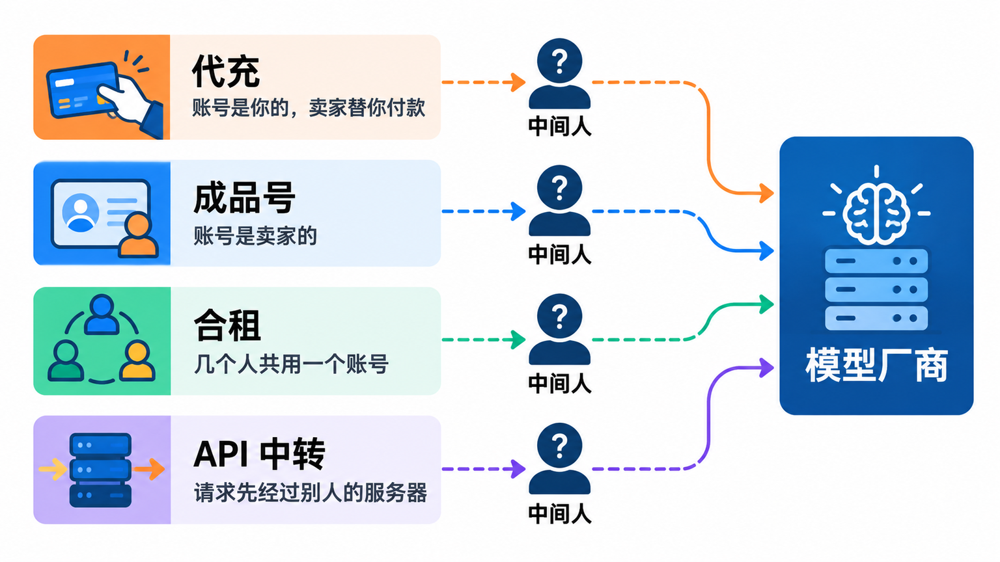
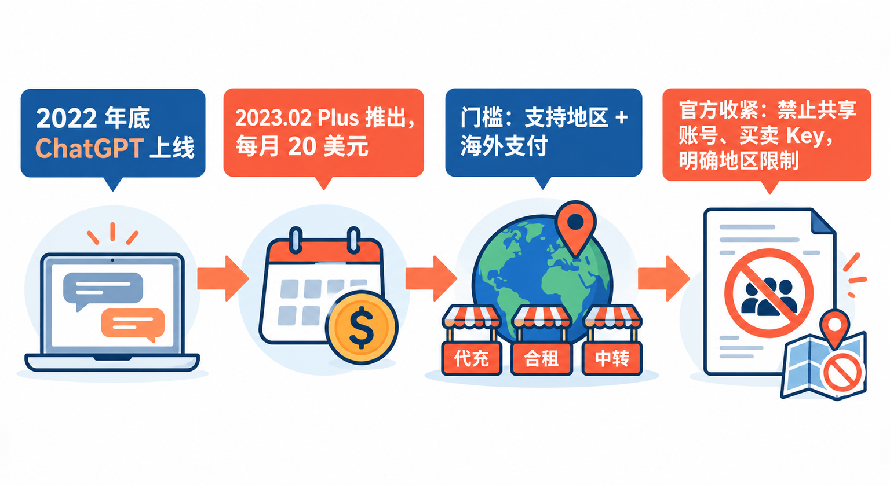
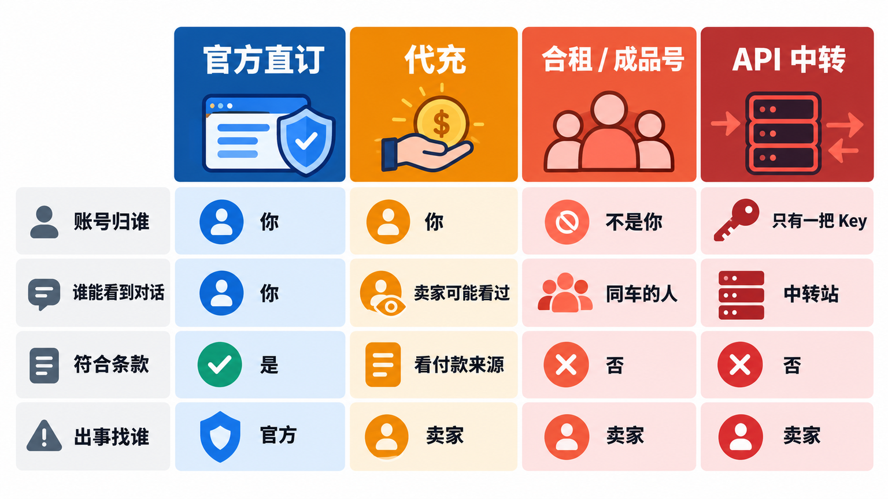
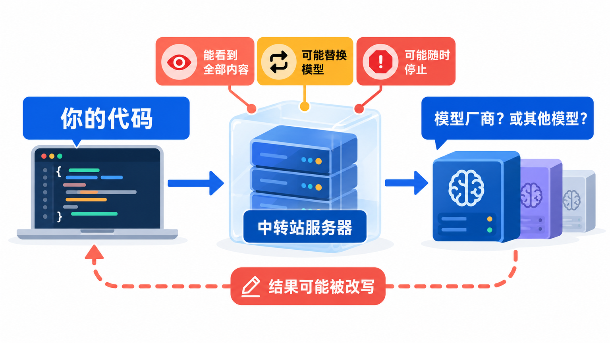
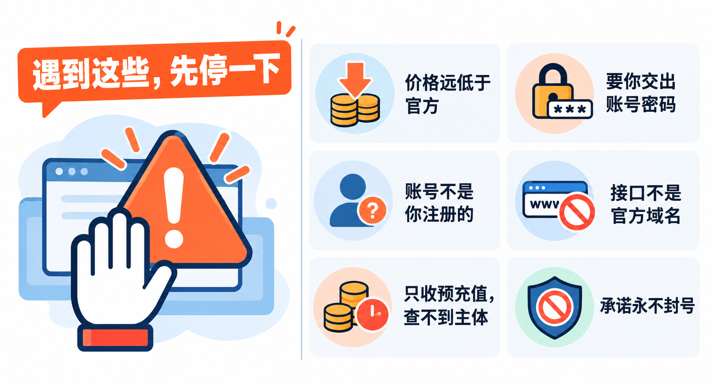

# ChatGPT代充、合租和API中转：便宜在哪，坑在哪

在群里、二手平台和各种小站上，总能看到这样的价格：ChatGPT Plus 代充比官网便宜一大截，“四人合租一个账号，每月只要几十块”，还有号称“官方原版接口、价格一折”的 API 中转。对想用 ChatGPT、Claude 又嫌麻烦的人来说，这些很诱人。

这篇不推荐任何渠道，只做一件事：**把这几种低价玩法分别是怎么回事、官方条款怎么规定、可能出什么事、怎么辨别讲清楚**。看完之后，你再遇到“便宜好几倍”的报价，至少知道自己买的到底是什么。

## 先分清：市面上的低价玩法有哪几种

名字五花八门，归纳起来大致是四类：

**代充**：账号是你自己的，你把账号交给卖家，或者给卖家一个付款链接，由卖家用他手里的支付方式帮你开通订阅。你付给卖家人民币，卖家替你付美元。

**成品号**：卖家直接给你一个已经开好会员的账号，账号不是你注册的，邮箱、密码、绑定的手机号都在卖家手里。

**合租（拼车）**：几个人共用一个付费账号，或者共用一个团队工作区里的席位，每人分摊费用。常见形式是卖家给你一个登录入口或者一组账号密码。

**API 中转**：卖家给你一个他自己网站的接口地址和一把“Key”，你在代码或者客户端里把官方地址换成他的。你发出去的请求先到他的服务器，再由他转发给模型厂商（或者别的什么地方），结果再传回来。

这四类的共同点是：**你和模型厂商之间，多了一个你不认识的中间人**。差别只在于这个中间人掌握了你多少东西：代充时是你的账号和付款，成品号和合租时是整个账号，API 中转时是你发出的每一个请求。

## 这些生意是怎么来的

ChatGPT 在 2022 年底上线后，OpenAI 于 **2023 年 2 月 1 日**推出 ChatGPT Plus，每月 20 美元，先面向美国用户，几天后开放给美国以外的地区。Claude、Gemini 后来也都有了类似的付费订阅。

需求一下子起来了，门槛也跟着出现：**一是地区，二是支付**。OpenAI 和 Anthropic 都公开了自己的支持国家和地区列表，中国内地和香港都不在其中；订阅通常要海外信用卡或应用商店付款。低价代充、成品号、合租和 API 中转，本质上都是在卖“替你跨过门槛”这件事，再加上“比官方便宜”这个卖点。

厂商这边，这几年是在一步步把规则写得更明确：

- OpenAI 的使用条款写明，**不能分享账号登录信息，也不能把账号提供给其他人使用**，账号下发生的一切活动由账号持有人负责。帮助中心还专门有一篇账号共享政策，说明账号是给注册者本人用的，其他人需要用就各自注册。
- OpenAI 面向企业和开发者的服务协议写明，客户**不得在多个用户之间共享登录凭据，不得转售或出租账号访问权限**，也**不得从第三方购买、向第三方出售或转让 API Key**。
- Anthropic 的消费者条款写明，**不能把账号登录信息、API Key 或账号凭据分享给任何人，也不能把账号提供给别人使用**，不能转售服务；商业条款同样规定，未经 Anthropic 明确批准不得转售服务。
- 2025 年 9 月，Anthropic 发布公告，把限制扩展到**由不受支持地区的公司控股超过 50% 的实体**，理由是有公司通过在其他国家设立子公司来绕过地区限制。它的支持地区政策（最新版本 2026 年 11 月 12 日生效）明确写出：人身处不受支持地区时的使用、在不受支持地区注册或总部设在那里的实体的使用，都在限制范围内。
- OpenAI 的支持国家页面写明，从列表以外的地区访问，**可能导致账号被封禁或暂停**。

从这个过程看，低价渠道卖的东西，恰好落在官方条款明确禁止的那几条上：共享账号、转售访问权限、买卖 API Key、在不受支持的地区使用。**这不是“灰色地带”，条款写得很清楚，只是平台不一定马上发现。**

## 横向比一比：官方直订和三种低价渠道

读者最可能拿来比较的，就是“自己去官方订阅”和这几种低价方式。用同样几个维度放在一起看：

| | 官方直订 | 代充 | 合租 / 成品号 | API 中转 |
|---|---|---|---|---|
| 账号归谁 | 你 | 你，但卖家经手过 | **不是你** | 你只有一把中转站的 Key |
| 谁能看到你的对话 | 你和平台 | 卖家可能登录过你的账号 | 所有合租的人、卖家 | 中转站经手每一条请求 |
| 是否符合官方条款 | 符合（前提是你所在地区受支持） | 付款来源不明时有风险 | 违反账号共享条款 | 违反 API Key 买卖、转售条款 |
| 付款出问题时 | 走官方账单和退款流程 | 找卖家 | 找卖家 | 找卖家 |
| 便宜的原因 | 没有便宜 | 汇率、礼品卡差价或来路不明的支付方式 | 多人分摊 | 来源不透明 |

**为什么有人选低价渠道**：便宜、省事，不用自己处理海外支付，合租还能“分摊成本”。对只是想偶尔试试的人，这些理由都很实在。

**为什么最后很多人放弃**：账号说没就没，钱找不回来；聊天记录被同车的人看到；接口突然停了，项目跟着停；或者用了一段时间才发现，自己付钱买的“最新模型”根本对不上。下面一种一种说。

## 代充：账号是你的，但钱从哪来你不知道

代充看起来最“干净”，账号毕竟是你自己的。风险主要在两处。

**第一，付款来源。** 卖家报价比官方便宜，差价总要有个来处：可能是不同地区应用商店的价差，可能是低价收来的礼品卡，也可能是盗刷的信用卡。后两种情况一旦被发卡行或支付平台追回，订阅会被撤销，平台也可能把这笔交易当成可疑付款处理。OpenAI 帮助中心列出的封号原因里，就包括违反服务条款和账号存在可疑活动。**被追回的是卖家的钱，被处理的是你的账号。**

**第二，账号交接。** 有的代充要你提供邮箱和密码，让卖家登录操作。这意味着卖家在那段时间里能看到你全部的聊天记录、记忆和已保存的文件，也有机会改绑邮箱或开启他自己的登录方式。

> **不要把主力邮箱的密码交给任何人。** 很多人的 ChatGPT 或 Claude 账号是用 Google、Apple 账号或者常用邮箱登录的，交出去的往往不只是一个 AI 账号。如果已经交过，尽快改密码、开两步验证，并在账号设置里检查登录设备和已连接的应用。

## 合租和成品号：账号从一开始就不是你的

合租和成品号的问题更直接：**这个账号在条款上就不允许多人用，平台发现以后，整个账号一起被处理**。OpenAI 的帮助文章把“不当分享账号或 API Key”明确列为违反服务条款的情形。账号被停用时，你预付的几个月费用找谁要，只能看卖家的良心。

数据也是个大问题。ChatGPT、Claude 都会保存历史对话，ChatGPT 还有记忆功能，会记住你说过的偏好和个人情况。**同一个账号里，每个能登录的人都能翻到所有人的对话**，包括你贴进去的简历、合同、代码和工作文件。有的合租用“镜像站”或者自建网页来隔离不同用户，但这样一来，你的对话又全部经过了卖家的服务器。

还有一个容易被忽略的点：**成品号的邮箱和手机号在卖家手里**，他随时可以改密码收回账号，或者把同一个号再卖给别人。你在里面积累的项目、GPT 和设置，都不归你。

如果真的是几个人、一个团队需要共同使用，官方给的办法是团队版：ChatGPT 有 Business 等团队方案，Claude 有 Team 等方案，每人一个独立席位，管理员统一付费，各自的对话互不可见。具体价格和可用地区以官网当前页面为准。

## API 中转：你的每一条请求都经过别人的服务器

API 中转对开发者特别有吸引力：改一个地址、换一把 Key，代码几乎不用动。但从技术上看，**中转站处在你和模型之间，能看到、能修改、能记录你发出的每一个字**。风险至少有四种。

**数据泄露。** 你发给模型的提示词、上传的代码、业务数据、用户信息，全部以明文形式先到达中转站。它会不会存、存多久、给谁看，你无从知道。如果你的应用处理的是用户数据，这一环还可能让你自己违反对用户的隐私承诺。

**版本掺假。** 你在请求里写的是某个最新模型的名字，中转站完全可以转给一个更便宜的模型，甚至别家的模型，再把返回结果里的模型名改成你要的那个。因为你看不到官方后台的调用记录，**单凭返回内容很难证明它给你用的是什么**。

**跑路和断供。** 中转站通常要求预充值。它背后用的 Key 被官方停掉、上游账号被封、或者干脆不想做了，接口就会突然失效，余额一起消失。如果你的产品依赖它，停的就不只是你自己。

**条款风险。** OpenAI 的服务协议明确禁止从第三方购买或向第三方出售、转让 API Key；Anthropic 的条款同样禁止分享 API Key 和转售服务。中转站卖给你的，本身就是条款不允许卖的东西。

> **公司项目、处理用户数据的项目，不要接中转接口。** 一旦出事，泄露的是用户的数据，承担责任的是你和你的公司，而你手里连一份能说明数据去了哪里的合同都没有。

## 怎么辨别：几个信号

遇到下面这些情况，基本可以判断不是官方渠道：

- **价格明显低于官方定价。** 官方订阅和 API 价格都公开在官网上，比它便宜一大截，就要先问清楚差价从哪来。
- **要你交出账号密码，或者让你登录一个别人给的账号。** 官方订阅只需要你在自己的账号里完成付款，不需要任何第三方登录。
- **在官方账户设置的账单页面看不到自己的订阅记录。** 正常订阅时，账单、续费日期和付款方式都在你自己的账户里。
- **接口地址不是厂商的官方域名，Key 也不是在官方控制台里生成的。** 官方 API Key 只会在厂商自己的开发者平台上创建和管理。
- **只收预充值，查不到经营主体，也不提供发票或合同。** 出了问题，你连能找的人都没有。
- **宣传“永不封号”“官方原版”“无限额度”。** 这些都是平台条款之外的承诺，卖家给不了。

> **已经在用的话，先做这三件事：** 改掉交出去过的密码并开启两步验证；停止往共享账号或中转接口里发敏感内容；把自己真正需要的对话、文件和代码导出或转存到自己手里。

## 想正经用，可以怎么选

说到底，低价渠道省下的是钱，换来的是账号、数据和稳定性都不在自己手里。比较稳妥的选择有这几种：

- **所在地区受官方支持的**：用本人账号、本人的支付方式在官网或官方 App 订阅；开发者在官方开发者平台申请自己的 API Key。
- **团队需要共用的**：用官方的团队方案，每人一个席位。
- **人在中国内地的**：ChatGPT、Claude 都不在官方支持范围内，硬用的话账号本身就有被停用的风险。DeepSeek、通义千问、Kimi、智谱 GLM 等国内大模型都提供官方网页版、App 和 API，按官方价格付费，开发票、签合同都有明确的主体。号里之前写过的 Ollama、魔搭 ModelScope，也可以让你在本地跑开源模型，数据不出自己的电脑。

## 写在最后

下次看到“便宜好几倍”的 AI 会员或接口，先问自己一句：**这个价格里，少付的那部分是谁在承担？** 想清楚这一点，再决定要不要把账号和数据交出去。

## 参考资料

OpenAI：<a href="https://openai.com/policies/terms-of-use/">Terms of Use</a>、<a href="https://openai.com/policies/services-agreement/">OpenAI Services Agreement</a>（<a href="https://cdn.openai.com/osa/openai-services-agreement.pdf">PDF，ONLINE v.010126</a>，第 3.1、3.3 条）、<a href="https://developers.openai.com/api/docs/supported-countries">Supported countries and territories</a>、<a href="https://help.openai.com/en/articles/10471989-openai-account-sharing-policy">OpenAI Account Sharing Policy</a>、<a href="https://help.openai.com/en/articles/10562188-why-was-my-openai-account-deactivated">Why was my OpenAI account deactivated?</a>、<a href="https://openai.com/index/chatgpt-plus/">Introducing ChatGPT Plus</a>。

Anthropic：<a href="https://www.anthropic.com/legal/consumer-terms">Consumer Terms of Service</a>（2025 年 10 月 8 日版，第 2、3、12 条）、<a href="https://www.anthropic.com/legal/commercial-terms">Commercial Terms of Service</a>（第 D.4、I.3 条）、<a href="https://www.anthropic.com/supported-countries">Supported Regions Policy</a>、<a href="https://www.anthropic.com/news/updating-restrictions-of-sales-to-unsupported-regions">Updating restrictions of sales to unsupported regions</a>（2025 年 9 月 4 日）。

资料核对于 2026 年 10 月 27 日。条款引用的是写作时各平台公开的版本，条款、支持地区和价格会更新，以官网当前页面为准。本文只讲风险和识别方法，不推荐、不评价任何非官方渠道。配图为示意图，不是产品界面截图。

