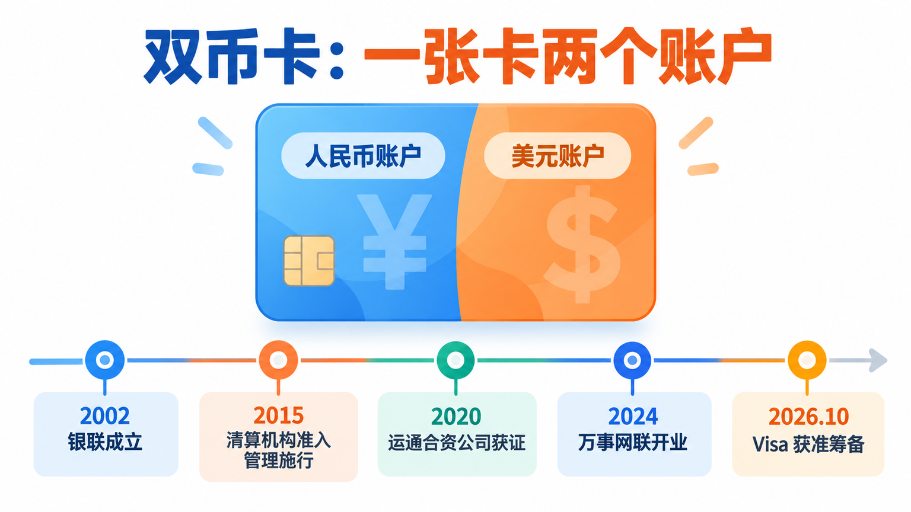
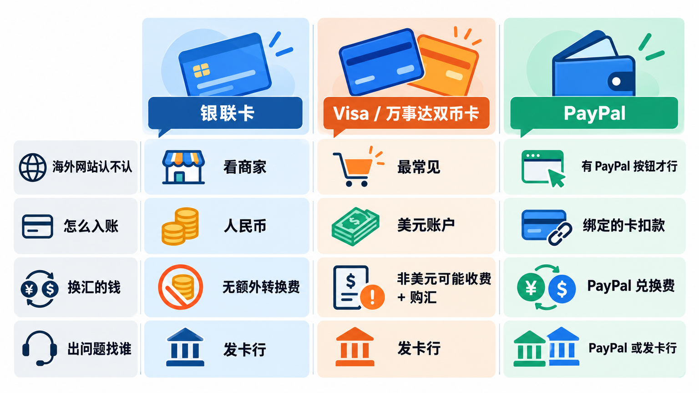
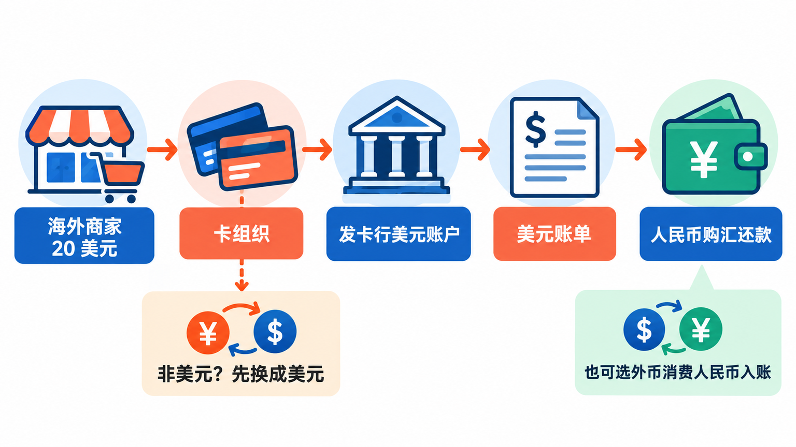
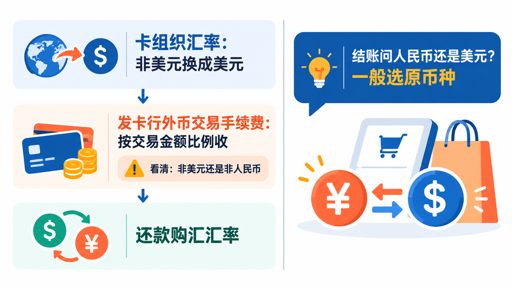
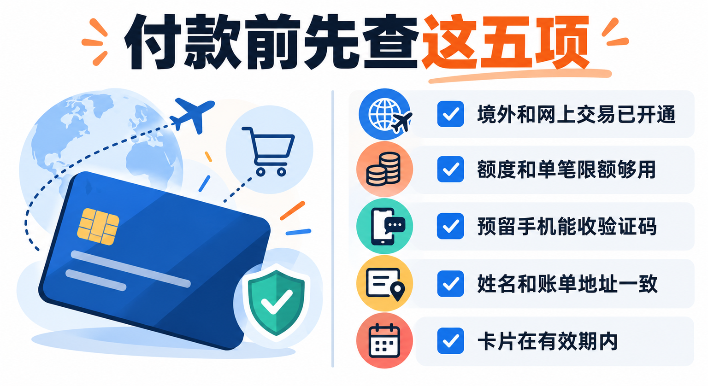
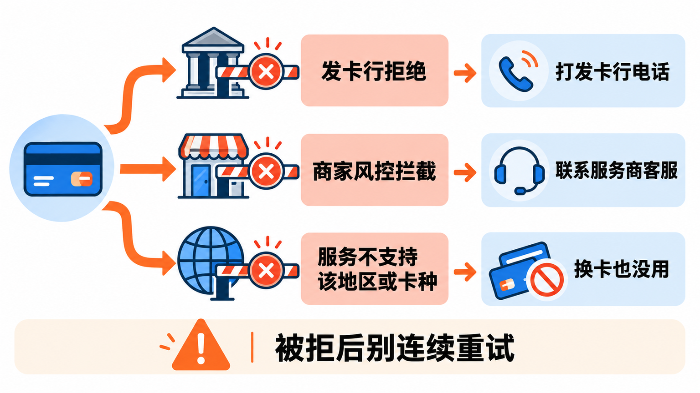
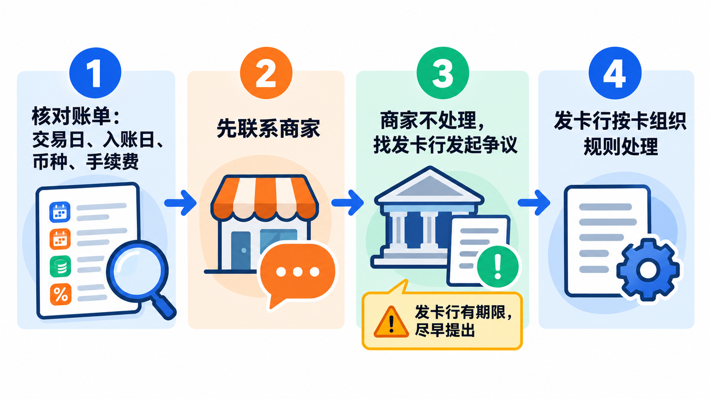

# 用双币信用卡付海外订阅：外币手续费、货币转换和拒付是怎么回事

想订一个海外的 AI 工具、开发者服务或者软件会员，结账页上最常见的付款方式就是填一张信用卡。手里那张印着 Visa 或万事达标识的双币卡，到底能不能付？付 20 美元，账单上会变成多少人民币？为什么卡里明明有额度，页面却提示“付款被拒”？

这篇把这几件事讲清楚：**银联、Visa、万事达分别管哪一段，一笔美元订阅的钱是怎么走的，发卡行和卡组织各收哪笔钱，付款被拒先查什么，扣错了钱怎么查账单、怎么申请退款。** 文中不排银行名次、不推荐返现卡，具体费率以你自己那张卡的发卡行官网为准。

先说一个和上一篇 PayPal 一样的前提：**信用卡解决的是“怎么付钱”，不解决“能不能用”。** 一个海外服务在你所在的地区提不提供、接不接受某种卡，是服务商自己决定的。比如 ChatGPT 和 Claude 的官方支持地区列表里都没有中国内地，换哪张卡也改变不了这一点，本文也不讲任何绕过地区限制的办法。

## 双币卡是怎么来的：银联管境内，Visa、万事达管跨境

“双币卡”这个说法，指的是一张信用卡同时有**人民币账户和外币账户**（最常见的是美元）。在国内刷卡、网购，走人民币账户；在海外网站付美元，走外币账户。为什么要这么设计，要从国内银行卡的清算格局说起。

**中国银联 2002 年在上海成立**，把各地分散的银行卡信息交换网络连到一起，此后国内的人民币刷卡交易基本由它清算。Visa、万事达这些国际卡组织早就在全球建好了受理网络，但很长一段时间里，它们在中国主要参与的是**跨境的外币交易**。银行想让客户既能在国内刷、又能在海外网站付美元，就发行了这种“一张卡两个账户”的产品。

后来的几个转折：

- **2015 年 6 月 1 日**，国务院《关于实施银行卡清算机构准入管理的决定》施行，在境内做银行卡清算要向中国人民银行申请许可证。只为跨境交易提供外币清算的境外机构，原则上不需要在境内设机构。
- **2020 年 6 月**，美国运通和连连数字合资的连通（杭州）技术服务有限公司拿到银行卡清算业务许可证，成为继银联之后第二家获证的银行卡清算机构。
- **2024 年 5 月**，万事达和网联合资的万事网联（2023 年 11 月获发许可证）正式开业，可以授权境内银行发行和受理“万事达”品牌的人民币银行卡。
- **2026 年 10 月**，中国人民银行准予 Visa 在境内设立的威士信息技术（北京）有限公司筹备银行卡清算机构，筹备期一年。

这些变化影响的主要是**境内人民币交易**。对付海外订阅来说，关键没有变：你在海外网站上付美元，钱走的是卡面上那个国际卡组织的网络。**所以卡面上印的是哪个标识，决定了海外网站认不认这张卡。**

## 付海外订阅，三类卡怎么比

付一个海外订阅，读者最可能拿来比较的是这三条路：一张只有银联标识的卡、一张 Visa 或万事达双币卡，以及上一篇讲过的 PayPal。

| | 银联卡 | Visa / 万事达双币卡 | PayPal |
|---|---|---|---|
| 海外网站认不认 | 要看商家支不支持银联，海外订阅类网站支持的不多 | 海外网站最常见的付款方式 | 只限结账页有 PayPal 的商家 |
| 怎么入账 | 按人民币入账 | 美元交易进美元账户，其他外币先换成美元 | 由绑定的卡扣款 |
| 换汇的钱 | 中国银行的用卡指南写明，持卡人不需负担额外货币转换费用 | 非美元交易可能被收一笔手续费，还款时按银行汇率购汇 | 默认由 PayPal 换汇，要加一笔兑换费 |
| 出问题找谁 | 发卡行 | 发卡行 | PayPal 调解中心，或发卡行 |

**为什么选双币卡**：海外网站基本都接受 Visa 和万事达，填卡就能付，不用多注册一个账户；付美元时进美元账户，不经过额外的换汇环节。

**为什么放弃它**：一是外币交易可能有手续费，付非美元的服务时尤其要看清；二是美元账单要购汇还款，多了一个步骤，忘了就可能产生利息；三是海外商家的风控和国内不一样，被拒付的概率比国内消费高，原因还不好查。

从定位上看，**付美元订阅，Visa 或万事达双币卡是最直接的工具**；银联卡在海外实体店和部分网站上有费用优势，但订阅类网站接不接受要看商家；PayPal 更适合不想把卡号交给每个小网站的人。

## 一笔 20 美元订阅，钱是怎么走的

用一张 Visa 双币卡付 20 美元的月费，大致是这样走的：

1. **授权**：你在结账页填卡，商家通过它的支付通道向卡组织发起请求，卡组织转给你的发卡行。发卡行决定批准还是拒绝，这一步通常是实时的。
2. **入账**：交易会在几天后正式记到你的卡上。因为商家收的就是美元，这 20 美元直接记在你的**美元账户**里，中间没有换汇。
3. **出账单**：到了账单日，你会看到一份美元账单，金额就是 20 美元。
4. **还款**：你用人民币还这笔美元欠款，这一步叫**购汇还款**，按发卡行当天定的人民币对美元汇率计算。很多银行支持设置自动购汇还款，到期还款日从你的人民币账户扣钱，自动换成美元还上。

如果你付的不是美元，比如一个按欧元或日元收费的服务，第 2 步会多一道：**卡组织先按它的汇率把这笔外币换成美元**，再记进你的美元账户，发卡行也可能在这一步加收一笔手续费，下一节细说。

还有一种越来越常见的做法：**外币消费直接按人民币入账**。以汇丰中国的条款为例，开通这项业务后，美元信用卡的外币消费都会换成人民币入账、用人民币还款；非美元消费先换成美元再换成人民币，并收取一定的国际交易接入服务费；**入账汇率按入账日当天，而不是交易日当天**。2025 年起，也有银行把部分万事达卡的境外交易改成由卡组织直接折算成人民币提交，或者让持卡人自选外币交易按人民币还是美元入账。你的卡属于哪一种，看账单上的入账币种最直观。

> **美元账单一定要按美元还上。** 如果没有开通自动购汇还款，只往卡里存了人民币，钱可能进的是人民币账户，美元欠款还在，到期就会产生利息甚至逾期记录。第一次刷外币之后，先确认这张卡的还款方式。

## 两笔容易混的钱：货币转换和外币交易手续费

很多人看到账单上的人民币比预想的多，会笼统地说“被收了手续费”。其实这里有几个不同的环节，名字也五花八门：

**第一层，卡组织的货币转换。** 交易币种和卡的记账币种不一样时，比如用美元账户付了一笔欧元，Visa 或万事达会按它们自己的汇率把欧元换成美元。这一层的价格体现在汇率里，两家都在官网提供了汇率查询工具。

**第二层，发卡行的外币交易手续费。** 各家银行叫法不同，有的叫“外币交易手续费”，有的叫“货币兑换费”“国外交易汇兑手续费”，本质上都是发卡行按交易金额的一定比例收的钱。以兴业银行公开的服务价目表为例，“国外交易汇兑手续费”适用于双币信用卡和 Visa、万事达单品牌信用卡，持卡人境外交易通过 Visa 或万事达结算**非美元消费**时，**按交易金额的 1.5% 收取**。

这里有个细节值得看清：**有的银行只对“非美元”交易收，有的银行写的是“非人民币”交易。** 如果你的卡是前者，付美元订阅这一层就是零；如果是后者，付美元也要收。打开发卡行官网的信用卡价目表或领用合约，找到这一项，看它的收费条件就知道了。

**第三层，还款时的购汇汇率。** 你用人民币还美元账单时，按发卡行当天定的售汇汇率换算。这不是一笔单列的“手续费”，但银行的售汇价和中间价之间本身有差价。

银联卡的规则不一样。中国银行的长城银联借记卡海外用卡指南写明，以当地货币计价消费、以人民币扣账，**持卡人不需负担额外货币转换费用**，汇率用当日国内银行挂牌的外币对人民币卖出价。这是银联卡在海外的主要优势，前提是商家接受银联。

还有一种情况容易让人多花钱：**商家主动帮你换成人民币**。Visa 把这叫作动态货币转换（Dynamic Currency Conversion，简称 DCC）：商户或 ATM 提出把交易换成你的本国货币结算，这个价格里已经包含了汇率和附加费用。Visa 要求商户必须同时显示两种币种的金额、所用汇率和附加费用，并且让持卡人自己选择接受或拒绝，不能替你选。

> **结账页问你“用人民币付还是用美元付”，一般选商家的原币种。** 选了人民币，等于让商家那边先换汇，汇率和加价由它定；选原币种，换汇交给卡组织和发卡行，规则写在价目表里，查得到。Visa 的建议是：信息显示不全或者感觉被引导选择时，拒绝换汇，并向发卡行报告。

## 付款前先检查这几项

第一次用双币卡付海外订阅，与其付了被拒再去查，不如先在发卡行 App 里看一遍：

- **境外交易和网上交易有没有开**。不少银行在 App 的卡片管理或安全设置里，提供境外交易、网上支付、无卡支付这类开关和单笔限额。新卡、长期没用过外币的卡，这些功能可能默认关闭。具体在哪个菜单，以你的银行 App 为准，找不到就打卡背面的客服电话问。
- **额度够不够**。有的卡美元账户和人民币账户共享额度，有的单独设置；单笔限额也可能比总额度低。
- **预留手机号能不能收短信**。海外网站付款时，发卡行可能要求做一次身份验证，比如给预留手机号发验证码，Visa 的这套机制叫 Visa Secure。号码换了没更新，这一步就过不去。
- **账单地址和持卡人姓名按发卡行记录填**。姓名用拼音时，按卡面或发卡行登记的格式写。部分商家会把你填的地址信息交给发卡行核对。
- **卡片在有效期内**。换过新卡要在各个订阅服务里同步更新卡号和有效期，不然下次续费会失败。

## 为什么会被拒：发卡行、商家和服务地区

付款失败时，页面上往往只有一句“您的卡被拒绝”，很难知道是谁拒的。海外网站常用的支付服务商 Stripe 在开发者文档里把付款失败分成几类，正好可以帮我们理解：

**第一类，发卡行拒绝。** 交易送到发卡行后，发卡行的自动系统会根据消费习惯、余额、卡片有效期、地址信息和安全码等信号决定批不批。发卡行有时会给出具体原因，比如卡号错误、额度不足；但很多时候只返回一个笼统的拒绝，商家那边也看不到详细原因。**这种情况只能你自己打给发卡行问**，问清楚是没开境外交易、触发了风控，还是别的原因。

**第二类，商家那边的风控拦截。** Stripe 有一套叫 Radar 的反欺诈系统，会拦截它判断为高风险的付款。被它拦下的交易**根本没有送到发卡行**，发卡行那边也就查不到拒绝记录。这时打银行电话也没用，只能联系服务商的客服。

**第三类，服务本身就不卖给你。** 服务不支持你所在的地区、不接受你这张卡的卡种，或者要求账单地址在支持的国家，这时换什么卡都付不了。

还有一个常见的误会：**付款失败了，卡上却显示一笔“已扣款”**。Stripe 的文档也提到，被拦截的付款有时会在持卡人账单上留下一笔授权，但商家并没有真正扣钱，发卡行通常几天内会撤掉这笔授权。

**被拒之后别连续重试。** 短时间内换着卡、换着信息反复提交，本身就可能被发卡行和商家判断成可疑行为，越试越难过。先打发卡行电话问清原因，处理好了再付一次。

## 账单怎么看，退款和争议怎么申请

每期账单出来，花一分钟看三样东西：**交易日和入账日**（入账通常比交易晚几天，汇率也可能按入账日算）、**币种**（这笔是记在美元账户还是人民币账户）、**有没有单独一行手续费**（外币交易手续费常常单独列一笔）。拿同一笔订阅连着看两期，就知道这张卡的实际成本了。

遇到问题，分两种情况：

**退款**，就是商家同意把钱退回来，比如你取消了订阅、商家按规则退款。要知道的是，**退回来的人民币不一定和付出去的一样多**。以汇丰中国的条款为例，按人民币入账的外币交易发生退货或撤销时，按退款当天的汇率换算成人民币退回，交易日、退款日、入账日之间的汇率差由持卡人承担。

**争议**，平时说的“拒付”“退单”指的就是这个：商家不处理，或者你根本没授权这笔扣款，由你向发卡行提出异议，发卡行再按卡组织的规则向商家那边追回。Visa 官网的说法很明确：要对一笔交易提出异议，**打卡片上的客服电话联系你的发卡行**，发卡行会要求你提供交易的详细信息；**发卡行可能规定提出异议的期限**。所以发现问题要尽快，别拖到几个月后。

比较稳妥的顺序是：**先找商家，商家不处理再找发卡行。** 订阅类服务的大多数问题，比如忘了取消被续费、重复扣款，商家客服或者账户设置里就能解决，走争议流程反而慢。准备好订单邮件、扣款截图和你和商家的沟通记录，不管找谁都用得上。

> **想停掉订阅，先在服务的账户设置里取消。** 只是让发卡行拒付或者换卡，服务那边的订阅可能还在，续费失败后账号会显示欠费；对一笔你确实用过的服务发起争议，商家也可能据此封禁账号。

## 写在最后

如果你手里已经有一张 Visa 或万事达双币卡，付海外订阅前花五分钟做三件事：**在银行 App 里确认境外和网上交易已开通、在价目表里查一下外币交易手续费是按“非美元”还是“非人民币”收、把美元账单设成自动购汇还款。** 第一笔扣款出账后对一下账单，心里就有数了。

## 参考资料

卡组织：<a href="https://www.visa.com/en-us/personal/travel/dynamic-currency-conversion">Visa：Dynamic Currency Conversion</a>、<a href="https://usa.visa.com/support.html">Visa：Get support（Disputing a charge）</a>。

发卡行公开资料：<a href="https://www.cib.com.cn/cn/aboutCIB/about/charges/adjustment/combined.html">兴业银行综合服务价目表</a>（信用卡“国外交易汇兑手续费”条目）、<a href="https://www.boc.cn/bcservice/bc3/bc31/201106/t20110607_1414168.html">中国银行长城银联借记卡海外用卡指南</a>、<a href="https://www.hsbc.com.cn/content/dam/hsbc/cn/docs/credit-cards/guide/usd-repayment-terms.pdf">汇丰中国信用卡外币消费人民币入账业务条款</a>、<a href="https://www.hsbc.com.cn/content/dam/hsbc/cn/docs/credit-cards/info/%E3%80%8A%E4%BF%A1%E7%94%A8%E5%8D%A1%E8%87%AA%E5%8A%A8%E8%BF%98%E6%AC%BE%E6%9D%A1%E6%AC%BE%E5%8F%8A%E7%BB%86%E5%88%99%E3%80%8B.pdf">汇丰中国《信用卡自动还款条款及细则》</a>。

支付服务商：<a href="https://docs.stripe.com/declines">Stripe Docs：Declines</a>。

银行卡清算市场：<a href="https://www.gov.cn/zhengce/content/2015-04/22/content_9656.htm">国务院关于实施银行卡清算机构准入管理的决定（国发〔2015〕22号）</a>、<a href="https://www.cls.cn/detail/1521135">财联社：万事网联获批银行卡清算机构</a>（2023 年 11 月 19 日，含连通公司获证情况）、<a href="https://www.ithome.com/0/766/714.htm">IT之家：万事网联正式开业</a>（2024 年 5 月 9 日）、<a href="https://www.cls.cn/detail/2503431">财联社：威士获批筹备银行卡清算机构</a>（2026 年 10 月 13 日）、<a href="http://jjckb.xinhuanet.com/20261013/08bc4dd43ef546d689b1d967fa2d9cc1/c.html">经济参考报：Visa 中国获批筹备银行卡清算机构</a>（2026 年 10 月 13 日）、<a href="https://www.yicai.com/news/102834363.html">第一财经：信用卡外币交易结算调整，人民币直接入账时代来临</a>（2025 年 9 月 21 日）。

服务地区：<a href="https://www.anthropic.com/supported-countries">Anthropic Supported Regions Policy</a>、<a href="https://developers.openai.com/api/docs/supported-countries">OpenAI Supported countries and territories</a>。

资料核对于 2026 年 10 月 29 日。文中费率和规则依据发卡行、卡组织和支付服务商的公开资料整理，写作时未实际操作；各银行的费率、收费条件、App 菜单和争议期限各不相同，并会调整，以你所持卡片的发卡行官网和领用合约为准。本文不推荐具体银行或卡片，也不讨论绕过服务地区限制的方法。配图为示意图，不是产品界面截图。

