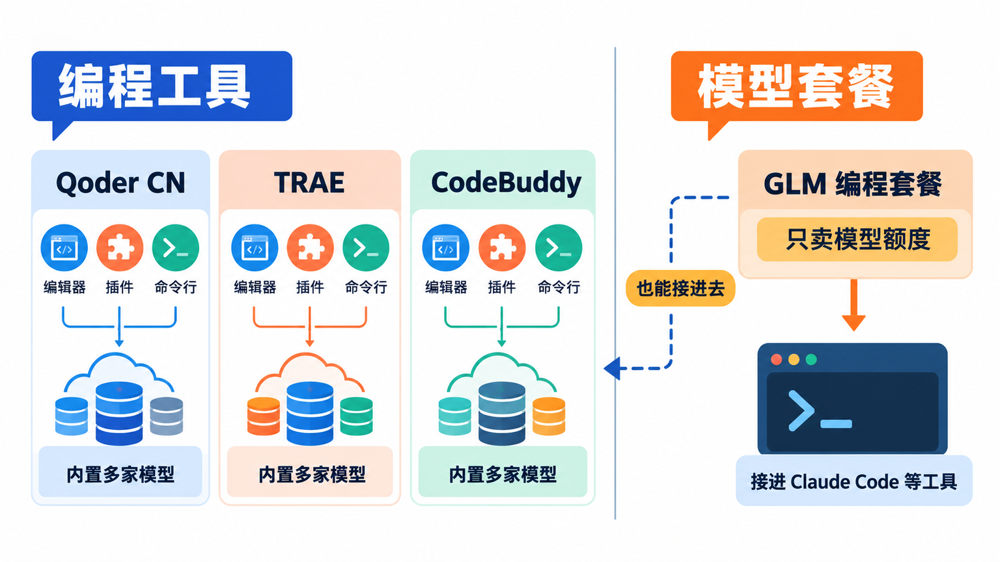
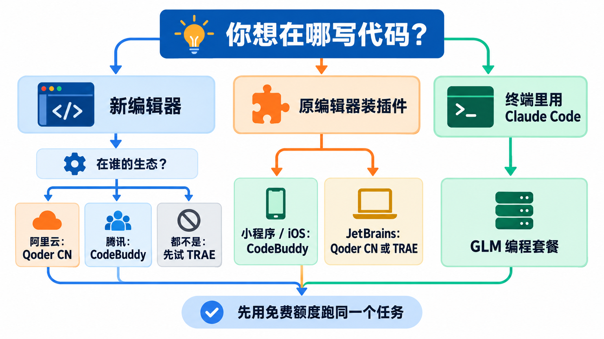
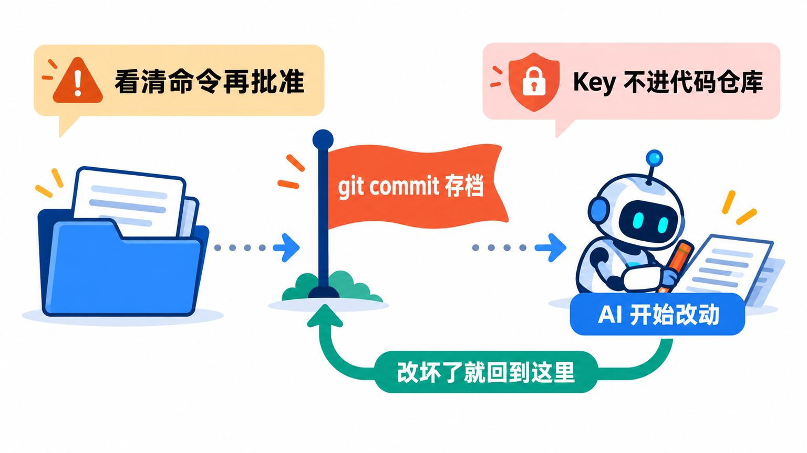

# 国产AI编程工具怎么选：Qoder CN（原通义灵码）、TRAE、CodeBuddy和GLM编程套餐

想在国内用上 AI 写代码，最常被问到的就是这几个名字：通义灵码、TRAE、CodeBuddy，还有智谱的 GLM 编程套餐。它们都能用手机号直接注册、用国内的支付方式付费，但**它们其实不是同一类东西**，收费方式也各不相同，放在一起比“哪个更强”很容易比岔了。

这篇先把四者的形态分清楚，再讲它们各自怎么走到今天、用统一的维度横向比一遍，最后给出每一款的第一步怎么做。顺便提一句：**通义灵码已经在 2026 年 5 月 20 日更名为 Qoder CN**，下文统一用新名字。

## 先分清：三个是“工具”，一个是“模型套餐”



这四个名字可以分成两组。

**Qoder CN、TRAE、CodeBuddy 是“编程工具”**。它们自带编辑器或者插件，内置了多家国产大模型，你在里面提需求、它改代码，费用按各家自己的“积分”或“Credits”计算。三家的形态都不止一种：

- **独立编辑器（IDE）**：一个完整的写代码软件，外观和 VS Code 很像，AI 功能是内置的。三家都有。
- **插件**：装进你已经在用的 VS Code、JetBrains（IntelliJ IDEA 等）里。三家都有，覆盖的编辑器各不相同。
- **命令行**：在终端里让 AI 读代码、改代码、跑命令。Qoder CN 和 CodeBuddy 对个人开放，TRAE 的命令行版只给企业旗舰版客户。

**GLM Coding Plan 是“模型套餐”**。智谱不卖编辑器，卖的是自家 GLM 模型的包月额度，你把它接进 Claude Code、Codex、OpenCode 这类编程工具里用。它甚至可以接进前面三家：智谱官方的适配列表里就有 TRAE、CodeBuddy、Lingma 和 Qoder。

分清这一点，后面的选择就简单了：**想要一个装好就能用的完整工具，看前三个；已经在用 Claude Code 这类工具、只缺一个国内能买的模型，看 GLM 编程套餐。**

## 它们是怎么走到今天的


四家起点不同，但最近一年走向了同一个方向。

**Qoder CN（原通义灵码）是阿里云的。** 通义灵码 2023 年在云栖大会上发布，一开始是 VS Code 和 JetBrains 里的代码补全插件。2025 年加入了能自己改多个文件的编程智能体；同年 5 月 29 日推出基于开源 VS Code 的独立编辑器 Lingma IDE。2026 年 5 月 20 日，整个产品线更名为 Qoder CN 系列，编码产品叫 Qoder CN，另有终端版 Qoder CN CLI 和办公用的桌面应用 QoderWork CN。更名同一天，计费改成了 Credits 配额，原来个人专业版的限时免费活动随之结束。

**TRAE 起步最晚、迭代最快。** 国际版 TRAE 1.0 在 2025 年 1 月 20 日发布，国内版第一个版本是 2025 年 3 月 3 日。它最有辨识度的是 **SOLO 模式**：2025 年 7 月作为预览上线，需要排队申请；11 月的 3.0 版起对所有人开放。之后产品线一度拆成偏编程的 TraeCode 和偏办公的 TraeWork，现在两者又合回了统一的 TRAE。2026 年 7 月 30 日起，国内版改用积分计费。国内版的运营方是北京引力弹弓科技有限公司。

**CodeBuddy 是腾讯云的。** 它最早是“腾讯云 AI 代码助手”插件，后来改名腾讯云代码助手 CodeBuddy。2025 年 7 月独立编辑器 CodeBuddy IDE 开始内测，9 月 9 日命令行工具 CodeBuddy Code 发布，IDE 同时转为公测、不再需要邀请码。现在它和办公智能体 WorkBuddy 出自同一团队，**两边共用一个账号和一份积分**。2026 年 7 月 1 日起，个人付费版从一档扩成标准、高级、旗舰三档。

**GLM Coding Plan 是智谱的。** 2025 年 7 月 28 日发布的 GLM-4.5 开始强调“一键兼容 Claude Code”，随后推出编程套餐，上线时的宣传是“低至 20 元/月”。此后模型一路升到 GLM-4.6、4.7、5、5.1、5.2，2026 年 8 月 19 日发布 GLM-5.3。套餐规则也几经调整：2026 年 2 月加入每周额度上限，7 月 30 日换成现在的积分制。

把四条线放在一起看，有两个共同的转折：

- **从“补全几行代码”到“自己干完一件事”。** 早期的卖点是写代码时自动补全；现在四家都把能读项目、改多个文件、跑命令的智能体放在了最前面。
- **从“免费或按次数”到“积分制”。** 2026 年 5 月到 7 月，四家先后改成了按积分或 Credits 计费：智能体干一件事要调用模型很多次，消耗的算力差别很大，按次数已经算不清了。**这也是为什么今天比较它们，不能只看月费。**

## 横向比一比


选这四个来比，是因为它们都满足“国内手机号能注册、人民币能付、走官方渠道”，而且是国内个人开发者最常拿来对比的几款。下表用同一组维度排开（价格为个人版，2026 年 10 月官方页面的标价）：

| | Qoder CN | TRAE 国内版 | CodeBuddy 国内版 | GLM Coding Plan |
|---|---|---|---|---|
| 出品 | 阿里云 | TRAE（引力弹弓科技） | 腾讯云 | 智谱 |
| 独立编辑器 | Windows、macOS | Windows、macOS、Linux | Windows、macOS | 无，接进别的工具 |
| 插件 | JetBrains、VS Code | VS Code、JetBrains、Android Studio | VS Code、JetBrains、Visual Studio、Xcode、微信开发者工具等 | — |
| 命令行 | 个人可用 | 仅企业旗舰版 | 个人可用 | 接 Claude Code、Codex 等 |
| 内置模型 | GLM、DeepSeek、Kimi、MiniMax 等 | Seed 系列、GLM、DeepSeek、Kimi、Qwen、MiniMax 等 | 混元、DeepSeek、Kimi、Qwen、GLM 等 | GLM-5.3、GLM-5.3-Flash |
| 免费档 | 体验版：两周专业版试用 + 300 Credits，补全有限 | 每月登录送 500 积分，另有新用户、签到赠送 | 体验版：每月 500 积分，补全每月 5000 次（目前限免不限次） | 无 |
| 个人付费 | 专业版 59 元/月（2000 Credits），高级版 169 元/月（6000 Credits） | Lite 49 元/月（2000 积分）、Pro 99 元/月（4000 积分），往上还有 Pro+、Ultra | 标准版 99 元/月（含限时赠送共 4000 积分），连续包月 70 元；往上有高级、旗舰 | Lite、Pro、Max 三档，价格以官网为准 |
| 额度用完 | 高级功能停用，退回基础模型和有限补全；可加购 | 会员可加购积分 | 付费版可加购积分 | 等下一个 5 小时周期，不能加购 |

> **各家的“积分”不能直接横比。** Qoder CN 的 Credits、TRAE 的积分、CodeBuddy 的积分、智谱的积分，换算规则各不相同，而且同一家里不同模型、不同模式的消耗也差好几倍（比如 Qoder CN 的智能体模式大约是问答模式的 2 到 4 倍）。“2000 积分”在两家能干的活可能完全不是一个量。真要比划算不划算，用免费额度拿同一个任务各跑一遍最实在。

**为什么选 Qoder CN**：你的项目在阿里云上，或者团队已经在用通义灵码，迁过来最顺；主力用 JetBrains 写 Java 的，它的 JetBrains 插件支持到 2020.3 这样较老的版本。**为什么放弃它**：免费档只是两周试用加少量 Credits，长期免费用不太够；独立编辑器暂时没有 Linux 版。

**为什么选 TRAE**：想要一个“把需求说清楚、让 AI 从规划做到预览”的体验，SOLO 模式是它的招牌；内置模型是四家里最多的，Seed 系列、GLM、DeepSeek、Kimi、Qwen 都在一个下拉框里，可以随手换着试；编辑器三个系统都支持，还有网页版和手机端。另外，**用自己的 API Key 接入的模型不消耗 TRAE 积分**，这一点后面会用到。**为什么放弃它**：命令行版只给企业旗舰版，喜欢在终端里干活的个人用不上。

**为什么选 CodeBuddy**：插件覆盖的编辑器最广，连 Xcode、Visual Studio 和微信开发者工具都有，写小程序、写 iOS 的会很顺手；做微信生态、腾讯云业务的更是近水楼台；同一份积分还能在 WorkBuddy 里处理办公任务。**为什么放弃它**：个人付费起步价是四家里最高的，标准版月付 99 元（连续包月 70 元）。

**为什么选 GLM 编程套餐**：你已经习惯 Claude Code 或 Codex 的工作方式，只是想要一个国内能直接买、能稳定访问的模型。它把 GLM-5.3 这类旗舰模型打包成按 5 小时和按周刷新的额度，非高峰时段（工作日 14:00–18:00 以外，周末全天）只按一半扣。**为什么放弃它**：只有模型、没有编辑器，要自己会配工具；不支持退款，额度用完只能等下个周期。

**从定位上看，这四个不是非此即彼。** 一种很实际的组合是：编辑器用 TRAE 或 Qoder CN 的免费档写日常代码，大任务交给接了 GLM 编程套餐的 Claude Code。先用免费额度把前三家都试一遍，再决定把钱花在哪儿，比看任何评测都可靠。

## 怎么选：三个问题帮你缩小范围



**第一个问题：你想在哪里写代码？** 想要一个装好就用的新编辑器，三家的 IDE 都可以；不想换编辑器，就装插件；习惯终端、已经在用 Claude Code 或 Codex，就看 GLM 编程套餐，或者 Qoder CN、CodeBuddy 的命令行版。

**第二个问题：你在谁的生态里？** 业务在阿里云、团队统一采购的，Qoder CN 的企业版和阿里云账号打通；做微信小程序、用腾讯云的，CodeBuddy 和微信开发者工具、腾讯云的集成更顺。都不沾的，从 TRAE 的免费积分开始试成本最低。

**第三个问题：你愿意每月花多少？** 只是偶尔用一用，三家工具的免费档轮着用就够；每天都在用、想要稳定额度，再按自己的主力工具订最低一档，不够再升级。GLM 编程套餐不能退款，**建议先买最短周期**，确认用得惯再续。

## 第一步怎么做

下面每一款都只走到“装好、登录、能用”为止。命令均来自各家官方文档。

**Qoder CN**：到 Qoder CN 官网（qoder.cn）下载 IDE，支持 Windows 10/11 和 macOS 11 以上；用 JetBrains 的，在插件页下载 JetBrains 插件。新用户用手机号注册 Qoder CN 账号，一个账号通用于整个产品系列；原来用阿里云账号登录通义灵码的，升级成 Qoder CN 账号后旧入口就不能再用了。想在终端里用，macOS 和 Linux 运行：

```bash
curl -fsSL https://static.qoder.com.cn/qoder-cli-cn/install.sh | bash
```

Windows 在 PowerShell 里运行：

```powershell
irm https://static.qoder.com.cn/qoder-cli-cn/install.ps1 | iex
```

装好后首次运行会提示登录，以后用 `qodercn update` 升级。Windows 的 ARM 设备目前还不支持命令行版。

**TRAE**：到 trae.cn 下载桌面端，macOS 需要 12.0 以上，Windows 需要 10 或 11（x64），Linux 提供 .deb 和 .rpm 包。用手机号、抖音账号、苹果账号或稀土掘金账号登录。打开后先在 IDE 模式里像平常一样写代码，熟悉了再切到 SOLO 模式，用一句话描述一个小需求，看它怎么拆任务、改代码、出预览。想用自己的模型时，在设置的模型页添加模型，填入对应平台的 API Key，这样调用的是你自己的额度，不扣 TRAE 积分。不想换编辑器的，VS Code（1.93.0 以上）和 JetBrains（2022.1 以上）都可以装 TRAE 插件。

**CodeBuddy**：最省事的是插件，在 VS Code 或 JetBrains 的插件市场里搜索“腾讯云代码助手”安装，用个人微信或手机号登录。独立编辑器支持 macOS 11 和 Windows 10 以上。命令行版需要 Node.js 18.20 或更高版本，用 npm 安装：

```bash
npm install -g @tencent-ai/codebuddy-code
```

Mac 上也可以用 Homebrew：

```bash
brew install Tencent-CodeBuddy/tap/codebuddy-code
```

装好后在项目目录里运行 `codebuddy`，按提示登录即可。

**GLM 编程套餐**：在智谱开放平台（bigmodel.cn）的编程套餐页面选档位下单，然后在“编程套餐”专属的 API Key 页面创建一个 Key。注意它和普通 API 的 Key 不通用。以接进 Claude Code 为例，先装好 Claude Code：

```bash
npm install -g @anthropic-ai/claude-code
```

再运行智谱官方的配置助手（需要 Node.js 18 以上），按界面提示选择 Claude Code、填入 Key，它会自动写好配置：

```bash
npx @z_ai/coding-helper
```

想手动配置的，官方文档给的做法是编辑 `~/.claude/settings.json`（Windows 在用户目录下的 `.claude` 文件夹里），在 `env` 里写入下面这些，把 `YOUR_API_KEY` 换成你自己的 Key：

```json
{
  "env": {
    "ANTHROPIC_AUTH_TOKEN": "YOUR_API_KEY",
    "ANTHROPIC_BASE_URL": "https://open.bigmodel.cn/api/anthropic",
    "ANTHROPIC_DEFAULT_HAIKU_MODEL": "glm-5.3-flash[1m]",
    "ANTHROPIC_DEFAULT_SONNET_MODEL": "glm-5.3[1m]",
    "ANTHROPIC_DEFAULT_OPUS_MODEL": "glm-5.3[1m]",
    "CLAUDE_CODE_AUTO_COMPACT_WINDOW": "1000000",
    "CLAUDE_CODE_DISABLE_NONESSENTIAL_TRAFFIC": 1,
    "API_TIMEOUT_MS": "3000000"
  }
}
```

改完后关掉所有终端窗口，新开一个，运行 `claude` 就能用上 GLM 模型了。

> **GLM 编程套餐只能自己用、只能在指定工具里用。** 官方规定套餐为订阅人专享，禁止账号共享和多人共用；在自建应用、网站、机器人里调用不走套餐额度，要用标准 API 另行计费；转售、中转会被永久封禁。买了也不能退款。所以别贪便宜去买别人“拼车”的 Key，也别把自己的 Key 发给别人。

## 让 AI 动手之前



这四款工具现在的主打功能都是智能体：它会改你磁盘上的真实文件，也会在终端里执行命令。几条通用的习惯，用哪一款都适用：

- **每次交给 AI 之前先 `git commit`**，改坏了随时能退回。
- **看清它要执行的命令再批准**，尤其是删除文件、安装依赖、改系统配置这类操作。
- **API Key 只放在本机配置里**，不写进代码、不提交到 Git、不贴到群里。

> **顺序不能反：先存档，再让 AI 动手。** 手头有没提交的改动时，AI 的修改会和你的混在一起，事后很难分清哪些是谁改的，更没法干净地撤回。

```bash
git add -A
git commit -m "交给 AI 之前的存档"
```

## 写在最后

如果只想花十分钟开始：**先装 TRAE 或 Qoder CN 的免费档，找一个自己的小项目存好档，让它讲讲这个项目、再改一处小地方。** 用顺了再看要不要付费；已经离不开 Claude Code 的，就给它配一份 GLM 编程套餐，从最短周期买起。

## 参考资料

<div class="sources">
<p>Qoder CN（原通义灵码）：<a href="https://lingma.aliyun.com">产品首页</a>、<a href="https://help.aliyun.com/zh/lingma/what-is-qoder-cn">什么是 Qoder CN</a>、<a href="https://help.aliyun.com/zh/lingma/introduction-of-lingma">产品介绍（更名说明）</a>、<a href="https://help.aliyun.com/zh/lingma/product-overview/billing-description">计费说明</a>、<a href="https://help.aliyun.com/zh/lingma/credits">Credits 说明</a>、<a href="https://help.aliyun.com/zh/lingma/product-overview/changelogs-of-lingma-ide">Lingma IDE 更新日志</a>、<a href="https://docs.qoder.cn/cli/installation">Qoder CN CLI 安装</a>、<a href="https://docs.qoder.cn/product-overview/qoder-cn-ide-jetbrains">账号与登录</a>、<a href="https://docs.qoder.cn/product-overview/qoder-cn-vscode-update-log">VS Code 插件更新日志</a>、<a href="https://developer.aliyun.com/article/1365025">通义灵码发布（阿里云开发者社区）</a>。</p>
<p>TRAE 国内版：<a href="https://www.trae.cn">官网</a>、<a href="https://docs.trae.cn/ide_what-is-trae">什么是 TRAE</a>、<a href="https://docs.trae.cn/ide_get-started-with-trae">快速开始（系统要求与登录）</a>、<a href="https://docs.trae.cn/ide_models">模型</a>、<a href="https://docs.trae.cn/ide_plans-and-billing">套餐与计费</a>、<a href="https://docs.trae.cn/ide_changelog">更新日志</a>、<a href="https://docs.trae.cn/plugin_what-is-trae-plugin">TRAE 插件</a>、<a href="https://docs.trae.cn/cli_about-trae-code-cli-2">TRAE CLI</a>、<a href="https://docs.trae.cn/ide_traework-to-traecode-data-migration">TraeWork 与 TraeCode 融合说明</a>、<a href="https://docs.trae.cn/ide_trae-auto-renewal-service-agreement">自动续费服务协议</a>、<a href="https://docs.trae.ai/ide/changelog">国际版更新日志</a>。</p>
<p>CodeBuddy 国内版：<a href="https://www.codebuddy.cn">官网</a>、<a href="https://www.codebuddy.cn/docs/ide/Introduction">产品介绍</a>、<a href="https://www.codebuddy.cn/docs/ide/Getting-Started/Installation">安装与登录</a>、<a href="https://www.codebuddy.cn/docs/ide/Account/pricing">个人版价格</a>、<a href="https://www.codebuddy.cn/docs/ide/Account/credits">积分说明</a>、<a href="https://www.codebuddy.cn/docs/cli/installation">CodeBuddy Code 安装</a>、<a href="https://developer.cloud.tencent.com/article/2566993">CodeBuddy Code 发布（腾讯开源专栏）</a>。</p>
<p>GLM Coding Plan：<a href="https://bigmodel.cn/glm-coding">套餐页面</a>、<a href="https://docs.bigmodel.cn/cn/coding-plan/overview">套餐概述</a>、<a href="https://docs.bigmodel.cn/cn/coding-plan/quick-start">快速开始</a>、<a href="https://docs.bigmodel.cn/cn/coding-plan/tool/claude">接入 Claude Code</a>、<a href="https://docs.bigmodel.cn/cn/coding-plan/extension/coding-tool-helper">一键安装助手</a>、<a href="https://docs.bigmodel.cn/cn/coding-plan/tool/others">适用工具</a>、<a href="https://docs.bigmodel.cn/cn/coding-plan/usage-notes">使用须知</a>、<a href="https://docs.bigmodel.cn/cn/coding-plan/faq">常见问题</a>、<a href="https://docs.bigmodel.cn/cn/coding-plan/transition">套餐调整说明</a>、<a href="https://docs.bigmodel.cn/cn/coding-plan/notice/usage-revision">用量规则调整</a>、<a href="https://docs.bigmodel.cn/cn/update/new-releases">模型发布记录</a>、<a href="https://docs.bigmodel.cn/cn/update/promotion">上线活动</a>。</p>
<p>资料核对于 2026 年 10 月 20 日。文中命令来自官方文档，写作时未实际运行。四家的价格、积分、赠送活动和内置模型变化很快，以各家官网当前页面和登录后的显示为准。配图为示意图，不是产品界面截图。</p>
</div>
